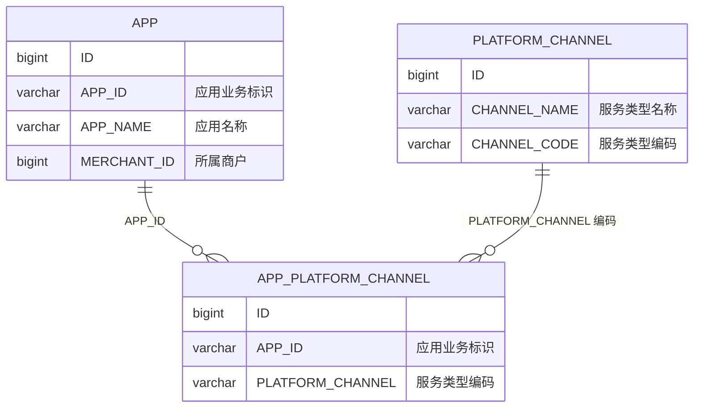
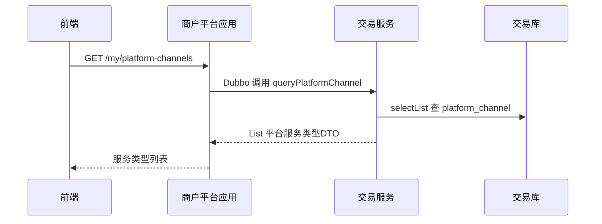
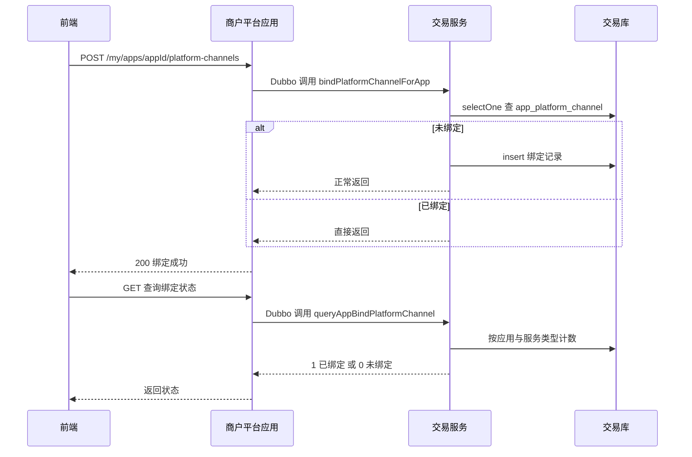

# 支付渠道参数配置-应用绑定服务类型三讲：三表设计、服务类型查询双层接口与绑定闭环开发

## 先给结论

应用绑定服务类型是支付渠道参数配置的第一段落地：商户给某个应用开启某种支付服务，绑定关系落在数据模型上，接口按「先查后绑」展开。全系列三讲从三张表设计讲到四个接口的双层实现与联调测试，把 Dubbo 与 REST 两层配合的开发套路完整走一遍。
系统设计先立稳三张表：app 应用表、platform_channel 服务类型表各自独立存储，app_platform_channel 关系表专门记录绑定，应用与服务类型是多对多，一行记录就是一次绑定。查询侧分两层：交易服务的 Dubbo 接口 queryPlatformChannel 无参查全量，商户平台应用的 REST 接口 `GET /my/platform-channels` 用 @Reference 转调，渠道参数相关接口单独归置进 PlatformParamController。
绑定侧收口成闭环：绑定接口入参用服务类型编码而不是自增 ID，实现是先查后插的幂等绑定加 @Transactional；绑定状态查询返回 int 表达已绑未绑；联调时 MapStruct 转换器缺失与 Dubbo 超时两处现场各自有解法，删除记录重测还能验证幂等。
三讲依次是：
- 系统设计：三张表、多对多关系与先查后绑的接口思路。
- 查询平台服务类型：Dubbo 接口与 REST 转发的两层实现及首次联调排错。
- 接口开发：幂等绑定落库、绑定状态查询与 Postman 联调验证。

## 第1部分：应用绑定服务类型的系统设计：三张表撑起多对多绑定关系

第一阶段「应用绑定服务类型」要写代码了，动接口之前先把数据模型立稳。这个功能涉及三张表，字段不多，却是第一次照面，别急着背，把谁跟谁的关系说清楚，后面四节课的接口开发与测试都会反复回到这三张表上。

### 三张表：应用、服务类型与绑定关系

绑定关系的数据模型由三张表组成。`app` 是应用表，在商户库 `pay_merchant_service` 里，创建应用课时已经落过库；`platform_channel` 是服务类型表，在交易库 `pay_transaction` 里，基础数据一课刚初始化了数据；`app_platform_channel` 是绑定关系表，同样在交易库，建表语句如下：

```sql
CREATE TABLE `app_platform_channel` (
  `ID` bigint(20) NOT NULL,
  `APP_ID` varchar(50) DEFAULT NULL COMMENT '应用id',
  `PLATFORM_CHANNEL` varchar(50) DEFAULT NULL COMMENT '平台支付渠道',
  PRIMARY KEY (`ID`) USING BTREE
) ENGINE=InnoDB DEFAULT CHARSET=utf8 COMMENT='说明了应用选择了平台中的哪些支付渠道';
```

关系表只有两列业务字段，`APP_ID` 存应用标识，`PLATFORM_CHANNEL` 存服务类型编码，正好对应绑定的两个要素。对应到代码里，实体类也简单到只有三个属性：

```java
@Data
@TableName("app_platform_channel")
public class AppPlatformChannel implements Serializable {

    private static final long serialVersionUID = 1L;

    @TableId(value = "ID", type = IdType.ID_WORKER)
    private Long id;

    @TableField("APP_ID")
    private String appId;

    @TableField("PLATFORM_CHANNEL")
    private String platformChannel;
}
```



关系表两边都挂业务标识，这个选择有一层跨库的现实原因。应用表在商户库，关系表在交易库，两个库互相建不了外键，把商户库的自增主键抄过来当关联键既不可靠也无意义；而 `APP_ID` 是创建应用时生成的 UUID 业务标识，跨库传递稳定，服务类型一侧同理用 `CHANNEL_CODE` 编码。分布式系统里跨服务的数据关联，靠的正是这种全局唯一、语义明确的业务键。

### 多对多：用业务场景记住关系

多对多不必往映射理论里绕，用两句大白话就能记住。第一句，一个应用可以绑定多个服务类型：开餐厅的商户建了餐厅应用，线下收款场景里 B 扫C、C 扫B 两种服务都用得上，那就都绑上。第二句，一种服务类型可以被多个应用绑定：C 扫B 这种用户扫商户码的支付方式，餐厅应用能用，理发店应用能用，超市应用也能用，大家各绑各的，互不影响。

落到关系表上，多对多就是「一行一个绑定」：餐厅应用绑 C 扫B 插一行，理发店应用绑 C 扫B 再插一行，C 扫B 的编码在表里出现多少次，就有多少个应用绑了它；餐厅应用的 APP_ID 出现几次，它就绑了几个服务类型。查询某应用绑了哪些服务类型、某种服务类型被哪些应用使用，都是按对应字段做过滤查询，不需要任何特殊设计。

### 绑定动作与接口设计思路

界面上给应用绑定服务类型的操作流程是：绑定页面先列出平台所有服务类型，每个服务类型旁边有「开启服务」按钮，点一下，当前页面选定的应用就与这个服务类型绑定。背后的数据动作只有一条：向 `app_platform_channel` 插入一行。

围绕这个模型，接口设计成三组。查询组是接口①与接口②，交易服务提供查询服务类型列表的 Dubbo 接口，商户平台应用提供面向前端的 REST 接口并转调前者，页面靠它们画出服务类型列表。绑定组是接口③与接口④，交易服务负责绑定逻辑与落库，商户平台应用接收前端的绑定请求并转发，绑定实现里要先查关系表判重，没绑过才插入，保证重复点「开启服务」不产生重复数据。状态组配套一个查询接口，前端页面需要知道每个服务类型的开启状态（已绑定的按钮置灰），按应用与服务类型查询绑定记录是否存在即可返回。

接口设计与此前创建应用的做法一脉相承：被依赖的交易服务接口先行定义与实现，商户平台应用的 REST 接口做纯转发，业务校验收在交易服务里，任何消费方走 Dubbo 接口都能得到同等保护。

## 第2部分：查询平台服务类型：交易服务 Dubbo 接口与商户平台应用 REST 接口的两层实现

绑定服务类型页面上那张服务类型列表，数据来自接口①与接口②：交易服务的 Dubbo 接口查表，商户平台应用的 REST 接口面向前端转发。这一课把两层接口一次做完，顺带处理导入工程首次联调最常见的两类报错。查询本身简单，简单查询背后把 Dubbo 双层接口的开发套路走通，才是这一课的真正目标。

### 接口①定义：无参查全量

接口分析从三件事入手。职责：查询平台支持的所有服务类型。入参：不传参，查的是全部记录，没有任何过滤条件，硬造一个参数反而误导消费方。出参：服务类型有多条，返回 `List`，元素类型对应 `platform_channel` 表的 `PlatformChannelDTO`，id、channelName、channelCode 三个字段与表列一一对应，DTO 在导入交易服务工程时已备好。

接口定义放在 `pay-transaction-api` 工程，新建 `PayChannelService`：

```java
/**
 * 支付渠道服务 管理平台支付渠道，原始支付渠道，以及相关配置
 */
public interface PayChannelService {

    /**
     * 获取平台服务类型
     * @return
     * @throws BusinessException
     */
    List<PlatformChannelDTO> queryPlatformChannel() throws BusinessException;
}
```

方法声明抛 `BusinessException`，与商户服务的接口风格一致，业务异常统一走全局异常码体系，消费方拿到的是错误码而非堆栈。

### 接口①实现：查表加转换

实现类 `PayChannelServiceImpl` 放在 `pay-transaction-service` 的 service 包，类上的注解是 Dubbo 的 `@Service`，与 Spring 同名注解冲突，写全限定名最稳。方法体两步，查表与转换：

```java
@org.apache.dubbo.config.annotation.Service
public class PayChannelServiceImpl implements PayChannelService {

    @Autowired
    private PlatformChannelMapper platformChannelMapper;

    @Override
    public List<PlatformChannelDTO> queryPlatformChannel() {
        List<PlatformChannel> platformChannels = platformChannelMapper.selectList(null);
        List<PlatformChannelDTO> platformChannelDTOS =
                PlatformChannelConvert.INSTANCE.listentity2listdto(platformChannels);
        return platformChannelDTOS;
    }
}
```

`selectList(null)` 传空查询条件即查全表，MyBatis-Plus 的 `BaseMapper` 现成能力，`PlatformChannelMapper` 继承 `BaseMapper<PlatformChannel>` 就够了，一行 SQL 都不用写。查出来的是实体列表，Dubbo 接口传输与前端展示都要 DTO，转换交给 MapStruct 转换器：

```java
@Mapper
public interface PlatformChannelConvert {

    PlatformChannelConvert INSTANCE = Mappers.getMapper(PlatformChannelConvert.class);

    PlatformChannelDTO entity2dto(PlatformChannel entity);

    PlatformChannel dto2entity(PlatformChannelDTO dto);

    List<PlatformChannelDTO> listentity2listdto(List<PlatformChannel> platformChannels);
}
```

单对象与列表两种转换都定义在接口上，实现类由 MapStruct 注解处理器在编译期生成。转换器、实体、Mapper 在导入工程时都已预置，这一课只需把调用串起来。



### 接口②定义：引入 API 坐标与独立控制器

商户平台应用此前只调过商户服务，现在要调交易服务，第一步是把交易服务的接口契约引进来。在商户平台应用工程的 pom 中添加 `pay-transaction-api` 依赖：

```xml
<dependency>
    <groupId>com.study.pay</groupId>
    <artifactId>pay-transaction-api</artifactId>
    <version>1.0-SNAPSHOT</version>
</dependency>
```

引的是 api 坐标而不是 service 工程，消费方只需要接口与 DTO。控制器层面，商户平台应用已有应用管理的 `AppController` 与商户管理的 `MerchantController`，渠道参数是新的职责域，单独新建 `PlatformParamController`，此后渠道与支付参数相关的接口都归它：

```java
@Api(value = "商户平台-渠道和支付参数相关", tags = "商户平台-渠道和支付参数", description = "商户平台-渠道和支付参数相关")
@Slf4j
@RestController
public class PlatformParamController {

    @Reference
    private PayChannelService payChannelService;

    @ApiOperation("获取平台服务类型")
    @GetMapping(value = "/my/platform-channels")
    public List<PlatformChannelDTO> queryPlatformChannel() {
        return payChannelService.queryPlatformChannel();
    }
}
```

注入交易服务用 Dubbo 的 `@Reference`，方法体一行转调，控制器保持纯转发。接口无入参，URL 也就没有查询串，`/my/platform-channels` 前缀 `/my` 延续商户平台登录态接口的约定。

### 接口测试与两处排错

交易服务与商户平台应用先后启动，Postman 里建「支付渠道参数配置」目录归置本模块的请求，再建查询请求：GET 方式，URL 为 `http://localhost:57010/merchant/my/platform-channels`，请求头带商户登录 token。

第一发请求返回 500，响应体是 `未找到转换器`，日志里能看到 `ClassNotFoundException: Cannot find implementation for PlatformChannelConvert`。这是 MapStruct 的典型症状：接口存在，注解处理器生成的实现类没有进入编译产物，导入工程时编译状态不干净就容易踩中。处理办法是把交易服务从父工程开始整体 Maven clean，再重新编译启动，实现类重新生成后报错消失。遇到导入工程的类莫名缺失，先 clean 再排查，不要急着改代码。

第二发请求报找不到服务提供者，这是 Dubbo 消费方从 Nacos 拿不到刚注册的服务，注册与订阅有传播延时，等一分钟左右再试即可通过。这类等待不是问题，把它当成微服务联调的常规节奏就好。

最终请求返回四条服务类型：

```json
[
  {"id": 1, "channelName": "闪聚B扫C", "channelCode": "shanju_b2c"},
  {"id": 2, "channelName": "闪聚C扫B", "channelCode": "shanju_c2b"},
  {"id": 3, "channelName": "微信Native支付", "channelCode": "wx_native"},
  {"id": 4, "channelName": "支付宝手机网站支付", "channelCode": "alipay_wap"}
]
```

数据与基础数据初始化的内容一致，接口链路完整打通。整个交互就是时序图上那一条直线：前端请求商户平台应用，商户平台应用远程调用交易服务，交易服务查库返回。应用绑定服务类型的第一步至此完成，下一课在这个基础上做绑定动作。

## 第3部分：应用绑定服务类型接口开发：绑定落库、联调测试与绑定状态查询

服务类型列表已经能查出来了，页面上点「开启服务」还差最后一步：把绑定关系真正写进数据库。这一课把应用绑定服务类型的闭环走完，交易服务实现绑定逻辑与状态查询，商户平台应用暴露对应的 REST 端点，再用 Postman 联调验证，最后顺手处理断点引发的调用超时这类联调现场问题。

### 接口③定义：入参选编码，返回选 void

绑定发生在绑定页面：页面已选定一个应用，点某个服务类型的「开启服务」，就把应用与该服务类型绑在一起，关系写入 `app_platform_channel` 表。接口参数不用凭空想象，从界面就能推导出来。用户进入绑定页面前已经选定了应用，所以应用标识由页面带着；点「开启服务」选的是某个服务类型，所以服务类型标识由请求传入。两个标识齐了，接口契约就定了，这种「从界面动作反推接口签名」的分析方法，比先写代码再补参数靠谱得多。

入参清单自然浮出：一个应用标识，一个服务类型标识。

应用标识传 `appId` 没有悬念，服务类型传什么值得停下来想。`platform_channel` 表里既有自增 `ID` 也有 `CHANNEL_CODE` 编码，这里选编码，并且后边所有接口都沿用这个选择。编码是系统预先配置的参数，`shanju_c2b` 就是 C 扫B，`shanju_b2c` 就是 B 扫C，定义之后不会改动，语义自解释；自增 ID 随环境与数据导入顺序而变，用它做接口契约，换个数据库数据就对不上。对外契约用业务编码、对内检索用主键，是数据模型一课双标识设计的延续。

返回值声明为 `void`：绑定成功不需要回传数据，方法正常执行结束就是成功；失败通过抛 `BusinessException` 表达，Dubbo 消费方收到异常，REST 层转成错误响应。在 `PayChannelService` 中追加定义：

```java
/**
 * 为app绑定平台服务类型
 * @param appId 应用id
 * @param platformChannelCodes 平台服务类型编码
 */
void bindPlatformChannelForApp(String appId, String platformChannelCodes) throws BusinessException;

/**
 * 应用是否已经绑定了某个服务类型
 * @param appId 应用id
 * @param platformChannel 服务类型编码
 * @return 已绑定返回1，否则返回0
 */
int queryAppBindPlatformChannel(String appId, String platformChannel) throws BusinessException;
```

状态查询接口一并在契约里声明，两者共用同一张关系表，属于同一个业务域。

### 接口③实现：先查后插的幂等绑定

实现放在 `PayChannelServiceImpl`，注入 `AppPlatformChannelMapper`。核心逻辑一句话：查关系表，没有才插。方法上标注 `@Transactional`，写操作包进事务是底线要求：

```java
@Autowired
private AppPlatformChannelMapper appPlatformChannelMapper;

@Override
@Transactional
public void bindPlatformChannelForApp(String appId, String platformChannelCodes) throws BusinessException {
    //根据应用id和服务类型code查询，如果已经绑定则不再插入，否则插入记录
    AppPlatformChannel appPlatformChannel = appPlatformChannelMapper.selectOne(
            new LambdaQueryWrapper<AppPlatformChannel>()
                    .eq(AppPlatformChannel::getAppId, appId)
                    .eq(AppPlatformChannel::getPlatformChannel, platformChannelCodes));
    if (appPlatformChannel == null) {
        //如果没有绑定则绑定
        AppPlatformChannel entity = new AppPlatformChannel();
        entity.setAppId(appId);                          //应用id
        entity.setPlatformChannel(platformChannelCodes); //服务类型code
        appPlatformChannelMapper.insert(entity);
    }
}
```

`LambdaQueryWrapper` 用方法引用拼条件，编译期就能发现字段名写错，比手写列名可靠。判重这一步不可省：用户在页面上反复点「开启服务」，前端不做拦截的话，服务端必须兜住，查到记录直接跳过插入，接口天然幂等。这张表没有给两列建唯一索引，幂等完全靠业务判断实现，并发极端场景下理论上有重复插入窗口，这与创建应用时名称查重的取舍一致，必要时可补数据库唯一约束加固。

`@Transactional` 标在写方法上是团队约定：查询可以不管事务，凡是 insert、update、delete 都要包进事务，异常发生时插了一半的数据能整体回滚。绑定方法只有一条 insert，看似不需要事务，但约定不因方法小而破例，将来在方法里追加第二条写语句时，事务边界已经划好，不需要回头补注解。插入完成后，`app_platform_channel` 的主键由 MyBatis-Plus 的雪花算法自动回填到实体的 `id` 属性，这一点眼下用不上，却是后面渠道参数配置的命门：参数表的每一行都要挂在这个主键上，绑定记录的 ID 就是应用与服务类型在交易域的锚点。

先查再插的写法还有一层复用价值：查出的绑定记录本身是后续功能的关键中间量，渠道参数配置就要靠它的主键做挂载点，这里先把「按应用与服务类型查关系记录」的模式立起来，后面直接照搬。



### 接口④定义：REST 端点与 Swagger 参数标注

商户平台应用侧的绑定端点放在 `PlatformParamController`，与查询服务类型接口同属渠道参数职责域。接口定义如下：

```java
@Reference
private PayChannelService payChannelService;

@ApiOperation("绑定服务类型")
@ApiImplicitParams({
        @ApiImplicitParam(value = "应用id", name = "appId", required = true, dataType = "String", paramType = "path"),
        @ApiImplicitParam(value = "服务类型code", name = "platformChannelCodes", required = true, dataType = "String", paramType = "query")
})
@PostMapping(value = "/my/apps/{appId}/platform-channels")
public void bindPlatformForApp(@PathVariable("appId") String appId,
                               @RequestParam("platformChannelCodes") String platformChannelCodes) {
    payChannelService.bindPlatformChannelForApp(appId, platformChannelCodes);
}
```

URL 采用了资源化设计：`/my/apps/{appId}/platform-channels` 表达「给某个应用添加服务类型」这层语义，应用是资源，服务类型是其子资源，新增绑定用 POST。按 REST 的语义细读，`platform-channels` 是集合资源，向集合 POST 一条成员就是建立一次绑定，将来若要解绑，向同一资源发 DELETE 即可扩展，URL 结构已经为演进留了位置。两个参数的传递位置由此确定，`appId` 在路径里，用 `@PathVariable` 接；`platformChannelCodes` 在问号后面的查询串里，用 `@RequestParam` 接。参数名上还有一处小细节，REST 端点用了复数形式的 `platformChannelCodes`，与 Dubbo 接口保持同名，两侧契约共享一套词汇，读代码的人在两层之间切换时不需要翻译。Swagger 注解的 `paramType` 必须与之一一对应，`path` 与 `query` 写反了，文档里参数位置就会误导调用方，联调时按文档拼请求必然出错。

方法体保持纯转发，一行转调 Dubbo 接口。绑定成功什么都不返回，HTTP 200 就是成功信号；异常发生时全局异常处理把 `BusinessException` 转成 500 与错误信息，前端据此提示绑定失败。返回值设计的取舍在这里体现得很清楚：有数据要回传的接口返回数据，动作型接口用状态码说话。

### 接口测试：断点、超时与落库验证

交易服务与商户平台应用重启后进入测试。测试身份先行解决，沿用创建应用联调时的做法，用工程里的 `TokenTemp` 测试类生成一个登录 token，商户 id 取审核通过的记录，token 放进请求头复用即可。Postman 目录也按模块归置，此前建的「支付渠道参数配置」目录下新增「应用绑定服务类型」请求，接口多了以后，目录就是接口清单。

发请求前先看 Swagger 文档，商户应用 API 文档里「商户平台-渠道和支付参数相关」分组下出现了绑定接口，参数名、类型、传递位置与代码一致。Postman 里发请求：POST 方式，URL 为 `http://localhost:57010/merchant/my/apps/{appId}/platform-channels?platformChannelCodes=shanju_c2b`，`appId` 从商户库 `app` 表里取一个真实应用填入路径，请求头带登录 token。

接口没有返回值，如何确认成功？在交易服务的绑定实现里打断点，观察执行路径。第一发请求在断点处停下，单步放行到 `insert`，说明判定为未绑定，执行了插入。此时出现一个经典现象：断点停留期间 Postman 端报错了。原因是 Dubbo 消费方有超时时间，工程配置里 `consumer.timeout` 为 3000 毫秒，断点停留超过三秒，消费方等不到响应按超时报错。报错不代表失败，查库才是裁决：`app_platform_channel` 表里已经出现了一条记录，`APP_ID` 与 `PLATFORM_CHANNEL` 正是请求传入的两个值，落库实际完成。

放行断点后再发一次同样的请求，这次断点处的查询已经能查到记录，直接走「已绑定」分支返回，不再插入，请求正常返回 200。把库里那条记录删掉再测，接口又重新插入成功。三个动作合在一起验证了两件事：绑定逻辑正确，幂等语义成立。联调时把「看返回」「打断点」「查数据库」三招组合使用，比单看任何一处都可靠。服务重启的顺序也有讲究，改了交易服务就重启交易服务，改了商户平台应用就重启后者，两边都动就按依赖顺序先服务后应用，启动后稍等注册生效再发请求，能避开一大半「调不通」的假故障。

### 绑定状态查询：两种写法的取舍

绑定成功后，前端需要确认应用与服务类型是否真的绑定上了；页面渲染时判断哪些服务类型已经开启，同样依赖这个查询，进入绑定页面时逐个检查开启状态，已绑定的按钮置灰。这个接口不只在绑定动作后使用，凡是需要展示应用与服务类型关系的地方都要调它，所以值得单独成为一个接口而不是绑定的附属品。接口契约是返回 `int`，1 表示已绑定，0 表示未绑定，用数值而不是布尔，是为了跨语言序列化时语义不受影响。

讲义的实现按计数判断：

```java
@Override
public int queryAppBindPlatformChannel(String appId, String platformChannel) throws BusinessException {
    int count = appPlatformChannelMapper.selectCount(new QueryWrapper<AppPlatformChannel>().lambda()
            .eq(AppPlatformChannel::getAppId, appId)
            .eq(AppPlatformChannel::getPlatformChannel, platformChannel));
    //已存在绑定关系返回1
    if (count > 0) {
        return 1;
    } else {
        return 0;
    }
}
```

课堂演示与工程代码用的是另一种写法：`selectOne` 查单条，非空返回 1，否则返回 0。两种写法都成立，前提是绑定关系在表中唯一：一个应用对一个服务类型只能绑定一次，`APP_ID` 与 `PLATFORM_CHANNEL` 两个字段组合在表里不会出现多行。计数写法对数据重复更宽容，判空写法更直接，选择哪个取决于对数据唯一性的把握；若补上了数据库唯一索引，两者彻底等价。同一个需求有两种合理实现，能说清各自的依据，比背下某一种写法更有价值。

商户平台应用侧的查询端点同样是 REST 转调：

```java
@ApiOperation("查询应用是否绑定了某个服务类型")
@ApiImplicitParams({
        @ApiImplicitParam(name = "appId", value = "应用appId", required = true, dataType = "String", paramType = "query"),
        @ApiImplicitParam(name = "platformChannel", value = "服务类型", required = true, dataType = "String", paramType = "query")
})
@GetMapping("/my/merchants/apps/platformchannels")
public int queryAppBindPlatformChannel(@RequestParam String appId, @RequestParam String platformChannel) {
    return payChannelService.queryAppBindPlatformChannel(appId, platformChannel);
}
```

与绑定接口不同，这里两个参数都走查询串，GET 请求没有报文体，路径也不再嵌资源层级，按课程既定路径实现即可。开发这个端点时有一个务实细节值得记录：它的参数与绑定接口高度相似，返回类型与转调目标不同，实际开发中直接把绑定方法拷贝过来，改注解、改返回值、改方法名，几分钟就能完成。接口开发里大量工作就是这类「结构相同、细节不同」的重复劳动，熟练使用复制改造是效率的来源，拷贝之后逐行核对 Swagger 注解与形参的对应关系，是把效率与质量同时保住的关键，只拷不改或漏改注解，错误会顺着文档传染给调用方。

Postman 里建 GET 请求，`appId` 与 `platformChannel` 都拼在问号后面。用绑定过的应用与服务类型查询，返回 1；把服务类型编码随便改成一个库里不存在的值，返回 0，两种结果都符合预期。应用绑定服务类型这一节的接口至此全部完成，查询列表、绑定、查询状态三件套齐了。

## 常见误区

- **把关系表当成应用表的从表看待。** 错例：想给 `app` 表加字段记录绑定了哪些服务类型。正解：多对多关系必须独立成表，一行一条绑定，加字段或逗号拼接都撑不住双向的扩展查询。
- **用商户库的应用主键做关联。** 错例：`app_platform_channel.APP_ID` 存 `app` 表的自增主键。正解：存 UUID 业务标识 `APP_ID`，跨库无法建外键，业务键才是稳定可靠的关联依据。
- **绑定时不判重，重复插记录。** 错例：多次点击开启服务，关系表里堆出多条重复绑定。正解：插入前按 `APP_ID` 加服务类型编码查询，已存在即跳过，绑定动作幂等。
- **认为绑定是应用与支付渠道直接发生关系。** 错例：关系表里存微信、支付宝的渠道编码。正解：应用绑定的是平台服务类型，渠道是服务类型之下再映射的一层，绑定表里只有 `PLATFORM_CHANNEL`。
- **消费方引错了坐标。** 错例：商户平台应用引 `pay-transaction-service`，把实现类全部拖进消费方。正解：Dubbo 消费方只依赖 api 工程，接口与 DTO 足够，实现留在提供方。
- **控制器混职责。** 错例：把渠道参数接口塞进 `AppController`。正解：按职责域拆控制器，渠道与支付参数相关统一放 `PlatformParamController`，Swagger 分组也随之清晰。
- **转换器报错先改代码。** 错例：看到 `Cannot find implementation` 就去重写转换器。正解：接口本身没问题，是编译产物缺了生成类，从父工程 clean 后重建即可。
- **服务调不通就回滚代码。** 错例：Dubbo 报找不到提供者，以为接口没暴露。正解：先确认交易服务已启动且注册到 Nacos，注册与订阅有延时，稍候重试是常规操作。
- **接口契约里用自增 ID 标识服务类型。** 错例：绑定接口传 `platform_channel` 的主键 ID。正解：对外契约用 `CHANNEL_CODE` 编码，它是配置级的稳定业务标识，自增 ID 随数据环境而变，跨库跨环境都对不齐。
- **绑定时不判重。** 错例：点一次「开启服务」插一条，重复点击堆出多条绑定记录。正解：先查后插，已存在直接返回，接口幂等；更彻底的方案是给两列加唯一索引兜底。
- **断点导致超时误判为失败。** 错例：Postman 报错就认定绑定失败，回滚代码。正解：Dubbo 消费超时只是没等到响应，落库可能已完成，先查数据库确认实际结果再下结论。
- **Swagger 的 paramType 与实际传参位置写不一致。** 错例：参数实际在路径里，文档却写 query，调用方按文档拼请求必错。正解：`@PathVariable` 对应 `path`，`@RequestParam` 对应 `query`，注解与形参逐一核对。
- **状态查询返回布尔类型。** 错例：Dubbo 接口返回 `boolean`。正解：返回 `int` 的 1 与 0，跨语言序列化语义稳定，前端拿到数值直接判断。

## 面试可能被问到的问题

1. 面试官追问：「应用与服务类型的绑定为什么是多对多？」
   答：从一个应用看，一条业务线往往要多种支付方式，餐厅应用同时用 B 扫C 与 C 扫B；从一种服务类型看，它面向所有接入商户，餐厅、理发店、超市的应用都可以绑定。双向都是多个，关系表配合「一行一个绑定」即可表达。

2. 面试官追问：「绑定关系表为什么放在交易库而不是商户库？」
   答：绑定关系是交易域的数据，它决定渠道参数配置与支付路由，使用者是交易服务；商户库管的是商户与应用这类主体数据。数据跟着主要使用它的服务走，交易服务读绑定关系不必跨库调商户服务。

3. 面试官追问：「跨库的数据关联怎么设计？」
   答：用业务键而不是数据库主键。应用表在商户库、绑定表在交易库，建不了外键；APP_ID 是 UUID 生成的全局唯一业务标识，CHANNEL_CODE 是服务类型编码，两者语义明确、跨库稳定，关联查询与数据校验都按业务键做。

4. 面试官追问：「绑定接口要考虑哪些校验？」
   答：应用与服务类型的合法性、绑定关系是否已存在。应用不存在或编码非法应拒绝；已存在的绑定直接返回成功而不是再插一条，保证幂等。重复点击是前端常态，服务端必须兜住。

5. 面试官追问：「页面怎么知道某个服务类型对该应用已经开启？」
   答：前端在展示服务类型列表时，逐个或批量调用绑定状态查询接口，按应用标识与服务类型编码到关系表里查记录，存在即视为已绑定，页面把对应按钮置灰，避免用户重复操作。

6. 面试官追问：「查询全量数据的 Dubbo 接口要不要加分页？」
   答：平台服务类型是基础数据，量小且稳定，全量返回没有性能压力，加反而不便前端一次渲染。判断标准是数据规模与增长预期，小而稳的字典类数据全量查询是合理设计，交易流水这类大数据量则必须分页。

7. 面试官追问：「为什么实体不直接返回，要转 DTO？」
   答：实体绑定数据库表结构，直接暴露会把存储细节泄漏给消费方，表结构演进会冲击接口契约；DTO 按接口需要裁剪与命名，隔离内外两层。Dubbo 传输与前端展示都用 DTO，实体只存在于服务内部。

8. 面试官追问：「MapStruct 报 Cannot find implementation 怎么排查？」
   答：这是注解处理器没有生成实现类，先看编译产物里有没有 ConvertImpl；没有就执行 Maven clean 后重新编译，让处理器重新生成。导入工程或缓存脏了常触发这类问题，代码本身往往无错。

9. 面试官追问：「@Reference 注入的服务调用失败，一般是什么原因？」
   答：常见三类，提供方没启动或没注册到注册中心；消费方与提供方的接口签名或版本不一致；注册信息传播有延时。排查顺序是先看 Nacos 服务列表有没有提供方，再核对 api 坐标版本，最后考虑等待重试。

10. 面试官追问：「无参接口和带参接口在契约设计上要注意什么？」
   答：无参意味着无过滤，接口语义必须明确，比如查询平台全部服务类型；将来出现按条件查询的需求，应新增方法而不是给现有方法加可选参数，避免同一个接口承载多重语义，参数空与不空行为不同是契约腐蚀的开端。

11. 面试官追问：「绑定接口为什么设计成无返回值？」
   答：绑定是动作型操作，成功时没有新数据需要回传，页面刷新状态靠独立的查询接口完成。用 void 加异常表达结果，正常返回即成功，抛异常即失败，REST 层据此映射 200 或 500，语义干净，也避免为了返回而硬造数据。

12. 面试官追问：「绑定操作的幂等性是怎么保证的？」
   答：实现上先按应用 id 与服务类型编码查关系表，存在即跳过插入，重复调用结果一致，这是业务层幂等。数据层可以再加两列的唯一索引做最后防线，业务判断负责友好处理，数据库约束负责正确性兜底。

13. 面试官追问：「联调时断点停住导致 Dubbo 调用超时报错，数据到底写没写进去？」
   答：可能已经写进去了。消费方超时只是说明它在超时时间内没等到响应，提供方的事务可能早已提交。正确做法是查库确认实际结果，再决定是否重试；盲目重试在幂等接口下安全，在非幂等接口下会造成重复数据。

14. 面试官追问：「绑定状态查询用 selectCount 和 selectOne 有什么区别？」
   答：selectCount 返回匹配行数，selectOne 返回单条记录、多条时报错。若绑定关系保证唯一，两者语义等价，selectOne 还能顺带拿到记录主键；若数据可能重复，selectCount 更稳健。选择依据是对数据唯一性的确信程度。

15. 面试官追问：「为什么绑定接口用 POST 而状态查询用 GET？」
   答：绑定改变服务端状态，属于非幂等安全的写操作，用 POST；状态查询只读，用 GET 语义准确，还能被缓存与重试。REST 风格里方法对应语义，路径表达资源，两者组合让接口自解释。

16. 面试官追问：「服务类型编码做接口参数，怎么防止前端传一个不存在的编码？」
   答：服务端不信任前端输入。绑定前可校验编码在 platform_channel 表中存在，未绑定时才落库；即便传入乱值，状态查询会返回 0，绑定记录也不会被查出来。更严格的做法是接口入口统一做字典校验，非法编码直接拒绝并返回明确错误码。

## 配套资料

- 讲义：`materials/docs/10/闪聚支付-第2章-讲义-支付参数配置v1.0.md`，5.3 应用绑定服务类型之 5.3.1 系统设计（三表数据模型与多对多说明）为本课出处。
- 代码：`materials/code/10/代码/`，交易服务工程中 `AppPlatformChannel` 实体与 `AppPlatformChannelMapper` 为真实文件，正文代码为按 `com.study.pay` 系口径改写后的节选（内层工程目录与包名为课程原始命名，不在此展开）；`app_platform_channel` 表 DDL 见 `materials/code/10/_散落资料/`（交易库 SQL 转储，正文为该脚本节选）。
- 说明：应用表 `app` 位于商户库 `pay_merchant_service`，建表脚本同归档于 `materials/code/10/_散落资料/`；接口设计与实现细节在应用绑定服务类型的后续课程展开；该阶段课程资料归档在 `materials/docs/10/` 与 `materials/code/10/`（不存在 09 编号目录）。
- 讲义：`materials/docs/10/闪聚支付-第2章-讲义-支付参数配置v1.0.md`，5.3.2 交易服务获取平台服务类型（接口①）与 5.3.3 商户平台应用获取平台服务类型（接口②，含接口测试）为本课出处。
- 代码：`materials/code/10/代码/`，交易服务工程的 `PayChannelService`（归档中接口与实现分布在工程目录内）、`PlatformChannelDTO`、`PlatformChannelConvert`、`PlatformChannelMapper` 为真实文件，商户平台应用工程的 `PlatformParamController` 同归档于该目录，正文代码为按 `com.study.pay` 系口径改写后的节选（内层工程目录与包名为课程原始命名，不在此展开）。
- 说明：该阶段课程资料归档在 `materials/docs/10/` 与 `materials/code/10/`（不存在 09 编号目录），引用路径截至该层级；测试端口与 URL 按课程环境口径书写。
- 讲义：`materials/docs/10/闪聚支付-第2章-讲义-支付参数配置v1.0.md`，5.3.4 交易服务绑定服务类型接口（接口③）、5.3.5 商户平台应用绑定服务类型接口（接口④，含接口测试）、5.3.6 交易服务查询服务类型绑定状态、5.3.7 商户平台查询服务类型绑定状态为本课出处。
- 代码：`materials/code/10/代码/`，交易服务与商户平台应用工程归档于该目录，`PayChannelService`、`PayChannelServiceImpl`、`AppPlatformChannel`、`AppPlatformChannelMapper` 与 `PlatformParamController` 的绑定及状态查询方法为真实文件，正文代码为按 `com.study.pay` 系口径改写后的节选（内层工程目录与包名为课程原始命名，不在此展开）。
- 说明：该阶段课程资料归档在 `materials/docs/10/` 与 `materials/code/10/`（不存在 09 编号目录），引用路径截至该层级； Dubbo 消费超时 3000 毫秒取自工程 `bootstrap.yml` 的 consumer 配置，测试 URL 与端口按课程环境口径书写。
