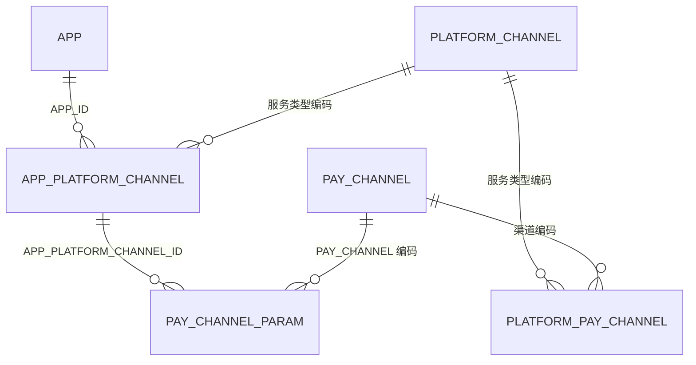

# 支付渠道参数配置的系统设计：一张参数表挂住四个业务要素

> 🔒 安全提示：文中示例的口令/密钥均为课程教学环境演示口径，生产环境的安全要求见《安全与合规须知》。

应用与服务类型的绑定关系落了库，第二阶段「配置支付渠道参数」随之展开。动接口之前照例做系统设计，这一课要回答的问题是：渠道参数到底配置在哪张表、一行参数由哪些要素定位、表结构为什么长成这样。把这些想通，后面的接口开发只是把设计翻译成代码。

## 先给结论

- 渠道参数的配置目标由四要素定位：商户、商户的应用、应用绑定的服务类型、服务类型对应的支付渠道。
- 服务类型决定要配哪些渠道：选 C 扫B 就配微信 JSAPI 与支付宝手机网站支付两组参数，B 扫C 与 C 扫B 都选则四组都要配。
- 参数落在交易库 `pay_channel_param` 表，四个要素压缩成三个字段：`MERCHANT_ID`、`APP_PLATFORM_CHANNEL_ID`、`PAY_CHANNEL`，参数本体放 `PARAM` 大文本字段。
- 应用与服务类型不占两个字段，由绑定关系表的主键 `APP_PLATFORM_CHANNEL_ID` 一并代表，这是整个设计最值得琢磨的一步。
- `APP_PLATFORM_CHANNEL_ID` 加 `PAY_CHANNEL` 有唯一约束，一个应用的一种服务类型下一个渠道只允许一份参数配置。

## 配参数为什么是四要素定位

平台聚合了众多第三方支付渠道，要调用微信、支付宝的接口完成支付交易，接口要求的参数必须先配在闪聚支付平台上。第三方渠道的接口那么多，配哪些？答案是跟着商户选择的服务类型走。商户选了 C 扫B，平台按对应关系给出微信 JSAPI 与支付宝手机网站支付两个渠道，只需配这两组；选了 B 扫C，对应微信付款码支付与支付宝条码支付；两种服务类型都选，四组参数一个不少。绑定服务类型缩小范围的意义在这一步兑现。

把「给谁配」这个问题从大到小过一遍，就是四个要素。商户是主体，比如某餐厅；应用是商户在平台上的业务标识，比如餐厅应用，订单挂在应用下分类汇总；应用绑定了服务类型，比如 C 扫B，这一步在应用绑定服务类型的功能里已经落库；服务类型再映射到具体支付渠道，比如微信 JSAPI。四要素从前往后逐级收窄，最终锁定一行参数的归属：给某商户的某应用的某服务类型下的某渠道配置参数。


## 参数表结构：四个要素压缩成三个字段

参数落在交易库 `pay_transaction` 的 `pay_channel_param` 表，建表语句如下：

```sql
CREATE TABLE `pay_channel_param` (
  `ID` bigint(20) NOT NULL,
  `CHANNEL_NAME` varchar(50) DEFAULT NULL COMMENT '自定义渠道名称',
  `MERCHANT_ID` bigint(20) DEFAULT NULL COMMENT '商户ID',
  `PAY_CHANNEL` varchar(50) DEFAULT NULL COMMENT '原始支付渠道编码',
  `PARAM` text COMMENT '支付参数',
  `APP_PLATFORM_CHANNEL_ID` bigint(20) DEFAULT NULL COMMENT '应用所选择的平台支付渠道ID',
  PRIMARY KEY (`ID`) USING BTREE,
  UNIQUE KEY `PAY_CHANNEL` (`PAY_CHANNEL`,`APP_PLATFORM_CHANNEL_ID`)
) ENGINE=InnoDB DEFAULT CHARSET=utf8 COMMENT='某商户针对某一种原始支付渠道的配置参数';
```

对照四要素看字段，会发现一个压缩设计。商户对应 `MERCHANT_ID`，支付渠道对应 `PAY_CHANNEL` 编码，应用与服务类型却没有各自成列，两者合起来由 `APP_PLATFORM_CHANNEL_ID` 一个字段代表，它存的是绑定关系表 `app_platform_channel` 的主键。应用与服务类型的绑定记录在上一阶段已经写入，一行绑定记录自带主键，参数表引用这个主键，就同时表达了「哪个应用」与「哪种服务类型」两个要素。查询参数时先按应用加服务类型查绑定表拿主键，再按主键查参数，两跳完成定位；反过来，想从一个参数行还原业务归属，拿 `APP_PLATFORM_CHANNEL_ID` 回绑定表一查便知。一个字段承载两个要素，靠的正是关系表先行落库的设计，绑定关系是渠道参数的锚点。

其余字段各司其职。`CHANNEL_NAME` 是商户给配置起的自定义名称，方便页面上辨认；`PARAM` 是 text 大文本，渠道要求的参数往往是一组键值对，以 JSON 串整体存入，不同渠道的参数结构不同，大文本加 JSON 恰好容纳这种差异；唯一约束建在 `PAY_CHANNEL` 与 `APP_PLATFORM_CHANNEL_ID` 两列上，含义是应用、服务类型、支付渠道三者组合唯一，同一个渠道在同一绑定下只允许一份参数，重复配置在数据库层面就被挡住。



实体类与表一一对应，`PayChannelParam` 在交易服务工程里已经备好：

```java
@Data
@TableName("pay_channel_param")
public class PayChannelParam implements Serializable {

    private static final long serialVersionUID = 1L;

    @TableId(value = "ID", type = IdType.ID_WORKER)
    private Long id;

    @TableField("CHANNEL_NAME")
    private String channelName;

    @TableField("MERCHANT_ID")
    private Long merchantId;

    @TableField("PAY_CHANNEL")
    private String payChannel;

    @TableField("PARAM")
    private String param;

    @TableField("APP_PLATFORM_CHANNEL_ID")
    private Long appPlatformChannelId;
}
```

## 手工插库走一遍配置过程

界面表单是后面的实现，理解设计最快的办法是手工往参数表里插一行，把四个要素的来源逐个摸一遍。商户要素去商户库 `merchant` 表拿主键；应用与服务类型要素去 `app_platform_channel` 找到对应的绑定记录，取它的主键；支付渠道要素去 `platform_pay_channel` 查服务类型对应的渠道编码，比如给 `shanju_c2b` 配微信 JSAPI，取 `WX_JSAPI`。四个值凑齐，插入一行：

```sql
INSERT INTO `pay_channel_param`
(`ID`, `CHANNEL_NAME`, `MERCHANT_ID`, `PAY_CHANNEL`, `PARAM`, `APP_PLATFORM_CHANNEL_ID`)
VALUES
(1, '微信JSAPI接口参数', 1211220010036162226, 'WX_JSAPI',
 '{"appID":"example-appid","appSecret":"example-secret","mchID":"example-mch-id","key":"example-secret","payKey":"example-secret"}',
 1211159463723554260);
```

`PARAM` 里是微信 JSAPI 渠道要求的商户凭证集合，课程演示以占位符示意，实际配置时商户要从微信商户平台拿到自己的 appid、mchid、密钥填进去；支付宝渠道则是另一套键值，appId、私钥、公钥、回调地址等。渠道参数差异被 JSON 大文本吸收，表结构不用为渠道变化改一列。

手工插完这一行，配置的完整图景就通了：商户先去微信或支付宝注册成为其商户，拿到渠道参数；通过平台界面为应用的绑定服务类型下的具体渠道填入参数；参数落进 `pay_channel_param`。将来发起支付时，系统按应用与服务类型一路查询，取到参数，携参调用微信或支付宝的接口完成支付。配置是准备，取参是兑现，这张表就是两者之间的交接点。

## 常见误区

- **以为参数表里要有应用与服务类型两个独立字段。** 错例：给 `pay_channel_param` 加 `APP_ID` 与 `PLATFORM_CHANNEL` 列。正解：绑定关系表先行落库，参数表引用其主键，一个字段表达两个要素，归属还原与查重都靠这一跳。
- **每个渠道的参数各建一张表或各加一列。** 错例：为微信、支付宝分别建表。正解：渠道差异收敛进 `PARAM` 的 JSON 大文本，表结构对渠道数量不敏感，新增渠道零改表。
- **忽视唯一约束，重复插入同一渠道的参数。** 错例：同一绑定下同渠道插了多行，取参时不知用哪条。正解：`PAY_CHANNEL` 加 `APP_PLATFORM_CHANNEL_ID` 的唯一约束保证一份配置；实现上做「存在即更新」的逻辑，重复保存转为更新。
- **把商户 ID 当成参数定位的主键。** 错例：只按 `MERCHANT_ID` 查参数。正解：商户下有多个应用、多个服务类型，仅凭商户 ID 定位不了参数，四要素缺一不可，实际检索的入口是绑定关系主键。

## 面试可能被问到的问题

1. 面试官追问：「渠道参数表为什么用绑定关系表的主键，而不直接存应用 ID 和服务类型编码？」
   答：应用与服务类型的绑定关系已经是落库的事实，一行绑定记录有稳定主键；参数表引用主键，一次关联就能还原完整归属，也天然保证了「应用加服务类型」的组合一致性。直接存两个字段则要与绑定表反复核对，还可能出现参数挂在不存在的绑定组合上的脏数据。
2. 面试官追问：「不同支付渠道的参数结构不同，表是怎么兼容的？」
   答：用 text 类型的 PARAM 字段存 JSON 串。微信的 appid、商户号、密钥与支付宝的 appId、私钥、公钥结构完全不同，结构化建模就得一渠道一套表；JSON 大文本把结构差异收敛到数据内容里，表结构不随渠道扩展，解析由应用层按渠道完成。
3. 面试官追问：「同一渠道重复提交配置怎么处理？」
   答：表上建了 PAY_CHANNEL 与 APP_PLATFORM_CHANNEL_ID 的唯一约束，同一绑定下同一渠道只允许一行。实现上先按两键查询，存在则更新参数内容，不存在才插入，业务侧做「存在即更新」，数据库约束做最后防线。
4. 面试官追问：「发起支付时如何取到渠道参数？」
   答：支付请求带有应用标识与服务类型，先查 app_platform_channel 得到绑定主键，再按主键与渠道编码从 pay_channel_param 取出 PARAM 的 JSON 串，解析后携参调用第三方接口。这条查询路径与配置路径完全对称，配置时的四要素就是取参时的四要素。
5. 面试官追问：「为什么要让商户先绑定服务类型，才允许配置渠道参数？」
   答：服务类型决定了渠道范围，参数必须挂在「应用加服务类型加渠道」的完整链路上。没有绑定关系，参数就缺少归属与校验依据，任意渠道都能配参，支付时无法判断该不该使用。绑定在前是配置合法性的前提，也是支付取参的路由依据。

## 配套资料

- 讲义：`materials/docs/10/闪聚支付-第2章-讲义-支付参数配置v1.0.md`，5.4 支付渠道参数配置之 5.4.1 系统设计（参数表结构、APP_PLATFORM_CHANNEL_ID 与 PAY_CHANNEL 唯一约束的说明、应用 app01 配置 WX_JSAPI 参数的示例）为本课出处。
- 代码：`materials/code/10/代码/`，交易服务工程中 `PayChannelParam` 实体与 `PayChannelParamMapper` 为真实文件，正文代码为按 `com.study.pay` 系口径改写后的节选（内层工程目录与包名为课程原始命名，不在此展开）；`pay_channel_param` 表 DDL 见 `materials/code/10/_散落资料/`（交易库 SQL 转储，正文为该脚本节选）。
- 说明：正文手工插入参数的 SQL 为按课程演示整理的示例，`PARAM` 中的渠道凭证一律以 example-appid、example-mch-id、example-secret 占位，实际取值来自商户在微信、支付宝侧注册后获得的参数；该阶段课程资料归档在 `materials/docs/10/` 与 `materials/code/10/`（不存在 09 编号目录）。
