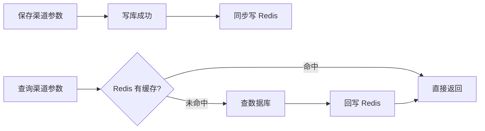
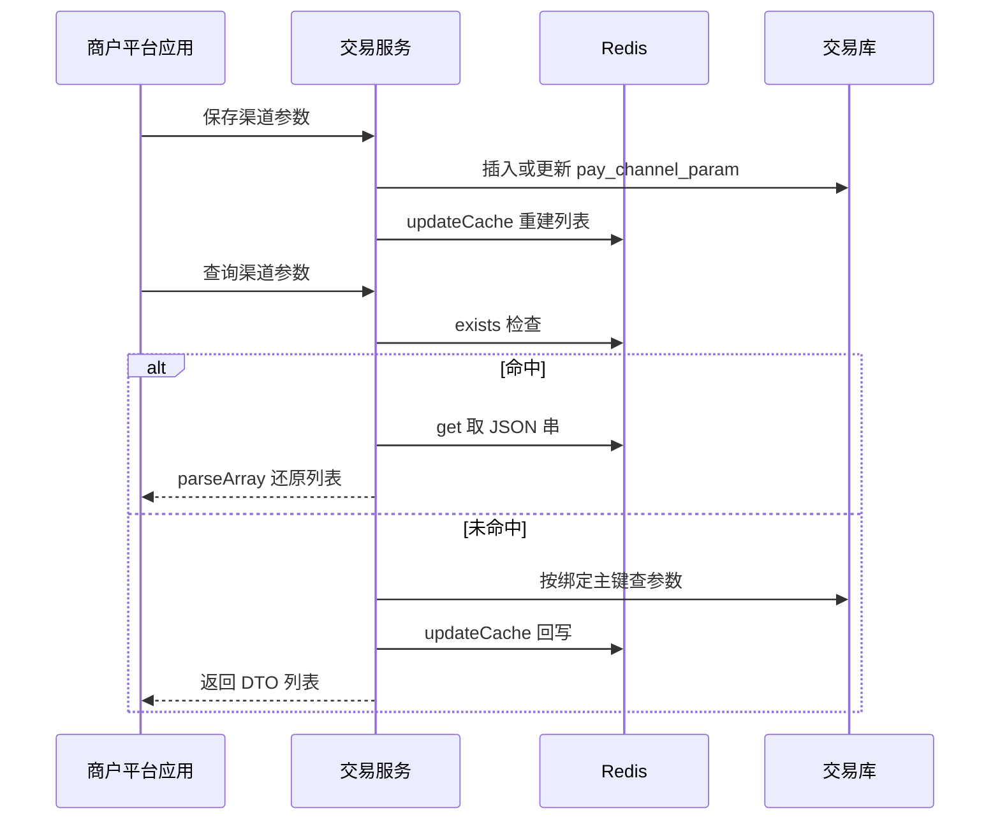
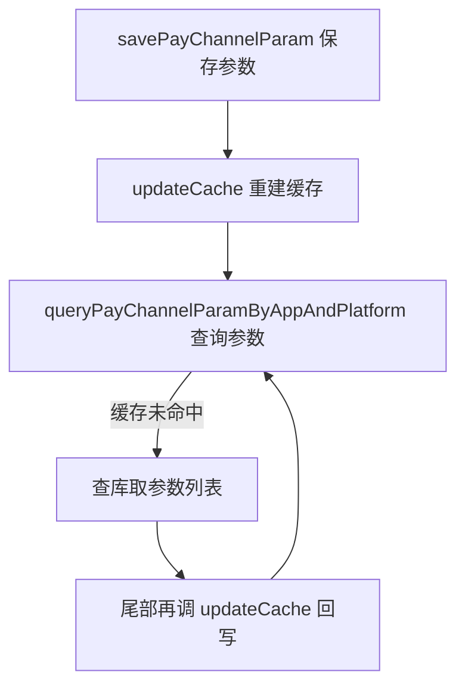
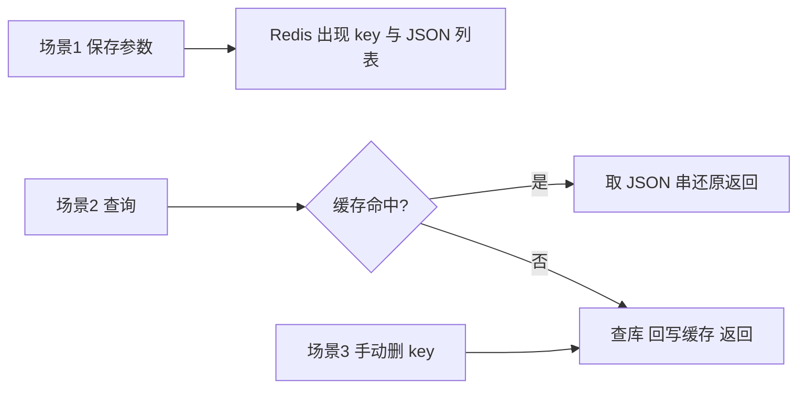

# 支付渠道参数缓存实战：Redis 缓存策略、代码落地与联调验证

> 🔒 安全提示：文中示例的口令/密钥均为课程教学环境演示口径，生产环境的安全要求见《安全与合规须知》。

## 先给结论

- 三篇内容完成渠道参数缓存：缓存逻辑和 redis 配置、缓存代码实现、缓存测试。
- 渠道参数读多写少，值得进内存；策略两条：保存成功同步写 Redis，查询先缓存后数据库、未命中回源并回写。
- key 有统一规则：前缀 `SJ_PAY_PARAM` 加冒号分隔，形如 `SJ_PAY_PARAM:应用ID:服务类型编码`，构建逻辑收敛在 `RedisUtil`。
- Redis 连接配置放 Nacos 公共组 `spring-boot-redis.yaml`，交易服务经 ext-config 引入；代码不直接碰 RedisTemplate，而是 Cache 接口由 RedisCache 实现。
- 缓存重建收敛成一个私有方法 `updateCache`，保存后与未命中回源两处复用；序列化 JSON 串进出，fastjson `parseArray` 还原列表。
- 联调翻出一颗真雷：updateCache 调查询方法取数、查询方法尾部又调 updateCache，缓存为空时形成相互递归死循环；修复是让 updateCache 直连 Mapper 查数，取数路径单向。
- 验证三条链路：保存后 Redis 出现 key 且 value 是 JSON 数组，断点看命中路径 `exists`、`get`、`parseArray`，删 key 后走回源并回写。
- 服务启动后 Dubbo 向 Nacos 注册需要几秒，立刻发请求会收到未知错误，稍候重发即可。

## 第1部分：支付渠道参数进 Redis：缓存策略设计与连接环境搭建

渠道参数配置落库之后，这条链路并没有结束。每一次支付动作都要按应用与服务类型取一次渠道参数，支付是全系统频率最高的操作之一，参数表也就成了读得最狠的一张表。每次都打到 MySQL，磁盘与连接池都吃不消，这一课把支付渠道参数缓存到 Redis，先讲清缓存策略与 key 规则，再把 Redis 的连接环境在交易服务里搭起来。

### 读多写少的参数，值得进内存

判断一个数据该不该缓存，先看它的读写比。渠道参数的写发生在商户配置时，一辈子可能就保存几次；读发生在支付时，一天可能是几万次。典型的读多写少，缓存收益极高。

再看存储介质。MySQL 的数据在磁盘上，走索引也要经历连接获取、磁盘页读取这几步；Redis 基于内存存储，单机就能做到十万级每秒的读操作。把每次支付都要取的参数放进内存，支付链路上这一跳的耗时就从毫秒级压到微秒级。Redis 在搭建验证码服务的阶段已经安装完成，本课不再重复安装，重点在连接配置与代码侧的封装。

### 缓存策略：两个写入时机

数据在数据库里，怎么进 Redis？顺着已有业务找写入点，会发现有两个天然时机，这张图把两条路径画在一起。



第一个时机在保存参数的接口里：落库成功的同时向 Redis 写一份，配置动作完成即缓存就绪。第二个时机在查询接口里：先查 Redis，命中直接返回；未命中则查数据库，返回前把结果写回 Redis。两处都写不是重复劳动，只靠保存时写，Redis 重启丢数据或 key 被误删之后就没人补了，查询未命中回写让缓存具备自愈能力。这个模式就是经典的 Cache Aside，读路径挂缓存、写路径刷缓存，后续实现都围绕它展开。

### key 设计：前缀加冒号的命名规则

往 Redis 写数据得先定 key。渠道参数的定位要素是应用与服务类型，key 就把这两个值编进去，规则固化在 common 工具类 `RedisUtil` 里：

```java
public class RedisUtil {

    /** 主数据系统标识 */
    public static final String KEY_PREFIX = "SJ_PAY_PARAM";
    /** 分割字符，使用冒号可用于客户端分组查看 */
    private static final String KEY_SPLIT_CHAR = ":";

    /**
     * redis的key键规则定义
     * @param module 模块名称
     * @param func 方法名称
     * @param args 参数..
     * @return key
     */
    public static String keyBuilder(String module, String func, String... args) {
        return keyBuilder(null, module, func, args);
    }

    public static String keyBuilder(String prefix, String module, String func, String... args) {
        // 项目前缀
        if (prefix == null) {
            prefix = KEY_PREFIX;
        }
        StringBuilder key = new StringBuilder(prefix);
        key.append(KEY_SPLIT_CHAR).append(module).append(KEY_SPLIT_CHAR).append(func);
        for (String arg : args) {
            key.append(KEY_SPLIT_CHAR).append(arg);
        }
        return key.toString();
    }
}
```

按这个规则，给应用 `ebcecedd-3032-49a6-9691-4770e66577af` 的 C 扫B 服务类型存参数，key 就是 `SJ_PAY_PARAM:ebcecedd-3032-49a6-9691-4770e66577af:shanju_c2b`。冒号分隔不是审美偏好，Redis 客户端会按冒号把 key 渲染成树状层级，前缀把本项目的 key 圈成一个命名空间，与验证码等其他业务的 key 天然隔离；排查问题时按 `SJ_PAY_PARAM*` 模式一搜，这一类 key 全部现形。同包下的 `RedisEnum` 把前缀、模块名、方法名、描述固化成枚举，配合 `keyBuilder(RedisEnum, objStr)` 重载使用，key 规则多一处约束。

### 搭建环境：公共配置、依赖与装配

Redis 的主机、端口、密码、连接池参数属于环境信息，按项目的配置管理惯例放 Nacos，而且是公共组，因为商户服务将来也要读 Redis。在 Nacos 新增配置，data-id 为 `spring-boot-redis.yaml`，Group 为 `COMMON_GROUP`，内容如下：

```yaml
spring:
  redis:
    # Redis数据库索引（默认为0）
    database: 0
    host: 127.0.0.1
    port: 6379
    # 连接超时时间（毫秒）
    timeout: 1000ms
    password: 123456
  lettuce:
    pool:
      # 连接池中的最大空闲连接
      max-idle: 8
      # 连接池中的最小空闲连接
      min-idle: 0
      # 连接池最大连接数（使用负值表示没有限制）
      max-active: 8
      # 连接池最大阻塞等待时间（使用负值表示没有限制）
      max-wait: 1000ms
      shutdown-timeout: 1000ms
```

密码一项有讲究：生产环境必然要配密码，开发期就把 `123456` 配上，连接配置问题在开发阶段暴露，不要留到上线前。连接池用的是 Lettuce，`max-active` 与 `max-idle` 控制池中连接的上下限，默认 8 个连接对支付参数查询这种短平快的场景足够。

交易服务在 `bootstrap.yml` 的 `ext-config` 里把这个配置文件挂进来：

```yaml
ext-config:
  - refresh: true
    data-id: spring-boot-redis.yaml # redis配置
    group: COMMON_GROUP # 通用配置组
```

`refresh: true` 让 Nacos 上的修改可以推送到服务。工程侧再补 Redis 启动器依赖：

```xml
<!-- Redis启动器 -->
<dependency>
    <groupId>org.springframework.boot</groupId>
    <artifactId>spring-boot-starter-data-redis</artifactId>
</dependency>
```

依赖就位后，Spring Boot 自动装配出 `StringRedisTemplate`。代码侧的封装分两层落位：`Cache` 接口与 `RedisUtil`、`RedisEnum` 拷入 common 工程，接口只声明能力不谈实现；`RedisCache` 拷入交易服务工程的 util 包，是接口的 Redis 实现。缓存不止 Redis 一种，抽象出接口，将来换实现或加本地缓存，业务代码不动：

```java
public interface Cache {
    Set<String> getKeys(String pattern);
    /** 检查给定key是否存在 */
    Boolean exists(String key);
    /** 移除给定的key，不存在则忽略 */
    void del(String key);
    /** 简单的字符串设置 */
    void set(String key, String value);
    void set(String key, String value, Integer expiration);
    /** 返回key所关联的字符串值 */
    String get(String key);
    void expire(String key, int expire);
    boolean setnx(String key, String value);
    Long incrBy(String key, Long delta);
}
```

`RedisCache` 内部拿着 `StringRedisTemplate` 逐个实现这些方法，`set` 底层是 `opsForValue().set(key, value)`，`exists` 是 `hasKey(key)`，全部是字符串操作。最后在交易服务的 config 包写一个配置类，把实现注册成 Bean：

```java
@Configuration
public class RedisConfig {

    @Bean
    public Cache cache(StringRedisTemplate stringRedisTemplate) {
        return new RedisCache(stringRedisTemplate);
    }
}
```

到这里环境闭环：Service 里注入 `Cache` 接口，拿到的是 `RedisCache` 实例，背后是 Nacos 公共配置描述的那个 Redis。选择 `StringRedisTemplate` 而非泛型 `RedisTemplate<String, Object>` 也顺理成章，缓存值计划存 JSON 串，键值都是字符串，序列化策略最简单透明。

## 第2部分：渠道参数缓存落地：保存时写入与查询时回源的两条代码路径

上一课把 Redis 环境与 key 规则备好，缓存还停在纸面上。这一课把缓存动作写进交易服务的代码：保存渠道参数的接口要顺手写一份缓存，查询接口要先问缓存再落库。两个入口共用一套重建逻辑，写法的取舍与序列化的选择都在这一课里。

### 把写缓存收敛成一个私有方法

保存与查询两个入口都要向 Redis 写数据，各写一遍必然重复，抽一个私有方法出来。方法签名只带两个参数：应用 ID 与服务类型编码，因为 key 的规则就是它们拼出来的。方法内部按四步走，先看课程实现：

```java
private void updateCache(String appId, String platformChannelCode) {
    //根据应用和服务类型查询支付渠道参数列表写入redis
    String redisKey = RedisUtil.keyBuilder(appId, platformChannelCode);
    Boolean exists = cache.exists(redisKey);
    if (exists) {
        cache.del(redisKey);
    }
    //根据应用和服务类型查询支付渠道参数列表写入redis
    List<PayChannelParamDTO> payChannelParamDTOs = queryPayChannelParamByAppAndPlatform(appId, platformChannelCode);
    if (payChannelParamDTOs != null) {
        //将payChannelParamDTOs转换成json存入redis
        cache.set(redisKey, JSON.toJSONString(payChannelParamDTOs));
    }
}
```

第一步构建 key，规则在上一课已定，形如 `SJ_PAY_PARAM:应用ID:服务类型编码`。第二步先查 key 是否存在，存在就删掉，这就是「先删后写」。为什么不直接覆盖写？因为一个 key 对应的是「该应用该服务类型下全部渠道的参数列表」，商户可能刚配了微信，又来配支付宝，覆盖写一个只含支付宝的列表就把微信丢了。先删掉旧值，再查库取一份完整的列表重新写入，保证缓存里的永远是全量。第三步从数据库查询这个应用与服务类型下的参数列表，第四步非空判断后才 `set`，避免把空值写进缓存占位。

这个写法里取数走的是对外查询方法，图的是省事，但它埋着一颗递归的雷，测试课上会当场引爆，先按下不表，读者可以自己顺着调用链推一遍。

### 保存参数的接口挂上缓存

保存渠道参数的接口是交易服务的 Dubbo 方法 `savePayChannelParam`，「存在即更新、不存在即插入」的落库逻辑不变，只在方法末尾追加一行：

```java
//保存到redis
updateCache(payChannelParam.getAppId(), payChannelParam.getPlatformChannelCode());
```

注意调用时机：放在数据库操作全部完成之后。落库失败抛异常，缓存不会被污染；落库成功，缓存立刻与新数据对齐。商户改一次配置，Redis 里的列表就重建一次，配置与缓存始终保持同步。

### 查询接口：先缓存后数据库

查询方法承载了缓存策略的另一半。改造后的 `queryPayChannelParamByAppAndPlatform` 完整结构如下：

```java
/**
 * 根据应用和服务类型查询支付渠道参数列表
 * @param appId           应用id
 * @param platformChannel 服务类型code
 * @return
 */
@Override
public List<PayChannelParamDTO> queryPayChannelParamByAppAndPlatform(String appId, String platformChannel) {
    //先从redis查询，如果有则返回
    String redisKey = RedisUtil.keyBuilder(appId, platformChannel);
    Boolean exists = cache.exists(redisKey);
    if (exists) {
        //从redis获取支付渠道参数列表（json串）
        String payChannelParamDTOsString = cache.get(redisKey);
        //将json串转成 List<PayChannelParamDTO>
        List<PayChannelParamDTO> payChannelParamDTOS = JSON.parseArray(payChannelParamDTOsString, PayChannelParamDTO.class);
        return payChannelParamDTOS;
    }
    //根据应用和服务类型找到它们绑定id
    Long appPlatformChannelId = selectIdByAppPlatformChannel(appId, platformChannel);
    if (appPlatformChannelId == null) {
        return null;
    }
    //应用和服务类型绑定id查询支付渠道参数记录
    List<PayChannelParam> payChannelParams = payChannelParamMapper.selectList(
            new LambdaQueryWrapper<PayChannelParam>().eq(PayChannelParam::getAppPlatformChannelId, appPlatformChannelId));
    List<PayChannelParamDTO> payChannelParamDTOS = PayChannelParamConvert.INSTANCE.listentity2listdto(payChannelParams);
    //保存到redis
    updateCache(appId, platformChannel);
    return payChannelParamDTOS;
}
```

缓存命中时，方法在第二行判断后就折返，数据库一次都不碰，这是缓存全部价值的兑现点。未命中时走原路：按应用与服务类型查出绑定关系主键，再按主键捞出参数实体列表，转换成 DTO。返回之前多了一步 `updateCache`，把这份查询结果固化到 Redis，同样的请求再来一次就命中了。两条路径的完整流转如下：



### 序列化：JSON 串进，JSON 串出

`StringRedisTemplate` 的键与值都是字符串，列表对象必须先变成字符串。选 JSON 有三个理由：一是有现成工具，工程里已经引了 fastjson，`JSON.toJSON(list).toString()` 一行完成序列化；二是还原容易，`JSON.parseArray(串, PayChannelParamDTO.class)` 指定元素类型即可，泛型反序列化不用手写；三是可读可迁移，Redis 客户端里直接看到内容，排查问题不需要反序列化工具，其他语言的服务将来也能读这份数据。

对比被淘汰的选项：JDK 原生序列化会把对象写成二进制，客户端里是一堆乱码，类结构一变旧数据就读不出；自己拼字符串则要处理转义与嵌套，得不偿失。按对象图转 JSON 串，是这个场景最稳的写法。

还有一个工程习惯值得单独说：私有方法抽取的价值在这节课体现得很直观。`updateCache` 抽出来之后，保存接口加缓存是一行调用，查询接口回写也是一行调用，序列化与 key 规则的细节被锁在一个方法里。方法抽得好，后面的功能就是搭积木；抽不好，两处各写一遍，改 key 规则时漏一处就是线上事故。

## 第3部分：缓存联调现场：一次相互递归的翻车与三条验证链路

缓存代码写完不等于能用，它横跨 Redis 与数据库，联调时最容易翻出藏在调用链里的隐性 bug。这一课是完整的测试现场：保存参数触发了一次死循环，当场定位修复，随后把命中、未命中、失效三个场景逐一验证。这段翻车记录比代码本身更值钱。

### 测试准备与第一次保存

先把两个服务都重启：交易服务与商户平台应用。缓存代码改动在交易服务里，不重启跑的还是旧类；商户平台应用一起重启，保证联调两端干净。Redis 客户端连上 `127.0.0.1:6379`（密码 `123456`）先刷一眼，确认当前没有渠道参数的 key，测试才有干净的起点。

用 Postman 发保存渠道参数的请求，第一次执行返回未知错误。这个错误在联调里出现过太多次了：交易服务的 Dubbo 接口还在向 Nacos 注册，注册未完成时远程调用找不到提供者。等一小会儿重发，不必改任何代码。这类「环境没就绪」的报错要有条件反射，先查注册状态再怀疑代码。

### 翻车现场：保存触发死循环

重发之后没有等来成功，控制台的日志像死循环一样狂刷。把方法栈展开，能看到调用链在两个方法之间来回打转：保存方法调用了 `updateCache`，`updateCache` 里调用查询方法取参数列表，查询方法发现缓存未命中，走库查询后尾部又调用 `updateCache` 回写，而 `updateCache` 再次调用查询方法，环就这么闭上了。



这张图就是死循环的全貌。触发条件是缓存为空：Redis 里没有这个 key，查询方法永远走未命中分支，回写动作永远在执行。上一课埋下的雷在这里炸了，取数依赖画了一个环。

修复的思路是让取数路径单向：`updateCache` 不再调用对外的查询方法，改用 Mapper 直查。先按应用与服务类型查出绑定关系主键，主键非空再按主键捞参数列表，转换后写入 Redis：

```java
private void updateCache(String appId, String platformChannelCode) {
    //得到redis中key，格式：SJ_PAY_PARAM:应用id:服务类型code
    String redisKey = RedisUtil.keyBuilder(appId, platformChannelCode);
    //根据key查询redis，存在则先删除
    Boolean exists = cache.exists(redisKey);
    if (exists) {
        cache.del(redisKey);
    }
    //根据应用和服务类型找到它们绑定id
    Long appPlatformChannelId = selectIdByAppPlatformChannel(appId, platformChannelCode);
    if (appPlatformChannelId != null) {
        //应用和服务类型绑定id查询支付渠道参数记录
        List<PayChannelParam> payChannelParams = payChannelParamMapper.selectList(
                new LambdaQueryWrapper<PayChannelParam>().eq(PayChannelParam::getAppPlatformChannelId, appPlatformChannelId));
        List<PayChannelParamDTO> payChannelParamDTOS = PayChannelParamConvert.INSTANCE.listentity2listdto(payChannelParams);
        //将payChannelParamDTOS转成json串存入redis
        cache.set(redisKey, JSON.toJSON(payChannelParamDTOS).toString());
    }
}
```

改完重启，再执行保存，一次通过。两条纪律值得记下：私有缓存方法只依赖数据访问层，不反向调用业务查询方法；新方法接入既有调用链前，把调用图画一遍，环在纸上就能看出来。

### 命中验证：断点看 Redis 取数

保存成功后刷新 Redis 客户端，key 已经在了：前缀 `SJ_PAY_PARAM` 固定，中间是应用 ID，后面是服务类型编码，value 是一个 JSON 数组，渠道参数内容一目了然。接下来验证查询的命中路径，断点打在查询方法开头的 `exists` 判断上，从商户平台应用的 Swagger 执行「根据应用和服务类型查询渠道参数」，入参应用 ID 与 `shanju_c2b`。

断点停下后单步跟进：`exists` 返回 true，`cache.get` 拿到 JSON 串，`JSON.parseArray` 把串还原成 `List<PayChannelParamDTO>`，变量窗口里列表元素俱全，全程没碰数据库。有个细节别当成 bug：还原出的 DTO 里应用 ID 字段是空的，因为参数表里本就没有应用 ID 这一列，DTO 由库记录转换而来，序列化进缓存时就是空值，命中路径原样吐回，属正常现象。

### 失效验证：删 key 走回源

缓存命中的反面同样要验证。在 Redis 客户端里把这个 key 删掉，再执行一次查询：断点显示 `exists` 返回 false，进入未命中分支，查出绑定主键，按主键捞参数列表，尾部调用 `updateCache` 回写。返回之后刷新客户端，key 重新出现，再查一次直接命中。三个场景连起来看：



保存即建缓存、命中即免查库、失效即回源自愈，三条链路全部按设计走通，缓存模块的验证闭环完成。

## 常见误区

- **Redis 密码留到上线再配。** 错例：开发环境免密连接，代码与配置都按无密码写。正解：开发期就配上密码并走通连接，配置项缺失这类问题在联调前暴露。
- **把 Redis 连接配置写死在工程 `application.yml`。** 错例：每个服务各抄一份连接信息。正解：环境类配置集中到 Nacos 公共组，一处修改全局生效，交易服务与商户服务共用同一份。
- **key 随手拼字符串，无前缀无分隔符。** 错例：直接用应用 ID 当 key，与验证码等其他业务的 key 混在一起。正解：统一走 `RedisUtil.keyBuilder`，前缀圈定命名空间，冒号分层便于客户端浏览与批量排查。
- **业务代码直接注入 `RedisTemplate` 操作。** 错例：各 Service 里散落 `redisTemplate.opsForValue()` 调用。正解：经 `Cache` 接口收敛，实现类唯一，换缓存组件或统一加监控时只改一处。
- **只在保存时写缓存，查询不做未命中回写。** 错例：以为保存时写过了就一劳永逸。正解：Redis 重启、key 被清理都会让缓存消失，查询未命中必须回写，否则缓存永远冷着。
- **把对象直接 `set` 进 Redis。** 错例：`cache.set(key, 对象)` 依赖模板自带的序列化器。正解：显式转 JSON 串再存，读出时按类型还原，内容可读且不受模板序列化配置影响。
- **写缓存放在数据库操作之前。** 错例：先写缓存再落库，落库失败后缓存里是库里没有的数据。正解：数据库操作全部成功之后再重建缓存，失败路径不碰缓存。
- **写入前不做非空判断。** 错例：查询结果为空也 `set` 进去。正解：非空才写，空结果留给未命中逻辑处理，避免空值长期占位造成语义混乱。
- **改了交易服务代码不重启就开测。** 错例：旧进程还在跑，怎么测都是旧行为。正解：服务端代码每次修改后重启，联调两端保持版本一致。
- **把注册延迟当 bug 排查。** 错例：启动后立刻发请求报错，从头读代码找问题。正解：Dubbo 向 Nacos 注册有几秒延迟，报「找不到服务」先等再试。
- **只测命中不测未命中与失效。** 错例：缓存里有数据时查询正常就收工。正解：命中、未命中、失效三个分支都要覆盖，未命中回写恰恰是最容易出问题的路径。
- **递归风险靠运气规避。** 错例：缓存方法与查询方法互相调用，平时有缓存罩着没暴露。正解：取数依赖单向，缓存重建只落数据访问层；新链路合入前把调用关系画出来检查成环。

## 面试可能被问到的问题

1. 面试官追问：「为什么渠道参数适合放 Redis 缓存，判断依据是什么？」
   答：看读写比与访问频率。渠道参数只在商户配置时写入，读取发生在每一次支付动作上，读多写少且访问高频；参数体积小，一个 key 存一份 JSON 串。这类数据放内存缓存收益最大，同时一致性压力小，因为写极少。

2. 面试官追问：「查询先查缓存、未命中查库回写，这个模式叫什么？有什么变种？」
   答：Cache Aside 旁路缓存。读路径先缓存后库并回填，写路径更新库后使缓存失效或重建。变种有 Read Through（缓存层自己回源）与 Write Through（同步写缓存与库），本项目用的就是最朴素的 Cache Aside，重建逻辑收敛在一个方法里。

3. 面试官追问：「为什么要抽象 Cache 接口，直接用 RedisTemplate 不行吗？」
   答：直接用会把 Redis 的 API 糊到每个业务类里，换缓存实现或加统一控制时改动面大。接口把 exists、get、set、del 这些能力抽象出来，业务只依赖抽象，RedisCache 一个实现类持有模板完成适配，也便于在实现里统一埋点。

4. 面试官追问：「Redis 配置为什么放 Nacos 公共组，而不是各服务自己的配置文件？」
   答：Redis 是跨服务共享的基础设施，交易服务与商户服务都要连。放公共组一份配置多处引用，改主机或密码只动一处；服务私有配置只留服务自己特有的东西。配合 refresh 还能做到不重启刷新。

5. 面试官追问：「StringRedisTemplate 和 RedisTemplate 有什么区别，这里为什么选前者？」
   答：RedisTemplate 默认用 JDK 序列化存对象，值在 Redis 里不可读且跨语言困难；StringRedisTemplate 键值都按字符串处理。渠道缓存放的是 JSON 串，序列化由 fastjson 显式完成，字符串直存直取，行为透明，调试时在客户端能直接看到内容。

6. 面试官追问：「更新缓存时为什么先删后整份重建，而不是只更新变化的那个渠道？」
   答：key 的粒度是「应用加服务类型」对应的整份参数列表，缓存的是全量。只更新单个渠道要精确维护列表内元素，逻辑复杂且容易漏；先删再从库里查全量重建，逻辑只有一条路径，数据完整性靠查询保证。删除也是原子的，重建期间短暂未命中由回写机制兜底。

7. 面试官追问：「写库成功但写缓存失败，数据会不一致吗？怎么处理？」
   答：会短暂不一致，缓存里可能是旧数据或没有数据。查询回写机制保证了缓存最终可用：未命中就回源。对一致性要求更高的场景可以加重试、延迟双删或订阅 binlog 异步刷新，渠道参数这种写极少的数据，重建式回写已经足够。

8. 面试官追问：「为什么用 fastjson 做 Redis 值的序列化，而不是 JDK 序列化？」
   答：JSON 是文本，客户端可读、跨语言通用、不依赖类的 serialVersionUID；JDK 序列化是二进制，类结构变更后旧值反序列化可能直接失败。缓存数据通常要可排查、可演进，JSON 是更稳的选择，注意反序列化时指明元素类型。

9. 面试官追问：「查询方法命中缓存直接返回，和未命中走数据库，两条路径返回的数据有差别吗？」
   答：字段层面可能有小差别。缓存里的数据来自数据库查询后的 DTO 转换，某些只存在于入参上下文的字段不在库里，命中路径上它就是空；未命中回源时也是同一份 DTO 结构，序列化前后的字段集合一致。联调时要核对两种路径的返回结构是否对齐。

10. 面试官追问：「缓存重建逻辑抽成私有方法，有什么设计上的讲究？」
   答：第一，单一职责，key 规则、删除、查询、序列化都锁在一个方法里，改动只发生在一处；第二，复用，保存与查询两个入口共用；第三，可测试，重建逻辑可以单独验证。反过来的教训是取数依赖要单向，私有方法不要再反向调用对外查询方法，否则容易形成环。

11. 面试官追问：「线上遇到 StackOverflowError，你的排查思路是什么？」
   答：先看完整堆栈，重复出现的同一段方法调用就是循环点；确认是相互递归后打断环，让依赖单向化。本次案例里是缓存重建方法反向调用查询方法，修复成直连 Mapper 查数。堆栈不会骗人，循环一定在重复的帧里。

12. 面试官追问：「怎么从设计上避免这类相互递归？」
   答：给方法分层定角色：对外业务方法、缓存重建方法、数据访问方法，依赖只允许从上往下。缓存重建落数据访问层，业务查询可以调缓存重建，反向引用一律禁止。代码评审时把调用图画出来，环一眼可见。

13. 面试官追问：「缓存功能的测试要覆盖哪些场景？」
   答：至少三类。命中路径验证缓存值正确返回且不落库；未命中路径验证回源取数并回写；失效场景验证 key 清除后能自愈。再加上写入时机的验证，即保存数据后缓存同步更新。有条件还要测缓存与库字段差异在两种路径下返回是否一致。

14. 面试官追问：「缓存命中路径返回的数据和直接查库有什么不同，怎么验证？」
   答：结构应当一致，个别上下文字段可能为空。验证手段是断点对比：命中路径看反序列化后的列表，未命中路径看转换后的列表，字段逐个核对。本项目里 DTO 的应用 ID 字段就因库里无此列而在缓存值中为空，属预期行为。

15. 面试官追问：「测试时删 key 模拟失效，和真实失效有什么差距？」
   答：手动删 key 验证的是未命中回源逻辑，真实失效还可能有 Redis 重启、内存淘汰、过期时间到达等多种原因，表现都是 key 消失，回源逻辑相同。差距在于真实场景失效时间不可控，联调时也可以给 key 设置过期时间来观察自动失效后的回写。

## 配套资料

- 讲义：`materials/docs/10/闪聚支付-第2章-讲义-支付参数配置v1.0.md`，5.6 支付渠道参数缓存之 5.6.1 需求分析与 5.6.2 搭建 redis 环境（缓存流程、Nacos 的 `spring-boot-redis.yaml` 配置、`bootstrap.yml` 引入方式、依赖与工具类落位、`RedisConfig` 装配）为本课出处。
- 指南：`materials/docs/10/Redis安装指南.md`，Redis 本体安装参照该文档，本课环境在验证码服务阶段已装好。
- 代码：`materials/code/10/代码/redis/`，`RedisCache`、`RedisEnum`、`RedisUtil` 三个工具类源文件归档于此（`Cache` 接口在 common 工程源码中）；交易服务工程的 `RedisConfig`、`bootstrap.yml` 与 Redis 依赖见 `materials/code/10/完整代码/`（内层工程目录与包名为课程原始命名，不在此展开）。
- 说明：该阶段课程资料归档在 `materials/docs/10/` 与 `materials/code/10/`（不存在 09 编号目录），引用路径截至该层级；正文包名按 `com.study.pay` 系口径书写，Redis 密码 `123456` 为课程环境演示值。
- 讲义：`materials/docs/10/闪聚支付-第2章-讲义-支付参数配置v1.0.md`，5.6 支付渠道参数缓存之 5.6.3 保存缓存与 5.6.4 查询缓存（`updateCache` 实现、`savePayChannelParam` 追加缓存调用、`queryPayChannelParamByAppAndPlatform` 先缓存后库改造）为本课出处。
- 代码：`materials/code/10/代码/redis/`，`RedisCache`、`RedisUtil` 等工具类源文件；交易服务 `PayChannelServiceImpl` 的缓存实现（含修复后的 `updateCache` 直查版本）归档于 `materials/code/10/完整代码/`（内层工程目录与包名为课程原始命名，不在此展开）。
- 说明：该阶段课程资料归档在 `materials/docs/10/` 与 `materials/code/10/`（不存在 09 编号目录）；正文包名按 `com.study.pay` 系口径书写，方法签名与序列化调用以归档源码为准，`updateCache` 初版经由查询方法取数的写法为课堂演进过程，见下一课的测试与修复。
- 讲义：`materials/docs/10/闪聚支付-第2章-讲义-支付参数配置v1.0.md`，5.6 支付渠道参数缓存之 5.6.4 查询缓存为本课出处；`updateCache` 直连 Mapper 查数的修复写法以归档源码为准。
- 代码：`materials/code/10/完整代码/`，交易服务 `PayChannelServiceImpl`（修复后的 `updateCache` 与 `queryPayChannelParamByAppAndPlatform` 完整实现）、`RedisCache`、`RedisUtil` 为真实文件（内层工程目录与包名为课程原始命名，不在此展开）。
- 说明：该阶段课程资料归档在 `materials/docs/10/` 与 `materials/code/10/`（不存在 09 编号目录）；测试 URL 与端口按课程环境口径书写，Redis 连接为 `127.0.0.1:6379`、密码 `123456` 演示环境；正文包名按 `com.study.pay` 系口径书写。
