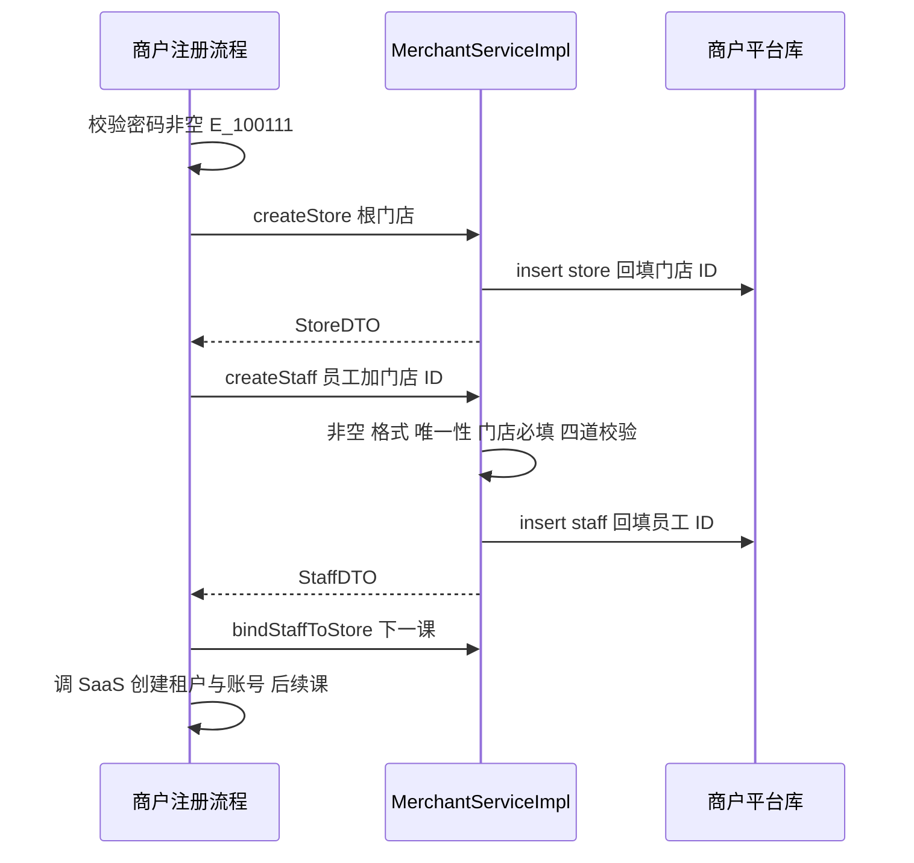
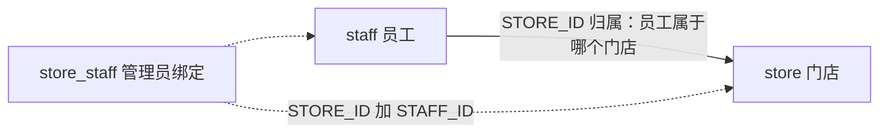
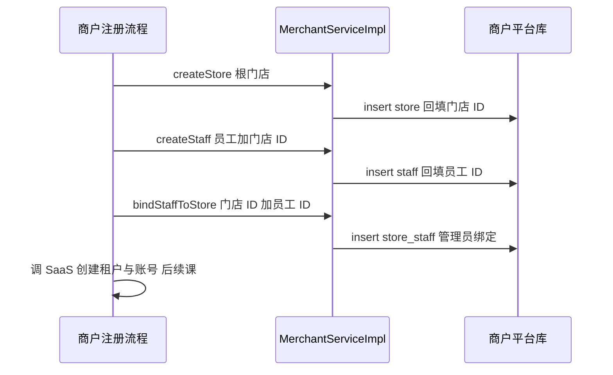
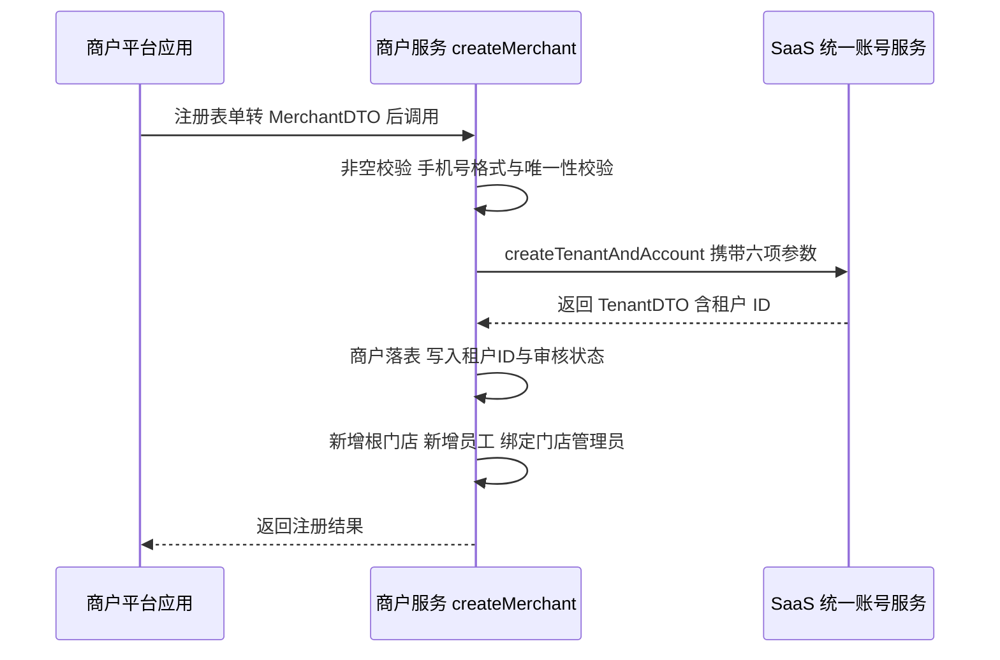
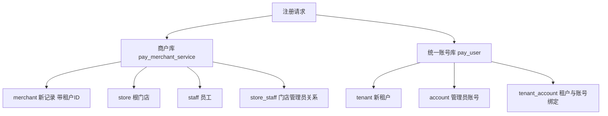

# 对接SaaS-代码实现与测试全流程：新增门店员工、绑定管理员、注册调用统一账号与双库验证

> 🔒 安全提示：文中示例的口令/密钥均为课程教学环境演示口径，生产环境的安全要求见《安全与合规须知》。

## 先给结论

- 闪聚支付「对接SaaS」的代码实现与代码测试两课合并为一篇完整实录；实现篇本身已含三个部分：商户侧新增门店与新增员工、为门店设置管理员、商户注册方法调用 SaaS 接口，测试篇用一次真实注册把商户库与统一账号库同时写满。
- 注册主线串起四步本地落库加一次远程开通：createStore 建根门店拿 ID，createStaff 建员工，bindStaffToStore 把员工绑成门店管理员，最后调 SaaS 的 createTenantAndAccount 一步完成建租户、绑用户、初始化权限、分配管理员权限四件事；类级 @Transactional 保证全套成功或整体回滚。
- 账号域分工是这次对接的架构要点：密码属于 SaaS 统一账号域，商户平台校验非空后原样透传、不落不存；员工表的 username 与 mobile 是与统一用户的关联键，登录认证由 SaaS 统一完成。
- 租户 ID 是两边的锚点：SaaS 接口幂等（租户已存在返回既有信息），拿到返回后必须判空再落库，商户表按租户 ID 查重防重复注册。
- 工程细节集中在四件工具：MapStruct 做对象转换（编译期发现字段对不上）、MyBatis-Plus 的 ID_WORKER 雪花 ID 与 LambdaQueryWrapper、Dubbo 的 @Reference 注入远程接口（用 @Autowired 会启动报错）、唯一性校验的粒度是商户内唯一。
- 测试篇给出完整验收路径：全新手机号与账号避免撞唯一性校验，验证码先调短信接口再从 Redis 取，确认 SaaS 三服务与商户服务都注册进 Nacos；注册成功后三层核对，接口返回租户 ID 非空、商户表新记录带租户 ID、统一账号库 account 与 tenant 表出现对应记录。
- 实现篇三部分各有落点：新增门店与员工落在商户库的 store 与 staff 表；绑定管理员落在 store_staff 关系表，语义是管理员标记而非普通多对多，测试数据随测随清；租户开通缝进注册流程，远程调用放在本地落库之前。
- 顺序即依赖：绑定管理员的两个入参就是前两步的返回值，先本地完成组织建档再到 SaaS 开通账号，SaaS 失败时本地随注册事务回滚，重试成本最低，也避免 SaaS 里出现没有组织数据支撑的孤儿账号。
- 表结构语义要分清：STORE_ID 表达组织归属随人事变动更新，谁是门店管理员是授权关系低频演化，分表建模互不干扰；void 接口的契约是成功即返回、失败即抛 BusinessException，错误码统一收口。
- 一店一管理员的防重要心里有数：课程实现保持最简未加唯一约束，生产上应给 STORE_ID 建唯一约束或先查后插，注册重试才不会插出多条管理员记录。

## 第1部分：对接SaaS-代码实现三部曲：新增门店与员工、设置管理员、注册流程调用 SaaS 接口

### 第1部分之1：对接 SaaS 代码实现：商户侧新增门店与新增员工

SaaS 系统部署完成后，对接进入写代码的阶段。按接入步骤的分析，商户平台要自己完成四个本地动作：新增门店、新增员工、为门店设置管理员，然后在商户注册流程里把这三步串起来并调用 SaaS 接口完成租户开通。两课合为一篇，先把前两步写扎实：门店与员工是商户平台的组织数据，也是后续绑定管理员、调用 SaaS 创建账号的地基。接口本身不复杂，复杂度全在新增员工的校验规则里。

#### 三个动作背后的三张表

商户平台库里 `app`、`merchant` 两张表早已在使用，本课补齐组织机构相关的三张：`store`（门店）、`staff`（员工）、`store_staff`（员工与门店关系）。先把字段看清楚：

```text
store        门店表
  ID            主键
  STORE_NAME    门店名称
  STORE_NUMBER  门店编号
  MERCHANT_ID   所属商户
  PARENT_ID     父门店，组织树的挂靠点
  STORE_STATUS  0 禁用，1 启用
  STORE_ADDRESS 门店地址

staff        员工表
  ID              主键
  MERCHANT_ID     商户 ID
  FULL_NAME       姓名
  POSITION        职位
  USERNAME        用户名（关联统一用户）
  MOBILE          手机号（关联统一用户）
  STORE_ID        员工所属门店
  STAFF_STATUS    0 禁用，1 启用

store_staff  门店与员工关系表
  ID        主键
  STORE_ID  门店标识
  STAFF_ID  员工标识
```

（表结构整理自商户服务建库脚本，见配套资料。）

三张表的关系用一张图摆出来，本课只关心前两条实线，第三条留给下一课的绑定管理员：


`staff` 表的 `USERNAME` 与 `MOBILE` 两个字段，注释里都写着「关联统一用户」，这是理解整个对接的关键：员工这个实体在商户平台只存业务属性（姓名、职位、归属），而账号与密码落在 SaaS 系统的统一账号库里。商户平台的员工与 SaaS 的用户靠用户名和手机号建立关联，这也是后面新增员工要做多重唯一性校验的根本原因：这两个字段将来就是登录凭证，重复了认证体系就乱套。

顺带注意主键设计：门店、员工、关系表的主键全部是 `ID_WORKER` 雪花 ID，`STORE_NUMBER` 这类业务编号与物理主键分离，各司其职。分布式场景下各节点自行生成全局唯一 ID，不依赖数据库自增，也不会暴露业务量。

#### 新增门店接口：注册事务里的一次插入

**接口定义。** 生成 `StoreDTO` 后在商户服务的 API 接口 `MerchantService` 中声明：

```java
/**
 * 商户下新增门店
 * @param storeDTO 门店信息
 * @return 新增成功的门店信息
 */
StoreDTO createStore(StoreDTO storeDTO) throws BusinessException;
```

`StoreDTO` 由代码生成器按 `store` 表生成，业务字段与表一一对应：

```java
@Data
@ApiModel(value = "StoreDTO", description = "")
public class StoreDTO implements Serializable {

    private Long id;

    @ApiModelProperty(value = "门店名称")
    private String storeName;

    @ApiModelProperty(value = "门店编号")
    private Long storeNumber;

    @ApiModelProperty(value = "所属商户")
    private Long merchantId;

    @ApiModelProperty(value = "父门店")
    private Long parentId;

    @ApiModelProperty(value = "0表示禁用，1表示启用")
    private Boolean storeStatus;

    @ApiModelProperty(value = "门店地址")
    private String storeAddress;
}
```

**接口实现。** 注册场景下门店必然不存在（商户刚建，门店还没建过），不需要先查后插，直接 insert 即可。在 `MerchantServiceImpl` 中实现，先注入 `StoreMapper`：

```java
@Override
public StoreDTO createStore(StoreDTO storeDTO) {
    //DTO 转 entity
    Store store = StoreConvert.INSTANCE.dto2entity(storeDTO);
    log.info("商户下新增门店：{}", JSON.toJSONString(store));
    //根门店直接插入
    storeMapper.insert(store);
    //entity 转 DTO 返回，主键已回填
    return StoreConvert.INSTANCE.entity2dto(store);
}
```

实现类上带三个注解：`@Slf4j` 支撑日志输出；`@Transactional` 把新增商户、新增门店等动作圈进同一个注册事务，任何一步失败整体回滚；Dubbo 的 `@Service` 把实现暴露为 RPC 服务，商户平台应用远程调用的就是它。

**转换器取资料里现成的，不用手写。** 课程把资料目录中提供的两个转换器（门店与员工各一个）拷进商户服务的 convert 目录直接使用。`StoreConvert` 是 MapStruct 风格的接口，方法签名声明转换方向，实现类由 MapStruct 在编译期自动生成，运行期通过静态单例 `INSTANCE` 调用：

```java
@Mapper
public interface StoreConvert {

    StoreConvert INSTANCE = Mappers.getMapper(StoreConvert.class);

    StoreDTO entity2dto(Store entity);

    Store dto2entity(StoreDTO dto);

    List<StoreDTO> listentity2dto(List<Store> staff);
}
```

`insert` 之后实体的主键就有值了：MyBatis-Plus 的主键策略是 `ID_WORKER`，插入时生成分布式 ID 并回填到实体上，所以紧接着的 `entity2dto` 能带出 ID，调用方拿着这个返回值就能继续往下走。这里埋一个伏笔：注册流程马上要用这个门店 ID 去建员工。

返回 DTO 而不是返回实体也有讲究。entity 与表结构绑定，带着 `@TableName`、`@TableField` 这些持久层注解，属于服务的内部资产；DTO 才是跨模块、跨服务传输的契约对象，Dubbo 接口的出入参一律用它，避免把 ORM 映射细节暴露给消费方，也给两边的数据结构各自留出演化空间。商户平台与 SaaS 之间传的同样是 DTO，这条纪律在整个对接过程中一以贯之。

根门店的定位要说清楚：它是商户组织架构的顶点，相当于公司的总部建制。注册时插这一条就够了，后面门店管理功能里再按 `PARENT_ID` 挂部门、连锁店等子门店，门店树从这条根记录开始生长。

**门店接口不设层层校验，与员工接口正形成对照。** 门店是注册时由后台装配的数据：商户 ID 来自注册上下文，门店信息由流程填充，里面没有用户手输的凭证类字段，所以接口保持直插的最简形态，出问题按异常统一上报。员工的字段几乎全部来自填写，才需要非空、格式、唯一性层层把关。两个接口放在一起看，校验密度跟着数据来源的风险走，这正是参数校验设计的基本思路。

#### 新增员工接口：校验规则是主体

**接口定义。** 同样在 `MerchantService` 中声明，入参出参都是 `StaffDTO`：

```java
/**
 * 商户新增员工
 * @param staffDTO 员工信息
 * @return 新增成功的员工信息
 */
StaffDTO createStaff(StaffDTO staffDTO) throws BusinessException;
```

`StaffDTO` 的关键字段比门店多了账号属性，`username` 与 `mobile` 的 swagger 描述直接标注了「关联统一用户」：

```java
@ApiModelProperty(value = "用户名(关联统一用户)")
private String username;

@ApiModelProperty(value = "手机号(关联统一用户)")
private String mobile;

@ApiModelProperty(value = "员工所属门店")
private Long storeId;
```

**第一道校验，参数合法性。** 手机号与用户名是登录凭证，密码由注册入口负责，三者都不能为空；手机号还要过格式校验，公共包的 `PhoneUtil.isMatches` 用正则判断号段与位数，不合法抛 E_100109：

```java
@Override
public StaffDTO createStaff(StaffDTO staffDTO) {
    //手机号非空校验
    String mobile = staffDTO.getMobile();
    if (StringUtils.isBlank(mobile)) {
        throw new BusinessException(CommonErrorCode.E_100112);
    }
    //手机号格式校验（公共包 PhoneUtil）
    if (!PhoneUtil.isMatches(mobile)) {
        throw new BusinessException(CommonErrorCode.E_100109);
    }
    //用户名非空校验
    String username = staffDTO.getUsername();
    if (StringUtils.isBlank(username)) {
        throw new BusinessException(CommonErrorCode.E_100110);
    }
    //后续：同一商户下的唯一性校验
}
```

**第二道校验，同一商户下唯一。** 商户 A 与商户 B 各有一个叫 `zhangsan` 的员工是完全合法的，唯一性的粒度是商户内唯一，所以查询条件必须是手机号加商户 ID 两个字段联合判断。按讲义口径写两个私有方法：

```java
/**
 * 根据手机号判断员工是否已在指定商户存在
 * @param mobile      手机号
 * @param merchantId  商户 ID
 * @return 存在返回 true
 */
private boolean isExistStaffByMobile(String mobile, Long merchantId) {
    LambdaQueryWrapper<Staff> lambdaQueryWrapper = new LambdaQueryWrapper<Staff>();
    lambdaQueryWrapper.eq(Staff::getMobile, mobile).eq(Staff::getMerchantId, merchantId);
    int i = staffMapper.selectCount(lambdaQueryWrapper);
    return i > 0;
}

/**
 * 根据账号判断员工是否已在指定商户存在
 * @param username    用户名
 * @param merchantId  商户 ID
 * @return 存在返回 true
 */
private boolean isExistStaffByUserName(String username, Long merchantId) {
    LambdaQueryWrapper<Staff> lambdaQueryWrapper = new LambdaQueryWrapper<Staff>();
    lambdaQueryWrapper.eq(Staff::getUsername, username).eq(Staff::getMerchantId, merchantId);
    int i = staffMapper.selectCount(lambdaQueryWrapper);
    return i > 0;
}
```

两个方法结构完全一致，差别只在比较的字段：一个 `Staff::getMobile`，一个 `Staff::getUsername`。判断存在性用 `selectCount` 而不是 `selectList`，只取数量不拉数据，命中即返回 true。在主流程里接上这两个校验，命中即抛对应异常：

```java
//同一商户下手机号唯一
if (isExistStaffByMobile(mobile, staffDTO.getMerchantId())) {
    throw new BusinessException(CommonErrorCode.E_100113);
}
//同一商户下用户名唯一
if (isExistStaffByUserName(username, staffDTO.getMerchantId())) {
    throw new BusinessException(CommonErrorCode.E_100114);
}
```

错误码对照公共异常表：E_100112 手机号为空、E_100109 手机号格式不正确、E_100113 手机号已存在、E_100110 用户名为空、E_100114 用户名已存在。异常一路抛到全局异常处理器，前端收到的就是明确的业务提示，而不是一串堆栈。

**校验顺序本身也是设计。** 非空与格式校验在前，唯一性查库在后：前者是纯内存判断，成本近乎为零；后者要发起一次数据库查询。非法参数在查库之前就被拦下，数据库不做无用功。两条唯一性查询都携带商户 ID 条件，按条件命中即返回，不扫全表；注册场景下这些查询落在商户平台库的单表索引上，高频调用也构不成压力。

**第三道校验，所属门店必填。** `StaffDTO` 里的 `storeId` 是员工与门店的挂靠点，员工实体没有所属门店就不允许新增，这是商户平台自己的流程约束。注册流程里根门店刚建好，把它的 ID 传进来即可，为空则按缺少必要参数处理：

```java
//员工所属门店必填：注册流程先建根门店，再把门店 ID 传入
if (staffDTO.getStoreId() == null) {
    throw new BusinessException(CommonErrorCode.E_300009);
}
```

E_300009 在公共异常表里就是「传入对象为空或者缺少必要的参数」，此处复用正好。这一校验不是可选项：漏掉它，一条没有门店的员工记录会静静躺进表里，等到登录或权限分配时才暴露问题。

**转换落库与回传。** 校验全部通过后走与新增门店相同的路径，`StaffConvert` 转 entity、insert、转回 DTO 返回：

```java
//DTO 转 entity 并插入
Staff entity = StaffConvert.INSTANCE.dto2entity(staffDTO);
log.info("商户下新增员工：{}", JSON.toJSONString(entity));
staffMapper.insert(entity);
//entity 转 DTO 返回，主键已回填
return StaffConvert.INSTANCE.entity2dto(entity);
```

`StaffConvert` 与 `StoreConvert` 同构，也是 `entity2dto`、`dto2entity`、列表转换三个方法，`@Mapper` 注解交给 MapStruct 生成实现。姓名、职位这些业务字段直接由 DTO 带过来，`storeId` 由调用方传入，员工落库时归属关系一并写入。

**日志把每一步写库都留了痕。** 实现类标注 `@Slf4j`，新增门店与新增员工各有一行 `log.info`，输出转换后实体的 JSON 串。这样做有两个用途：联调时对照日志与库表记录，立刻能确认字段映射有没有漏、主键有没有回填；进入 SaaS 对接阶段后，一次注册会横跨商户平台与 SaaS 两侧多个服务，入口处的结构化日志就是排查问题的第一现场。转换器里预留的 `listentity2dto` 也顺手配齐，后续员工列表查询接口拿来即用。

#### 密码的去向：员工域与账号域的分界

看遍 `StaffDTO` 找不到密码字段，这是刻意设计而不是遗漏。员工表里没有密码列，密码属于 SaaS 统一账号库的 `account` 表，商户平台只保存 `username` 与 `mobile` 两个关联字段。数据各归其位，认证逻辑整体由 SaaS 承担，商户平台不做任何密码的存储与校验逻辑。

但注册入口不能不问密码：租户开通后总得有人能登录。手机号被抬到与用户名同等的位置也有实际考虑：账号与手机号将来都是登录凭证，手机号还承担验证码登录这类场景，所以在员工域里两个字段都要唯一、格式都要把关。按课程口径，商户注册方法要增加密码参数，注册入口只做非空校验：

```java
//商户注册入口：密码为空不允许注册（示例口径，按本课讲解整理）
if (StringUtils.isBlank(password)) {
    throw new BusinessException(CommonErrorCode.E_100111);
}
```

校验通过后，密码不会写进商户平台的任何一张表，而是随注册流程调用 SaaS 用户服务的租户创建接口传过去。讲义对该接口的说明是：创建租户，若已存在则返回租户信息，否则新增租户、新增租户管理员并初始化权限，创建账号时需要手机号、账号的用户名与密码。也就是说，SaaS 侧一次调用完成建租户、建账号、绑关系、设管理员四件事，商户平台侧只负责收集与传递数据。该接口的调用实现在后续课程展开，这里先把分界线立住：**员工数据归商户平台，账号密码归 SaaS。**

#### 注册流程里的调用顺序

三个本地动作与一次 SaaS 调用在注册流程里的位置如下，这里完成前两步，绑定管理员由下一课接手：



顺序有严格的依赖：门店先于员工，因为员工 DTO 需要 `storeId`；绑定先于 SaaS 调用，因为本地组织数据齐了才谈得上把账号关系建到 SaaS。整条链路放在注册事务里，任何一步抛出 `BusinessException`，已插入的商户、门店、员工记录整体回滚，不会留下半套组织数据。

还要说清调用方是谁。createStore 与 createStaff 并不是暴露给前端逐个点击的接口，而是由商户注册方法在内部按顺序调用，前端只面对注册这一个入口。这样安排有两个好处：步骤顺序与参数传递（门店 ID、员工 ID）被代码固定下来，前端无法乱序调用；校验与落库集中在服务端一个事务里，数据完整性由后端兜底。两个接口定义在商户服务的 Dubbo API 模块上，商户平台应用远程触发注册时，走的就是同一套实现。
### 第1部分之2：为门店设置管理员：绑定门店与员工的落库实现

门店建好了，员工也落库了，注册流程还差一步把两者绑起来：注册时新增的这名员工默认就是门店的管理员，可以理解为这家商户的总经理。绑定动作本身很轻，往 `store_staff` 关系表插一条记录而已，但它的位置很关键：没有这一步，门店是门店、员工是员工，两套数据对不上号，登录进来的人既没有组织归属也没有管理权限。接口虽小，两条「关系」的区别和 void 返回值的设计意图值得说透。

#### 一张只有三个字段的关系表

`store_staff` 表结构简单到极致：

```text
store_staff   门店与员工关系表
  ID         bigint  主键
  STORE_ID   bigint  门店标识
  STAFF_ID   bigint  员工标识
  PRIMARY KEY (ID)
```

（表结构整理自商户服务建库脚本，见配套资料。）

这张表容易与员工表里的 `STORE_ID` 字段混淆，两者的语义要分清。`staff.STORE_ID` 回答的是归属问题：这个员工属于哪家门店，连锁超市的收银员、理货员各自挂在不同的门店上，一个门店可以有多名员工，归属关系是多对一。`store_staff` 表回答的是管理问题：这家门店的管理员是谁，表里存在一条记录，就代表该门店的管理员是这条记录指向的员工。注册场景下第一个员工既是普通员工又是管理员，所以两边都有他的痕迹，但记录写在不同的表里，含义不同：



实线是归属，随新增员工落库；虚线是管理员绑定，由本课的接口独立完成。分开建模的好处在于两者演化节奏不同：归属关系随招聘与调岗频繁变化，管理员绑定是低频的授权动作，将来若支持一店多管理员，扩展的也是这张关系表，员工基础数据不受影响。

#### 接口定义与实现

**接口定义。** 在商户服务的 API 接口 `MerchantService` 中接着新增员工的方法声明：

```java
/**
 * 为门店设置管理员
 * @param storeId 门店 ID
 * @param staffId 员工 ID
 * @throws BusinessException 设置失败时抛出
 */
void bindStaffToStore(Long storeId, Long staffId) throws BusinessException;
```

参数类型要与数据库列一致，`store_staff` 的两列都是数字型，这里用 `Long`；写成字符串类型会在落库时依赖隐式转换，类型修正就发生在课程现场。

**接口实现。** 实体类 `StoreStaff` 与 Mapper 都是代码生成器的产物，`StoreStaff` 映射关系表：

```java
@Data
@TableName("store_staff")
public class StoreStaff implements Serializable {

    private static final long serialVersionUID = 1L;

    @TableId(value = "ID", type = IdType.ID_WORKER)
    private Long id;

    /**
     * 门店标识
     */
    @TableField("STORE_ID")
    private Long storeId;

    /**
     * 员工标识
     */
    @TableField("STAFF_ID")
    private Long staffId;
}
```

`StoreStaffMapper` 继承 MyBatis-Plus 的 `BaseMapper`，insert 能力开箱即用：

```java
@Repository
public interface StoreStaffMapper extends BaseMapper<StoreStaff> {

}
```

实现里注入 `StoreStaffMapper`，构造实体、插入、结束：

```java
@Override
public void bindStaffToStore(Long storeId, Long staffId) {
    StoreStaff storeStaff = new StoreStaff();
    //门店 ID
    storeStaff.setStoreId(storeId);
    //员工 ID，即该门店的管理员
    storeStaff.setStaffId(staffId);
    storeStaffMapper.insert(storeStaff);
}
```

没有返回值，也没有先查后插：两个 ID 都是注册流程前两步刚拿到的真实主键，合法性由上游保证；任何一步抛异常，方法不会正常返回，注册事务随之回滚。类级 `@Transactional` 保证新增门店、新增员工、绑定管理员三笔写库要么全成、要么全败，不会留下有门店没管理员、有员工没归属的半套数据。

#### 在注册链路里的位置

把三篇连起来看，商户注册流程的本地部分到此完整：



本地三步各自产出下一步需要的 ID：门店 ID 传给新增员工，门店 ID 与员工 ID 一起传给绑定接口，环环相扣。再往后就是对接步骤专题里拆解过的 SaaS 侧四步：新增租户、新增用户并自动绑定租户且设为管理员、初始化租户默认权限、分配管理员权限。商户平台的组织数据与 SaaS 的账号体系在这条链路上缝合，注册一个商户等于同时完成本地建档与租户开通。SaaS 接口的调用实现是下一阶段的主题，本课把本地侧全部备齐。
### 第1部分之3：商户注册方法调用 SaaS 接口：把租户开通缝进注册流程

门店、员工、门店管理员三个本地接口都已就位，商户注册的完整链路却还缺一段：注册方法目前只往商户表插一条记录，SaaS 侧的租户开通、管理员账号创建、权限初始化一行代码都还没写。第 9 到 13 步的对接动作，全部要落进 `createMerchant` 这一个方法里，本课把它补齐。

#### 第 9 到 13 步怎么落进一个方法

此前实现 `createMerchant` 时，流程只走到「校验通过、插商户表」就停了，当时明确留了一句：租户开通等对接 SaaS 的动作后续补上。现在把整条链摆出来，SaaS 调用发生在本地校验之后、商户落库之前，因为商户表必须有租户 ID 才算完整：



读图的关键在第四步：SaaS 返回的 `TenantDTO` 里的租户 ID 是后续所有动作的锚点，商户表靠它建立与租户的一一对应，门店与员工两步也依赖商户先落库拿到主键。

#### 引依赖与注入远程服务

**依赖先行。** `TenantService` 定义在 SaaS 统一账号服务的 API 工程里，商户服务要调用它，先在 `pay-merchant-service` 的 `pom.xml` 加上 API 依赖：

```xml
<!-- SaaS 统一账号服务的 API 依赖 -->
<dependency>
    <groupId>com.study.pay</groupId>
    <artifactId>pay-saas-user-api</artifactId>
    <version>1.0-SNAPSHOT</version>
</dependency>
```

API 工程里只有接口与 DTO，没有实现类，这正是 Dubbo 双工程结构的意义：调用方编译期依赖接口，运行期通过注册中心找到统一账号服务里的实现。

**注入用 `@Reference`。** 商户服务里的 `MerchantMapper` 这类本地 bean 用 `@Autowired` 注入没有问题，`TenantService` 却不行，它的实现在另一个进程里：

```java
@Reference // Dubbo 远程服务注入，生成代理走注册中心
private TenantService tenantService;
```

`@Autowired` 只会在本容器里找 bean，`TenantService` 的实现类根本不在商户服务的 Spring 容器中，用它注入启动即报找不到 bean；`@Reference` 由 Dubbo 生成远程代理，调用时经负载均衡落到统一账号服务的实例上。

#### 构造六个调用参数

SaaS 租户服务的接口定义值得先看一遍，语义都在注释里：

```java
/**
 * 创建租户：如果已存在租户则返回租户信息，否则新增租户、新增租户管理员，同时初始化权限
 * 1.若管理员用户名已存在，禁止创建
 * 2.手机号已存在，禁止创建
 * 3.创建根租户对应账号时，需要手机号、账号的用户名密码
 * @param createTenantRequest 创建租户请求信息
 * @return
 */
TenantDTO createTenantAndAccount(CreateTenantRequestDTO createTenantRequest);
```

调用参数装在 `CreateTenantRequestDTO` 里，逐项填值：

```java
CreateTenantRequestDTO createTenantRequest = new CreateTenantRequestDTO();
createTenantRequest.setMobile(merchantDTO.getMobile());      // 手机号
createTenantRequest.setTenantTypeCode("shanju-merchant");    // 租户类型：商户
createTenantRequest.setBundleCode("shanju-merchant");        // 初始化套餐，按套餐分配权限
createTenantRequest.setUsername(merchantDTO.getUsername());  // 管理员账号
createTenantRequest.setPassword(merchantDTO.getPassword());  // 管理员密码
createTenantRequest.setName(merchantDTO.getUsername());      // 租户名称，与账号同名
```

六个参数各有讲究。手机号、账号、密码是创建管理员账号的三要素，也是后续登录的凭据，它们全部来自注册页面填写的表单，通过 `MerchantDTO` 一路传到这里。租户类型编码 `shanju-merchant` 与默认套餐编码 `shanju-merchant` 不是随手起的字符串，它们对应统一账号库种子数据里预置的租户类型「商户」与初始化套餐，SaaS 内部按套餐包含的权限集合给新租户分配默认权限，注册时传错编码，权限就分配不下来。租户名称本身只是个标记，约定与账号同名，两边数据核对时一眼能对上。

员工与门店的信息在这里完全没出现，这不是遗漏：SaaS 里没有门店模型，员工也只在开通管理员账号时需要手机号、账号、密码三项，门店归属是商户平台自己的组织机构数据。

#### 调用与结果处理

发起调用并处理返回值：

```java
// 租户已存在则直接返回该租户信息，否则创建
TenantDTO tenantDTO = tenantService.createTenantAndAccount(createTenantRequest);
if (tenantDTO == null || tenantDTO.getId() == null) {
    throw new BusinessException(CommonErrorCode.E_200012); // 租户不存在
}
Long tenantId = tenantDTO.getId();
```

返回值 `TenantDTO` 里最要紧的是租户 ID，取不到就说明 SaaS 侧构建租户失败，抛出 `E_200012` 让调用方感知，异常描述就是「租户不存在」。接口幂等的设计在此发挥作用：同一个人重复提交注册，租户已存在时 SaaS 不报错，直接把已有租户信息还回来，配合商户侧的手机号唯一性校验，整条注册链路天然防重。

#### 拿到租户 ID 后串完注册闭环

租户 ID 到手，先把它写进商户表，再执行本地三步：

```java
// 租户 ID 落入商户表，商户与租户一一对应
merchantDTO.setTenantId(tenantId);
// 审核状态：0-未申请资质
merchantDTO.setAuditStatus("0");
Merchant entity = MerchantConvert.INSTANCE.dto2entity(merchantDTO);
merchantMapper.insert(entity);

// 新增根门店
StoreDTO storeDTO = new StoreDTO();
storeDTO.setMerchantId(entity.getId());
storeDTO.setStoreName("根门店");
storeDTO = createStore(storeDTO);

// 新增员工，归属根门店
StaffDTO staffDTO = new StaffDTO();
staffDTO.setMerchantId(entity.getId());
staffDTO.setMobile(merchantDTO.getMobile());
staffDTO.setUsername(merchantDTO.getUsername());
staffDTO.setStoreId(storeDTO.getId());
staffDTO = createStaff(staffDTO);

// 为门店设置管理员
bindStaffToStore(storeDTO.getId(), staffDTO.getId());
return MerchantConvert.INSTANCE.entity2dto(entity);
```

根门店是商户的组织树起点，部门与连锁店将来都挂在它下面，注册时先建一个作为员工的归属；员工的手机号与账号直接复用注册表单的值，与 SaaS 侧管理员账号天然对应，这组 `username` 与 `mobile` 正是商户平台员工与统一账号之间的关联键。三步实现都是此前课程写好的接口，这里逐个调用即可。整段方法加 `@Transactional`，商户、门店、员工、关系四类落库共享一个事务边界，任何一步抛异常整体回滚。

注册闭环至此完整：一次提交，商户平台的商户、门店、员工、门店管理员四份数据落库，SaaS 侧租户、管理员账号、绑定关系、默认权限四份数据生成，两边靠 `username`、`mobile` 与租户 ID 关联。多租户的开通动作，从此藏在一次普通的注册请求里。

## 第2部分：对接 SaaS 代码测试：一次注册写满两张库

注册代码把商户侧与 SaaS 侧缝在了一起，测一次注册就要同时核对两边的落库结果。测试过程不会一帆风顺：服务起不来、密码传不到、字段对不上，每一个报错都在替你检查前面课里埋的细节。本课把首跑、排障、核对、修补、回归的全过程走一遍。

### 启动与第一个报错

先按依赖顺序起服务。SaaS 三件套此前部署完成且已启动过，商户侧这次要新起，启动清单与端口对上号：

```text
SaaS 侧（此前已启动）
  gateway-service   56010   网关
  uaa-service       56020   统一认证服务
  user-service      56030   统一账号服务
商户侧（本次启动）
  merchant-service  56040   商户服务（Dubbo 提供注册接口实现）
  merchant-application 57010 商户平台应用（HTTP 入口 /merchant/**）
```

商户平台应用启动即报 bean 定义错误，报错位置正是注入 `TenantService` 的那行。原因上一课留了个尾巴：`TenantService` 是 SaaS 统一账号服务的远程 Dubbo 接口，实现类在另一个进程里，注入必须用 `@Reference` 生成远程代理；写成 `@Autowired` 时 Spring 在本容器里找不到实现，容器装配直接失败。改成 `@Reference` 重启，服务起来了，再到 Nacos 控制台把服务列表与上面的清单逐个核对，缺哪个补哪个，这一步做完环境才算就绪。

### 构造注册请求

用 Postman 向 `POST http://localhost:57010/merchant/merchants/register` 提交注册，请求体按注册 VO 的五个字段构造：

```json
{
  "mobile": "13344445544",
  "username": "test01",
  "password": "123456",
  "verifiykey": "example-verify-key",
  "verifiyCode": "471957"
}
```

手机号不能沿用库里的老号码，商户表按手机号做唯一性校验，拿已注册的号码测注册，只会得到「手机号已存在」的报错，测不出新链路。账号同理，员工账号在同一商户下唯一，取个没用过的值。验证码要先发后验：先调获取验证码接口让验证码服务下发短信，再到 Redis 里把刚生成的验证码查出来回填进请求：

```bash
# 连本机 Redis，密码 123456，按手机号片段搜出验证码键再取值
redis-cli -a 123456 keys "*13344445544*"
redis-cli -a 123456 get "验证码键"
```

（Redis 键名为按本课环境整理的示例口径，验证码服务写入的键随环境而异，用手机号片段模糊匹配最快。）验证码有时效，取出来尽快提交，超时就得重发。

### 首跑排障：密码在半路丢了

请求发出去，服务端在商户服务入口打断点，发现注册 DTO 里密码是 null。往上游追：商户平台应用的 Controller 里，注册 VO 拿到的密码明明有值，MapStruct 转换成 DTO 后就不见了。

问题出在对象类型不一致。对接 SaaS 时给 `MerchantDTO` 新加了密码与联系人字段，这个 DTO 定义在商户服务的 API 工程里，被商户平台应用依赖。API 工程加了字段后只重新编译了自己，商户平台应用跑的还是旧编译产物，它的 `MerchantDTO` 类没有密码字段，转换时自然拷贝不上。

处理办法是把整条依赖链清干净再构建：商户服务的 API 工程执行清理重建，商户平台应用同样清理重建，然后重启。密码顺利传到商户服务，断点里 DTO 各字段齐了。这一课的教训值得记牢：**公共 API 工程里改了 DTO 字段，所有依赖它的工程都要重新构建，否则运行期用的还是旧类结构。**

### 成功之后核对两张库

密码问题解决，注册请求走完全程，SaaS 调用返回租户 ID，本地四类数据依次落库。核对动作分两边做，这张图把数据流摆出来：



商户库这边，商户表新记录的关键字段是租户 ID，测试时拿到的是 2，说明 SaaS 成功开通了租户并把 ID 送了回来；门店、员工、门店管理员关系三张表各有一条记录，商户 ID 字段值应当一致。统一账号库这边不必细究表结构，`account` 表对应账号记录，`tenant` 表对应租户记录，两边出现了新数据，就证明 SaaS 接口内部完整执行了租户开通、账号创建与绑定。接口返回成功即是 SaaS 落库成功的信号，但知道观察窗口在哪些表里，出问题时才有排查的抓手。

### 两处收尾修补

**状态字段暂缓维护。** 核对时发现员工表的状态字段没赋值，门店表的状态字段值也不对。这两个状态（0 禁用、1 启用）属于门店管理与员工管理的业务功能范畴，注册链路此刻既没有管理入口，也没有启用停用的场景，硬编码状态只会给后续课程埋雷。处理是先把状态相关的赋值去掉，等做门店管理与员工管理功能时再专门维护，测试通过率不受影响。

**租户 ID 唯一性补校验。** 商户表按手机号唯一，但还有个隐藏约束：商户与租户一一对应，租户 ID 是 SaaS 平台侧租户的唯一标记，商户表里同一个租户 ID 不允许出现两条记录。SaaS 接口幂等，重复注册会返回同一个租户 ID，如果不加校验，换个手机号就能给同一个租户插出第二条商户记录。拿到租户 ID 后先查再插：

```java
// 租户 ID 在商户表唯一，存在记录则不允许重复注册商户
Merchant existMerchant = merchantMapper.selectOne(new QueryWrapper<Merchant>().lambda()
        .eq(Merchant::getTenantId, tenantId));
if (existMerchant != null && existMerchant.getId() != null) {
    throw new BusinessException(CommonErrorCode.E_200017); // 不可重复注册
}
```

`E_200017` 的描述就是「商户在当前租户下已经注册，不可重复注册」，与约束语义一一对应。

### 回归测试

修补完成不能只测一遍新代码。先把同一手机号再提交一次，手机号唯一性校验把请求拦下，验证码先重发一次再提交，确认拦的是手机号而不是过期的验证码。再换一个全新手机号与新账号完整注册一遍，租户 ID 唯一性校验、SaaS 调用、四类落库全链路重跑，注册成功后逐表核对，门店、员工、关系记录里的商户 ID 保持一致。回归两遍都符合预期，对接工作才算收尾。

调试过程中还有个小现象值得说明：打断点单步执行时，前端报了一个「未知错误」，这是请求等待响应超时所致，断点暂停把响应拖过了超时线，放行或重发即可，不是代码缺陷。

## 常见误区

- **唯一性校验漏掉商户 ID 条件。** 错例：只按手机号或用户名查全表，第二个商户建同名员工被误拒。正解：`LambdaQueryWrapper` 里 `eq` 手机号（或用户名）之外必须再 `eq` 商户 ID，唯一性粒度是商户内唯一。
- **先建员工后建门店。** 错例：员工 DTO 里 `storeId` 随手传空，落库后员工成了无归属记录。正解：注册流程先调 `createStore` 拿到根门店 ID，再传给 `createStaff`；接口内也要保留门店必填校验兜底。
- **把密码塞进员工表或员工 DTO。** 错例：给 `StaffDTO` 加 password 字段顺手插进 staff 表。正解：密码属于 SaaS 统一账号域，注册入口校验非空后原样传给 SaaS 租户创建接口，商户平台不落不存。
- **手写 getter 与 setter 做对象转换。** 错例：新建一个 entity 逐字段 set，字段多了漏一两个编译期毫无提示。正解：MapStruct 转换器按映射方法生成代码，字段对不上在编译期就能发现，运行期也没有反射开销。
- **认为绑定接口必须返回结果对象。** 错例：给方法加 boolean 或 DTO 返回值，调用方再判断一次。正解：void 加异常已经完整表达「成功即返回、失败即抛出」的契约，多余返回值只会让调用方写出永不触发的分支。
- **把 store_staff 当普通多对多中间表随意插。** 错例：调试时手动插几条记录做测试。正解：这张表的语义是门店管理员标记，多插一条就多出一个管理员，测试数据要随测随清。
- **重复绑定不设防。** 错例：注册流程重试时对同一门店与员工反复调用，落多条管理员记录。正解：课程实现保持最简未加约束，生产上应给 STORE_ID 建唯一约束，或先查后插，保证一店一管理员。
- **接口参数用 String 类型。** 错例：`bindStaffToStore(String storeId, String staffId)`。正解：实体字段与数据库列都是数字型，参数用 Long，避免隐式类型转换埋雷。
- **用 `@Autowired` 注入远程服务。** 错例：照本地 bean 的习惯写 `@Autowired TenantService`，启动报 bean 定义找不到。正解：远程接口用 `@Reference`，由 Dubbo 生成代理走注册中心调用统一账号服务。
- **把门店或员工全量信息传给 SaaS。** 错例：构造参数时想塞门店 ID、员工姓名。正解：SaaS 无门店模型，创建账号只要手机号、账号、密码三要素，组织机构数据留在商户平台本地。
- **租户类型与套餐编码随手写字符串。** 错例：传 `merchant`、`default` 这类自造值，注册成功但权限分配为空。正解：编码来自 SaaS 库种子数据预置的租户类型与初始化套餐，按约定传 `shanju-merchant`。
- **拿到返回值直接用，不判租户 ID。** 错例：不判空就取 ID 落库，SaaS 侧异常时商户表写入租户 ID 为空的脏数据。正解：返回对象或租户 ID 为空立即抛 `E_200012`，把问题挡在落库之前。
- **只核对本地库，不看 SaaS 侧。** 错例：商户表有记录就宣布成功。正解：统一账号库的 `account`、`tenant` 表同步核对，SaaS 调用是否真正落库要看观察窗口。
- **DTO 加字段后只重编译自己。** 错例：API 工程加了密码字段，商户平台应用不清理直接跑，对象拷贝丢字段。正解：清干净所有依赖工程再重启，编译产物旧类结构是隐形杀手。
- **用旧手机号测注册。** 错例：拿库里已有的手机号提交，报「手机号已存在」却以为是新代码的 bug。正解：注册链路测试必须用全新手机号与账号，唯一性校验是设计内行为。
- **把断点暂停当成线上故障。** 错例：单步调试时前端报未知错误，误判为服务异常。正解：调试态响应变慢导致请求超时，放行或重发即可。

## 面试可能被问到的问题

1. 面试官追问：「员工账号的唯一性为什么设计成商户内唯一，而不是全局唯一？」
   答：账号体系按租户隔离，每个商户是一个租户，账号在租户内唯一即可满足认证需要；全局唯一会把平台级约束强加给业务，不同商户各自有叫张三的员工是合理现实。校验时手机号或用户名要联合商户 ID 查询，SaaS 侧创建账号时同样按租户维度校验。
2. 面试官追问：「判断记录存在为什么用 selectCount 而不是查出来再判空？」
   答：存在性判断只需要数量，selectCount 在数据库端完成计数，不把整行数据拉回应用内存；配合唯一性校验的高频调用，count 的开销与传输量都更小。需要实体数据时才用 selectOne 或 selectList。
3. 面试官追问：「LambdaQueryWrapper 相比字符串列名的好处是什么？」
   答：用方法引用 `Staff::getMobile` 代替手写列名字符串，列名随实体编译期确定，重构改名时编译器直接报错，避免运行期才发现 SQL 字段对不上的隐患，链式写法也让多条件组合更清晰。
4. 面试官追问：「insert 之后返回的 DTO 为什么能带上 ID？」
   答：MyBatis-Plus 主键策略配置为 ID_WORKER，插入时生成雪花 ID 并回填到实体对象；MapStruct 的 entity2dto 按字段拷贝，主键随之进入 DTO。调用方因此能直接用返回值串联后续步骤，例如拿门店 ID 去建员工。
5. 面试官追问：「新增门店与新增员工为什么放在同一个事务里？」
   答：它们都是商户注册这个业务动作的组成部分，注册语义要求要么全套成功要么全套失败；类级 @Transactional 让注册流程内的多次落库共享一个事务边界，任何一步抛异常整体回滚，避免出现有商户无门店、有门店无员工的半套数据。
6. 面试官追问：「员工表的 username 与 SaaS 的账号是什么关系？」
   答：员工表的 username 与 mobile 标注为关联统一用户，它们是商户平台员工与 SaaS 账号之间的关联键；密码与认证凭据全部在 SaaS 的 account 表，商户平台不存密码。登录时由 SaaS 统一认证校验，商户平台只消费认证结果。
7. 面试官追问：「为什么单独建 store_staff 关系表，而不是在员工表加一个 is_manager 字段？」
   答：归属与管理是两个独立关注点。员工表的 STORE_ID 表达组织归属，随人事变动频繁更新；谁是门店管理员是授权关系，低频且可能演化为一店多管理员或换绑。分表建模让两者互不干扰，查某门店的管理员直接扫关系表即可。
8. 面试官追问：「void 接口的失败如何让调用方感知？」
   答：约定为失败即抛 BusinessException，错误码取自统一的异常表，全局异常处理器转换为标准响应；调用方在注册流程里统一捕获，事务整体回滚。返回值只承载成功结果，异常承载失败原因，契约清晰。
9. 面试官追问：「这类关系表在数据一致性上要注意什么？」
   答：绑定的两个 ID 必须来自已落库的门店与员工，值的有效性由上游流程保证；重复调用会产生重复记录，需要唯一约束兜底；与前面几步放在同一事务里，保证组织数据与绑定关系原子生效。
10. 面试官追问：「继承 BaseMapper 就能 insert，主键是怎么来的？」
   答：实体主键标注 IdType.ID_WORKER，MyBatis-Plus 在插入时生成雪花 ID 并回填到实体，无需数据库自增；分布式场景下各节点生成全局唯一 ID，也不暴露业务量。
11. 面试官追问：「绑定管理员为什么安排在新增员工之后、调用 SaaS 之前？」
   答：绑定的两个入参就是前两步的返回值，顺序上是数据依赖；先在本地完成组织建档再到 SaaS 开通账号与权限，SaaS 侧失败时本地随注册事务一起回滚，重试成本最低，也避免 SaaS 里出现没有组织数据支撑的孤儿账号。
12. 面试官追问：「接入步骤有四步，为什么代码里只调了一个接口？」
   答：新增租户、新增用户并绑定、初始化默认权限、分配管理员权限四步被 SaaS 侧封装进 `createTenantAndAccount` 一个接口，调用方一次传参，服务端内部按序完成。跨服务调用次数越少，出错点与补偿逻辑越少，幂等语义也更容易在服务端统一保证。
13. 面试官追问：「`@Reference` 和 `@Autowired` 的区别是什么？」
   答：`@Autowired` 是 Spring 的依赖注入，只从当前容器的 bean 里找实现；`@Reference` 是 Dubbo 的远程引用注解，生成的是远程代理对象，调用时经注册中心发现服务、负载均衡后发起 RPC。注入 Dubbo 接口用错注解，轻则启动失败，重则误以为本地有实现。
14. 面试官追问：「这个 SaaS 接口是幂等的吗，依据是什么？」
   答：幂等。接口注释明确：租户已存在则返回租户信息而非报错，管理员用户名或手机号已存在则禁止创建。重复调用不会产生第二个租户，配合商户侧手机号唯一校验，注册链路重复提交只会拿到既有租户的信息。
15. 面试官追问：「租户 ID 为什么一定要落进商户表？」
   答：商户与租户一一对应，租户 ID 是商户在 SaaS 体系中的唯一锚点。后续登录后按租户取权限、资质申请、创建应用、按租户隔离数据，全都要靠这个字段定位租户上下文，少了它两边数据对不上。
16. 面试官追问：「注册方法里远程调用失败但本地还没落库，数据会乱吗？」
   答：本地四类落库在同一个 `@Transactional` 里，异常时整体回滚；远程调用放在本地落库之前，SaaS 调用抛异常则本地一行都不写。极端情况下 SaaS 成功而本地失败会留下空租户，好在接口幂等，用户重新注册会复用该租户并完成本地落库。
17. 面试官追问：「DTO 加了一个字段，为什么调用方拿到的值变成了 null？」
   答：DTO 定义在公共 API 工程里，依赖方运行期加载的是各自编译产物里的类。API 工程重新编译了，依赖方没清理重建，它的旧类没有新字段，反序列化或对象拷贝时新字段直接丢失。所有依赖该 API 的工程都要清理重建后重启，才能恢复一致。
18. 面试官追问：「商户注册成功后，你如何验证 SaaS 侧的对接结果？」
   答：接口返回的租户 ID 非空是第一层信号；商户表新记录带租户 ID 是第二层；再查统一账号库的 `account` 与 `tenant` 表出现对应账号与租户记录、绑定关系表就位，三层都对上才算完整验证。观察窗口意识比单点看返回值可靠得多。
19. 面试官追问：「为什么租户 ID 在商户表必须唯一，怎么实现？」
   答：商户与租户是一一对应关系，租户 ID 是 SaaS 侧租户的唯一标记；SaaS 接口幂等，重复注册会返回同一租户 ID，不校验就会给同一租户插出多条商户记录。实现上拿到租户 ID 后先按它查询商户表，存在记录抛业务异常，错误码语义与约束一一对应。
20. 面试官追问：「注册接口的测试数据要准备哪些？」
   答：全新的手机号与账号，避免撞上唯一性校验；有效的验证码 key 与验证码，先调短信接口发送再从 Redis 取出回填；环境上确认 SaaS 三服务与商户侧服务全部注册进 Nacos。任何一项缺失，报错都会把问题指向对应环节。
21. 面试官追问：「启动时报某个 bean 定义失败的错误，你的排查路径是什么？」
   答：先看报错的类型是不是远程服务接口，远程接口要用 Dubbo 的 `@Reference` 注入而不是 `@Autowired`；确认注解无误后，再检查依赖工程是否引入、注册中心里服务是否已上线。三类原因按「注入方式、依赖、服务在线状态」的顺序排，基本覆盖启动期 bean 装配问题。

## 配套资料

- 讲义：`materials/docs/10/闪聚支付-第2章-讲义-对接SaaSv1.0.md`，1.4.1 商户服务新增门店接口（1.4.1.1 接口定义、1.4.1.2 接口实现）与 1.4.2 商户服务新增员工接口（1.4.2.1 接口定义、1.4.2.2 接口实现）为本课出处。
- 代码：`materials/code/10/代码/`，`convert/StoreConvert.java`、`convert/StaffConvert.java`、`dto/StoreDTO.java`、`dto/StaffDTO.java` 为真实文件，正文包名按 `com.study.pay` 口径改写。
- 代码：`materials/code/10/shanjupay/`，聚合支付工程中商户服务的 `entity/Store.java`、`entity/Staff.java`、`mapper/StoreMapper.java`、`mapper/StaffMapper.java` 与公共包 `CommonErrorCode`、`PhoneUtil` 为真实文件（内层目录为课程原始命名，路径列至工程目录层级）。
- 数据库：`materials/code/10/_散落资料/`，商户服务建库脚本（store、staff、store_staff 表 DDL）在该目录内层（文件名为课程原始命名，不在此展开）。
- 说明：该阶段课程资料归档在 `materials/docs/10/` 与 `materials/code/10/`（不存在 09 编号目录）；`MerchantServiceImpl` 中 createStore、createStaff 的实现以讲义代码为准，包名按本系列口径改写；所属门店必填校验的错误码复用 E_300009、注册入口密码非空校验为按本课讲解整理的示例口径；SaaS 租户创建接口的调用由后续课程展开。
- 讲义：`materials/docs/10/闪聚支付-第2章-讲义-对接SaaSv1.0.md`，1.4.3 商户服务门店设置管理员接口（1.4.3.1 接口定义、1.4.3.2 接口实现）为本课出处。
- 代码：`materials/code/10/shanjupay/`，聚合支付工程中商户服务的 `entity/StoreStaff.java`、`mapper/StoreStaffMapper.java` 为真实文件（内层目录为课程原始命名，路径列至工程目录层级）；`materials/code/10/代码/` 下 `dto/StoreStaffDTO.java` 为对应 DTO 真实文件，包名按 `com.study.pay` 口径改写。
- 数据库：`materials/code/10/_散落资料/`，商户服务建库脚本（store_staff 表 DDL）在该目录内层（文件名为课程原始命名，不在此展开）。
- 说明：该阶段课程资料归档在 `materials/docs/10/` 与 `materials/code/10/`（不存在 09 编号目录）；bindStaffToStore 实现以讲义代码为准，包名按本系列口径改写；store_staff 防重唯一约束为补充建议，课程实现未包含；SaaS 租户创建接口的调用由后续课程展开。
- 讲义：`materials/docs/10/闪聚支付-第2章-讲义-对接SaaSv1.0.md`，1.4.4 商户服务商户注册接口修改（1.4.4.1 接口说明的参数清单与接口定义、1.4.4.2 接口实现）为本课出处。
- 代码：`materials/code/10/代码/`，SaaS 统一账号服务 API 工程的 `TenantService.java`、`dto/tenant/CreateTenantRequestDTO.java`、`dto/tenant/TenantDTO.java` 为真实文件（内层目录为课程原始命名，路径列至该目录层级）。
- 代码：`materials/code/10/完整代码/`，商户服务 `MerchantServiceImpl` 的 createMerchant 最终实现与公共包 `CommonErrorCode`、`PhoneUtil` 为真实文件（内层目录为课程原始命名，路径列至该目录层级）。
- 说明：该阶段课程资料归档在 `materials/docs/10/` 与 `materials/code/10/`（不存在 09 编号目录）；包名与模块名按 `com.study.pay`、`pay-*` 系口径改写，租户类型与套餐编码 `shanju-merchant` 为课程种子数据约定，正文代码为真实实现按口径改写后的节选。
- 讲义：`materials/docs/10/闪聚支付-第2章-讲义-对接SaaSv1.0.md`，1.4.4.2 接口实现中的测试部分（使用 Postman 请求商户注册接口，注册成功后观察统一账号库的 account、tenant、tenant_account 表）为本课出处。
- 代码：`materials/code/10/完整代码/`，商户服务 `MerchantServiceImpl`（createMerchant 与租户 ID 唯一校验）、商户平台应用 `MerchantController`、`MerchantRegisterVO`、商户 API 工程 `MerchantDTO` 为真实文件（内层目录为课程原始命名，路径列至该目录层级）。
- 代码：`materials/code/10/代码/`，SaaS 网关、统一认证、统一账号三个工程（本课作为被调方启动）归档于该目录，内层目录为课程原始命名，路径列至该目录层级。
- 说明：该阶段课程资料归档在 `materials/docs/10/` 与 `materials/code/10/`（不存在 09 编号目录）；库名按本系列口径写作 `pay_merchant_service`、`pay_user`，包名与模块名按 `com.study.pay`、`pay-*` 系口径改写；验证码的 Redis 键名与取值命令、验证码占位值均为按本课环境整理的示例口径。
