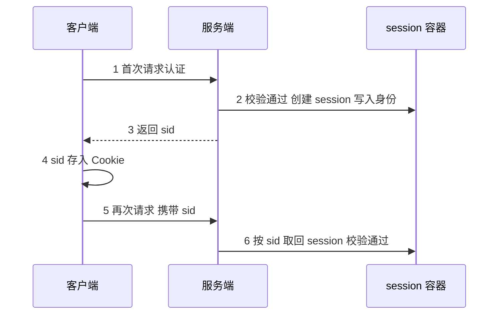
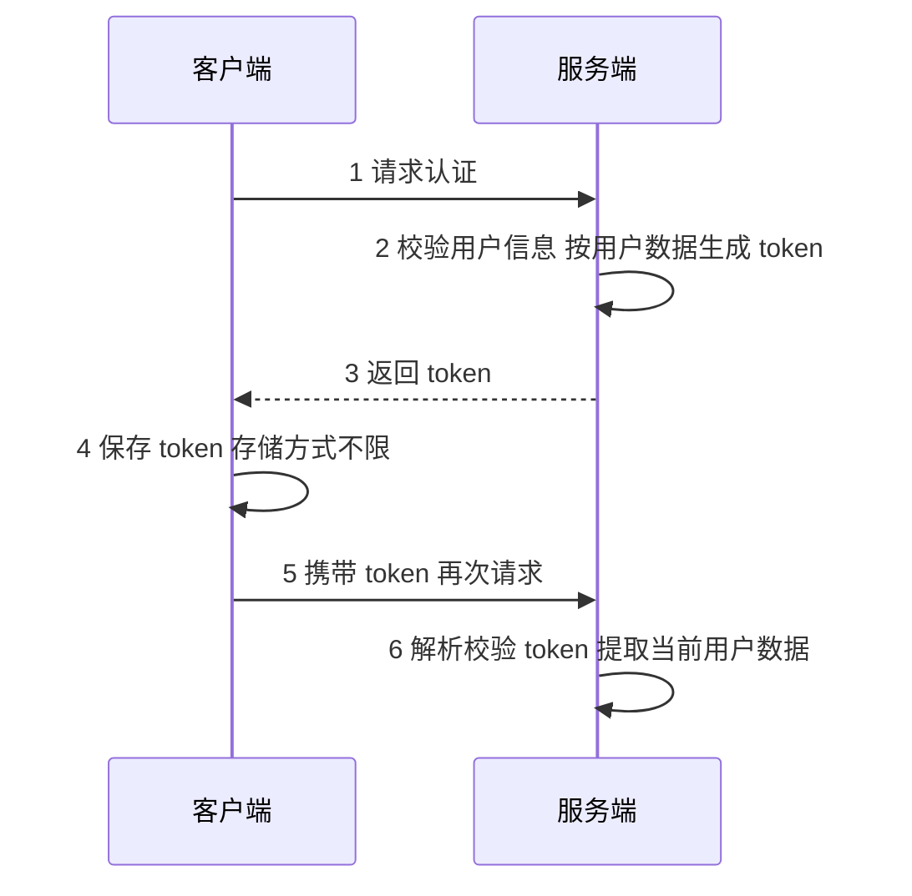

# 用户认证三件事：认证、会话、授权

对接 SaaS 完成后，商户平台的登录从模拟 token 换成了真实认证，但真实认证长什么样、令牌怎么用，得先把概念立起来。SaaS 系统承载的统一认证授权能力，正建立在这三个概念之上：认证判断你是谁，会话记住你已经登录，授权决定你能碰什么。概念不清，后面测登录、看令牌时只能看热闹。

## 先给结论

- 认证是判断用户身份是否合法的过程，合法放行访问资源，不合法拒绝；账号密码、二维码、手机短信、指纹都是认证方式。
- 会话是系统为保持用户登录状态提供的机制，目的是认证通过后不必每次操作都重新认证，常见实现有基于 session 与基于 token 两种。
- 基于 session 的方式服务端存会话、客户端凭 sid 认人，依赖 Cookie，由 Servlet 规范定制；基于 token 的方式服务端不存会话，身份信息装进令牌交给客户端自己保管。
- 移动互联网时代客户端种类繁多、系统多为前后端分离，token 不挑客户端也不挑存储方式，是更合身的选择。
- 授权在认证通过之后发生，按用户权限控制资源访问，没有权限照样拒绝，认证管合法性，授权管能不能碰。

## 认证：系统凭什么放行

刷手机的人每天都在经历认证：初次使用一个应用要先注册成为用户，之后输入账号和密码登录，这个输入与校验的过程就是认证。系统要校验的是提交的账号密码是否正确、身份是否合法，合法才能访问系统资源，不合法一律拒绝。

系统为什么非要认证不可，答案落在资源保护上。每个系统都有自己的隐私数据与业务资源，如果任何人都无需证明身份就能读取，数据安全无从谈起。认证是资源保护的第一道闸门。方式上账号密码只是最常见的一种，扫码登录靠设备绑定确认身份，短信登录靠手机号持有者身份，指纹认证靠生物特征，形式不同，回答的都是同一个问题：来者是谁，可不可信。

## 会话：认证一次，持续有效

认证通过的用户不可能每个操作都重新输一遍密码，系统需要一个机制把「这个人已经认证过了」记下来，这就是会话。会话保存的正是认证通过后的身份信息，它把一次性的认证动作延伸成一段持续的登录状态。常见的会话机制有两种，差别在于这份状态存在谁那里。

**基于 session 的方式，状态存在服务端。** 用户首次请求，服务端校验通过后在内存里创建 session 并写入身份信息，同时把这个会话的标识 sid 返回给客户端；客户端把 sid 存进 Cookie，之后每次请求都带上它，服务端拿 sid 到 session 容器里找会话，找到即认为已认证：



这套机制由 Servlet 规范定制，Java 开发者最早在 Servlet 与 JSP 时代用的就是它。用代码表达其核心动作（示例为按本课写法补全）：

```java
// 示例：Servlet 容器中的会话保存（按本课写法补全）
HttpSession session = request.getSession();   // 首次访问创建 session
session.setAttribute("user", "zhangsan");     // 认证通过后写入身份信息
String sid = session.getId();                 // sid 返回客户端 存入 Cookie
```

**基于 token 的方式，状态交给客户端。** 用户请求认证，服务端校验通过后生成一个 token 令牌，身份信息就装在令牌里，服务端自己不存会话，直接把令牌返回；客户端把它存下来（存哪里服务端不管），之后每次请求携带 token，服务端解析校验令牌即可确认身份：



token 本质上是一串字符串，内容是把谁的信息写进去都行。张三登录成功，把张三的账号、用户名这类基本信息编进令牌，服务端拿到令牌一解析就知道是谁在访问。一个自包含的令牌负载大致长这样（示例为按主流 JWT 负载写法补全，项目实际令牌结构在后续令牌课程展开）：

```json
{
  "username": "zhangsan",
  "mobile": "13300000000",
  "authorities": ["ROLE_MERCHANT"],
  "exp": 1606354316
}
```

两种方式的分野在于服务端要不要存状态。session 方式服务端保存会话数据，占内存、便于在服务端控制会话生命周期，安全性相对高，但客户端必须支持 Cookie，Cookie 还带跨域限制；token 方式服务端无状态，客户端是浏览器就放 Cookie，是 App 就放本地存储，不限制客户端类型，也不受 Cookie 跨域约束。如今客户端种类繁多、前后端分离成为常态，token 方式因此成为主流推荐。

## 授权：认证之后还有一道闸

登录成功不等于什么都能干。微信登录后可以发红包、发朋友圈、加好友，但没有绑定银行卡的用户发不了红包，因为发红包要扣钱，没有银行卡无从扣款，系统就是不给你这个功能。发红包、发朋友圈这些功能都是系统的资源，拥有发红包的权限才能用发红包功能，这个按权限控制用户使用资源的过程就是授权。

授权发生在认证之后：认证回答「你是谁，可不可信」，授权回答「你可以访问哪些资源」。它存在的意义是对隐私数据做更细粒度的划分，让不同用户看到不同资源，拥有访问权限的正常访问，没有权限的拒绝访问。认证与授权合在一起，构成系统资源保护的完整闸门。

## 落到项目：认证能力在统一账号服务

概念落到聚合支付平台，位置很明确：统一认证授权由 SaaS 系统承担。统一账号服务暴露认证接口，校验登录请求的身份信息，校验通过返回账号信息，随后由统一认证服务签发令牌：

```java
/**
 * 用户认证
 * @param authenticationInfo 认证请求信息
 * @return 认证成功的账号信息
 */
AccountDTO authentication(AuthenticationInfo authenticationInfo) throws BusinessException;
```

商户平台后续接入登录时，前端把账号密码提交给统一认证服务，统一认证服务调用这个接口完成身份校验，再按平台统一的认证协议生成令牌交给客户端，客户端此后携带令牌访问商户平台各接口。前两节讲的概念，在这条链路里各就各位：authentication 对应认证，签发的令牌对应会话状态，令牌里携带的权限信息对应授权依据。

## 常见误区

- **把会话和认证混为一谈。** 错例：认为用户登录着就等于会话在做认证。正解：认证是校验身份的一次性动作，会话是认证通过后维持登录状态的机制，会话建立的前提是认证已经通过。
- **以为 token 也必须存在服务端。** 错例：按 session 的思路找服务端里的 token 存储，找不到就怀疑实现有问题。正解：token 方式的要点恰是服务端一般不存会话，身份信息自包含在令牌中，服务端解析校验即可。
- **以为登录成功就能访问一切。** 错例：拿到合法身份后直接调管理接口，返回无权限又以为是 bug。正解：认证只保证身份合法，能不能访问具体资源由授权决定，授权在认证通过后按权限逐项校验。
- **把 Cookie 等同于 session。** 错例：清了 Cookie 就以为 session 还在别处生效。正解：session 存在服务端，Cookie 里只是 sid 这把钥匙，钥匙失效或丢失，服务端的会话就认不出人。

## 面试可能被问到的问题

1. 面试官追问：「基于 session 和基于 token 的认证，核心区别是什么？」
   答：状态存在谁那里。session 方式服务端保存会话数据，客户端凭 Cookie 里的 sid 认人；token 方式服务端一般不存会话，身份信息自包含在令牌里交给客户端保存，服务端解析校验令牌即可确认身份。前者便于服务端控制会话，后者无状态、利于水平扩展与多端接入。
2. 面试官追问：「为什么移动互联网时代推荐 token 方式？」
   答：客户端种类爆炸式增长，浏览器、App、平板、小程序都要接入同一套认证。session 机制基于 Cookie，在非浏览器客户端上不好使，且由 Servlet 规范定制、绑定服务端容器；token 对存储位置和客户端类型都不挑，天然适配前后端分离与多端统一认证。
3. 面试官追问：「认证和授权的关系是什么？」
   答：认证在前，授权在后。认证判断身份是否合法，是访问资源的门票；授权在认证通过后按用户权限控制具体资源的访问，做更细粒度的划分。没有认证，授权无从谈起；只有认证没有授权，登录者会拿到超出其职责范围的全部资源。
4. 面试官追问：「session 方式里，服务端是怎么认出请求来自哪个用户的？」
   答：认证通过时服务端创建 session 并把会话标识 sid 返回客户端，客户端存入 Cookie，之后每次请求自动携带 sid；服务端以 sid 为键到 session 容器里取回会话，会话里保存着用户身份信息，取到即认人成功，取不到就要求重新认证。
5. 面试官追问：「聚合支付项目里认证能力放在哪，为什么不放在商户平台？」
   答：认证、授权、账号管理是所有系统的通用能力，沉淀在 SaaS 系统的统一账号服务与统一认证服务里，商户平台只做对接消费。登录请求由统一认证服务处理，身份校验落到统一账号服务的 authentication 接口，令牌统一签发，这样内部应用与后续接入方都用同一套认证机制。

## 配套资料

- 讲义：`materials/docs/10/闪聚支付-第2章-讲义-对接SaaSv1.0.md`，2.1 基本概念之 2.1.1 什么是认证、2.1.2 什么是会话（基于 session 与基于 token 的交互流程）、2.1.3 什么是授权为本课出处。
- 代码：`materials/code/10/代码/`，SaaS 统一账号服务 API 工程 `TenantService.java` 中的 authentication 认证接口为真实文件（内层目录为课程原始命名，路径列至该目录层级）。
- 说明：该阶段课程资料归档在 `materials/docs/10/` 与 `materials/code/10/`（不存在 09 编号目录）；本课为概念课，Servlet 会话示例按本课写法补全，token 负载 JSON 按主流 JWT 写法补全，均为示例而非课程源码；项目实际令牌结构与签发流程由后续认证课程展开。
