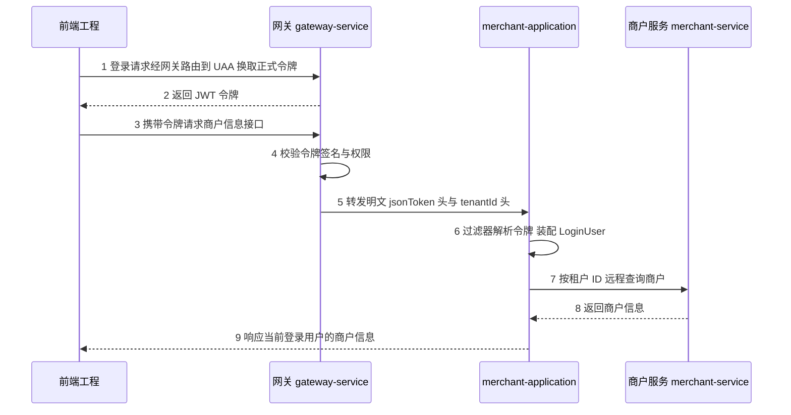

# 前后端集成测试前期准备：从 Postman 自测切换到正式令牌联调

> 🔒 安全提示：文中示例的口令/密钥均为课程教学环境演示口径，生产环境的安全要求见《安全与合规须知》。

商户注册、资质申请、支付参数配置这些功能，服务端一路是用 Postman 自测的，令牌是工具类伪造的临时 token，应付接口级验证没问题。现在前端工程要接进来了：真实用户从前端登录，走 SaaS 统一认证拿正式令牌，伪造的令牌糊弄不过去。集成测试开工之前，服务端要先把三件事补齐，再把该起的服务起起来。

## 先给结论

- 前后端集成测试，就是双方按接口文档各自开发完成后，把前端工程与服务端工程都部署起来，把全部业务功能与流程集中过一遍。
- 准备工作三件事：补「获取当前登录用户的商户信息」接口、替换解析令牌的工具类、新增按租户 ID 查询商户的接口。
- 正式令牌链路：前端登录 UAA 拿令牌，网关校验后向微服务转发明文 jsonToken 与租户 ID，微服务的过滤器解析出登录用户，再由工具类换取商户身份。
- 工具类替换只动四个类：`SecurityUtil`、`LoginUser`、`ApplicationContextHelper` 拷入商户平台应用，`TokenAuthenticationFilter` 拷入 common 工程；业务接口里取商户 ID 的调用代码一行不用改。
- 需要启动的服务：基础设施 Nacos、MySQL、Redis，加网关 `gateway-service`（56010）、统一认证 `uaa-service`（56020）、统一账号 `user-service`（56030）、商户平台应用 `merchant-application`（57010）。
- 前端工程是 Vue 2 加 TypeScript 加 Element UI 的单页应用，`npm install` 装依赖，`npm run serve` 启动开发服务器。

## 集成测试要测什么

前后端分离开发的协作方式是：前端工程师与服务端工程师按接口文档约定，各自开发各自的功能；一个完整模块或系统开发完成后，双方在约定时间集中做集成测试，把前端工程和服务端工程都部署起来，测试开发的所有业务功能和业务流程。

此前的测试只覆盖了服务端一侧：每个接口用 Postman 打一遍，验证服务端接收与处理正确。集成测试补上了另一半，由前端发起真实请求，从登录开始把整条链路走通。登录成功后前端第一件要做的事，是展示当前登录用户的信息，这需要服务端提供「获取当前登录用户的商户信息」接口，这正是要补的第一个接口。

## 补接口：获取当前登录用户的商户信息

接口定义在商户平台应用（服务名 `merchant-application`）的 Controller 层，对外暴露 HTTP，GET 方式，路径 `/my/merchants`，没有参数。当前用户是谁，不从请求参数里来，从令牌里来（节选自工程源码，包名按本系列口径改写）：

```java
@ApiOperation("获取登录用户的商户信息")
@GetMapping(value = "/my/merchants")
public MerchantDTO getMyMerchantInfo() {
    // 从 token 中提取商户 id
    Long merchantId = SecurityUtil.getMerchantId();
    return merchantService.queryMerchantById(merchantId);
}
```

Controller 只做两件事：调工具类从令牌取商户 ID，再按 ID 查商户。查询逻辑落在商户服务（`merchant-service`）的 Service 层，这个接口此前已经实现过，把实体经 MapStruct 转成 DTO 返回即可：

```java
@Override
public MerchantDTO queryMerchantById(Long id) {
    Merchant merchant = merchantMapper.selectById(id);
    return MerchantConvert.INSTANCE.entity2dto(merchant);
}
```

接口本身简单，真正的分量在 `SecurityUtil.getMerchantId()` 这一行背后：它要从正式令牌里解析出商户身份，而解析逻辑整个换掉了。

## 替换令牌解析：从伪造令牌到正式令牌

之前的令牌是测试工具类伪造的，`SecurityUtil` 的旧实现直接从请求头里解出商户 ID。接入 SaaS 之后，用户经前端登录 UAA 认证中心拿到的是正式令牌，链路完全变了：



替换涉及四个类，都是授课资料里准备好的成品。**第一个是 `LoginUser`**，令牌明文的载体，字段包括账号、手机号、客户端标识、payload 权限集合，还有本项目最关心的 `tenantId`（节选自工程源码）：

```java
@Data
public class LoginUser {
    private String mobile;
    private Map<String, Object> payload = new HashMap<>();
    private String clientId;
    private String username;
    private Long tenantId;
}
```

**第二个是 `ApplicationContextHelper`**，Spring 上下文工具。它存在的原因很实际：`SecurityUtil` 是静态工具类，注入不进 Dubbo 服务引用，查商户只能通过它从容器里按类型取 bean。

**第三个是 `SecurityUtil` 本体。** 新实现里，`getUser()` 从请求属性中取过滤器装配好的 `LoginUser`，`getMerchantId()` 的逻辑从「直接解析商户 ID」改成「先拿租户 ID，再换商户 ID」：

```java
public static Long getMerchantId() {
    MerchantService merchantService = ApplicationContextHelper.getBean(MerchantService.class);
    MerchantDTO merchant = merchantService.queryMerchantByTenantId(getUser().getTenantId());
    Long merchantId = null;
    if (merchant != null) {
        merchantId = merchant.getId();
    }
    return merchantId;
}
```

为什么是租户 ID？商户在 SaaS 平台的对应物就是租户，用户经 SaaS 登录后，令牌与请求头里携带的是租户 ID，商户 ID 得靠查询换回来。**第四个是 `TokenAuthenticationFilter`**，拷入 common 工程供各微服务复用。它继承 `OncePerRequestFilter`，每个请求进来先过它：静态资源、Swagger 文档、商户注册、验证码这类免登录路径直接放行；其余请求校验网关传来的 `jsonToken` 头，Base64 解码后取出租户对应的权限信息，装配成 `LoginUser` 放进请求属性，权限缺失或租户信息不符就带着 999911、999913 这类错误码直接响应（节选自工程源码）：

```java
// 1.校验 jsontoken（网关给后端微服务传的令牌）
String jsonToken = httpServletRequest.getHeader("jsonToken");
if (StringUtils.isBlank(jsonToken)) {
    responseMessage(999911, "调用微服务-没有jsontoken令牌", httpServletRequest, httpServletResponse);
    return;
}
// 2.解码并装配当前登录用户
LoginUser loginUser = SecurityUtil.convertTokenToLoginUser(jsonToken);
String tenantId = httpServletRequest.getHeader("tenantId");
if (StringUtils.isNotBlank(tenantId)) {
    loginUser.setTenantId(Long.parseLong(tenantId));
}
httpServletRequest.setAttribute("jsonToken", loginUser);
```

替换完成后有个值得点出的好处：各业务接口里「从令牌取商户 ID」的调用代码一行没动，变的只是工具类内部实现，接口层对令牌方案的更替完全无感。

## 新增接口：按租户 ID 查商户

`getMerchantId()` 依赖的 `queryMerchantByTenantId` 是这次要补的第三个准备项。它能成立，靠的是商户注册时埋下的一笔：注册流程调用 SaaS 接口创建租户后，把返回的租户 ID 存进了商户表的 `tenant_id` 字段。现在反向查询即可（节选自工程源码）：

```java
@Override
public MerchantDTO queryMerchantByTenantId(Long tenantId) {
    Merchant merchant = merchantMapper.selectOne(
            new LambdaQueryWrapper<Merchant>().eq(Merchant::getTenantId, tenantId));
    return MerchantConvert.INSTANCE.entity2dto(merchant);
}
```

用 MyBatis-Plus 的条件构造器按租户 ID 匹配商户表，查到后照例经 `MerchantConvert` 转成 DTO。到这里，三件准备工作全部就位：一个面向前端的查询接口、一套解析正式令牌的工具类、一条从租户 ID 到商户 ID 的查询路径。

## 启动与检查清单

部署前端之前，先把服务端环境起齐。按依赖顺序过一遍清单：

```text
基础设施
  Nacos        127.0.0.1:8848     配置中心与服务发现
  MySQL        root/123456        pay_uaa / pay_user / pay_merchant_service 三库就绪
  Redis        密码 123456        验证码服务依赖
服务（IDEA 内逐个启动）
  gateway-service        56010   统一入口，校验令牌并转发
  uaa-service            56020   统一认证，签发与校验令牌
  user-service           56030   统一账号，登录时校验账号密码
  merchant-application   57010   商户平台应用，前端请求的落点
前端工程
  npm install                    依赖 Vue 2、TypeScript、Element UI、vue-router、vuex、axios 等
  npm run serve                  启动开发服务器，请求统一走网关
```

核对项集中在配置一致性上：各工程 `bootstrap.yml` 的 namespace 与 Nacos 控制台一致；Nacos 上 `jwt.yaml` 的签名密钥（example-signing-key）对网关与统一认证同时生效，两边不一致令牌校验必挂；统一认证库 `oauth_client_details` 里有商户平台客户端的登记数据；准备一个此前注册过、能正常登录的商户账号。服务端的验证方式沿用老办法：Nacos 服务列表能看到四个服务实例即视为就绪。前端工程的启动留给下一课，届时登录、令牌、商户信息查询会在真实页面里连成一条线。

## 常见误区

- **只替换工具类，漏拷过滤器。** 错例：`SecurityUtil` 换了新实现，`TokenAuthenticationFilter` 没拷，请求进来无人解析令牌，接口报没有 jsontoken 令牌。正解：四个类是一套，工具类与过滤器同步替换，过滤器还要注册在 common 工程里被各微服务扫描到。
- **继续拿伪造令牌联调。** 错例：用旧的测试工具类生成 token 塞进请求头。正解：正式链路下请求应从登录接口走起，拿 UAA 签发的真实令牌；伪造令牌经网关校验后下发的权限信息对不上，会触发权限相关错误码。
- **租户 ID 与商户 ID 混用。** 错例：拿令牌里的租户 ID 直接当商户 ID 去查商户表主键。正解：令牌携带的是 SaaS 侧的租户 ID，商户 ID 必须通过商户表 `tenant_id` 字段反查得到，两者是不同实体。
- **前端直连微服务端口。** 错例：前端把请求地址配成 57010 直打商户平台应用。正解：前端统一请求网关 56010，按 `/merchant/**` 等路由转发，令牌校验与令牌转发都发生在网关层，绕过网关链路就断了。

## 面试可能被问到的问题

1. 面试官追问：「前后端分离项目怎么做集成测试？」
   答：开发阶段双方按接口文档并行开发，接口级验证用 Postman 即可；模块完成后把前端工程与服务端工程都部署起来，从真实用户操作入口把登录、查询、提交等完整流程走一遍，重点验证接口约定、鉴权链路与数据流转在真实请求下是否成立。
2. 面试官追问：「从伪造令牌切到正式令牌，为什么要替换整组工具类？」
   答：伪造令牌只在服务端本地解析，正式令牌由统一认证签发、网关校验后以明文转发，二者携带的内容与到达方式都不同。解析入口、用户载体、按租户反查商户的路径都要跟着变，而通过保持工具类方法签名不变，业务代码无需改动。
3. 面试官追问：「网关为什么把明文令牌再传给微服务，而不是只转发原始令牌？」
   答：网关已经完成签名校验，解出的明文含用户身份、租户与权限，微服务直接消费即可，不必每个服务都集成 JWT 验签逻辑。明文随内网请求头传递，配合过滤器解析成用户对象，微服务拿到的就是即用的身份上下文。
4. 面试官追问：「静态工具类里怎么拿到 Spring 容器里的 bean？」
   答：实现 ApplicationContextAware 接口，容器启动时把上下文写入静态字段，之后用 getBean 按类型或名称获取。项目中 SecurityUtil 这类静态工具需要调用 Dubbo 服务，就用这个辅助类做桥接，它也随工具组一起拷入了商户平台应用。
5. 面试官追问：「集成测试前你的检查清单会列哪些项？」
   答：基础设施三件（Nacos、MySQL 各库、Redis）就绪；四个服务启动成功并在 Nacos 服务列表可见；各工程 namespace 与 Nacos 一致；jwt.yaml 签名密钥对网关与认证服务一致；客户端凭据表数据在位；有一个可登录的测试账号；前端依赖安装完成且请求地址指向网关。配置一致性问题在这一步全部排除，联调时才不会被环境问题干扰。

## 配套资料

- 代码：`materials/code/10/完整代码/`，商户平台应用与商户服务工程中 `MerchantController.java`、`MerchantServiceImpl.java`（queryMerchantById 与 queryMerchantByTenantId）、`SecurityUtil.java`、`LoginUser.java`、`ApplicationContextHelper.java`、`TokenAuthenticationFilter.java`、`bootstrap.yml` 为真实文件；`materials/code/10/_散落资料/`，授课资料单独提供的令牌解析替换类（SecurityUtil、LoginUser、ApplicationContextHelper、TokenAuthenticationFilter）在该目录内层，文件名为课程原始命名，不在此展开。
- 前端：`materials/code/10/前端代码/`，商户平台前端工程（`package.json`、`src/api`、`src/router` 等为真实文件，内层目录为课程原始命名，路径列至该目录层级）。
- 说明：该阶段课程资料归档在 `materials/docs/10/` 与 `materials/code/10/`（不存在 09 编号目录），本课讲义未在归档资料中，小节标题按画面线整理；包名与模块名按 `com.study.pay`、`pay-merchant-*` 口径改写，库名写作 `pay_merchant_service`，签名密钥与 namespace 为示例占位，服务端口取自各工程 `bootstrap.yml` 真实配置。
