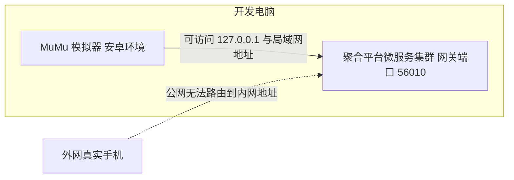

# 测试环境准备：用安卓模拟器把沙箱支付宝装到开发机上

> 🔒 安全提示：文中示例的口令/密钥均为课程教学环境演示口径，生产环境的安全要求见《安全与合规须知》。

沙箱环境配好了，密钥、网关、买家账号都齐了，但要真正跑一遍扫码支付还缺一个环节：得有一个能装支付宝沙箱客户端、能扫门店二维码的「手机」。开发阶段平台服务全部跑在本机，二维码地址是内网地址，拿着自己的真手机在外网扫，请求根本到不了开发机。方案是在电脑上装一个安卓模拟器，模拟器与开发机共享网络，天然能访问本机服务；再把沙箱版支付宝装进模拟器，扫码链路就通了。这一课完成模拟器安装、沙箱客户端安装与登录，并给出环境就绪的判据。

## 先给结论

- 测试必须用模拟器的根因是网络可达性：平台服务在内网，真实手机在外网扫不到，模拟器跑在本机，访问局域网地址没有障碍。
- 选用 MuMu 模拟器，资料包内提供安装包；安装目录不能含中文与空格，这是安装时唯一要特别留意的坑。
- 模拟器里装应用有两条路：直接安装 APK 包，或进应用中心联网安装；本项目用 APK 方式装沙箱版支付宝，微信后续集成时再装。
- 登录沙箱客户端必须用沙箱买家账号，真实账号在沙箱环境里没有资金账户。
- 模拟器不支持调摄像头扫码，扫一扫功能里从相册选图完成扫码，这个交互习惯要提前知道。
- 就绪判据四条：模拟器启动正常、沙箱客户端登录成功、网关端口可通、支付入口地址在模拟器浏览器可达。

## 为什么真手机不行，模拟器行

把扫码支付链路里「扫」这个动作拆开看：顾客用支付宝扫二维码，本质是支付宝客户端解析出码里的 URL 并发起 HTTP 请求。项目设想里，这个 URL 指向闪聚支付平台，顾客一扫就是请求平台服务。开发期平台服务在哪？全在本机：网关、商户服务、交易服务跑在开发电脑上，对外暴露的是 `127.0.0.1` 或局域网 IP 这类内网地址。

用真实手机测试时，手机连的是外网或另一张局域网，它发起的请求对着一个外网不可路由的内网地址，必然超时。有人会想到改 hosts、端口映射，但那是在为测试做额外运维，得不偿失。模拟器的思路直接绕开了问题：模拟器是跑在开发机上的一个安卓环境，与开发机同处一个网络命名空间，它访问 `127.0.0.1` 或局域网地址与开发机自己访问没有区别。网络关系如下图：



实线这条通路就是选模拟器的全部理由：模拟器里的支付宝客户端扫了码，请求能直接落到本机跑的服务上。后面调试支付入口、确认页、下单接口，全靠这条通路。

## 安装模拟器：一步到位，但目录有讲究

模拟器选型取 MuMu 模拟器，资料包里提供了安装包（版本号形如 `MuMuInstaller_1.1.8.4` 的 Windows 安装程序），官网按 Windows 或 Mac 对应版本自行下载也可以。安装过程一路下一步，唯一要强调的约束是安装路径：目录里不要有中文和空格。安卓模拟器内部会创建虚拟机镜像并执行一系列底层脚本，含中文或空格的路径会让启动阶段出现各种难排查的报错，装在类似 `D:\MuMu` 这样的纯英文路径最稳妥。

安装成功后启动，看到的是类似手机桌面的界面：图库、应用中心、截屏等一应俱全，跟操作一部安卓手机没有本质差别。往里装应用有两条路：一条是应用中心联网安装，像应用商店一样搜到什么装什么；另一条是直接安装 APK 包。本项目要装的沙箱版支付宝不在任何应用商店里，只能走 APK 这条路。

## 装沙箱版支付宝：两个 APK 里先装哪个

资料包里备好了两个 APK 安装包，一个是微信，一个是支付宝沙箱版本（文件名形如 `release_201812261416.apk`）。本阶段的对接对象是支付宝，先装支付宝；微信在后续做微信支付集成时装。安装方式与手机上装 App 一样：把 APK 拖进模拟器或通过安装入口选择资料包里的文件，安装完成后桌面上出现支付宝图标。

登录是下一个关键动作。点开支付宝，首次启动会要求登录，这里必须用沙箱环境的买家账号，账号与密码在上一课配置的沙箱账号页面查看（买家账号的登录名以 `@sandbox.com` 结尾，直接从控制台复制）。用真实支付宝账号登录是无效的，沙箱环境里没有它的资金账户。登录成功后，这个客户端就具备了两项能力：连着沙箱环境，可以完成假数据的付款；能发起扫一扫，可以扫门店二维码。

## 扫码的替代动作与环境就绪判据

还有个小细节要提前适应：模拟器没有摄像头，支付宝的扫一扫打开后无法对准屏幕外的实物拍照扫码。实际测试时用的是相册选图方式：先把二维码图片存进模拟器相册，再在扫一扫功能里从相册选择该图片，客户端解析出 URL 并发起请求，效果与摄像头扫码一致。这个交互贯穿后续所有扫码测试。

环境是否就绪，按四条判据逐项验收。前两条是模拟器侧的：模拟器启动进入桌面无报错，沙箱版支付宝能用买家账号登录到主界面。后两条是网络侧的，可以在开发机命令行里直接验证：

```bash
# 查看本机局域网 IP，二维码中的支付入口地址要用这个地址或 127.0.0.1
ipconfig

# 验证网关端口可通，56010 是网关端口，transaction 是交易服务的路由前缀
curl -I http://127.0.0.1:56010/transaction/pay-entry/
```

`curl` 有响应（哪怕返回 404 或 500）说明网关到交易服务的链路已经通了，模拟器内的客户端只要访问同一地址就没有网络障碍。交易服务的支付入口地址来自配置中心，在 Nacos 的交易服务配置里定义（按本系列口径改写前缀，示例为按本课写法补全的配置结构）：

```yaml
# 交易服务配置：支付入口 url
pay:
  payurl: "http://127.0.0.1:56010/transaction/pay-entry/"
```

生成门店二维码时，平台就是拿这个前缀拼上编码后的订单参数，构成码里的完整 URL。模拟器浏览器里直接输入这个地址能看到页面渲染，说明判据四条全部满足，测试环境就绪，可以进入支付链路的真刀真枪调试。

## 常见误区

- **拿真手机扫内网二维码。** 错例：手机在外网对着屏幕上的码扫，请求超时还以为是服务没起来。正解：开发期二维码地址是内网地址，外网不可路由，用跑在本机的模拟器扫码。
- **模拟器装在含中文或空格的目录。** 错例：装到 `D:\软件\模拟器` 之类路径，启动报错且日志难以定位。正解：安装路径保持纯英文无空格，虚拟机镜像与脚本对路径敏感。
- **用真实支付宝账号登录沙箱客户端。** 错例：登录后看不到沙箱测试环境或付款失败。正解：沙箱客户端必须用沙箱买家账号，登录名以 `@sandbox.com` 结尾，从沙箱账号页复制。
- **执着于摄像头扫码。** 错例：模拟器扫一扫打开后对屏幕拍来拍去。正解：模拟器无摄像头，用相册选图的方式完成扫码，先把二维码图片保存进模拟器相册。

## 面试可能被问到的问题

1. 面试官追问：「开发阶段测试第三方支付回调或扫码跳转，怎么解决内外网不通的问题？」
   答：常见做法有三类：让调用方与被调方处在同一网络，如本项目用本机模拟器；用内网穿透工具把内网服务映射到公网域名；在测试环境部署到可公网访问的机器。支付对接里沙箱环境配合模拟器是最轻量的组合，不动运维配置就能跑通全链路。
2. 面试官追问：「为什么选模拟器而不是真机调试？」
   答：核心是网络可达性。平台服务跑在开发机，真实手机在外网，扫内网地址的二维码请求到不了服务；模拟器与开发机共享网络，`127.0.0.1` 与局域网地址都可直接访问，同时模拟器能安装渠道沙箱客户端，完整还原扫码付款的用户路径。
3. 面试官追问：「模拟器扫码没有摄像头怎么办？」
   答：用相册选图替代。先把二维码图片保存进模拟器相册，在客户端扫一扫功能里从相册选择图片，客户端解析图片中的码内容并发起请求，与摄像头扫码在解析环节完全一致。
4. 面试官追问：「沙箱版客户端和正式版客户端能共存吗？」
   答：能。沙箱版是独立的安装包，装在模拟器或测试机上与正式版互不干扰；关键约束是登录身份，沙箱版必须用沙箱账号登录，连接的是沙箱环境，资金为模拟数据，真实账号在沙箱里没有对应账户。
5. 面试官追问：「测试环境就绪的判据你怎么定？」
   答：按链路分段定。客户端侧：模拟器启动正常、沙箱客户端用买家账号登录成功；网络侧：网关端口可通、支付入口地址在模拟器内可达；数据侧：门店可生成二维码。四类都满足，扫码调试才不会把环境问题误判成代码问题。

## 配套资料

- 讲义：`materials/docs/10/闪聚支付-第3章-C扫Bv1.1.md`，4.3.3 接口测试（支付入口地址改为模拟器可访问的局域网地址、用模拟器运行支付宝沙箱 APP 扫描二维码）与本课操作出处；3.4.2.4 中交易服务支付入口配置为本课 YAML 示例结构来源。
- 代码：本课无新增源码改动，模拟器与沙箱客户端安装包由课程资料包提供；正文命令与 YAML 为按本课写法补全的示例。
- 说明：该阶段课程资料归档在 `materials/docs/10/` 与 `materials/code/10/`（不存在 09 编号目录），引用路径截至章目录与工程目录层级；课程环境的 MySQL 账号 root/123456，Redis 密码 123456；沙箱买家账号、安装包版本号以课堂现场为准，示例中不做真实账号引用。
