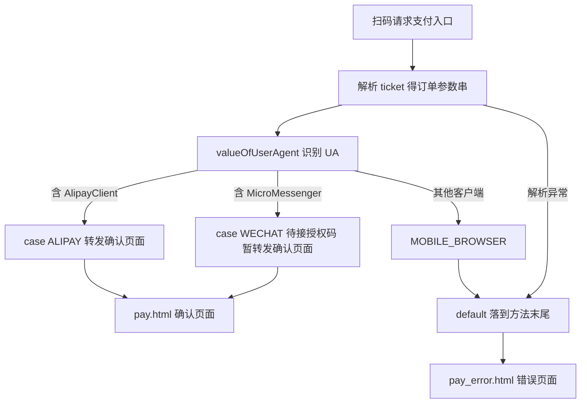

# 支付入口解析客户端类型：按 User-Agent 识别支付宝与微信，决定去确认页还是错误页

ticket 解析完成，确认页面能渲染，但整条 C 扫 B 的入口逻辑还缺最后一环：同一个入口 URL，微信扫进来的用户和支付宝扫进来的用户，后续要走的支付流程完全不同，微信甚至要先拿授权码换 openId 才能下单。入口必须先回答「扫码的人用的是哪个客户端」，再决定把请求引向哪里。这一课把这件事补上：一个记录客户端类型的枚举、一个从 User-Agent 特征串映射枚举的静态方法、一段 switch 分流，外加一个兜底的错误页面。代码不长，价值在于想清楚「为什么在入口处分流」。

## 先给结论

- 客户端类型用枚举 `BrowserType` 表达，四个值：`ALIPAY`、`WECHAT`、`PC_BROWSER`、`MOBILE_BROWSER`，枚举类放进交易服务的 controller 包。
- 识别依据是 HTTP 请求头 `user-agent`：内含 `AlipayClient` 判为支付宝，内含 `MicroMessenger` 判为微信，其余一律归入 `MOBILE_BROWSER`。
- `payEntry` 在解析 ticket 之后增加 switch 分流：支付宝转发确认页面，微信的授权码环节后续再接（当前同样先转发确认页），default 分支转发错误页面 `pay_error`。
- 分流的意义在于两条渠道的下单流程不同：支付宝可直接调手机网站支付下单，微信必须先获取授权码申请 openId，入口处的分支就是后续两条对接链路的分叉点。
- 测试要过两道：浏览器直接访问入口必须落到错误页，用模拟器里的支付宝沙箱客户端扫码才能进入确认页；为此支付入口前缀要从本机回环地址改成局域网地址。

## 入口为什么要识别客户端

回看支付入口现在干的事：解析 ticket、还原订单要素、转发确认页面。这条路径对所有扫码者一视同仁，看起来已经闭环了。问题出在确认页之后。C 扫 B 的下单动作由平台代用户向支付渠道发起，而支付宝与微信两家渠道的下单流程并不对称：支付宝的手机网站支付接口拿到订单参数就能下单，返回一张拉起收银台的表单；微信的 JSAPI 支付在下单之前必须先拿到付款用户的 openId，而 openId 要通过网页授权流程（先取授权码、再换 openId）才能获得。两条链路从第一步起就不同，入口如果不区分客户端，后面的代码无从写起。

分流点放在入口还有一层含义：客户端类型此刻的信息最全。用户刚刚扫码，请求头里带着浏览器环境，入口是唯一一个必然能同时看到 ticket 与请求头的位置；等转发到确认页面再想判断，请求参数里已经没有 UA 可用了。所以入口的职责清单是两项：解析 ticket 准备数据，解析客户端类型决定去向，缺一不可。

客户端是哪家的，谁说了算？渠道官方在内嵌浏览器的 User-Agent 里埋了自己的特征串。用支付宝客户端扫一扫打开网页，请求头 UA 会包含 `AlipayClient`；用微信内置浏览器打开，UA 会包含 `MicroMessenger`。这两个特征串是业界通用的识别依据，稳定且官方维护。至于普通手机浏览器与 PC 浏览器，它们既不会拉起支付收银台，也不该被引导到支付流程，归为一类兜底处理即可。

## BrowserType 枚举与 UA 映射

客户端类型在系统里是一个基础数据，用枚举承载最合适。资料提供 `BrowserType.java`，拷入交易服务 controller 包：

```java
package com.study.pay.transaction.controller;

/**
 * 浏览器类型
 */
public enum BrowserType {
    ALIPAY,//支付宝
    WECHAT,//微信
    PC_BROWSER,//pc端浏览器
    MOBILE_BROWSER; //手机端浏览器

    /**
     * 根据UA获取浏览器类型
     * @param userAgent userAgent
     * @return 浏览器类型
     */
    public static BrowserType valueOfUserAgent(String userAgent) {
        if (userAgent != null && userAgent.contains("AlipayClient")) {
            return BrowserType.ALIPAY;
        }else if (userAgent != null && userAgent.contains("MicroMessenger")) {
            return BrowserType.WECHAT;
        }else{
            return BrowserType.MOBILE_BROWSER;
        }
    }
}
```

四个枚举值把客户端世界一分为四，映射逻辑全收在静态方法 `valueOfUserAgent` 里。读这段代码有三个点值得留意。**第一，判空在前。** `userAgent != null` 的判断写在 `contains` 之前，UA 头缺失的请求直接落到 `MOBILE_BROWSER`，不会抛空指针；映射方法自己处理边界，调用方就不必先判空再调用。**第二，两个特征串是渠道的官方标识。** `AlipayClient` 与 `MicroMessenger` 不是随手挑的子串，它们分别是支付宝与微信内嵌浏览器 UA 的固定片段，用它们判断比按浏览器名称猜测可靠得多。**第三，else 分支不是返回 null。** 识别不出来的客户端统一归入 `MOBILE_BROWSER`，调用方拿到的永远是一个有效枚举值，switch 里不需要再处理 null，这种「永远有答案」的设计让映射方法可以被放心调用。

UA 到底长什么样，亲眼看一遍比背结论有用。浏览器发起任何请求，请求头里都带着 `user-agent`，Chrome 开发者工具的 Network 面板点开任意一条请求就能看到；开启手机设备模拟后，UA 会变成移动端形态，其中出现 `iPhone` 一类字样，模拟的正是一台手机的浏览器环境。将来在模拟器里用支付宝扫码，UA 里就会出现 `AlipayClient`，识别逻辑随即生效。

## payEntry 的分流改造

枚举就位，改 `PayController` 的入口方法。在解析 ticket 得到参数串之后插入客户端判断，整段方法用 try/catch 包住，任何一步失败都统一送错误页：

```java
@RequestMapping("/pay-entry/{ticket}")
public String payEntry(@PathVariable("ticket") String ticket, HttpServletRequest request) throws Exception {
    try {
        //将ticket的base64还原
        String ticketStr = EncryptUtil.decodeUTF8StringBase64(ticket);
        //将ticket（json）转成对象
        PayOrderDTO order = JSON.parseObject(ticketStr, PayOrderDTO.class);
        //将对象转成url格式
        String params = ParseURLPairUtil.parseURLPair(order);
        //解析客户端的类型（微信、支付宝）
        BrowserType browserType = BrowserType.valueOfUserAgent(request.getHeader("user-agent"));
        switch (browserType) {
            case ALIPAY:
                //支付宝扫码，转发到确认页面
                return "forward:/pay-page?" + params;
            case WECHAT:
                //微信需先获取授权码申请openId，此环节待实现，当前先转发确认页面
                return "forward:/pay-page?" + params;
            default:
        }
    } catch (Exception e) {
        e.printStackTrace();
        log.error(e.getMessage(), e);
    }
    //不支持客户端类型，转发到错误页面
    return "forward:/pay-page-error";
}
```

与上一课的版本对比，变化有三处。**第一，拿到了请求头。** 方法签名里早就有 `HttpServletRequest request`，之前一直没用上，此刻 `request.getHeader("user-agent")` 把 UA 取出来交给枚举映射，参数预备得恰到好处。**第二，switch 三个出口。** `ALIPAY` 与 `WECHAT` 目前都转发确认页面，区别在于注释里写明的规划：微信分支将来要换成「先获取授权码、申请 openId、再进确认页面」的完整链路，等对接微信时实现；`default` 分支故意留空不返回，代码落到方法末尾统一转发错误页，这样 switch 之外只写一份错误出口，三个「不该发生」的路径（异常、空 UA、未识别类型）全部汇到同一处。**第三，try/catch 收口。** ticket 非法、JSON 解析失败、反射拼接出错，任何异常都不再向外抛，而是记日志后送错误页。入口是面向公网的门面，把异常翻译成用户能理解的页面，比让用户看到堆栈体面得多。

错误页面本身此前已经备好，`templates` 目录下的 `pay_error.html`：

```html
<div class="content">
    订单错误！<br/>
    请使用微信或支付宝重新扫码。
</div>
```

页面文案直接告诉用户该怎么办。FreeMarker 视图按名称解析，`forward:/pay-page-error` 转发后渲染的就是这份模板，无需额外代码。



图上三条去向一目了然：两条渠道进确认页（微信的完整链路后续补上），其余一切路径进错误页。真正的分叉在确认页之后才会展开，但入口已经把「该走哪条路」标记好了。

## 测试：错误页与模拟器扫码各验一遍

加上了客户端解析，测试方式随之改变，讲义在 4.3.3 专门交代了接口测试步骤。第一道验证最简单：交易服务重启后，直接在电脑浏览器里请求支付入口 URL。浏览器不是支付宝也不是微信，UA 落到 `MOBILE_BROWSER`，switch 走 default，页面显示「订单错误！请使用微信或支付宝重新扫码」。看到错误页不是失败，恰恰证明分流逻辑生效了。

第二道验证要让真支付宝扫进来，这里有一个必须先解决的环境问题：模拟器安装在开发电脑上，它访问不了 `127.0.0.1`，因为回环地址在模拟器自己的网络栈里指向的是模拟器而非宿主机。支付入口前缀必须改成开发电脑的局域网地址，在 Nacos 的 `transaction-service.yaml` 里修改 `pay.payurl`（地址为示例，按本机局域网 IP 填写）：

```yaml
pay:
  payurl: "http://192.168.1.100:56050/transaction/pay-entry/"
```

改完发布配置并重启交易服务，走一遍生成门店二维码的流程拿到新 URL 生成的二维码。模拟器没有摄像头，扫不了纸面二维码，用模拟器自带的截屏把二维码存成图片，打开支付宝（沙箱版）的扫一扫，从相册选择这张图片识别。识别成功后支付宝内嵌浏览器带着 ticket 请求支付入口，UA 中携带 `AlipayClient`，`valueOfUserAgent` 返回 `ALIPAY`，转发确认页面，商品名称与订单描述正常显示，金额输入框就位。同样的二维码换电脑浏览器打开，落回错误页。两相对照，客户端解析的行为边界清晰可见。

## 常见误区

- **特征串记错或大小写敏感处理不当。** 错例：按 `alipay`、`weixin` 这类想当然的子串判断，真实 UA 里根本不含它们。正解：支付宝用 `AlipayClient`，微信用 `MicroMessenger`，两个都是渠道内嵌浏览器 UA 的固定片段，照实引用。
- **映射方法对 null 直接调用 `contains`。** 错例：`userAgent.contains("AlipayClient")` 不判空，个别无 UA 头的请求直接空指针。正解：先判 `null` 再 `contains`，识别不了归入 `MOBILE_BROWSER`，方法永远返回有效枚举。
- **switch 漏写兜底分支。** 错例：只写 `ALIPAY`、`WECHAT` 两个 case，其他客户端既不进页面也不报错，行为不可预期。正解：`default` 之后的路径统一转发 `pay-error` 错误页，把未识别类型的处理显式化。
- **测试时沿用回环地址。** 错例：`pay.payurl` 仍是 `127.0.0.1`，模拟器扫码后请求打不到宿主机，排查半天代码。正解：模拟器场景下入口前缀必须是开发电脑的局域网地址，改 Nacos 配置并重启服务后再生成新二维码。

## 面试可能被问到的问题

1. 面试官追问：「为什么在支付入口就区分客户端类型，而不是到下单时再判断？」
   答：两条渠道从下单前一步就分岔了，微信 JSAPI 下单必须先有 openId，要提前走网页授权拿授权码，支付宝则可以直接下单。入口是请求头 UA 信息最全的位置，在这里识别一次、全程复用，后续每个环节都不用再猜客户端是谁。
2. 面试官追问：「User-Agent 判断客户端可靠吗？被伪造了怎么办？」
   答：UA 本质是请求头，可以伪造，所以它只承担「体验分流」职责，不承担安全职责。真正的安全控制在下单与支付环节：订单要素要与库内数据核对，金额由服务端换算校验，支付结果以渠道异步通知为准。UA 判错最多是分流错了页面，不会造成资金风险。
3. 面试官追问：「用枚举表达客户端类型，比用字符串常量好在哪里？」
   答：枚举把合法取值封闭在四个实例内，switch 漏分支编译器会提示，传入非法值在编译期就会被拦住；字符串常量拼错一个字母照样编译通过，错误要等到运行期才暴露。项目里错误码也用枚举表达，思路一致：有限集合的类型都值得用枚举收口。
4. 面试官追问：「微信扫进来现在也转发确认页，为什么明明知道这条链路不完整还要先这样写？」
   答：先让主干可运行、可测试，授权码流程涉及微信网页授权的跳转与回调，是一个独立且较重的环节。当前占位保证了支付宝链路可以先行打通，微信分支的替换点已经收在 switch 的一个 case 里，后续实现时入口其他代码零改动，这是增量开发里常用的桩位写法。
5. 面试官追问：「异常统一转发错误页，会不会把真正需要排查的问题也吞掉了？」
   答：不会，前提是转发之前记了日志。代码里 `log.error` 把异常消息与堆栈完整落日志，用户看到的是友好页面，开发者在日志里看到全部现场。对外收敛、对内留痕，是门面接口处理异常的标准姿势，只吞不记才是事故。

## 配套资料

- 讲义：`materials/docs/10/闪聚支付-第3章-C扫Bv1.1.md`，4.3.2.2 解析客户端类型（拷贝 `BrowserType.java` 到交易服务 controller 包并修改支付入口代码）、4.3.3 接口测试（入口地址改为局域网地址、生成门店二维码、模拟器运行支付宝沙箱 APP 扫码验证）为本课出处。
- 代码：`materials/code/10/完整代码/完整代码/` 归档中，交易服务工程的 `controller/BrowserType.java`（枚举与 `valueOfUserAgent` 映射）、`controller/PayController.java`（`payEntry` 分流与错误页转发）、`templates/pay_error.html`（错误页面模板）均为真实文件；`materials/code/10/_散落资料/` 归档含资料分发的 `BrowserType` 单文件版本；`materials/code/10/基准代码/zip/` 归档含同一套文件的基准版本。正文代码为按 `com.study.pay` 系口径改写后的节选（归档内层工程目录与包名为课程原始命名，不在此展开）。
- 说明：该阶段课程资料归档在 `materials/docs/10/` 与 `materials/code/10/`（不存在 09 编号目录），引用路径截至该层级；支付入口前缀在测试示例中以局域网地址 `192.168.1.100` 占位，实际值按开发机环境填写。
