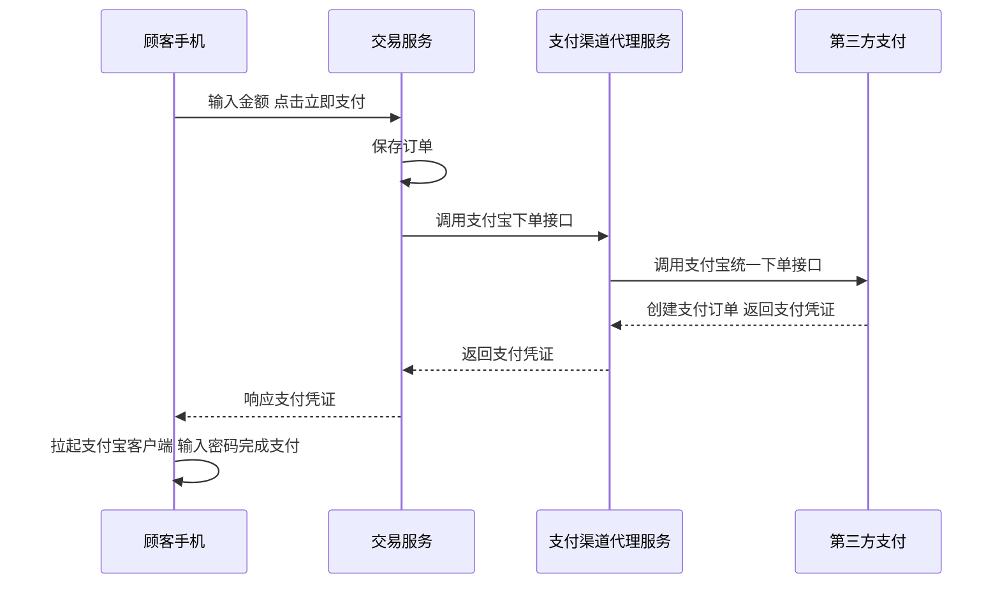
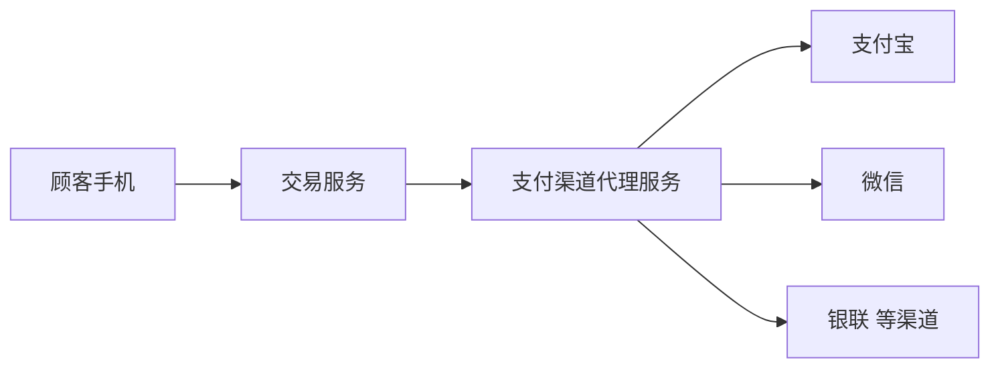

# 立即支付需求分析：确认页按钮按下之后，平台要把一笔订单送进支付渠道

确认页面已经完整可用，商品名称、订单描述、金额输入框、立即支付按钮都在位上。按钮此刻还是个摆设，点了没有任何事情发生。从这一课起进入 C 扫 B 的最后一章：立即支付，目标是让用户按下按钮后真的被带进微信或支付宝的收银台，输入密码完成付款。动代码之前先把需求与交互流程分析透，因为这条链路要跨四个角色、牵出一个新的微服务，还有两个容易混淆的「订单」概念。

## 先给结论

- 立即支付的业务动作一句话：顾客在确认页输入金额点击立即支付，平台代其向支付渠道下单，最终拉起微信或支付宝客户端完成付款。
- 交互链路五步：点击立即支付请求交易服务，交易服务保存订单，交易服务调用支付渠道代理服务的支付宝下单接口，代理服务调用支付宝的统一下单接口，支付凭证逐层返回并最终拉起用户手机上的支付界面。
- 订单信息此前只活在 ticket 与页面里，闪聚支付平台的数据库中并没有这笔订单，所以「保存订单」是链路的第一个动作。
- 本章引入一个新微服务：支付渠道代理服务，专门负责与第三方支付系统对接，把交易服务与渠道之间的耦合解开。
- 前端按钮的 JS 已经按 openId 有无把表单指向两个下单接口，与服务端按渠道拆接口的思路互为呼应。

## 从业务视角看「立即支付」

把用户视角的完整过程复述一遍：顾客扫门店二维码，进入支付入口解析出的订单确认页面，页面展示商品名称与订单描述，顾客输入付款金额，点击立即支付；此后发生的事情对用户是瞬间完成的，屏幕上弹出微信或支付宝的支付界面，输入支付密码，付款完成。平台的职责范围止于「让支付界面弹出来」，输密码与扣款发生在渠道侧，平台在后面通过异步通知与订单查询得知结果，那是下一章的主题。

用户看到的轻巧一步，在平台内部是一条跨服务的链路。确认页发起的下单请求为什么先进交易服务？因为订单交易相关的接口全部在交易服务，下单自然也从它进。交易服务拿到请求后做两件事，把订单落库保存，然后把下单请求转交给支付渠道代理服务，由代理服务去调支付宝或微信的下单接口。渠道创建支付订单后生成支付凭证，凭证沿着原路一层层传回来，最终到达用户手机上正在运行的渠道客户端，收银台弹起，等待输密码。

这张交互流程图把四个角色与凭证的回流路径画在一起：



图中有一个环节值得单独解释：支付凭证。它是渠道下单接口返回的凭据，手机网站支付场景下是一段自动提交的 HTML 表单，客户端拿到后会拉起收银台。凭证不是支付结果，它只说明「渠道已经为这笔订单开好了收银台」，真正的支付结果要等用户输完密码、渠道异步通知或平台主动查询后才能确认。凭证顺着调用链原路返回，每一层都不加工不拆包，因为它面向的最终消费者是渠道自己的客户端。

## 支付渠道代理服务：为什么多出一层

链路里最扎眼的问题是：交易服务为什么不直接调支付宝的接口，中间偏偏隔一个代理服务？答案要从对接的长期性里找。聚合支付平台要对接的第三方支付系统不止微信和支付宝，银联等渠道都在清单上，而每家的接口协议、参数结构、下单流程、签名方式全都不同。这些「不同」如果散落在交易服务里，交易服务就得同时懂得每家渠道的方言。

交易服务是什么？订单交易相关的全部业务都压在它身上，是平台的核心服务。让核心服务被渠道接口的差异牵着走，每接一个新渠道核心就要改一次，耦合性太强。支付渠道代理服务因此被单独立出来，它的职责边界非常清晰：专门与第三方支付系统打交道，渠道的 SDK 调用、参数组装、签名、异常处理全部收进这一个服务。交易服务只面对代理服务的统一接口，说「我要下单一笔支付宝订单」；至于支付宝接口长什么样、参数怎么拼，代理服务内部的事。渠道扩展时只动代理服务，交易服务的业务代码纹丝不动，核心服务由此稳定。

分层后的依赖关系用架构图看更直观：



图上交易服务只认识代理服务一个下游，渠道数量再多也不改变这条线的形状，这就是「有支付需求的微服务统一通过支付渠道代理服务调用第三方支付服务」这句话的图形化表达。

## 前端按钮与服务端接口的对应关系

链路分析要在前后端两侧同时对上号。确认页面 `pay.html` 里立即支付按钮的点击处理是一段真实写好的 JS，它已经在替服务端做一次分流：

```javascript
function IsWeixinOrAlipay(){
    var totalAmount = document.getElementsByName("totalAmount")[0];
    if (!totalAmount.value) {
        alert("付款金额不能为空");
        return;
    }
    var action;
    <#if RequestParameters['openId']?? >
        action = "${rc.contextPath}/wxjspay";
    <#else>
        action = "${rc.contextPath}/createAliPayOrder";
    </#if>
    document.getElementById("form").action = action;
    document.getElementById("form").submit();
    return "false";
}
```

按钮先校验金额非空，然后看页面参数里有没有 openId：有，说明顾客是从微信网页授权流程走来的，表单提交到微信下单接口 `/wxjspay`；没有，说明是支付宝扫码进入，表单提交到支付宝下单接口 `/createAliPayOrder`。这与支付入口按 User-Agent 分流的思路一脉相承，入口识别的客户端类型决定了确认页拿到哪些参数，页面再据此把请求送到对应的下单接口。本章先做支付宝这一条线，微信下单与授权码流程随后展开。

由此也能推出服务端接口的拆法：交易服务要提供一个面向前端的 HTTP 下单接口，接收确认页表单；支付渠道代理服务要提供一个供交易服务调用的支付宝下单接口，内部封装支付宝 SDK。两个接口各管一段，正是时序图里相邻两层之间的边界。接口怎么定义、参数怎么设计，随后的课程逐个落地。

## 常见误区

- **把「保存订单」当成可有可无的过场。** 错例：以为订单信息在 URL ticket 里已经有了，直接转发下单。正解：ticket 只是订单要素的搬运载体，平台库里没有这笔订单，不落库则后续的订单状态管理、支付结果更新全部无处安放，保存订单是链路第一步。
- **把支付凭证当成支付成功。** 错例：渠道下单接口返回凭证就给订单标记成功。正解：凭证只是收银台的入场券，支付结果以渠道异步通知与主动查询确认，凭证与结果是两个状态。
- **认为交易服务直接调渠道 SDK 更简单。** 错例：在交易服务里引支付宝 SDK 直接下单，少一层服务少一次调用。正解：渠道接口彼此差异大且会持续增加，收敛到支付渠道代理服务统一对接，交易服务只面对统一接口，核心业务不被渠道变化牵连。
- **金额在链路上原样透传。** 错例：页面输入的数字一路传到渠道接口。正解：页面是元，平台内部订单用分，支付宝下单接口要求的单位是元，链路上有明确的换算点，职责归属在接口设计时就要定下来。

## 面试可能被问到的问题

1. 面试官追问：「用户点击立即支付之后，平台内部依次发生了什么？」
   答：请求先进交易服务，交易服务把订单信息落库保存，然后调用支付渠道代理服务的支付宝下单接口，代理服务组装渠道参数与业务参数调用支付宝统一下单接口，渠道创建支付订单返回支付凭证，凭证经代理服务、交易服务原样返回给前端，前端拉起支付宝客户端等待用户付款。
2. 面试官追问：「为什么要单独搞一个支付渠道代理服务，交易服务直接对接不行吗？」
   答：交易服务是核心业务服务，渠道接口协议、参数、流程各不相同，直连意味着每接一个渠道核心服务就要改一次。代理服务把所有第三方对接收敛到一处，对上提供统一接口，交易服务与渠道解耦，新增渠道或渠道升级只改代理服务，核心服务保持稳定。
3. 面试官追问：「平台的订单和支付宝侧的支付订单是什么关系？」
   答：两笔订单分属两个系统，平台保存的交易订单记录业务事实，渠道创建的支付订单记录扣款凭据，靠商户订单号关联，平台把自己的订单号作为 outTradeNo 传给渠道，后续的凭证回传、异步通知、状态查询都按这个单号对上号。
4. 面试官追问：「支付凭证返回了，用户没付款，订单算什么状态？」
   答：算待支付。凭证只代表渠道已建好收银台，用户可能付也可能不付，平台订单此刻保持新建或待支付状态，等异步通知或主动查询把 SUCCESS、CLOSED 之类的终态带回来后再更新，超时未付的订单按过期规则关闭。
5. 面试官追问：「前端页面凭什么决定把下单请求发给哪个接口？」
   答：确认页参数里有没有 openId。微信链路必须先经网页授权拿到 openId 才能下单，所以带 openId 的请求发微信下单接口，没有 openId 的请求发支付宝下单接口，这与支付入口按 User-Agent 识别客户端的分流互为配套。

## 配套资料

- 讲义：`materials/docs/10/闪聚支付-第3章-C扫Bv1.1.md`，5 立即支付、5.1 需求分析（业务流程、交互流程图、支付渠道代理服务介绍、整体执行流程五步）为本课出处。
- 代码：`materials/code/10/完整代码/完整代码/` 归档中，交易服务工程的 `templates/pay.html`（立即支付按钮的 `IsWeixinOrAlipay` 分流逻辑与表单字段）为真实文件；`materials/code/10/基准代码/zip/` 归档含同一文件的基准版本。支付渠道代理服务工程的接口与实现属于随后两课的内容，此处按画面线与讲义口径叙述，未引用其源码细节。
- 说明：该阶段课程资料归档在 `materials/docs/10/` 与 `materials/code/10/`（不存在 09 编号目录），引用路径截至该层级；交互流程与执行步骤以讲义与课堂演示为准，示例中未出现的路径值均以 `example.com` 风格占位。
