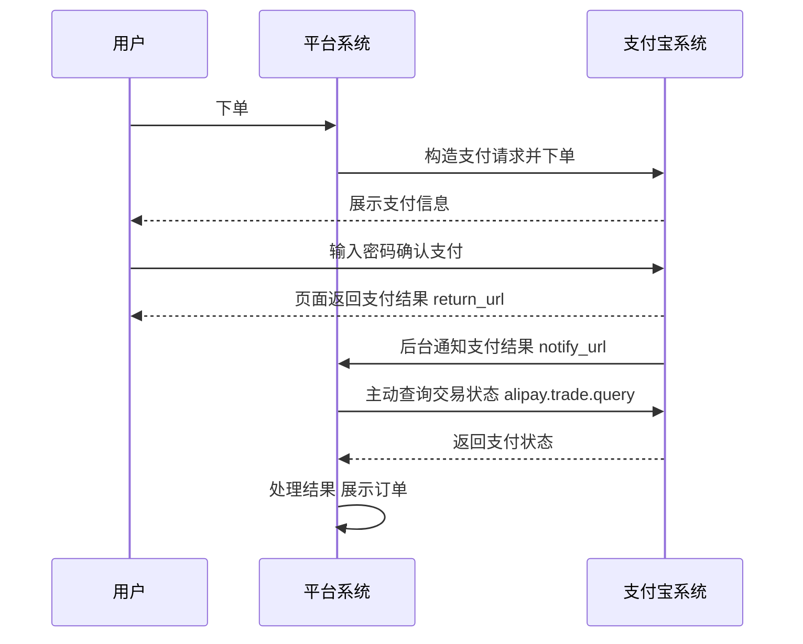
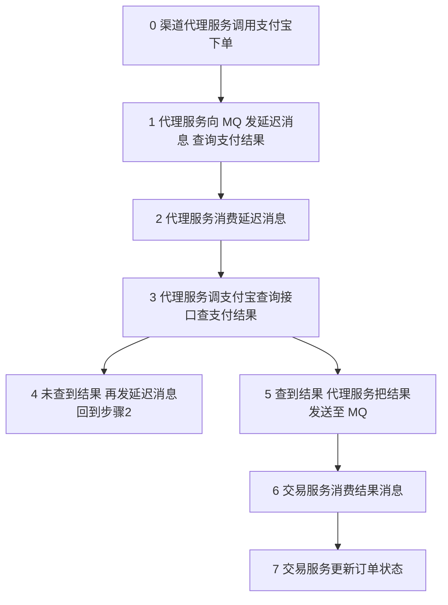

# 获取支付结果需求分析：结果在渠道手里，谁去拿、何时拿、拿到了传给谁

沙箱付款成功那一刻，交易闭环其实只走了一半：`pay_order` 表里那笔订单还停在状态 `0`（订单生成），用户到底付没付成功，平台并不知情。支付结果产生在支付宝侧，要让它变成平台订单表里的状态更新，中间隔着三个问题：结果由谁去拿，什么时候去拿，拿到了怎么送到负责订单的服务手里。本课把这些需求掰开分析清楚，代码一行不写，但每一个设计决策的「为什么」都在这里定型。

## 先给结论

- 职责划分决定通信形态：渠道代理服务负责与支付宝、微信通信拿支付结果，交易服务负责维护订单数据，两个服务之间的结果传递用消息队列完成，项目选定 RocketMQ。
- 支付宝侧拿结果有两条路：渠道主动通知（下单时登记的 `notify_url`）与平台主动查询（交易查询接口）。主动查询是必须实现的兜底路径，因为通知在网络异常或服务宕机时重试到一定次数就会放弃，漏了就是漏单。
- 查询时机不能是下单后立即查：用户还在输密码，查了必然是「等待付款」，纯浪费。节奏是下单成功后延迟一段时间查，未查到继续等待再查，到订单有效期（30 分钟）为止。
- 这个「延迟后查、未果再查」的节奏正好是 RocketMQ 延迟消息的形状：渠道代理服务下单后发一条延迟消息，自己消费，到期即查询；查到结果再发一条结果消息，交易服务消费后更新订单状态。
- 一条链路里两条消息各司其职：延迟消息解决「什么时候查」，结果消息解决「结果交给谁」。

## 需求一：代理服务与交易服务之间的异步通信

拿结果的动作先按职责归属拆开。微服务开发有一条纪律：每个接口功能必须想清楚它属于哪个服务。渠道代理服务的职责是与支付宝、微信这些第三方系统对接，查支付结果这种「跟渠道说话」的事天然归它；交易服务的职责是维护订单，状态更新落在这边。于是结构是：渠道代理服务去支付宝拿结果，交易服务拿结果更新订单，两个服务各干各的擅长的活。

问题卡在中间那一步：渠道代理服务拿到结果，怎么交给交易服务？这件事比看上去难，因为它不是一次「你问我答」的远程调用能解决的。

**第一，结果不是一次性的。** 用户没付完款时查询返回「等待付款」，过一会儿还得再查，同一笔订单的查询会反复发生，每次查询的结论都要有归宿；交易服务不能一直挂着一个同步请求等结论，渠道代理服务也不该被交易服务的调用节奏绑住。

**第二，两个服务的负载节奏不同步。** 支付高峰期查询请求一波接一波，交易服务可能正在忙别的，同步调用会让压力传导成雪崩；消息队列在中间当一个蓄水池，交易服务按自己的能力消费，高峰期的查询结论排队等它。

**第三，事件驱动的语义本来就匹配。** 「支付完成了」这件事的发生时机由用户的支付行为决定，平台只能被动得知，这正是事件的定义。用消息传递事件，渠道代理服务发完就返回，交易服务收到再处理，两边都不为对方等待。项目选型定为 RocketMQ，后续课程会先做一轮 RocketMQ 技术预研再动手实现。

## 需求二：通知与查询，两条路怎么选

向支付宝要结果，它给两条路。把官方下单到收单的完整时序摆出来，两条路的位置一目了然：



第一条路是渠道主动通知。下单时把 `notify_url` 登记给支付宝，支付完成后支付宝向这个地址发请求，把结果推过来；页面上用户看到的支付结果走的是另一条同步线 `return_url`，两者不可混为一谈，后台入账认的是 `notify_url`。第二条路是平台主动查询，支付宝提供交易状态查询接口，凭平台订单号随时可查，返回的交易状态里最常用的是等待买家付款、交易成功、交易关闭几档。

两条路都实现当然最好，但优先级有硬差异：**主动查询是必须项，主动通知不是。** 道理在通知的可靠性上。支付宝发出通知时平台可能正宕机、可能网络抖动，渠道会重试，但重试到一定次数就放弃，此后这笔结果再也不会被推过来。把唯一的数据来源押在一个「可能放弃」的机制上，漏单只是时间问题。主动查询则完全不同：订单在支付宝侧一直放着，只要平台在订单有效期内发起查询，结果一定能拿到，主动权始终在平台手里。

所以项目的落地口径是：渠道代理服务集成主动查询，把它作为支付结果的可靠来源；主动通知在企业级项目里通常也会接上，作用是让绝大多数正常订单更快拿到结果，查询退居兜底。目的只有一个，尽快且不漏地拿到支付结果。

## 需求三：延迟查询的节奏

主动查询定了，新问题是「什么时候查」。下单接口调完的那一刻就查吗？不行。用户此刻正在收银台输密码，立即查询得到的必然是「等待付款」，这次请求白白消耗一次渠道接口调用；高峰期每笔订单都这么查一遍，大多数请求都是废的，渠道接口的配额与平台资源双双浪费。

合理的节奏是把查询往后推。下单成功后延迟一段时间发起第一次查询，没查到支付结果就再等一段时间再查，如此往复；一旦查到结果，流程往下走；如果一直查到订单有效期结束还是未支付，就不再查了，订单按超时关闭处理。这个「延迟触发、未果重试、有界停止」的节奏，恰好与 RocketMQ 的延迟消息一一对应：下单后发一条延迟消息，消息到期投递就是查询的触发时机；查不到就再发一条延迟消息，天然的循环；订单过期后停止投递，有界的终止。

把整条技术方案连起来看，两条消息在链路里的位置就清楚了：



图里有两处值得多看一眼。延迟消息的发送方与消费方都是渠道代理服务，消息在它自己手里转一圈，为的是把「何时查」从代码里的定时器换成消息队列的投递节奏，查询的触发与下单的线程彻底解耦；结果消息的发送方是渠道代理服务、消费方是交易服务，这条消息就是需求一里那道通信题的答案。结果消息的载体沿用渠道代理服务统一的 `PaymentResponseDTO` 结构，订单号、渠道标识、支付状态都在里面，以下是其字段雏形（按本课写法补全的示例）：

```java
//支付结果消息的载体示意（非本课实际代码，按统一响应结构补全）
PaymentResponseDTO<AliConfigParam> notice = new PaymentResponseDTO<>();
notice.setOutTradeNo(alipayBean.getOutTradeNo());//平台订单号，交易服务凭它更新订单
notice.setContent(aliConfigParam);//渠道参数，消费方查询时要用
notice.setMsg("ALIPAY_WAP");//渠道标识，消费方据此选择查询哪个渠道的接口
```

需求分析到此收口：RocketMQ 负责两个服务之间的通信，主动查询作为结果的可靠来源，延迟消息编排查询的节奏。接下来的课程先预研 RocketMQ 本身，再把这条链路一段段实现出来。

## 常见误区

- **把 return_url 当成支付结果的来源。** 错例：以为用户支付完页面跳回平台，状态就同步了。正解：`return_url` 是给用户看的同步跳转，可能被关闭、可能根本不跳，入账依据是后台的 `notify_url` 通知与主动查询。
- **只实现渠道通知，不做主动查询。** 错例：坐等支付宝推送结果，通知重试失败后订单永远停在未支付。正解：主动查询是兜底必须项，通知只能当加速手段，两者可靠性不对称。
- **下单后立即发起查询。** 错例：调完下单接口马上查支付结果，得到的全是「等待付款」。正解：延迟一段时间再查，未支付则继续延迟重试，至订单有效期为止。
- **拿结果的职责安错了服务。** 错例：让交易服务直接调支付宝查询接口，或让渠道代理服务直接改订单表。正解：与渠道通信归渠道代理服务，订单维护归交易服务，中间用消息传递结果，越界会让渠道细节渗进订单域。
- **把消息队列当成可有可无的中间件。** 错例：用同步 RPC 传结果，交易服务一忙查询就堆积超时。正解：支付结果天然是事件，异步消息提供解耦、蓄峰与重试能力，选 RocketMQ 还能直接用延迟消息表达查询节奏。

## 面试可能被问到的问题

1. 面试官追问：「支付结果为什么用消息队列传递，两个服务直接 RPC 不行吗？」
   答：结果是事件，发生时机由用户支付行为决定，同步 RPC 要么发起方反复轮询占用资源，要么接收方被调用洪峰压垮。消息队列提供解耦与蓄峰，查询结论逐条排队送达，消费方按自身能力处理；延迟查询这类节奏需求也天然由延迟消息表达，RPC 没有对应机制。
2. 面试官追问：「渠道主动通知为什么不能作为唯一的支付结果来源？」
   答：通知的成功到达没有保证。平台宕机、网络异常、接口变更都会让通知失败，渠道重试到设定次数后放弃，之后不再推送。唯一来源必须是自己可控、随时可发起的主动查询，通知只用来加速正常路径。
3. 面试官追问：「延迟查询的间隔怎么定？查到什么时候停止？」
   答：间隔要平衡及时性与渠道配额，通常首次延迟数十秒起，之后阶梯放大；停止条件是订单有效期，本项目订单过期时间 30 分钟，查询循环在有效期结束即终止，订单转超时关闭。间隔与终止条件都应做成配置，随渠道策略调整。
4. 面试官追问：「为什么由渠道代理服务自己发延迟消息自己消费，而不是交易服务定时扫表？」
   答：查询动作要调渠道接口，与渠道通信的职责在渠道代理服务，扫表方案会让交易服务越界接触渠道细节，且扫描周期固定、粒度粗，短延迟高频查询的节奏表达不了。代理服务下单时对订单最了解，发一条延迟消息让查询触发精确到单，也避免全表扫描。
5. 面试官追问：「查到支付结果后，交易服务更新订单状态要注意什么？」
   答：状态机要防回退与重复，同一订单可能收到多次结果消息，更新前校验当前状态，已成功的订单不再被后续消息改写；更新动作与支付成功时间一起落库，保证幂等。消息消费失败还要有重试与死信出路，避免结果丢失。
6. 面试官追问：「为什么选 RocketMQ 而不是用数据库轮询或 Redis 延迟任务？」
   答：数据库轮询把压力压在订单库上，间隔短了浪费、长了不及时；Redis 延迟任务需要自己处理可靠投递与持久化，多造一遍轮子。RocketMQ 原生支持延迟消息、消费重试与持久化，服务间通信与延迟触发一个组件全解决，与项目的微服务技术栈也是同源的。

## 配套资料

- 讲义：`materials/docs/10/闪聚支付-第3章-C扫Bv1.1.md`，第 6 章 获取支付结果，6.1 需求分析（服务间异步通信、第三方支付系统支付结果查询的两种方式、下单成功延迟查询）、6.3 技术方案（RocketMQ 通信的五步链路）为本课出处。
- 讲义：`materials/docs/10/RocketMQ研究v1.0.md`，为 6.2 RocketMQ 技术预研指定的参考讲义，后续课程预研与实现阶段使用。
- 代码：本课为需求分析课，无配套源码改动；文中消息载体示意按统一响应结构 `PaymentResponseDTO` 补全，该类真实定义见 `materials/code/10/完整代码/完整代码/` 归档中渠道代理服务 api 工程的 `dto/PaymentResponseDTO.java`（归档内层工程目录与包名为课程原始命名，不在此展开，正文代码为按 `com.study.pay` 系口径改写后的示例）。
- 说明：该阶段课程资料归档在 `materials/docs/10/` 与 `materials/code/10/`（不存在 09 编号目录），引用路径截至该层级。
