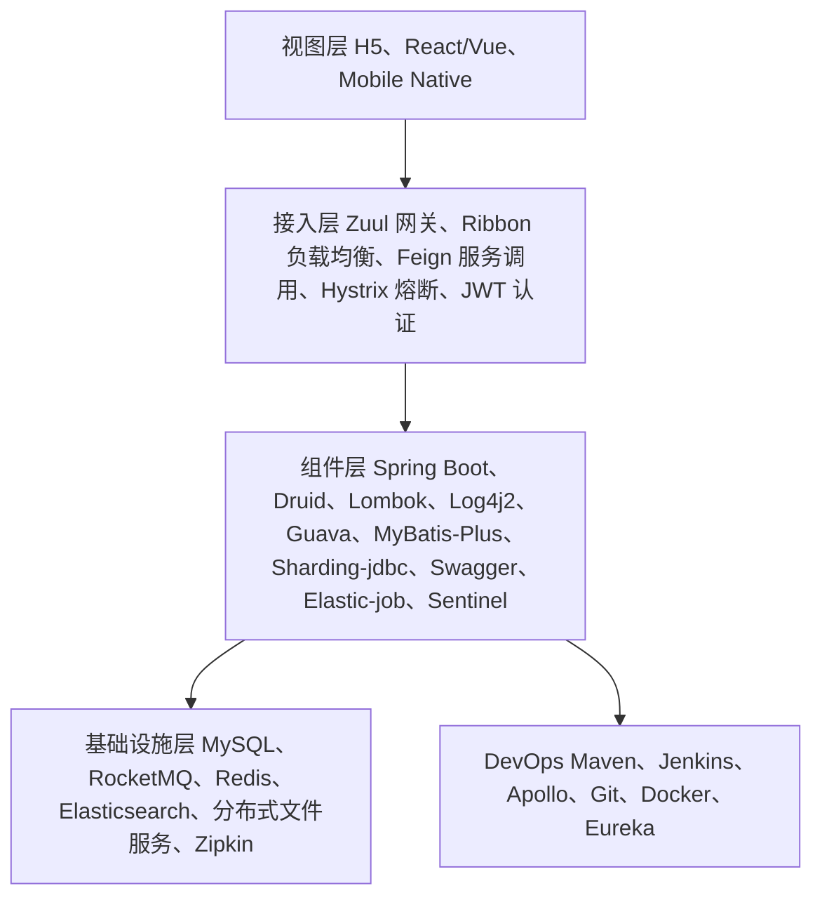

# 万信金融技术栈全景：五层组件与 P2P 场景的解决方案清单

技术架构定了，接下来要回答两个问题：开发这个项目具体要装什么、学什么；这些组件组合起来，能解决 P2P 金融场景里的哪些难题。技术栈图回答前者，技术解决方案清单回答后者。把这两张图对齐着读一遍，哪些组件是学过的、哪些是本阶段新增的，开工前心里要有一张账。

## 先给结论

- 技术栈按视图、接入、组件、基础设施、DevOps 五层组织；服务端基于 Spring Boot 构建，采用 Spring Cloud 微服务框架。
- 接入层五件套：Zuul 网关、Ribbon 负载均衡、Feign 服务调用、Hystrix 熔断降级、JWT 令牌；组件层主力是 MyBatis-Plus、Druid、Sharding-jdbc、Swagger、Elastic-job、Sentinel。
- 基础设施层四大件：MySQL 持久化、RocketMQ 消息、Redis 缓存、Elasticsearch 搜索，再加分布式文件服务与 Zipkin 链路追踪。
- 技术解决方案是把技术栈按场景组装：接口规范用 Spring Boot 加 Swagger，持久层用 MyBatis-Plus，配置中心用 Apollo，认证用 Spring Security Oauth2 加 JWT 加 Zuul，分布式事务有 RocketMQ、Hmily 等多种方案。
- 前端视图层不用管，Java 工程师的重心在接入层与组件层，以及它们在金融场景下的组合用法。

## 技术栈：按层读组件清单



从上往下看这张图：视图层是 H5、React/Vue、移动原生这些前端形态，本项目前端是现成工程，这一层了解即可。接入层解决「请求怎么进来、服务之间怎么互调」：Zuul 做服务网关，Ribbon 做客户端负载均衡，Feign 做服务远程调用，Hystrix 做服务熔断降级，JWT 提供前后端之间的令牌管理方案。组件层是后端开发的日常：核心框架 Spring Boot，数据库连接池 Druid，POJO 构建工具 Lombok，日志系统 Log4j2，工具库 Guava，持久层增强 MyBatis-Plus，分库分表组件 Sharding-jdbc，接口规范组件 Swagger，分布式任务调度 Elastic-job，限流组件 Sentinel。基础设施层往下是运行时依赖：MySQL 存业务数据，RocketMQ 承担消息队列，Redis 做缓存，Elasticsearch 支撑标的信息的全文检索，分布式文件服务负责文件上传与存储，Zipkin 做分布式链路追踪。再往下是与部署相关的一圈 DevOps 组件：Maven 管依赖，Jenkins 做持续集成，Apollo 是本项目的统一配置中心，Git 管代码，Docker 做容器化部署，Eureka 承担服务注册治理。

企业里的惯例是项目一启动就把技术栈清单发到每个人手上，提前把没学过的组件补起来，因为后面每天都在用。

## 版本清单写在父工程里

组件名单背下来没有用，版本对应关系才是实际开发里最容易翻车的地方。这些信息全部锁在聚合工程父 pom 的依赖管理里，节选几段与本阶段直接相关的：

```xml
<!-- 微服务基础工程父 pom 依赖管理（节选，groupId 已按本系列口径改写） -->
<parent>
    <groupId>org.springframework.boot</groupId>
    <artifactId>spring-boot-starter-parent</artifactId>
    <version>2.1.3.RELEASE</version>
</parent>

<dependencyManagement>
    <dependencies>
        <!-- Spring Cloud 版本基线 -->
        <dependency>
            <groupId>org.springframework.cloud</groupId>
            <artifactId>spring-cloud-dependencies</artifactId>
            <version>Greenwich.RELEASE</version>
            <type>pom</type>
            <scope>import</scope>
        </dependency>
        <!-- 分布式事务 Hmily -->
        <dependency>
            <groupId>org.dromara</groupId>
            <artifactId>hmily-springcloud</artifactId>
            <version>2.0.4-RELEASE</version>
        </dependency>
        <!-- 分布式任务调度 Elastic-job -->
        <dependency>
            <groupId>com.dangdang</groupId>
            <artifactId>elastic-job-lite-core</artifactId>
            <version>2.1.5</version>
        </dependency>
        <!-- 统一配置中心 Apollo 客户端 -->
        <dependency>
            <groupId>com.ctrip.framework.apollo</groupId>
            <artifactId>apollo-client</artifactId>
            <version>1.2.0</version>
        </dependency>
    </dependencies>
</dependencyManagement>
```

这一段把「技术栈图上的一个名字」落到「pom 里一个带版本的坐标」，Spring Boot 2.1.3 与 Spring Cloud Greenwich 配套，Hmily、Elastic-job、Apollo 各自的版本也全部由父工程统一锁定，子模块引依赖时不写版本号。

## 技术解决方案：组件在金融场景下的组装

技术栈是零件，技术解决方案是拿零件装出来的整机。P2P 金融场景催生了一批通用性很强的方案，清单如下：

| 场景 | 解决方案 |
|---|---|
| 微服务 | 微服务技术应用于 P2P 金融业务 |
| 接口规范 | Spring Boot + Swagger |
| 持久层编码 | MyBatis-Plus |
| 分布式配置中心 | Apollo |
| UAA 认证 | Spring Security Oauth2 + JWT + Zuul |
| 分布式事务 | RocketMQ 事务消息、Hmily、requestNo 同步机制 |
| 分库分表 | Sharding-jdbc |
| 分布式任务调度 | Elastic-job |
| 安全交易 | HTTPS + SHA1withRSA |
| 身份认证 | 百度 AI 实名核验 |
| 短信验证 | 短信验证服务 + 第三方短信平台 |

这份清单有两个读法。纵向看，每一行都是一个具体问题：交易量大了怎么办，答案是 Sharding-jdbc 分库分表；跨服务扣款和记账要保证一致性怎么办，答案是分布式事务方案组合；用户上传身份证要鉴别真伪怎么办，答案是接第三方实名认证。横向看，这些方案不限于 P2P 行业，换一个项目，认证、配置、分表、调度这些方案照样能用，金融项目只是给了它们一个足够复杂的演练场。

分布式事务值得单独强调：本项目里它不止一种方案，RocketMQ 的事务消息、Hmily 框架，再加上业务上的 requestNo 同步机制，分别对应不同的一致性场景，后续涉及还款、对账的章节会逐一展开。

## 学习重心的取舍

技术栈图上十几行组件，没有必要平均用力。视图层整层跳过；接入层的 JWT 与 OAuth2 属于统一认证方案的组成部分，先建立概念，等到开户与认证章节再深入。组件层与基础设施层是本阶段每天都要写的东西：MyBatis-Plus 的持久层编码、Druid 连接池、Apollo 配置管理、Swagger 接口文档，这些在第 1 章就要上手；Sharding-jdbc、Hmily、Elastic-job 等更重的方案按章节推进，用到时再系统学。组件层的多数成员在前几个阶段已经见过，本阶段的新面孔主要是 Apollo、Hmily 与 Elastic-job。

## 常见误区

- **把技术栈和技术解决方案混为一谈。** 错例：面试时报了一串组件名就说自己懂架构。正解：技术栈回答「用什么」，解决方案回答「怎么组合着解决什么问题」，比如「用 Spring Security Oauth2 加 JWT 加 Zuul 组成统一认证方案」才是完整的表达。
- **认为组件版本可以随便升级。** 错例：嫌 Spring Boot 2.1.3 老擅自升到 2.3，结果 OAuth2 与 Hmily 相关代码编译不过。正解：版本由父工程 dependencyManagement 统一锁定，Spring Boot 与 Spring Cloud 有配套关系，升级要成套评估。
- **认为分布式事务只有一种做法。** 错例：所有跨服务写操作都套同一个框架。正解：本项目同时准备 RocketMQ 事务消息、Hmily 与 requestNo 同步机制，按业务场景选择，消息可达性、TCC 补偿各有适用边界。
- **把前端技术栈也纳入学习计划。** 错例：看到 React/Vue 就去补前端。正解：前端是现成工程，Java 工程师要练的是读懂前端发出的接口请求，并用 Swagger 与 Postman 完成联调。

## 面试可能被问到的问题

1. 面试官追问：「你们项目用了哪些技术栈，分几层？」
   答：按视图、接入、组件、基础设施、DevOps 五层组织。视图层是 H5 与 App；接入层有 Zuul、Ribbon、Feign、Hystrix、JWT；组件层基于 Spring Boot 与 Spring Cloud，配套 MyBatis-Plus、Druid、Sharding-jdbc、Swagger、Elastic-job、Sentinel；基础设施层有 MySQL、RocketMQ、Redis、Elasticsearch、分布式文件服务与 Zipkin；DevOps 用 Maven、Jenkins、Apollo、Git、Docker。
2. 面试官追问：「分库分表为什么选 Sharding-jdbc，解决什么问题？」
   答：P2P 平台交易数据量大，单库单表会成为瓶颈。Sharding-jdbc 以 JDBC 层增强的方式实现分库分表，应用几乎不改代码就能按分片键路由，本项目交易中心规划了 transaction_0 与 transaction_1 两个库，就是为它准备的。
3. 面试官追问：「你们分布式事务是怎么做的？」
   答：不止一种方案。跨服务的数据一致性场景用 Hmily 这类 TCC 补偿型框架；异步解耦且最终一致的场景用 RocketMQ 事务消息；支付回调等需要防重的场景配合 requestNo 同步机制做幂等。按场景选方案，而不是一刀切。
4. 面试官追问：「配置中心为什么选 Apollo 而不是 Spring Cloud Config？」
   答：Apollo 提供发布审核、灰度发布、实时生效、多环境多集群管理等能力，配置修改有操作界面和审计记录，适合微服务数量多、配置频繁调整的项目；Spring Cloud Config 更轻量但没有开箱的管控台。本项目微服务的绝大部分配置由 Apollo 统一管理。
5. 面试官追问：「接口规范这一块你们是怎么统一的？」
   答：RESTful 接口基于 Spring Boot 开发，用 Swagger 注解描述接口并自动生成在线文档，前后端按文档并行联调；服务端开发完成后用 Postman 做功能测试。接口描述与代码同源，避免文档与实现脱节。

## 配套资料

- 讲义：`materials/docs/10/万信金融-第1章-讲义-项目介绍v1.0.md`，其中 2.2 技术栈、2.3 技术解决方案、2.4 软硬件环境为本课出处。
- 代码：`materials/code/10/wanxinp2p/`，微服务基础工程聚合工程，正文引用的父 pom 依赖管理节选自该工程 `pom.xml`；内层目录为原始包名，与正文 `com.study.finance` 改写口径不一致，引用路径到工程目录为止。
- 说明：该阶段资料归档在 `materials/docs/10/` 与 `materials/code/10/`，目录编号与相邻阶段共用；软硬件环境基线为 Windows 64 位 8G 内存以上、JDK 8+、Maven 3.2+、IDEA 2018+、MySQL 5.6.5+。
