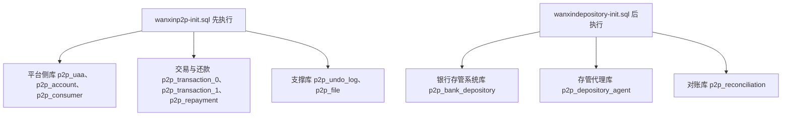

# 万信金融数据库环境搭建：版本红线、两个初始化脚本与十一个库

> 🔒 安全提示：文中示例的口令/密钥均为课程教学环境演示口径，生产环境的安全要求见《安全与合规须知》。

新项目开工，环境搭建往往被当成「装个软件导个脚本」的小事，实际它是新手折损率最高的环节：MySQL 版本不对、脚本执行顺序错了，后面每个微服务启动都会连环报错。万信金融服务端环境的第一步是数据库，这一步有明确的版本红线和固定的脚本清单，照着做可以一次走通。

## 先给结论

- 本项目要求 MySQL 5.6.5 以上版本，建议直接安装 5.7；端口保持默认 3306。
- 数据库初始化靠两个 SQL 脚本：先执行 `wanxinp2p-init.sql` 创建 P2P 平台侧的库和表，再执行 `wanxindepository-init.sql` 创建银行存管系统侧的库和表。
- 脚本一共建出 11 个库，其中交易库拆成 `p2p_transaction_0` 和 `p2p_transaction_1` 两份，为后续 Sharding-jdbc 分库分表预留。
- `p2p_undo_log` 是分布式事务框架 Hmily 的专用库，与银行侧的 `p2p_bank_depository`、代理侧的 `p2p_depository_agent`、对账侧的 `p2p_reconciliation` 各司其职，不要混用。
- 每个库承载什么业务先混个脸熟即可，表结构和字段在后续章节随用随讲。

## 版本红线为什么卡在 5.6.5

MySQL 的版本选择不是随意的。5.6.5 是一个分水岭版本，从这个版本起 DATETIME 类型支持默认值与毫秒级精度，后面要用到的框架和建表脚本都建立在这个能力之上。本项目对版本的要求写得很明确：5.6.5 以上，推荐 5.7。检查方式是连上数据库执行 `SELECT VERSION();`，版本低于要求就卸载重装，装完不要改端口，3306 保持默认，账号密码用 root/123456 即可。改动默认端口虽然可行，但会让后续每个微服务的连接配置多出一处差异点，纯属自找麻烦。

## 两个脚本，两侧系统



初始化分两侧是因为本项目模拟了完整的银行存管体系：P2P 平台是一侧，银行的存管系统是另一侧，两边各有一套数据库。平台侧脚本负责建出统一认证、账户、用户中心、交易、还款、文件等库；银行侧脚本负责建出存管系统的库，包括账户余额这类资金数据。执行顺序建议先平台侧再银行侧，用 SQLyog 或 Navicat 之类的客户端把两个脚本依次打开、整体执行即可，脚本内部自带建库建表和初始数据导入。

## 库清单：每个库承载什么业务

| 数据库名称 | 数据内容 |
|---|---|
| `p2p_uaa` | 统一认证数据 |
| `p2p_account` | 统一账户数据 |
| `p2p_consumer` | 用户中心数据 |
| `p2p_transaction_0` | 交易中心数据库 1 |
| `p2p_transaction_1` | 交易中心数据库 2 |
| `p2p_undo_log` | 分布式事务框架 Hmily 数据库 |
| `p2p_repayment` | 还款中心数据 |
| `p2p_file` | 文件存储服务 |
| `p2p_bank_depository` | 银行存管系统 |
| `p2p_depository_agent` | 银行存管代理服务数据 |
| `p2p_reconciliation` | 对账数据 |

这张表把 11 个库和微服务一一对应起来：认证服务读 `p2p_uaa`，用户中心读 `p2p_consumer`，交易中心的数据分散在两个交易库里，存款代理服务有自己的 `p2p_depository_agent`，银行存管系统的数据在 `p2p_bank_depository`，两边账单核对的结果落在 `p2p_reconciliation`。交易库拆两份是整张表里最值得琢磨的细节，它对应的是技术方案清单里的分库分表方案，交易中心后续会通过 Sharding-jdbc 把数据按规则路由到两个库，现在建库阶段就把架子搭好。

## 脚本里的关键语句

两个脚本都是标准的生产风格建表语句，以银行存管侧的账户余额表为例，核心片段如下（按课程画面整理，表名与字段为脚本原样）：

```sql
CREATE DATABASE p2p_bank_depository CHARACTER SET 'utf8' COLLATE 'utf8_general_ci';
USE p2p_bank_depository;

DROP TABLE IF EXISTS `balance_details`;

CREATE TABLE `balance_details` (
  ID BIGINT(20) NOT NULL AUTO_INCREMENT COMMENT '主键',
  USER_ID BIGINT(20) DEFAULT NULL COMMENT '用户ID',
  USER_TYPE VARCHAR(20) DEFAULT NULL COMMENT '用户类型',
  AMOUNT DECIMAL(10,2) DEFAULT NULL COMMENT '交易金额',
  STATUS TINYINT(4) DEFAULT NULL COMMENT '状态',
  BALANCE DECIMAL(10,2) DEFAULT NULL COMMENT '可用金额',
  CREATE_TIME DATETIME DEFAULT NULL COMMENT '创建时间',
  UPDATE_TIME DATETIME DEFAULT NULL COMMENT '更新时间',
  PRIMARY KEY (ID)
) ENGINE=InnoDB AUTO_INCREMENT=1 DEFAULT CHARSET=utf8 COMMENT='账户余额表';
```

平台侧脚本的套路相同，先用 `DROP DATABASE IF EXISTS` 清掉同名库再重建，保证脚本可以重复执行：

```sql
DROP DATABASE IF EXISTS p2p_uaa;
DROP DATABASE IF EXISTS p2p_account;
DROP DATABASE IF EXISTS p2p_consumer;
DROP DATABASE IF EXISTS p2p_repayment;
DROP DATABASE IF EXISTS p2p_transaction_0;
DROP DATABASE IF EXISTS p2p_transaction_1;
DROP DATABASE IF EXISTS p2p_undo_log;
DROP DATABASE IF EXISTS p2p_file;
```

两个细节值得留意。金额字段用 `DECIMAL(10,2)` 而不是 FLOAT 或 DOUBLE，浮点类型算钱必有精度丢失，这是金融库的底线；时间字段用 `DATETIME` 并依赖 MySQL 5.6.5 之后的能力，这也呼应了版本红线。另外脚本头部通常带 `SET NAMES utf8` 一类的会话设置，执行时保持默认整体执行，不要手动跳段。

## 常见误区

- **版本不达标硬着头皮上。** 错例：本机装着 5.5 直接导脚本，结果建表报语法错或时间字段异常。正解：先 `SELECT VERSION();` 确认版本，低于 5.6.5 就重装，推荐 5.7。
- **脚本顺序随意、重复执行不放心。** 错例：担心先执行银行侧脚本会出错。正解：两个脚本相互独立，顺序只影响排错方便，脚本自带 DROP IF EXISTS，重复执行是安全的；推荐先平台侧再银行侧。
- **把 `p2p_undo_log` 当业务库。** 错例：看到空表就想往里塞业务数据。正解：它是 Hmily 分布式事务框架记录事务日志的专用库，由框架自动读写，业务代码不要碰。
- **金额字段用浮点类型。** 错例：自己建表时把金额写成 DOUBLE。正解：金额一律 DECIMAL，脚本里 `DECIMAL(10,2)` 就是现成范例。

## 面试可能被问到的问题

1. 面试官追问：「你们项目的数据库是怎么初始化的？」
   答：执行课程提供的两个 SQL 脚本，`wanxinp2p-init.sql` 建 P2P 平台侧的库和表并导入初始数据，`wanxindepository-init.sql` 建银行存管系统侧的库和表，合计 11 个库；脚本自带 DROP IF EXISTS，可重复执行。
2. 面试官追问：「为什么交易中心要两个库？」
   答：为分库分表做准备。交易量大的场景下单库会成为瓶颈，项目用 Sharding-jdbc 按分片规则把交易数据路由到 `p2p_transaction_0` 和 `p2p_transaction_1`，建库阶段就按这个形态落位。
3. 面试官追问：「金额字段为什么用 DECIMAL 不用 DOUBLE？」
   答：DOUBLE 是二进制浮点，存在精度丢失，金额加减后会出现类似 0.1 加 0.2 不等于 0.3 的问题；DECIMAL 是精确小数，配合 `(10,2)` 两位小数恰好满足金额语义，金融库必须用 DECIMAL。
4. 面试官追问：「`p2p_undo_log` 是干什么用的？」
   答：它是分布式事务框架 Hmily 的专用库，存放事务回滚日志等框架数据，由框架在事务发起与补偿时自动读写，与业务库无关。
5. 面试官追问：「为什么强调 MySQL 5.6.5 这个版本线？」
   答：5.6.5 起 DATETIME 支持默认值与更高时间精度，项目的建表脚本和后续框架能力都以此为前提，版本不达标时轻则建表告警，重则数据写入异常，所以环境搭建第一步就是核对版本。

## 配套资料

- 讲义：`materials/docs/10/万信金融-第1章-讲义-开发环境搭建v1.0.md`，其中 1.1 数据库环境的版本要求、脚本清单与数据库清单表为本课出处。
- SQL 脚本：本课的 `wanxinp2p-init.sql` 与 `wanxindepository-init.sql` 在本系列归档的 `materials/` 下没有对应文件，正文 SQL 片段为按课程画面线整理的脚本原文节选，非凭空示例。
- 说明：该阶段资料归档在 `materials/docs/10/` 与 `materials/code/10/`，目录编号与相邻阶段共用。
