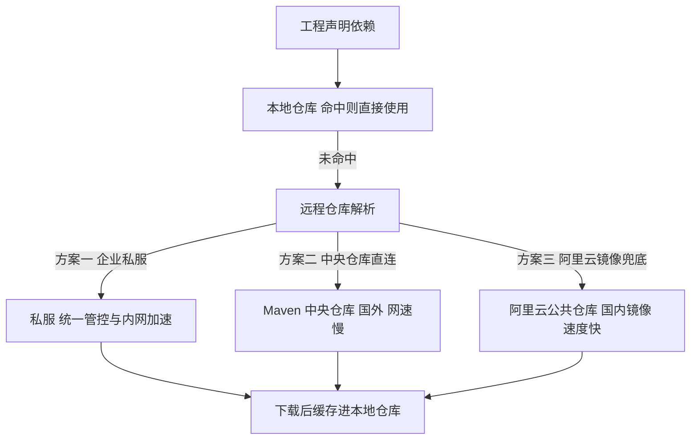

# 导入微服务基础工程后的第一小时：Maven 与 IDEA 环境配置清单

拿到的不是空白工程，而是一套多人协作的微服务基础工程，IDEA 直接打开就开始写代码，大概率会在依赖下载、中文乱码、注解报红这些地方浪费一晚上。基础工程在企业里通常由架构组通过 Git 发放，开发人员要做的第一件事不是写业务，而是把本机的 Maven 与 IDEA 配置对齐，让所有人在同一套环境基线上工作。

## 先给结论

- 基础工程不需要自己创建，直接用 IDEA 打开发放的聚合工程即可，开发工具要求 IDEA 2018 以上版本。
- Maven 仓库有三种方案：企业私服、中央仓库直连、本地仓库；学习期间用本地仓库，企业里最常用私服。
- `settings.xml` 里配三样：私服账号（如有）、本地仓库路径、阿里云镜像兜底；本地仓库路径必须按自己机器的实际位置写，不能照抄。
- IDEA 侧统一 UTF-8 编码、JDK 1.8、代码提示忽略大小写、自动导包优化这四项。
- 本地仓库路径不能包含中文，这是踩坑概率最高的一条。

## 配置前先想清楚仓库方案

Maven 依赖解析走的是固定顺序：工程声明依赖后，Maven 先查本地仓库，本地没有再去远程仓库下载。远程仓库选谁，就是三种方案的差别。



**方案一，企业私服。** 企业在内网搭一台 Nexus 之类的私服，所有依赖统一从私服走，速度、安全、版本管控都最好，需要在 `settings.xml` 的 `<servers>` 段配置账号密码，在 `<mirrors>` 里把请求指到私服地址。这是企业最常用的方式。

**方案二，中央仓库直连。** 什么都不配，Maven 默认去国外中央仓库下载。学习期间不建议这样，网速慢到经常超时，一个依赖卡半小时是常态。

**方案三，本地仓库。** 仓库本身就放在本机磁盘上，最省事也最稳，课程直接提供了一份配好的本地仓库，不存在下载环节，也就不存在因下载导致的奇奇怪怪的问题。学习期间推荐用它，同时配一个阿里云镜像兜底：万一本地仓库缺了某个 jar 包，就从阿里云公共仓库补齐。

## settings.xml 三段配置

按方案三落地，`settings.xml` 要动三处。私服场景的账号配置长这样，学习时用不到，企业入职时要会：

```xml
<!-- 私服场景：在 <servers> 段增加（账号密码占位，按企业实际填写） -->
<server>
    <id>maven-releases</id>
    <username>example-user</username>
    <password>example-password</password>
</server>
<server>
    <id>maven-snapshots</id>
    <username>example-user</username>
    <password>example-password</password>
</server>
```

本地仓库路径与镜像兜底是学习期间必配的两处：

```xml
<!-- 本地仓库路径：写自己机器上的实际位置，路径中不能有中文 -->
<localRepository>D:\maven-repo\localRepository</localRepository>

<!-- 阿里云镜像：本地仓库缺包时兜底，替换 central 的下载地址 -->
<mirror>
    <id>aliyun</id>
    <mirrorOf>central</mirrorOf>
    <name>阿里云公共仓库</name>
    <url>http://maven.aliyun.com/repository/public</url>
</mirror>
```

`<mirrorOf>central</mirrorOf>` 的含义是只拦截原本发往中央仓库的请求并转给阿里云，其他自定义远程仓库不受影响。IDEA 侧再把 Maven home 与 settings 文件指向同一份配置，路径例如 `C:\apache-maven-3.1.1` 与 `C:\apache-maven-3.1.1\conf\settings.xml`，避免命令行构建和 IDE 构建各用一套仓库。

## IDEA 四项检查清单

**编码统一 UTF-8。** Settings 里把 File Encoding 与 Project Encoding 都设为 UTF-8。这一项必须配，否则打开基础工程里的部分文件会乱码，配置文件里的中文注释尤其明显。

**JDK 1.8。** 先在本机安装 JDK 8 并设置好 `JAVA_HOME` 环境变量，再在 Project Structure 里把 Project SDK 选为 1.8，Project language level 选 8。基础工程父 pom 里声明的是 `java.version` 1.8，编译级别与它保持一致。

**代码提示忽略大小写。** IDEA 默认的补全是区分大小写的，输入小写 `str` 不会提示 `String`。把 Code Completion 设为不匹配大小写，提示命中率明显更高，编码更顺手。

**自动导包优化。** 开启 Add unambiguous imports on the fly 与 Optimize imports on the fly 后，多数情况下导入语句自动完成；粘贴代码时的 Insert imports on paste 按个人习惯选 Ask。遇到多个同名类分属不同包的情况，还是要手动 Alt+Enter 选择。

## 常见误区

- **照抄别人的本地仓库路径。** 错例：把示例里的 `C:\apache-maven-3.1.1\rep\localRepository` 原样抄进自己的 `settings.xml`，本机根本没有这个目录，构建报找不到仓库。正解：路径按自己机器实际位置写，并确认目录存在。
- **本地仓库放在中文目录下。** 错例：仓库放在「D:\课程资料\仓库」这类中文路径。正解：全英文无空格路径，Windows 下中文路径引发的依赖解析失败极难排查。
- **IDEA 与 `settings.xml` 两套配置。** 错例：IDEA 里选了内置 Maven 和另一个 settings 文件，命令行构建却走另一份配置，表现为时好时坏。正解：IDEA 的 Maven home 与 User settings file 指向命令行所用的同一份。
- **省掉编码配置。** 错例：新建工程默认 GBK 编码，提交后同事打开全是乱码。正解：UTF-8 是全团队统一的硬性约定，导入工程当天就配好。

## 面试可能被问到的问题

1. 面试官追问：「Maven 私服在企业里解决什么问题？」
   答：统一依赖来源与版本管控，内网下载速度快且不依赖外网；公司内部组件发布到私服供团队共享；还能缓存中央仓库的包，避免每个人重复从公网拉取。开发者需要在 `settings.xml` 配置私服账号与镜像地址。
2. 面试官追问：「`<mirrorOf>` 写 `central` 和写 `*` 有什么区别？」
   答：`central` 只拦截发往 Maven 中央仓库的请求，转到镜像地址，其他远程仓库照常直连；`*` 会拦截所有远程仓库请求全部走镜像。企业私服场景常写 `*` 让所有依赖统一进私服，个人配阿里云兜底时写 `central` 更稳妥。
3. 面试官追问：「Maven 找一个依赖的完整顺序是什么？」
   答：先查本地仓库，命中直接用；未命中按配置的镜像与远程仓库解析下载，下载成功后缓存进本地仓库，下次不再联网。所以本地仓库越全，构建越快。
4. 面试官追问：「为什么新导入一个工程要先做这些环境配置？」
   答：保证团队成员的编译级别、编码、依赖来源一致，避免「我这里好好的、你那里报错」的环境差异问题；这些差异往往表现为乱码、注解报红、依赖下载失败，定位成本远高于花十分钟统一配置。

## 配套资料

- 讲义：`materials/docs/10/万信金融-第1章-讲义-开发环境搭建v1.0.md`，其中 1.2.1 开发工具配置（Maven 三种仓库方案、编码、JDK、代码提示、自动导包）为本课出处。
- 代码：`materials/code/10/wanxinp2p/`，微服务基础工程聚合工程，父 pom 声明 UTF-8 编码与 JDK 1.8 编译级别，可作为上述配置的工程侧依据；内层目录为原始包名，引用路径到工程目录为止。
- 说明：该阶段资料归档在 `materials/docs/10/` 与 `materials/code/10/`，目录编号与相邻阶段共用；`settings.xml` 示例中私服账号密码为占位写法，按本课写法补全。
