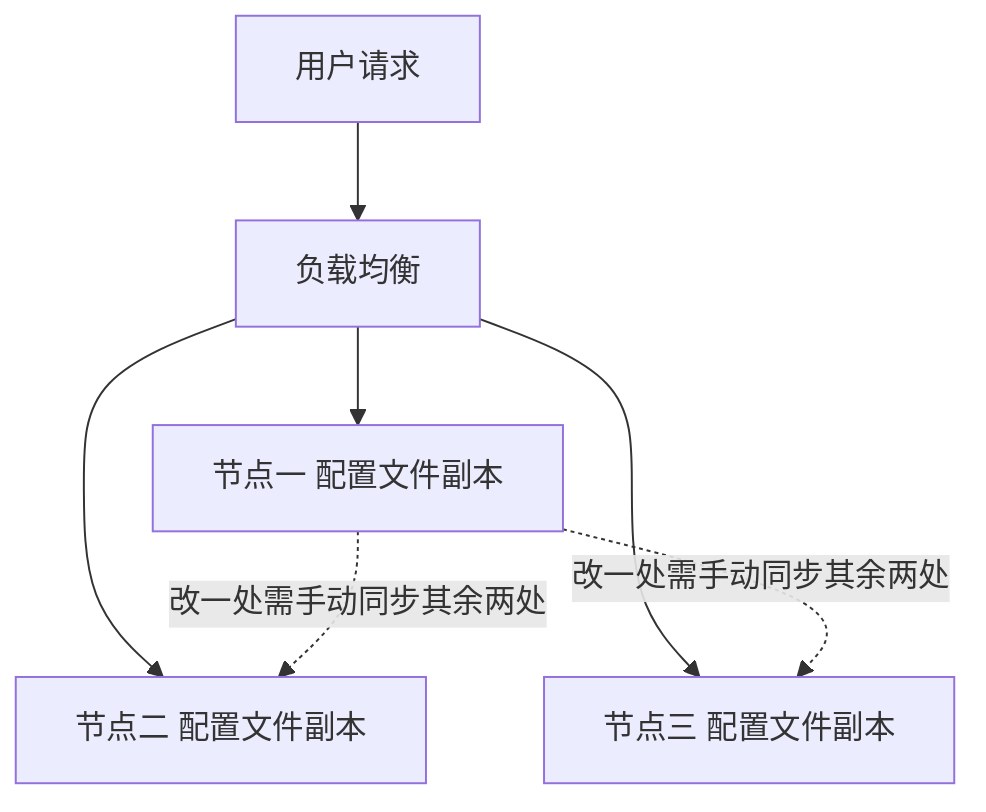
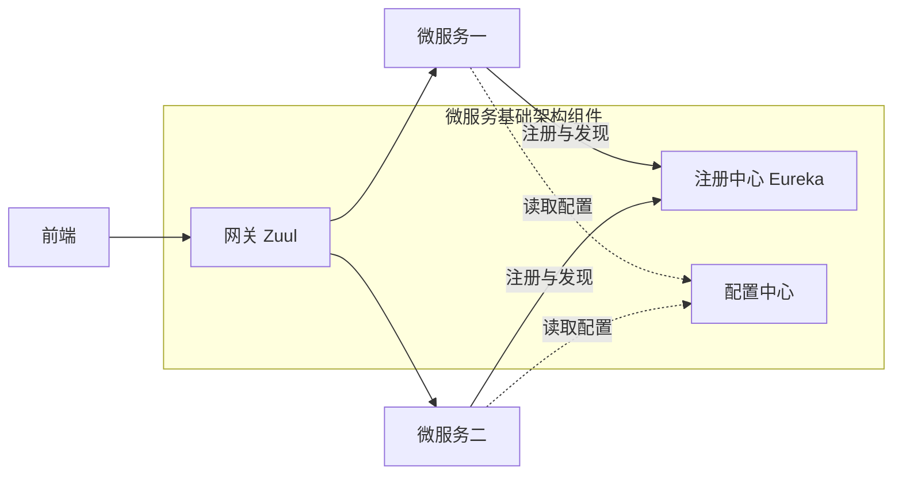

# 配置中心是什么：从散落的配置文件到统一管理

每个微服务工程里都躺着一份 `application.properties`：想改一个 Swagger 开关，要打开 IDEA 找到对应模块，改完必须重启服务；谁改过这个值、上一版是什么，没有任何记录。配置越积越多，这些零碎的不方便就攒成了实际的开发阻力。万信金融项目在动手写业务之前，专门用一节课把配置这件事讲透，因为接下来项目里各个微服务的大部分配置都要交给一个新角色统一管理，它就是配置中心。

## 先给结论

- 配置是程序员天天打交道、伴随应用整个生命周期的代码，常见形式有五种：环境变量、启动参数、配置文件、脚本、数据库。
- 传统配置形式有四个痛点：缺少权限控制、缺少版本控制、缺少实时生效、微服务化和分布式带来的管理挑战。
- 配置中心把配置从各个应用中剥离出来，独立部署、统一管理，地位与注册中心、网关平级，属于微服务基础架构中的一个基础服务组件。
- 万信金融项目选用 Apollo 作为配置中心，先把「为什么需要它」讲清楚，再进入部署与使用。

## 配置是什么，以什么形式存在

配置的作用一句话就能说清：把可能变化的值从代码里拿出来，提升应用程序的灵活性、可扩展性和可维护性。数据库地址、超时时间、功能开关这类信息不写死在代码里，调整起来就不用动代码、重新编译。

落到日常开发，配置以五种形式存在。

**第一种，环境变量。** 配在操作系统层面，比如 `PATH`、`JAVA_HOME`，学 Java 第一天就要配，是最早接触的一种配置。

**第二种，启动参数。** 微服务工程启动时传的参数，比如用 `-Dserver.port=53050` 指定用户中心的端口，同一份代码换个参数就能换端口。

**第三种，配置文件。** 最常用的主力形式，`properties`、`yml`、`xml` 都算。基础工程里的用户中心就靠一份配置文件撑起全部行为：

```properties
# 用户中心 application.properties 节选
spring.application.name=consumer-service
server.servlet.context-path=/consumer
# 开启swagger
swagger.enable=true
# 日志配置
logging.config=classpath:log4j2-dev.xml
# 中文乱码处理
spring.http.encoding.charset=UTF-8
spring.http.encoding.force=true
spring.http.encoding.enabled=true
# springCloud服务注册
eureka.client.serviceUrl.defaultZone=http://localhost:53000/eureka/
```

**第四种，脚本。** Windows 下的 `bat`、Linux 下的 `sh`，里面写的动作命令也是配置。后面部署 Apollo 时会直接碰到一个 `runApollo.bat`，三个服务的启动方式全写在里面。

**第五种，基于数据库。** 把配置存到数据库表里而不是文件里。这种形式平时见得少，但它正是 Apollo 的选择，配置的键值对就是表里的行：

```sql
-- 以数据库形式存放配置的示意（示例为按本课写法补全，Apollo 内部正是这种思路）
CREATE TABLE app_config (
    config_key   VARCHAR(128) NOT NULL COMMENT '配置键，例如 swagger.enable',
    config_value VARCHAR(512) NOT NULL COMMENT '配置值',
    remark       VARCHAR(256) DEFAULT NULL COMMENT '用途说明',
    PRIMARY KEY (config_key)
);
```

五种形式目标一致：让信息不硬编码，将来改值、调整行为足够灵活。

## 传统配置形式的四个痛点

这些形式用了很多年，问题恰恰藏在熟练里。

**第一，缺少权限控制。** 配置能改变程序行为，给不同的值直接影响应用运行，不正确的配置甚至能引起事故。而配置文件就躺在代码仓库里，团队里任何人都能改，改错了往往要全组排查。合理的诉求是：核心配置只有部分人能修改，其他人只读。

**第二，缺少版本控制。** 一个配置值可能反复改，`swagger.enable` 开发期是 true，上线前改成 false，某次排障又想改回去。代码有 Git 管着，配置本身却没有版本，想找回某一版用过的值时，历史已经没了。

**第三，缺少实时控制。** 改完配置大多要重启应用才生效，环境变量甚至要重启电脑。期望是配置变化后热发布、实时生效，省掉重启的等待。

**第四，微服务化和分布式带来的挑战。** 这是最结构性的一条。单体时代所有业务挤在一个项目里，一份配置文件再大也是一份；拆成微服务后，配置跟着拆散到各个工程，用户中心一份、网关一份，各自还要在多台服务器、多个集群上部署，同一份配置被复制成多份副本，改一处就得同步其余几处。



这张图讲的是分布式部署下同一份配置被复制成多份的处境：应用一样，配置文件一样，但它们是彼此独立的文件，没有任何机制保证一致。再叠加多环境差异，开发环境要开 Swagger，生产环境要关掉，配置文件就得改来改去，麻烦进一步放大。

## 配置中心：把配置剥离成一项基础服务

解决思路藏在「中心」两个字里：把各个微服务中的配置单独抽取出来，交给一个独立的服务统一管理。配置中心将配置从各个应用中剥离出来，自成一体，对所有配置进行统一管理，由此把权限、版本、实时、分散四个问题一并纳入解决范围。在系统架构里，配置管理和安全、日志、监控一样属于非功能性需求，配置中心是整个微服务基础架构体系中的一个组件，与注册中心、网关一样是项目的基础服务。



这张图表达配置中心在架构中的位置：注册中心管「服务在哪里」，网关管「请求从哪进」，配置中心管「配置从哪读」，三者都是独立部署的基础服务，业务微服务按需对接。配置中心具体怎么解决四个痛点、应用怎么从它取配置，就是接下来几课的内容。

## 常见误区

- **把配置等同于配置文件。** 错例：一说配置就只想到 `application.properties`。正解：环境变量、启动参数、脚本、数据库都是配置形式，配置文件只是最常用的一种。
- **把配置中心当成注册中心。** 错例：以为配置中心也是登记服务地址的。正解：注册中心管理服务实例的地址列表，配置中心管理键值对形式的配置，两者职责完全不同。
- **认为单体项目没有这些痛点。** 错例：单体项目配置集中，就以为权限、版本、实时问题不存在。正解：三个问题在单体时代同样存在，只是拆分成微服务后，随着配置数量和副本数量的增长被急剧放大。
- **多实例部署时改完一份配置就了事。** 错例：改了节点一的配置文件，忘掉另外两个副本。正解：这正是配置中心要消灭的手工同步，配置入库、各实例从中心读取，天然一致。

## 面试可能被问到的问题

1. 面试官追问：「配置和硬编码相比，解决了什么问题？」
   答：配置把可能变化的值从代码里抽出来，改值不需要改代码、重新编译发布，提升应用的灵活性、可扩展性和可维护性。数据库地址、超时时间、功能开关这类会随环境与运营策略变化的内容，都适合放进配置。
2. 面试官追问：「常见的配置形式有哪些？」
   答：五种：环境变量，配在操作系统层面；启动参数，进程启动时传入；配置文件，properties、yml、xml 等，是最常用的形式；脚本，bat、sh 里的动作命令；以及基于数据库，把配置作为表数据存储。
3. 面试官追问：「传统配置形式有哪些痛点，配置中心怎么对应解决？」
   答：四个痛点：缺少权限控制，配置中心提供账号与权限体系；缺少版本控制，配置中心记录每次发布历史并支持回滚；缺少实时控制，配置中心推送变更实时生效；微服务化后配置分散在多个工程和多份副本里，配置中心统一收口管理。
4. 面试官追问：「配置中心在系统架构中处于什么位置？」
   答：它和注册中心、网关一样是微服务基础架构里的基础服务组件，独立部署。注册中心解决服务注册与发现，配置中心解决配置的统一管理，两者都属于非功能性需求的基础设施，业务微服务在启动和运行阶段对接配置中心读取配置。

## 配套资料

- 讲义：`materials/docs/10/万信金融-第1章-讲义-开发环境搭建v1.0.md`，其中 1.3 节是 Apollo 配置中心的引入位置，并注明项目各微服务的大部分配置信息由 Apollo 统一管理。
- 代码：`materials/code/10/wanxinp2p/`，微服务基础工程聚合工程，正文引用的用户中心 `application.properties` 为该工程真实文件；内层目录为原始模块命名，与正文 `consumer-service` 改写口径不一致，引用路径到工程目录为止。
- 说明：数据库存放配置的建表 SQL 为示例，按本课写法补全；Apollo 真实的库表结构在搭建一课展开。
