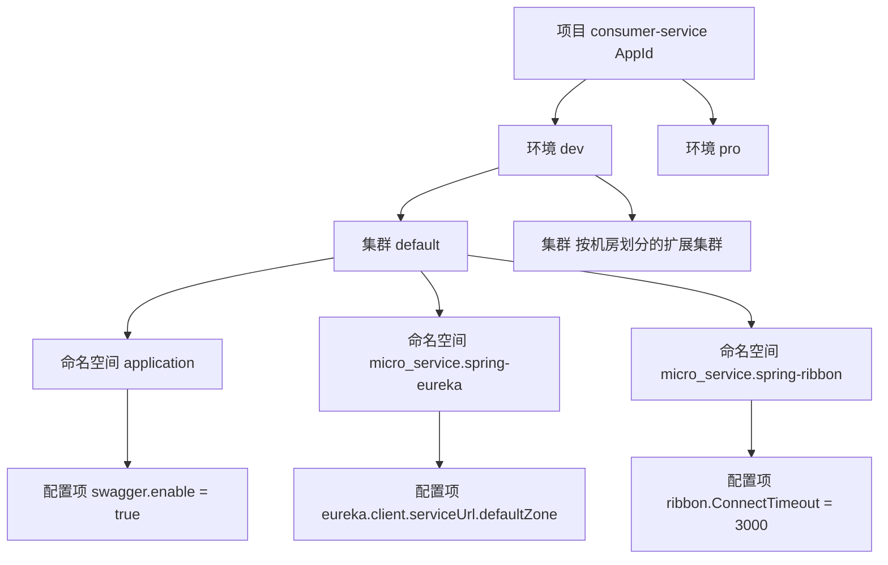

# Apollo 的四个核心概念：AppId、环境、集群、命名空间

服务端已经在本机跑起来了，接下来天天要和 Apollo 打交道，打交道绕不开控制台里的四层名词：项目、环境、集群、命名空间。打开任何一个项目页面，左边是环境与集群的树，右边是一排命名空间页签，页签里才是一条条配置。这四个概念分层咬合，缺一层客户端就定位不到配置，把它们一次搞透，后面整合 Spring Boot 时才不会迷路。

## 先给结论

- 四个核心概念：项目对应关键字 AppId，环境对应 env，集群对应 cluster，命名空间对应 namespaces。
- 项目与微服务工程一一对应，AppId 是应用在 Apollo 里的唯一标识，客户端取配置时凭它找到所属项目。
- 环境按部署阶段划分，如开发、测试、生产；集群是同一环境下实例的分组，常按机房或地域切分；开发阶段一个 default 默认集群就够。
- 命名空间是配置的分类单位，application 是每个项目自带的默认命名空间，按组件拆出的 `micro_service.*` 公共命名空间把原本一整块的配置文件分类管理。
- 客户端定位一条配置的完整路径是：AppId 找项目，env 找环境，cluster 找集群，namespace 找分类，最后落到键值对。

## 项目与应用 AppId

项目的含义最直观：一个 Apollo 项目对应一个微服务工程。用户中心 `consumer-service` 是一个工程，它涉及的几十项配置就整体放进 Apollo 里一个同名项目，五个微服务工程就建五个项目，配置按工程各归各的存放位置。

创建项目时的表单字段也顺带认一遍：部门、应用 ID、应用名称、应用负责人、项目管理员。其中「应用 ID」就是 AppId，它是整个体系里最重要的一个字段。微服务将来要从 Apollo 取配置，取配置首先要回答「从哪个项目取」，这个答案就是 AppId，客户端配置文件里的 `app.id` 与控制台里项目的应用 ID 必须严格一致，否则取到的永远是空。

## 环境 Environment：部署阶段的隔离

环境说的是这份配置属于哪个部署阶段。开发时是开发环境，部署测试时是测试环境，线上运行是生产环境，不同阶段的同一批配置往往值不同。课程演示的线上环境里就能看到多个环境并列：dev 是开发环境，pro 是生产环境，中间还有验收用的环境，Apollo 常见的划分是 dev、fat、uat、pro 四档。目前开发阶段只需要一个 dev 环境，概念先建立起来。

每个环境都要有对应的服务端地址，客户端才知道去哪取。这个映射写在工程的一个小文件里：

```properties
# apollo-env.properties：环境到 meta 服务地址的映射（列出开发环境，其余环境格式相同）
dev.meta=http://localhost:8080
```

`dev.meta` 指向开发环境 ConfigService 的地址，将来接入测试或生产环境，就按同样格式增加各自的 meta 地址。环境之间的切换由此变成换一个 `-Denv` 启动参数的事，配置不用改来改去。

## 集群 Cluster：同一环境下实例的分组

集群的官方定义是一份：一个应用下不同实例的分组。最典型的分法是按数据中心的位置：部署在上海机房的实例划成上海集群，部署在北京机房的划成北京集群。同一个应用部署在多个集群上，程序是一样的，但集群之间某些配置可能不一样，比如不同地域承载的访问量不同，超时时间、连接池大小这类参数就可能各有各的值。

把集群和环境区分开是关键一步：环境隔离的是部署阶段，集群隔离的是同一阶段内的实例分组。开发阶段所有实例都在本机，一个名为 default 的默认集群完全够用；将来上线运营，再看实际部署形态决定要不要按机房拆集群。

## 命名空间 Namespace：给配置分类

命名空间解决的是配置的「乱」。回想基础工程时代的用户中心配置文件，几十行配置挤在一个 `application.properties` 里：中文乱码处理三行、Eureka 注册三行、Ribbon 超时重试五六行，全混在一起。Apollo 建议把配置分类，每一类就是一个命名空间。

在控制台里可以自己创建、修改、删除命名空间，命名空间的名字往往直接暴露它的用途，打开列表一眼就能看出哪块放数据源、哪块放 Redis、哪块放 RocketMQ。项目接入 Apollo 后，用户中心的配置文件里如实记录了这套分类：

```yaml
# Apollo 环境基础工程中用户中心的 application.yml（包名与模块名已按本系列口径改写）
# 启动参数：-Denv=dev -Dapollo.cluster=DEFAULT -Dserver.port=53050
app:
  id: consumer-service
apollo:
  bootstrap:
    enabled: true
    namespaces: application,micro_service.spring-boot-druid,micro_service.spring-boot-http,micro_service.spring-eureka,micro_service.spring-hystrix,micro_service.spring-ribbon,micro_service.spring-boot-redis,micro_service.mybatis-plus,micro_service.spring-rocketmq

spring:
  application:
    name: consumer-service

logging:
  config: classpath:log4j2-dev.xml
```

数一数 namespaces 列表：application 加八个 `micro_service.` 前缀的命名空间，按组件各归各位，druid 管数据源连接池，spring-boot-http 管中文编码与异常处理，spring-eureka 管注册发现，hystrix 与 ribbon 管熔断和负载均衡，redis、mybatis-plus、rocketmq 各管一摊。application 是每个项目自带的默认命名空间，存放本应用私有的配置，其余属于公共命名空间，把多个项目共用的组件配置抽出去统一维护。对比过去一整块配置文件的时代，这种分法让每类配置有了明确的归属和边界，管理效率完全不同。

## 四层概念如何咬合

把四个概念从上到下串起来，就是客户端定位配置的完整坐标系：



这张图自上而下读就是查找路径：应用凭 `app.id` 找到自己的项目，凭 `env` 落到具体环境，凭 `cluster` 落到默认或指定集群，再按 namespaces 列表逐个打开命名空间，读出里面的键值对。控制台界面上的每一层列表，正好与这条路径一一对应，看懂界面就是看懂了这四层模型。

## 常见误区

- **AppId 与控制台项目对不上。** 错例：客户端配 `app.id: consumer-service`，控制台里建的项目 ID 却随手填了别的名字，启动后配置全部为空。正解：应用 ID 是取配置的唯一凭证，工程名、`app.id`、控制台项目 ID 三者保持一致。
- **把环境和集群混为一谈。** 错例：以为测试、生产各建一个集群就算分了环境。正解：环境隔离部署阶段，靠 `-Denv` 与各环境的 meta 地址实现；集群是同一环境下按机房或地域对实例分组，两者是上下两层。
- **把命名空间当目录树。** 错例：想在命名空间里再嵌套子命名空间。正解：命名空间是平级的配置分类单位，一个项目下一层命名空间、里面直接放键值对，没有目录嵌套的概念。
- **修改命名空间后不发布。** 错例：在某个自定义命名空间里改了配置就重启验证，值没有变化。正解：每个命名空间的变更都要单独发布后才生效，发布动作与默认命名空间一样不能省。
- **以为 default 集群可以随意改名。** 错例：把默认集群重命名成自己的机房名，客户端没配 cluster 参数后取不到配置。正解：客户端不指定 cluster 时落到 default 默认集群，改名的同时必须同步给客户端加 `-Dapollo.cluster` 参数。

## 面试可能被问到的问题

1. 面试官追问：「Apollo 里的 AppId 是什么，有什么用？」
   答：AppId 是应用在 Apollo 中的唯一标识，创建项目时指定，客户端配置文件里的 `app.id` 与之对应。客户端取配置时先凭 AppId 定位项目，它是「从哪个项目取配置」这个问题的答案，两边不一致会取到空配置。
2. 面试官追问：「环境和集群的区别是什么？」
   答：环境按部署阶段划分，如 dev、fat、uat、pro，不同环境配置值不同，各环境有独立的 ConfigService 与数据库；集群是同一环境下实例的分组，常按机房地域切分，同一集群内实例共享配置，不同集群允许部分配置不同。环境是横向的阶段隔离，集群是阶段内的实例分组。
3. 面试官追问：「命名空间是什么？默认命名空间叫什么？」
   答：命名空间是配置的分类单位，把按组件或用途归类的配置分成一组管理。每个项目自带一个名为 application 的默认命名空间，放应用私有配置；还可创建公共命名空间，如按组件拆分的 `micro_service.spring-eureka` 等，供多个项目共享。
4. 面试官追问：「客户端定位一条配置的完整路径是怎样的？」
   答：四个层级依次定位：AppId 确定项目，env 参数确定环境，cluster 参数确定集群，namespaces 列表确定命名空间，最终在命名空间里按 key 读到值。任何一个层级对不上，客户端就拿不到目标配置。
5. 面试官追问：「为什么要按组件拆命名空间，而不是一个大文件全装下？」
   答：拆开后每类配置有明确归属，查找与维护成本大幅下降；公共组件配置抽成公共命名空间后，多个项目可以共享同一份维护入口，改一处处处生效；不同命名空间还能设置不同的发布与权限策略，大文件无法做到这些。

## 配套资料

- 代码：`materials/code/10/wanxinp2p_apollo/`，Apollo 环境的微服务基础工程，正文引用的用户中心 `application.yml`（含 app.id 与九个命名空间的完整列表）与 `apollo-env.properties` 均为该工程真实文件；内层目录沿用原始模块命名，与正文 `consumer-service` 等改写口径不一致，引用路径到工程目录为止。
- 讲义：`materials/docs/10/万信金融-第1章-讲义-开发环境搭建v1.0.md`，1.4 节说明基础工程（Apollo 环境）的打开与测试方式，指出各基础工程与此前版本的差异正是接入 Apollo 带来的。
- 说明：控制台创建项目表单、环境与集群的界面细节来自课程演示画面，课程体验环境中以 dev 环境与 default 集群为主，正文对多环境的描述按 Apollo 主流环境划分补全。
