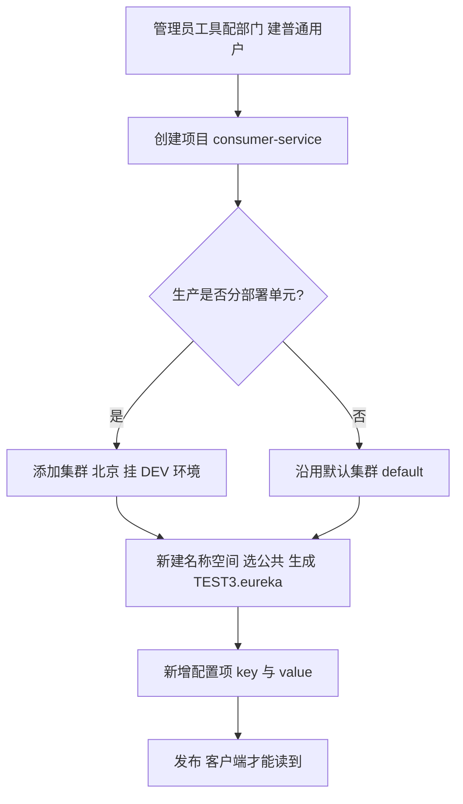

# Apollo 控制台实操：给微服务建配置的家，改完记得发布

项目、环境、集群、名称空间这四个核心概念理顺之后，剩下的就是动手。真要给一个微服务搬配置，控制台里点哪些按钮、按什么顺序点、点完怎么确认生效，每一步都有讲究：跳过基础数据直接建项目，会在部门下拉框前卡住；改完配置忘了发布，微服务那一头永远取不到新值。把控制台一次完整的操作流程走通，这些坑一次踩完，后续天天要用的界面就不再是黑盒。

## 先给结论

- 控制台操作主线：管理员工具备好部门与用户，再创建项目，再按需建集群与名称空间，最后新增配置并发布。
- 配置改完必须点发布，客户端只认已发布的版本；发布历史支持一键回滚，灰度发布可以让指定实例先试新配置。
- 应用 ID 建议与微服务名对上，`consumer-service` 一看就知道是用户中心的配置，别人才不用猜。
- 公共名称空间的命名会自动带上部门 ID 前缀，部门 ID 是 `test3` 时，新建的 `eureka` 名称空间实际叫 `TEST3.eureka`。
- 各微服务重复的配置收敛到一个专门项目，其他项目通过「关联公共名称空间」直接引用，不用每次重建。

## 先备基础数据：部门与用户

**管理员账号只有一个，名字就叫 apollo。** 用它登录才能看到「管理员工具」菜单，普通用户登录后这个菜单是消失的。控制台默认自带两个样例部门，正式使用前要把自己的组织结构填进去，入口在管理员工具的系统参数里，参数 key 是 `organizations`，value 是一份 JSON 部门列表。查询出来后可以直接编辑：样例部门可删可留，新增部门自己起 ID 和名字，ID 不重复就行：

```json
[
  {"name": "战狼组", "id": "test3"},
  {"name": "样例部门1", "id": "t1"}
]
```

保存成功后有个小坑值得提前知道：回到创建项目页面，部门下拉框里可能并没有刚才的部门，界面没有即时刷新。退出重新登录一次就出现了，这不是操作错了，属于控制台的体验问题，知道有这一出就不会慌。

用户管理也是管理员工具里的一项，用来新建普通用户，填个用户名、密码、邮箱提交即可。新建的用户能正常登录、能看项目，但看不到管理员工具菜单，这验证了一条权限规则：管理员全局只有一个，就是 `apollo` 账号本身。

## 创建项目：一个微服务一个家

基础数据就位后，创建项目就顺了。给用户中心 `consumer-service` 这个微服务建项目，要填的几项分别是：应用 ID 填 `consumer-service`，应用名称填「用户中心」，部门选刚建好的，负责人选自己。

应用 ID 和微服务本地的 `spring.application.name` 没有强制一致的技术约束，两者是独立的取值，但强烈建议见名知义并对上号。配置中心里项目会越建越多，ID 与服务名对应，定位配置不用翻记录；这套工程的口径就是两边同名，后续集成客户端时 `app.id` 直接照抄。

创建成功会直接进入项目首页，默认只有一个 DEV 开发环境，环境、项目的基本信息一并列在页面上。教学演示用开发环境已经够用，企业里通常还有测试、预发、生产几套，按需添加。

## 集群与名称空间：配置住在哪、归哪类

环境和项目之下还有两层组织单位。集群对应一套部署单元，同一个环境里可以有多个集群，每个集群的配置各管各的，适合多地部署或分组灰度的场景；演示时添加一个「北京」集群并挂到 DEV 环境即可，操作只有起名字和选环境两步。名称空间则是配置的分类目录，同一类配置放进同一个名称空间，找起来才不乱。两者的操作链路如下：



关键分支在集群那一步：没有多地部署需求就直接用默认的 `default` 集群，不必为了建而建。名称空间这里有个细节要留意：新建时填的名字是 `eureka`，保存后列表里出现的是 `TEST3.eureka`，前缀正是部门 ID `test3`。非默认的公共名称空间都会自动加部门前缀做隔离，客户端引用时必须写带前缀的全名。

新建名称空间时还要在「关联已有」与「新建」之间选一次：第一次自然选新建，同时勾选公共类型，公共名称空间才允许被其他项目引用；私有名称空间再好也只归自己项目。

## 加配置：把本地文件搬进名称空间

要搬的内容在本地 `consumer-service` 的配置文件里现成躺着，以注册中心与负载均衡这段为例：

```properties
# springCloud eureka配置
eureka.client.serviceUrl.defaultZone=http://localhost:53000/eureka/
#注册地址，不使用ip地址，使用应用名
eureka.instance.preferIpAddress=true
eureka.instance.instance-id=${spring.cloud.client.ip-address}:${spring.application.name}

# springCloud ribbon配置
ribbon.MaxAutoRetries=2
ribbon.ConnectTimeout=300
ribbon.ReadTimeout=20000
ribbon.MaxAutoRetriesNextServer=2
```

在 `TEST3.eureka` 名称空间里点新增配置，key 填等号前的部分，value 填等号后的部分，附一句注释说明用途，再选择配置生效的环境与集群，演示时放进 DEV 环境的 default 集群。保存后名称空间列表里就能看到这一条，之后随时可以修改、可以删除。搬进去之后名称空间里的内容长这样：

```properties
# 注册中心地址
eureka.client.serviceUrl.defaultZone=http://localhost:53000/eureka/
```

## 发布、回滚与灰度：生效环节的三道保险

**改完配置一定要点发布，这一步没有例外。** 控制台里的修改在发布之前只是草稿，客户端取配置取到的是最近一次发布生成的版本，不发布，本地怎么改微服务都感知不到。点下发布，控制台为这个名称空间生成一次发布记录，客户端通过长轮询机制感知到版本变化，随即拉取新配置并更新本地，整个过程不需要重启微服务。

发布之后还有两道保险在同一个页面上。发布历史里记录着每一次发布的版本与修改内容，发布错了可以一键回滚到上一个版本，配置回退的成本几乎为零；灰度发布则允许指定一部分实例的 IP 先用新配置跑，观察没问题再做全量发布，把影响面控制到最小。这两项是控制台的标配能力，入口都在名称空间页面的发布按钮附近，操作类内容跟着界面走一遍就会。

## 关联公共名称空间：重复配置只存一份

玩到这一步已经能独立管配置了，还有一手高级玩法解决重复问题。各微服务里的 Eureka 地址、Ribbon 参数、编码配置高度雷同，每个项目复制一遍既费事又容易改漏。做法是建一个专门的配置项目，名字见名知义，把重复配置全部建成公共名称空间放进去；其他项目再需要这些配置时，不新建，而是创建名称空间时选「关联公共名称空间」，从列表里勾选现成的即可。关联之后该名称空间在项目里可见可用，源头改一处，引用方全部受益，这份通用配置的正式落位在搭建 Apollo 环境基础工程时就能看到。

## 常见误区

- **改完配置不点发布就去验证。** 错例：控制台里改了 `eureka.client.serviceUrl.defaultZone`，重启微服务发现值没变。正解：发布之前客户端只认上一次发布的版本，修改后必须点发布。
- **新建的部门在下拉框里找不到就反复保存。** 错例：保存了部门又新建一个，越建越多。正解：退出重新登录一次，下拉框就会出现，控制台存在缓存延迟。
- **应用 ID 随手起名。** 错例：应用 ID 叫 `test01`、`abc`，一周后没人知道里面存的是谁的配置。正解：应用 ID 与微服务名对应，见名知义。
- **私有名称空间想让其他项目引用。** 错例：类型选了 private 还奇怪别的项目关联不到。正解：跨项目共享必须建成公共名称空间，其他项目通过关联公共名称空间引用。
- **用普通用户找管理员工具。** 错例：新建的账号里翻不到系统参数菜单。正解：管理员工具只对 `apollo` 管理员账号可见，普通用户做日常配置操作即可。

## 面试可能被问到的问题

1. 面试官追问：「Apollo 控制台里项目、环境、集群、名称空间是什么关系？」
   答：项目对应一个应用，用应用 ID 唯一标识；项目下有多个环境，如开发、测试、生产；每个环境下可分多个集群对应不同部署单元；配置最终以名称空间为单位组织，一个名称空间是一组配置的集合。定位一条配置就是这四层坐标逐层往下找。
2. 面试官追问：「为什么配置修改后必须发布才生效？」
   答：控制台的编辑保存只写入草稿，点发布才会生成一次正式的发布版本；客户端通过长轮询感知到新的发布版本后拉取并更新本地缓存与注入值。没有发布动作，客户端始终使用上一个版本，这是有意设计的生产保护。
3. 面试官追问：「公共名称空间和私有名称空间的区别是什么？」
   答：私有名称空间只归属本应用，其他应用不可见；公共名称空间可以被任意应用关联引用，适合放全项目重复的通用配置。非 application 的公共名称空间命名会自动加部门 ID 前缀，引用时要写带前缀的全名。
4. 面试官追问：「发布上去的配置改错了怎么办？」
   答：名称空间有发布历史，每次发布都是一条可追溯的版本记录，出问题可以从发布历史一键回滚到上一个版本，客户端会拿到回滚后的配置。所以配置变更不靠改回来，靠回滚机制。
5. 面试官追问：「灰度发布解决什么问题，怎么操作？」
   答：配置变更直接全量发布有风险，灰度发布先指定部分实例的 IP 使用新配置，观察业务表现没问题再全量发布，把配置事故的影响面限制在少数实例上；入口在名称空间发布按钮旁，按提示填灰度 IP 即可。
6. 面试官追问：「配置项多了怎么组织才不乱？」
   答：按用途拆名称空间分类存放，比如注册中心一类、数据库连接池一类、消息队列一类；重复配置收敛到专门的公共配置项目做成公共名称空间，各应用按需关联，控制台里再配合注释说明每项配置的用途。

## 配套资料

- 代码：`materials/code/10/wanxinp2p_apollo/`，控制台操作最终落成的工程产物：consumer-service、gateway-server 与通用配置项目均已建好，正文引用的名称空间清单与 `eureka.client.serviceUrl.defaultZone` 等配置项与该工程一致；内层目录为原始包名，与正文 `com.study.finance` 改写口径不一致，引用路径到工程目录为止。
- 讲义：`materials/docs/10/万信金融-第1章-讲义-开发环境搭建v1.0.md`，其中 1.3 节 Apollo 配置中心为本课出处；更细的控制台操作截图说明在课程配套的 Apollo 专题讲义中，未随本阶段资料归档。
- 说明：控制台操作类内容无源码对应，按本课演示与 Apollo 标准能力整理。
