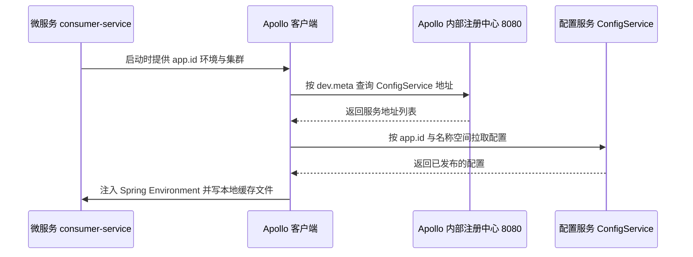

# 微服务接入 Apollo 客户端：一个依赖加五个配置项

配置在控制台里建好发布了，本地微服务一启动就露馅：`application.properties` 里的配置都搬去了 Apollo，Spring Boot 工程没有配置根本起不来。总得有个角色在启动时替应用去配置中心把配置取回来，再交给程序使用，这个角色就是 Apollo 客户端。接入客户端不用写一行代码，但要给它交代清楚五件事，少说一件它就取不到配置，应用照样起不来。

## 先给结论

- 集成是零代码的：pom 里引入 `apollo-client` 依赖即可，客户端在容器启动过程中自动工作。
- 客户端要被回答五个问题：连哪个环境、找哪台服务器、取哪个项目、读哪些名称空间、用哪个集群。
- 五个问题对应五处配置：`-Denv=dev`、`apollo-env.properties` 里的 `dev.meta`、`app.id`、`apollo.bootstrap.namespaces`、`-Dapollo.cluster`。
- `apollo.bootstrap.enabled=true` 让 Apollo 配置在容器启动早期注入，优先级高于本地配置。
- 验证集成成功的标志是热更新：控制台改值并发布后，`@Value` 注入的字段不重启就能拿到新值。

## 客户端在整个体系里的位置

配置中心的全貌分两半：控制台那半负责管配置，把增删改查和发布做掉；微服务这半负责取配置，在启动和运行期间把配置搬回本地。客户端就是这后半段的主角，它的工作流程如下：



从图里能读出客户端的全部诉求：要连对地方（meta 地址），要找对东西（app.id 与名称空间），中间还依赖 Apollo 自己的注册中心做服务发现。下面按接入顺序逐项交代。

## 依赖：加进 classpath 就自动工作

版本统一由父工程的依赖管理锁定，模块引用时不写版本号：

```xml
<!-- 父工程 pom.xml 依赖管理节选 -->
<dependency>
    <groupId>com.ctrip.framework.apollo</groupId>
    <artifactId>apollo-client</artifactId>
    <version>1.2.0</version>
</dependency>

<!-- 微服务模块 pom.xml 中引用，不写版本 -->
<dependency>
    <groupId>com.ctrip.framework.apollo</groupId>
    <artifactId>apollo-client</artifactId>
</dependency>
```

客户端不是那种要写代码调用的组件，依赖进来的瞬间它就存在了，Spring 容器启动时它会自动去配置中心拉配置并注入 Environment，业务代码完全无感。这也意味着如果集成有问题，症状不会是编译报错，而是启动时取不到配置，排查要靠日志和配置项对照。

## meta 地址：先找到配置中心在哪

客户端第一步要定位配置中心，这份信息写在 `src/main/resources/apollo-env.properties` 里，每个环境一条：

```properties
# 开发环境：Apollo 部署在本机
dev.meta=http://localhost:8080
# 功能验收测试环境
fat.meta=http://apollo.fat.example.com
# 用户验收测试环境
uat.meta=http://apollo.uat.example.com
# 生产环境
pro.meta=http://apollo.example.com
```

当前只用到第一行，key 的固定格式是 `<环境>.meta`，等号后是那个环境下 Apollo 服务的地址。端口为什么是 8080 而不是控制台的 8070？8070 是 Portal 管理界面的端口，人用浏览器访问；8080 是 Apollo 内部配置服务的端口，客户端取配置走这里。用浏览器访问 `http://localhost:8080` 会看到一个注册中心页面，上面注册着 Apollo 的两个关键内部服务，客户端正是通过它找到配置服务的地址，meta 配的就是这个入口。测试、生产环境的地址由企业实际部署决定，上线时切环境靠的是 `-Denv` 参数，不是改这份文件。

## app.id 与名称空间：取哪个项目的哪些配置

接下来在微服务的 `application.yml` 里回答「取什么」：

```yaml
# consumer-service 的 application.yml，启动参数见注释
# -Denv=dev -Dapollo.cluster=DEFAULT -Dserver.port=53050
app:
  id: consumer-service
apollo:
  bootstrap:
    enabled: true
    namespaces: application,micro_service.spring-boot-druid,micro_service.spring-boot-http,micro_service.spring-eureka,micro_service.spring-hystrix,micro_service.spring-ribbon,micro_service.spring-boot-redis,micro_service.mybatis-plus,micro_service.spring-rocketmq

spring:
  application:
    name: consumer-service

logging:
  config: classpath:log4j2-dev.xml
```

`app.id` 对应 Apollo 控制台里建的项目，配置中心里项目众多，不报 ID 客户端无从下手。`namespaces` 是一个逗号分隔的清单，`application` 是每个项目默认的私有名称空间，`micro_service.` 打头的这一串是关联过来的公共名称空间，分别装着连接池、HTTP、注册中心、熔断、负载均衡、Redis、MyBatis-Plus 与消息队列的配置。清单里写哪个才读哪个，工程里没用的名称空间不写，这里列这么多是因为用户中心把全家桶都用上了。

`apollo.bootstrap.enabled=true` 是固定套路配置，作用是把 Apollo 配置的加载提到容器启动的最早期，让远端配置的优先级高于本地文件。本地文件里留下来的 `spring.application.name` 与日志配置属于应用自己的身份信息，与配置中心无冲突。

## 启动参数：环境与集群放最灵活的位置

环境与集群是切换最频繁的两个维度，开发期用 dev，上线换 pro；集群也可能按部署调整。把它们放进 VM options，同一份代码不改一个字就能在多环境间切换：

```bash
# consumer-service 的 VM options
-Denv=dev -Dapollo.cluster=DEFAULT -Dserver.port=53050
```

`-Denv=dev` 里的 dev 与 `apollo-env.properties` 的 `dev.meta` 前缀严格对应，写成别的东西就找不到地址了；没建过多集群时集群名固定是 `DEFAULT`。端口顺手也放在这里，与本系列「网关和用户中心端口走启动参数」的约定一致。

## 验证：@Value 热更新才是集成的试金石

五处配置都就位后，启动微服务，能跑起来只能说明没报错，真正能证明配置取回来了的是热更新。`consumer-service` 的 application 名称空间里现成有一条 `swagger.enable=true`，用它写个验证接口：

```java
package com.study.finance.consumer.controller;

import org.springframework.beans.factory.annotation.Value;
import org.springframework.web.bind.annotation.GetMapping;
import org.springframework.web.bind.annotation.RestController;

@RestController
public class ConfigCheckController {

    // swagger.enable 已存在于 consumer-service 的 application 名称空间
    @Value("${swagger.enable:true}")
    private String swaggerEnable;

    @GetMapping("/config/check")
    public String check() {
        return "swagger.enable = " + swaggerEnable;
    }
}
```

访问接口看到当前值，然后去控制台把 `swagger.enable` 改成 `false` 并发布，再刷新接口，返回值已经变了，进程始终没有重启。这背后是客户端默认开启的注入值自动更新（`apollo.autoUpdateInjectedSpringProperties=true`），配合长轮询做到秒级生效。同时客户端会把取到的配置落到本地缓存文件，配置中心一时失联，应用重启也能用最后一次取到的配置撑住，可用性上多了一层兜底。

## 常见误区

- **meta 地址写成 8070。** 错例：照着浏览器里的控制台地址填 `http://localhost:8070`，客户端永远连不上。正解：8070 是给人看的管理界面，客户端走 8080 的内部配置服务。
- **app.id 与控制台项目对不上。** 错例：`app.id` 写成 `consumer`，控制台里的项目叫 `consumer-service`，客户端取不到任何配置。正解：`app.id` 照抄控制台的应用 ID。
- **namespaces 清单里写不存在的名称空间。** 错例：手滑写成 `micro_service.spring-ribben`，那部分配置静默缺失。正解：清单必须与控制台里的名称空间全名一致，公共名称空间带部门前缀。
- **忘配 `-Denv` 或写错值。** 错例：环境参数丢掉，客户端定位不到 meta，启动报连接失败。正解：env 值与 `apollo-env.properties` 的 key 前缀一一对应。
- **改完配置没发布就验证热更新。** 错例：控制台改了值就刷新接口，怀疑热更新失灵。正解：热更新的前提是点过发布，客户端只认发布版本。
- **给 `@Value` 再加 `@RefreshScope` 才放心。** 错例：把 Spring Cloud Config 的习惯带过来，多包一层注解。正解：Apollo 客户端默认自动更新注入值，不需要 `@RefreshScope`。

## 面试可能被问到的问题

1. 面试官追问：「Apollo 客户端是怎么找到配置中心的？」
   答：客户端从 `-Denv` 确定环境，再到 `apollo-env.properties` 里按环境取 meta 地址；meta 指向 Apollo 内部的注册中心，客户端通过它拿到 ConfigService 的真实地址，之后按 app.id、集群和名称空间拉取配置。整个寻址链路是环境、meta、服务发现三步。
2. 面试官追问：「`apollo.bootstrap.enabled=true` 的作用是什么？」
   答：开启后 Apollo 配置会在 Spring 容器启动的最早期作为 PropertySource 注入，优先级高于本地配置文件，保证应用启动阶段就能读到远端配置；不开的话 Apollo 配置注入得晚，依赖它的 Bean 可能在启动时拿不到值。
3. 面试官追问：「Apollo 下 `@Value` 为什么能热更新，原理是什么？」
   答：客户端默认开启 `apollo.autoUpdateInjectedSpringProperties`，配置发布后客户端通过长轮询感知新版本，自动比对变化的 key，通过反射更新 Spring Bean 中对应的 `@Value` 字段并刷新占位符值，整个过程不需要重启，也不需要 `@RefreshScope`。
4. 面试官追问：「配置中心挂了，微服务还能启动吗？」
   答：能。客户端拉取配置后会写本地缓存文件，配置中心不可用时客户端会先尝试本地缓存，再退回应用内的兜底配置，最终用最后一次成功取到的配置启动。所以 Apollo 对可用性的影响被缓存放大了，但代价是配置可能不是最新，恢复后要确认有没有发布变更。
5. 面试官追问：「定位一条 Apollo 配置需要哪几个坐标？」
   答：四个，应用 app.id、环境 env、集群 cluster、名称空间 namespace，控制台建配置与客户端取配置用的就是同一套四元组，排查「配置不生效」类问题时按这四个坐标逐一核对最有效。
6. 面试官追问：「集成了 Apollo 的名称空间，配置却没生效，怎么排查？」
   答：先看发布：改了没发布等于没改；再核对四元组：app.id 是否对、env 与 meta 是否匹配、集群名是否一致、namespace 全名有没有写错；然后看客户端启动日志的拉取结果；最后确认该 key 没有被更高优先级的本地配置覆盖。

## 配套资料

- 代码：`materials/code/10/wanxinp2p_apollo/wanxinp2p_apollo/`，`wanxinp2p-consumer-service/src/main/resources/application.yml` 与同目录 `apollo-env.properties`、`wanxinp2p-gateway-server` 下的同名文件、父 pom 中 apollo-client 1.2.0 的依赖管理均为真实文件；内层目录为原始包名，与正文 `com.study.finance` 改写口径不一致，引用路径到工程目录为止。
- 讲义：`materials/docs/10/万信金融-第1章-讲义-开发环境搭建v1.0.md`，其中 1.3 节 Apollo 配置中心为本课出处。
- 说明：`@Value` 热更新验证示例按本课写法补全；远程环境的 meta 地址以 example.com 占位，工程原文件里为内网 IP，本系列口径下不做保留。
