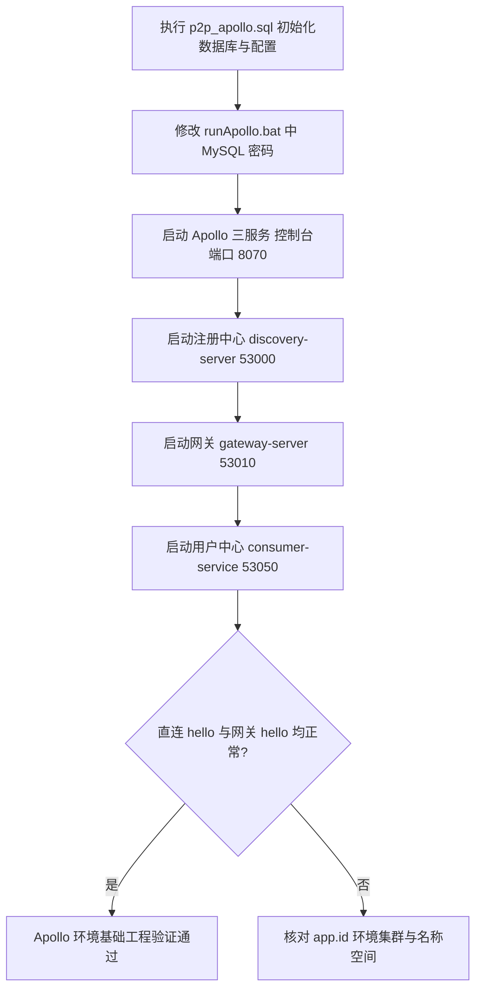

# 搭建 Apollo 环境的微服务基础工程：配置搬家后的骨架长什么样

> 🔒 安全提示：文中示例的口令/密钥均为课程教学环境演示口径，生产环境的安全要求见《安全与合规须知》。

上一套微服务基础工程里，Eureka 地址、Ribbon 参数、编码、日志的配置整整齐齐躺在各模块自己的配置文件里，所有配置都是本地的。真实项目不会这么干：既然引入了配置中心，微服务的大部分配置就该交给它统一管理。为后续开发准备的是一套 Apollo 环境的基础工程，配套一份初始化脚本，把它搭起来、跑通验证，之后每个章节的编码都在这套骨架上进行。旧的基础工程可以正式放下了。

## 先给结论

- 搭建三步：执行 `p2p_apollo.sql` 初始化数据库并导入基础配置，用记事本改 `runApollo.bat` 里的 MySQL 密码，双击启动后访问 `http://localhost:8070` 确认项目和配置已就位。
- 脚本会先删表再建表，本机数据库里若有其他项目的数据，先备份再执行。
- Apollo 化之后，微服务本地配置只剩 `app.id`、名称空间清单、应用名与日志几行，其余全部迁进控制台。
- 重复配置收敛到「通用配置」项目 `common-template`，以公共名称空间供各微服务关联引用。
- 注册中心不接 Apollo，配置保留在本地文件；启动顺序变成先 Apollo 后微服务，验证依旧走直连 hello 加网关 hello 两条路。

## 脚本与启动：把环境立起来

资料包里的 `p2p_apollo环境` 文件夹有两个主角。`p2p_apollo.sql` 一份脚本干两件事：创建 Apollo 服务端所需的数据库表，同时把基础工程的初始配置灌进去，项目、名称空间、一条条配置项全在 SQL 里预先写好了，不用在控制台里一项项手工添加。执行前要知道它的脾气：脚本先删表再重建，如果这台 MySQL 上还装着别的项目的库表，数据会被清掉，备份动作放在执行之前。

`runApollo.bat` 负责把 Apollo 的三个服务一键拉起，三个服务各占一个端口。用记事本打开它，把里面的 MySQL 连接密码改成自己数据库的真实密码，课程环境是 root 密码 123456，其余内容不用动。双击运行，等启动日志稳定后访问 `http://localhost:8070`，登录进去看到的不再是空壳：



图的左半段是环境准备，右半段是工程启动，顺序不能颠倒：Apollo 没起来，后面的微服务一个都起不来，因为它们的配置全在配置中心里。这一条也是从此以后每次开发的固定开场：先数据库与 Apollo，再注册中心，再业务微服务。

## 控制台里已经有什么

登录 8070 后能看到预置的四个项目：`consumer-service` 是用户中心，`gateway-server` 是网关，`common-template` 是通用配置，剩下的一个留给后续章节使用。真正值得细看的是通用配置项目，它把整个项目用得到的公共配置按类分好了名称空间：`micro_service.spring-boot-http`、`micro_service.spring-eureka`、`micro_service.spring-hystrix`、`micro_service.spring-ribbon`、`micro_service.spring-boot-redis`、`micro_service.spring-boot-druid`、`micro_service.mybatis-plus`、`micro_service.spring-rocketmq`，HTTP、注册中心、熔断、负载均衡、Redis、连接池、MyBatis-Plus、消息队列各占一格，每格里都是些眼熟的老配置，比如解决中文乱码的三行编码参数、Ribbon 的超时重试参数。

这些公共名称空间全部建为公共类型，`consumer-service` 与 `gateway-server` 需要哪类就关联哪类。公共配置的值在自己项目里也能覆盖，用到具体场景时再展开，设计意图记住一条：重复配置只有一份源头，改一处全项目生效。

## 本地配置瘦身后长什么样

打开 Apollo 版基础工程的 `consumer-service`，本地配置文件短得让人不适应：

```yaml
# consumer-service 的 application.yml，启动参数：-Denv=dev -Dapollo.cluster=DEFAULT -Dserver.port=53050
app:
  id: consumer-service
apollo:
  bootstrap:
    enabled: true
    namespaces: application,micro_service.spring-boot-druid,micro_service.spring-boot-http,micro_service.spring-eureka,micro_service.spring-hystrix,micro_service.spring-ribbon,micro_service.spring-boot-redis,micro_service.mybatis-plus,micro_service.spring-rocketmq

spring:
  application:
    name: consumer-service

logging:
  config: classpath:log4j2-dev.xml
```

对比传统版基础工程：`wanxinp2p` 那套里用户中心的配置文件有几十行 Eureka 与 Ribbon 配置，Apollo 版只剩十几行，而且一行业务配置都没有。留下的内容各有用途：`app.id` 告诉客户端取哪个项目，`namespaces` 清单声明读哪些名称空间，`spring.application.name` 是注册到 Eureka 的应用名，`logging.config` 指定本地日志配置。网关的文件结构一模一样，名称空间清单短一截，因为网关用不到连接池与消息队列：

```yaml
# gateway-server 的 application.yml，启动参数：-Denv=dev -Dapollo.cluster=DEFAULT -Dserver.port=53010
app:
  id: gateway-server
apollo:
  bootstrap:
    enabled: true
    namespaces: application,micro_service.spring-boot-http,micro_service.spring-eureka,micro_service.spring-hystrix,micro_service.spring-ribbon,micro_service.spring-boot-redis

spring:
  application:
    name: gateway-server

logging:
  config: classpath:log4j2-dev.xml
```

两个工程的模块结构完全相同：api、common、注册中心、网关、用户中心一个不少，pom 里的变化是父工程依赖管理多了 `apollo-client` 1.2.0，各模块按需引用。可以说这套工程就是把上一套的配置整体搬了家，代码一行没动。

## 注册中心为什么留在本地

三个可运行服务里只有注册中心的配置文件保持原样，端口 53000 与 Eureka 的开关照旧写在本地：

```yaml
# discovery-server 本地配置节选，应用名等项见工程文件
server:
    port: 53000

eureka:
  server:
    enable-self-preservation: false
    eviction-interval-timer-in-ms: 10000
  client:
    register-with-eureka: false
    fetch-registry: false
```

原因是一类经典的先有鸡还是先有蛋问题。Apollo 客户端自己也要通过服务发现去定位配置服务，而这套服务发现依赖的注册环境又建立在 Apollo 之上；让注册中心反过来依赖 Apollo，它启动时配置还没着落，整条链路会卡死。基础设施组件保持自持配置反而清晰，注册中心的角色和端口基本不变，写在本地没有维护负担。真实工程里它是唯一一个不装 Apollo 客户端的服务。

## 启动与验证：配置真的取回来了吗

三个工程的 VM options 都已经预置好，用户中心是 `-Denv=dev -Dapollo.cluster=DEFAULT -Dserver.port=53050`，网关把端口换成 53010，不用再手动配。按注册中心、网关、用户中心的顺序启动，机器上同时跑着 MySQL、Apollo 三服务与三个微服务，负载不小，耐心等控制台稳定。

验证逻辑和旧版一致：直连 `http://localhost:53050/consumer/hello` 返回 hello，说明用户中心正常；再访问 `http://localhost:53010/consumer/hello` 走网关转发，同样返回 hello。这两下返回的意义比旧版重得多：hello 接口背后需要 Eureka 地址、Ribbon 参数、编码配置、网关路由全部就位，而这些配置如今没有一个在本地文件里，能取回来用，就证明客户端与配置中心整条链路工作正常。哪一步起不来，回到控制台核对对应名称空间的配置与客户端的 `app.id`、环境、集群、名称空间四项声明是否对得上。

## 常见误区

- **不执行 SQL 直接双击启动脚本。** 错例：Apollo 起来了，控制台里空无一物，微服务取不到配置。正解：先执行 `p2p_apollo.sql` 完成初始化，项目和配置都在脚本里。
- **忘了改 `runApollo.bat` 里的数据库密码。** 错例：Apollo 起不来，日志里报数据库连接失败。正解：脚本里的密码要与本地 MySQL 一致，课程环境为 root 密码 123456。
- **旧数据不备份就跑脚本。** 错例：本机还装着其他项目的库，脚本一跑数据没了。正解：脚本先删表后建表，执行前确认影响范围并备份。
- **给注册中心也接上 Apollo 客户端。** 错例：追求统一把 discovery 的配置也搬进配置中心。正解：注册中心是配置链路自身的依赖，配置必须自持，否则互相等待起不来。
- **拿旧版基础工程继续往下开发。** 错例：两套工程都在 IDEA 里，随手打开没有 Apollo 的那套。正解：后续章节全部基于 Apollo 环境这套工程，本地配置已不再承载业务配置。
- **只看启动成功不算验证完。** 错例：三个服务控制台没报错就认为环境 OK。正解：直连 hello 与网关 hello 都返回才证明配置真的从配置中心取回来了。

## 面试可能被问到的问题

1. 面试官追问：「为什么注册中心不接入配置中心？」
   答：配置中心客户端定位服务、注册中心客户端发现服务，两者互为依赖时会出现启动死锁，注册中心作为最底层的基础设施必须自持配置。实践中注册中心这类地址固定、角色单一的服务保留本地配置，业务微服务的配置才交给配置中心。
2. 面试官追问：「公共名称空间是怎么实现配置复用的？」
   答：把各微服务重复的配置建成公共类型的名称空间放在专门的通用配置项目里，各微服务在项目里关联这些公共名称空间，加载时它们与私有的 application 名称空间一起注入；需要个性化时可在本项目的名称空间里覆盖同名 key，实现一处定义、按需覆盖。
3. 面试官追问：「哪些配置适合放配置中心，哪些留在本地？」
   答：会随环境变化或需要运行期调整的放配置中心，如中间件地址、超时参数、功能开关；应用身份类与应用强绑定的留本地，如应用名、客户端自身接入参数；基础设施组件为避免依赖环也保留本地。原则是配置中心管易变的公共配置，本地管不变的自持配置。
4. 面试官追问：「把一个微服务的配置从本地迁移到配置中心，步骤是怎样的？」
   答：先在控制台建项目与名称空间，把本地配置项按类导入并发布；再给工程引入客户端依赖，配 app.id、名称空间清单与启动参数；清空本地文件中的对应配置；最后启动验证核心接口，确认取值正常再提交。
5. 面试官追问：「这套基础工程的启动顺序和依赖关系是什么？」
   答：MySQL 与 Apollo 最先起，三个 Apollo 服务各占一个端口；然后是注册中心 53000，它是服务发现的地基；接着网关 53010 与用户中心 53050，两者都从 Apollo 取配置、向注册中心注册。顺序颠倒会出现配置取不到或注册失败的连锁报错。

## 配套资料

- 代码：`materials/code/10/wanxinp2p_apollo/wanxinp2p_apollo/`，Apollo 环境基础工程真实文件：`wanxinp2p-consumer-service` 与 `wanxinp2p-gateway-server` 的 `application.yml`、`apollo-env.properties`，父 pom 中 apollo-client 1.2.0 依赖管理；内层目录为原始包名，与正文 `com.study.finance` 改写口径不一致，引用路径到工程目录为止。
- 对比：`materials/code/10/wanxinp2p/`，传统配置版基础工程，正文引用的几十行本地 Eureka 与 Ribbon 配置出自其用户中心配置文件。
- 讲义：`materials/docs/10/万信金融-第1章-讲义-开发环境搭建v1.0.md`，其中 1.4 节微服务基础工程（Apollo 环境）为本课出处。
- 说明：`p2p_apollo.sql` 与 `runApollo.bat` 属课程资料包脚本，未随 materials 归档，操作步骤按讲义补记；注册中心配置节选略去了应用名等与本课无关的行。
