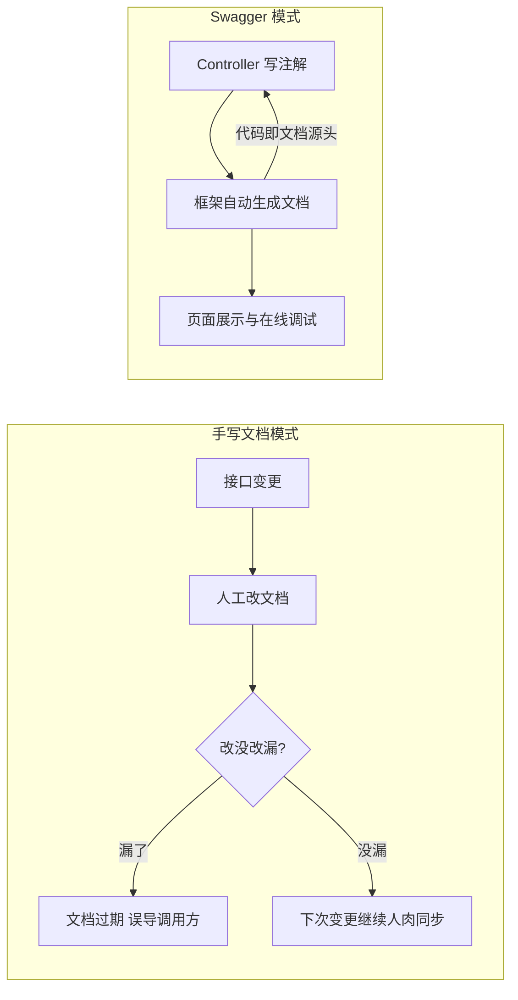

# Swagger 简介：接口文档为什么必须让代码自己生成

后端每天做得最多的事之一，是发请求到 Controller。要办成这件事，得知道访问路径是什么、有没有参数、参数长什么样、返回值是什么、请求方式是 GET 还是 POST。这些信息全在代码里，自己写的接口翻一翻也就知道了，可要是换个人、换个岗位，为了一次调用去翻别人的工程，成本一下子就上来了。接口文档工具解决的就是这件事，Swagger 是其中的代表，先把它的定位和用法预期讲清楚，再动手集成。

## 先给结论

- Swagger 是生成、描述、调用和可视化 RESTful 服务的框架，Spring 生态里的集成实现叫 Springfox，前身是 Spring-Swagger。
- 三大价值：前后端分离开发有依据、接口文档随代码自动生成、文档页面里直接做功能测试。
- 集成的落点：依赖放进 common 模块靠传递覆盖所有微服务，配置类装配 Docket，`swagger.enable` 开关控制生死。
- 文档不是零成本：注解要自己写，写得规范、跟着接口维护，文档才有可信度。
- 基础工程里三处落点已经埋好：common 的依赖、配置文件的开关、测试 Controller 上的注解示例。

## 痛点：四类信息与三类人

调用一个 Controller 需要的信息有四类：访问路径、参数、返回值、请求方式。缺了任何一类，请求就发不出去或者发错了。再数一数有哪几类人需要这些信息：写代码的人自己，团队里的其他后端，团队里的前端。三类人获取同一份信息的难度是递增的。

**第一类人，接口作者自己，也不轻松。** 项目开发完之后工程多、Controller 多、方法更多，自己的接口自己找，也要一层层点进工程、翻到类、再翻到方法，路径参数逐个确认，纯粹是体力活。

**第二类人，其他后端，比作者更麻烦。** 代码不是他写的，调用之前得先问接口在哪个工程、哪个包里，问完还得自己翻代码核对细节，问的人累，被问的人也累。

**第三类人，前端，几乎没法沟通。** 前端对后端工程结构不熟，让他去 IDEA 里找 Controller 读注解不现实，可他写请求代码恰恰最需要路径、参数、返回值这些信息。

于是团队的自然诉求出现了：给一份文档，写清楚每个接口的路径、参数、返回值、请求方式。文档的形态大家早就见过，Java 官方的 API 文档就是范本：想用 String 的某个方法忘了细节，翻开文档方法作用、参数、返回值一目了然，没有人为了这些去翻 JDK 源码。接口文档的价值完全一样。问题在于手写：写文档本身是大工作量，代码一改文档就过期，过期的文档误导调用方，比没有文档还危险。两个流程的差别如下：



手写模式的死结在人工同步这一环，Swagger 模式把文档的源头挪到了代码里，接口变了文档跟着变，这个死结才解得开。

## Swagger 与 Springfox 是什么关系

官方的介绍是：Swagger 是一个规范和完整的框架，用于生成、描述、调用和可视化 RESTful 风格的 Web 服务。落到实际使用上，它带来三件事：前后端分离开发更方便，前端拿着文档就能写请求代码，有利于团队协作；接口文档在线自动生成，后端不用手写文档，编写负担大幅下降；文档页面里可以直接发起请求做功能测试，填上参数点一下就能看到响应，省得为验证一个接口专门切工具。

Spring 生态的落地实现是 Springfox。Spring 官方曾把 Swagger 纳入自身标准建立 Spring-Swagger 项目，后来更名为 Springfox，现在项目里引的是 `springfox` 系列依赖，用起来依然叫 Swagger。本工程锁定 2.9.2 版本，依赖有两个，一个生成文档数据，一个提供可视化页面：

```xml
<!-- common 模块 pom.xml 依赖节选 -->
<dependency>
    <groupId>io.springfox</groupId>
    <artifactId>springfox-swagger2</artifactId>
    <version>2.9.2</version>
</dependency>
<dependency>
    <groupId>io.springfox</groupId>
    <artifactId>springfox-swagger-ui</artifactId>
    <version>2.9.2</version>
</dependency>
```

依赖放进 `finance-common` 而不是各微服务自己引，理由是本系列定下的依赖规则：所有微服务直接或间接依赖 common，api 依赖 common，业务服务依赖 api。在 common 里配一次，全项目的服务都获得文档能力，这正是公共能力下沉的标准做法。

## 开关与配置类：文档能力的两个落点

**开关写在配置文件里，一个 key 控制文档的生死。** 用户中心与网关的配置文件里都有这一行：

```properties
# 开启swagger
swagger.enable=true
```

**配置类放在微服务的 config 包里，负责装配文档引擎。** 用户中心里的真实配置类如下，文档标题与联系人已按本系列口径改写：

```java
package com.study.finance.consumer.config;

import org.springframework.boot.autoconfigure.condition.ConditionalOnProperty;
import org.springframework.context.annotation.Bean;
import org.springframework.context.annotation.Configuration;
import springfox.documentation.builders.ApiInfoBuilder;
import springfox.documentation.builders.PathSelectors;
import springfox.documentation.builders.RequestHandlerSelectors;
import springfox.documentation.service.ApiInfo;
import springfox.documentation.spi.DocumentationType;
import springfox.documentation.spring.web.plugins.Docket;
import springfox.documentation.swagger2.annotations.EnableSwagger2;

@Configuration
@ConditionalOnProperty(prefix = "swagger", value = {"enable"}, havingValue = "true")
@EnableSwagger2  //开启swagger注解支持
public class SwaggerConfiguration {

    @Bean
    public Docket buildDocket() {
        return new Docket(DocumentationType.SWAGGER_2)
                .apiInfo(buildApiInfo())
                .select()
                // 要扫描的API(Controller)基础包
                .apis(RequestHandlerSelectors.basePackage("com.study.finance"))
                .paths(PathSelectors.any())
                .build();
    }

    private ApiInfo buildApiInfo() {
        Contact contact = new Contact("万信金融项目组", "", "");
        return new ApiInfoBuilder()
                .title("万信金融P2P平台-用户服务API文档")
                .description("包含用户服务api")
                .contact(contact)
                .version("1.0.0").build();
    }
}
```

逐个看关键件。`@EnableSwagger2` 打开 Swagger 注解支持；`@ConditionalOnProperty(prefix = "swagger", value = {"enable"}, havingValue = "true")` 是条件装配：配置里 `swagger.enable` 为 true 时这个配置类才生效，为 false 时整个类不加载，Docket 不存在，文档能力整体下线，开关的杠杆作用就体现在这里。`Docket` 是文档的配置载体，`DocumentationType.SWAGGER_2` 声明文档规范版本，`apis` 指定扫描 `com.study.finance` 基础包下的 Controller，`paths` 放行全部路径；`ApiInfo` 填文档的标题、描述、联系人与版本，这些信息会出现在文档页面的抬头。

## 注解：文档的原料从哪来

框架能生成文档，原料是开发者写在 Controller 上的注解。基础工程的测试 Controller 已经是标准示范：

```java
package com.study.finance.consumer.controller;

import io.swagger.annotations.Api;
import io.swagger.annotations.ApiImplicitParam;
import io.swagger.annotations.ApiOperation;
import org.springframework.web.bind.annotation.GetMapping;
import org.springframework.web.bind.annotation.PostMapping;
import org.springframework.web.bind.annotation.RestController;

@RestController
@Api(value = "用户服务的Controller", tags = "Consumer", description = "用户服务API")
public class ConsumerController {

    @ApiOperation("测试hello")
    @GetMapping(path = "/hello")
    public String hello() {
        return "hello";
    }

    @ApiOperation("测试hi")
    @ApiImplicitParam(name = "name", value = "姓名", required = true, dataType = "String")
    @PostMapping(path = "/hi")
    public String hi(String name) {
        return "hi," + name;
    }
}
```

类上的 `@Api` 描述这个控制器是什么，方法上的 `@ApiOperation` 说明每个接口的用途，`@ApiImplicitParam` 描述参数的名字、含义、是否必填与类型。框架扫描到这些注解后组装成文档页面。注解写得越细，文档越接近一份合格的接口说明书；一个注解都不写，页面里只剩接口名和参数列表，能看但费劲。集成步骤与更多注解的用法在后续小节展开，此处先把认识立住：注解即文档的原料。

## 在万信金融里的用法预期

这套工程对 Swagger 的预期用法有三条。接口层面，后续每个微服务的 Controller 统一按示范补注解，`@Api`、`@ApiOperation`、`@ApiImplicitParam` 是起步三件套，写代码与写注解当成同一个动作。开关层面，`swagger.enable` 这类环境相关的开关可以交给配置中心管理，开发环境打开方便联调，生产环境关闭避免暴露接口信息，改配置不用动代码。协作层面，文档页面就是前后端沟通的契约：前端按页面上的路径、参数、返回值直接写请求，也能在页面里直接发请求做功能测试，验证接口联通后再进 Postman 做更复杂的场景构造，两个工具分工不冲突。

## 常见误区

- **以为引了依赖就有文档。** 错例：common 里加了依赖，启动后访问文档页面一片空白。正解：还需要 `@EnableSwagger2` 配置类装配 Docket，Controller 上要有注解，三样齐了文档才出来。
- **把注解当可有可无的负担。** 错例：注解写「测试1」「接口」，或者干脆不写。正解：注解是文档的唯一原料，写得含糊文档就含糊，误导调用方比没文档更糟。
- **生产环境忘关文档。** 错例：所有环境 `swagger.enable=true` 常开，接口全貌对外可见。正解：开关按环境配置，生产关闭，这也是开关做成条件装配的意义。
- **把 Swagger 当完整的测试方案。** 错例：页面里点通了接口就认为功能没问题。正解：它验证的是接口联通与契约正确，业务逻辑正确性仍要靠测试用例覆盖。

## 面试可能被问到的问题

1. 面试官追问：「Swagger 解决什么问题？」
   答：解决接口信息传递的成本问题。调用接口需要路径、参数、返回值、请求方式四类信息，散落在代码里，跨人获取要翻代码或口头询问；Swagger 从代码注解自动生成在线文档，还支持在页面上直接调试，让文档与代码同源、不过期。
2. 面试官追问：「Swagger 和 Springfox 是什么关系？」
   答：Swagger 是规范与框架本体，定义了描述 RESTful 服务的标准；Springfox 是它在 Spring 生态的集成实现，前身叫 Spring-Swagger。项目里引入 springfox 系列依赖，配合 `@EnableSwagger2` 使用 Swagger 的能力。
3. 面试官追问：「`@ConditionalOnProperty` 在你们的 Swagger 配置里起什么作用？」
   答：它是 Spring Boot 的条件装配注解，这里判断 `swagger.enable` 是否为 true，为 true 才装配整个配置类；开关关闭时 Docket 这个 Bean 根本不存在，文档功能整体下线。好处是开关粒度是整个文档能力，而不是逐个接口去排除。
4. 面试官追问：「Docket 是什么，你们是怎么配置的？」
   答：Docket 是 Springfox 里文档的配置载体。我们声明了 SWAGGER_2 规范，`apis` 指定扫描项目基础包下的 Controller，`paths` 放行全部路径，再用 `ApiInfo` 配置文档标题、描述、联系人与版本号。
5. 面试官追问：「你们项目里常用哪些 Swagger 注解？」
   答：类上 `@Api` 描述控制器；方法上 `@ApiOperation` 描述接口用途；参数用 `@ApiImplicitParam` 说明名字、含义、必填与类型，多个参数用 `@ApiImplicitParams` 包裹；实体字段用 `@ApiModelProperty`。注解写得细，生成的文档才可用。
6. 面试官追问：「生产环境要不要开 Swagger？」
   答：建议关闭。文档会把全部接口的路径、参数结构暴露出来，给攻击者递了接口清单；开发与测试环境开着方便联调，通过配置中心的开关按环境控制即可，切换不需要改代码发版。

## 配套资料

- 代码：`materials/code/10/wanxinp2p/wanxinp2p/`，`wanxinp2p-consumer-service` 模块 `config` 包下的 `SwaggerConfiguration.java` 与 `controller` 包下的 `ConsumerController.java`、`wanxinp2p-common/pom.xml` 的 springfox 依赖均为真实文件；内层目录为原始包名，与正文 `com.study.finance` 改写口径不一致，引用路径到工程目录为止。
- 讲义：`materials/docs/10/万信金融-第1章-讲义-开发环境搭建v1.0.md`，其中 2.1 节 API 接口文档利器：Swagger 为本课出处。
- 说明：配置类原文中的文档标题与联系人已按本系列改写口径处理，正文包名统一为 `com.study.finance` 系。
