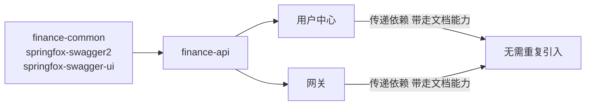
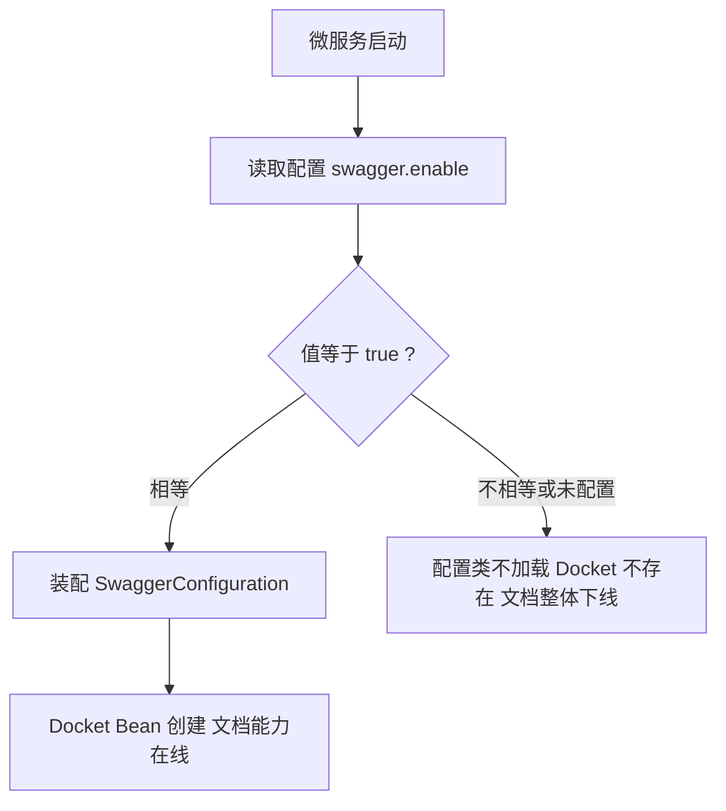

# Spring Boot 集成 Swagger：依赖落点、配置类与开关联动一次讲透

认识过 Swagger 的定位之后，真正动手集成时会撞上三个具体问题：依赖引在哪个工程才不用重复引、配置类里那一长串到底是什么、配置文件里一个 `swagger.enable=true` 为什么能决定整个文档能力的生死。集成本身没有任何玄机，套路与集成其他框架完全一致：引依赖、做配置，两步走完。本课把这两步落在用户中心微服务上，顺便把开关联动的原理拆开看。

## 先给结论

- 集成只有两步：`pom.xml` 引依赖，外加两块配置（`application.properties` 的开关 + `SwaggerConfiguration` 配置类）。
- 依赖引在 common 模块而不是业务服务里，靠 Maven 传递依赖覆盖全部微服务，这是公共能力下沉的标准做法。
- 配置类靠三个注解立起来：`@Configuration` 声明配置、`@EnableSwagger2` 开启注解支持、`@ConditionalOnProperty` 把配置文件里的开关接到整个类上。
- `Docket` 是文档的配置载体，`basePackage` 要写到项目最基础的一层包，写深了 Controller 扫不到。
- 开发环境开文档，生产环境必须关，开关就是为这个切换准备的。

## 第一步：依赖引在哪一层

集成任何框架的第一步都是引依赖。Swagger 在 Spring 生态的落地实现叫 Springfox，依赖有两块，`springfox-swagger2` 生成文档数据，`springfox-swagger-ui` 提供可视化页面。先在用户中心的 `pom.xml` 里搜一下，会发现这个工程并没有引 Swagger 相关依赖。

急着重抄一遍就错了。回看工程的依赖结构：业务服务依赖 api 模块，api 模块又依赖 common 模块。Swagger 这类全项目都要用的能力，正确落点是 common。翻开 common 的 `pom.xml`，两个依赖已经就位：

```xml
<!-- common 模块 pom.xml 依赖节选，版本 2.9.2 由父工程 dependencyManagement 统一管理 -->
<dependency>
    <groupId>io.springfox</groupId>
    <artifactId>springfox-swagger2</artifactId>
    <version>2.9.2</version>
</dependency>
<dependency>
    <groupId>io.springfox</groupId>
    <artifactId>springfox-swagger-ui</artifactId>
    <version>2.9.2</version>
</dependency>
```

依赖在 common 里配一次，下游所有模块通过传递依赖自动获得，用户中心不用再引，网关等微服务同样不用。这张图把传递链路画出来：



common 在最上游，两个 springfox 依赖随 api 一路传给每个业务服务。日后升级版本只改 common 一处，这也是把公共依赖下沉的核心理由。

## 第二步：两块配置各管一段

配置分两块，一块在 `application.properties`，一块是一个配置类。先看配置文件，用户中心里与 Swagger 相关的就一行：

```properties
# 应用程序名称
spring.application.name=consumer-service
# 微服务访问路径
server.servlet.context-path=/consumer
# 开启swagger
swagger.enable=true
# springCloud eureka配置
eureka.client.serviceUrl.defaultZone=http://localhost:53000/eureka/
```

这行 `swagger.enable=true` 表面上是开启文档功能，实际上它没那么简单：它的值并不是给个 true 功能就开、给个 false 就关，而是要和配置类上的某个注解做比对，比上了才生效。这个自定义 key 不是 Spring Boot 内置配置，将来可以托管到 Apollo 这类配置中心，按环境切换时改配置即可，不用动代码。

另一块配置是配置类，放在微服务的 `config` 包里。哪个微服务需要文档能力，就把这一套整体复制过去，代码基本不用改。逐件看用户中心里的真实配置类，包名与联系人按本系列口径书写：

```java
package com.study.finance.consumer.config;

import org.springframework.boot.autoconfigure.condition.ConditionalOnProperty;
import org.springframework.context.annotation.Bean;
import org.springframework.context.annotation.Configuration;
import springfox.documentation.builders.ApiInfoBuilder;
import springfox.documentation.builders.PathSelectors;
import springfox.documentation.builders.RequestHandlerSelectors;
import springfox.documentation.service.ApiInfo;
import springfox.documentation.service.Contact;
import springfox.documentation.spi.DocumentationType;
import springfox.documentation.spring.web.plugins.Docket;
import springfox.documentation.swagger2.annotations.EnableSwagger2;

@Configuration
@ConditionalOnProperty(prefix = "swagger", value = {"enable"}, havingValue = "true")
@EnableSwagger2  //开启swagger注解支持
public class SwaggerConfiguration {

    @Bean
    public Docket buildDocket() {
        return new Docket(DocumentationType.SWAGGER_2)
                .apiInfo(buildApiInfo())
                .select()
                // 要扫描的API(Controller)基础包
                .apis(RequestHandlerSelectors.basePackage("com.study.finance"))
                .paths(PathSelectors.any())
                .build();
    }

    private ApiInfo buildApiInfo() {
        Contact contact = new Contact("万信金融项目组", "", "");
        return new ApiInfoBuilder()
                .title("万信金融P2P平台-用户服务API文档")
                .description("包含用户服务api")
                .contact(contact)
                .version("1.0.0").build();
    }
}
```

类上三个注解各司其职。`@Configuration` 是配置类的常规标识。`@EnableSwagger2` 开启 Swagger 注解支持，可以把它理解成一个扫描器：Swagger 自带一批注解，这批注解要写到 Controller 里，由它负责扫描注解里的内容去生成想要的文档。`@ConditionalOnProperty` 最关键，留到下一节单独讲。

方法链部分，`Docket` 是文档的配置载体，`DocumentationType.SWAGGER_2` 声明文档规范版本。`basePackage` 的取值值得停下来看：用户中心的包是 `com.study.finance.consumer`，网关的包是 `com.study.finance.gateway`，两个服务从 `com.study.finance` 之后才开始分岔，所以扫描基础包写到 `com.study.finance` 这一层，凡是这个包及其子包下的 Controller 全都在扫描范围内。写深到某一层，别的服务的接口就漏掉了。`paths(PathSelectors.any())` 放行全部路径。`ApiInfo` 组装文档抬头：标题、描述、联系人（也可理解为作者或所属团队）、版本号，这些值最终原样出现在文档页面顶部。

## 开关与条件装配如何联动

`@ConditionalOnProperty(prefix = "swagger", value = {"enable"}, havingValue = "true")` 是 Spring Boot 的条件装配注解，prefix 与 value 拼出配置项名 `swagger.enable`，恰好和配置文件里那个 key 一模一样。这不是巧合：它启动时去 `application.properties` 里取 `swagger.enable` 的值，拿这个值和 `havingValue = "true"` 做相等判断，相等则整个配置类生效，不相等则配置类根本不加载。



判断的粒度是整个配置类，不是逐个接口排除，所以这行注解才是文档真正的总开关。为什么需要这么一个开关？Swagger 生成的文档包含项目全部接口的访问路径与参数结构，这些信息对外暴露就是安全隐患。开发阶段开着方便联调，项目一旦上线就把开关改成 false，文档能力整体消失。一个 key 决定一个能力的生死，条件装配在这里用得非常干净。

## 常见误区

- **依赖每个微服务都引一遍。** 错例：用户中心、网关的 `pom.xml` 各贴一份 springfox 依赖。正解：引在 common，下游靠传递依赖获得，版本升级只改一处。
- **`basePackage` 写到自己的 Controller 包。** 错例：写 `com.study.finance.consumer.controller`，用户中心能扫到，网关的接口全丢。正解：写到各微服务公共的祖先包这一层，如 `com.study.finance`。
- **以为开关关了页面还能访问。** 错例：`swagger.enable=false` 后仍去试文档地址，以为只是不显示。正解：条件装配让整个配置类不加载，Docket 不存在，文档功能彻底下线。
- **所有环境开关常开。** 错例：生产环境照样 `swagger.enable=true`。正解：开发、测试开，生产关，开关值交给配置中心按环境管理。

## 面试可能被问到的问题

1. 面试官追问：「在 Spring Boot 里集成 Swagger 需要哪几步？」
   答：两步。第一步在 `pom.xml` 引入 `springfox-swagger2` 与 `springfox-swagger-ui` 依赖；第二步做配置，配置文件里放 `swagger.enable` 开关，再写一个 `@Configuration` 配置类，用 `@EnableSwagger2` 开启注解支持，声明一个 Docket Bean 指定扫描包与文档信息。
2. 面试官追问：「你们项目的 Swagger 依赖为什么放在 common 模块？」
   答：所有业务服务直接或间接依赖 common，依赖放进 common 后通过 Maven 传递依赖覆盖全部微服务，各服务不用重复引入，版本升级也只改 common 一处。这是公共能力下沉的通用做法，和统一异常处理、工具类的下沉是一个思路。
3. 面试官追问：「`@ConditionalOnProperty` 是怎么让配置文件里的开关生效的？」
   答：它按 prefix 加 value 拼出配置项名，启动时从环境里取值，与 `havingValue` 做相等比较，相等才装配所在配置类。我们用它判断 `swagger.enable` 是否等于 true，等于 true 才创建 Docket；否则配置类不加载，文档功能整体下线。
4. 面试官追问：「Docket 的扫描包为什么要写到项目最基础的包那一层？」
   答：因为 `basePackage` 决定扫描范围，各微服务的包在基础包之后才分岔，比如用户中心和网关都在同一个父包之下。写到父包这一层，子包下所有 Controller 都能被扫到；写到某一服务的具体包，其他服务的接口就漏出文档了。
5. 面试官追问：「生产环境为什么要把 Swagger 关掉？」
   答：文档页汇聚了全部接口的路径、参数结构与请求方式，等于把接口清单暴露给外界，攻击者可以直接按图索骥。我们的做法是 `swagger.enable` 按环境配置，开发测试开着联调，生产置为 false，借助条件装配整个文档能力直接消失。

## 配套资料

- 代码：`materials/code/10/wanxinp2p/wanxinp2p/`，`wanxinp2p-consumer-service` 模块 `config` 包下的 `SwaggerConfiguration.java`、`resources/application.properties`，以及 `wanxinp2p-common/pom.xml`、父工程 `pom.xml` 的版本管理均为真实文件；内层目录沿用原始命名，与正文 `com.study.finance` 改写口径不一致，引用路径到工程目录为止。
- 讲义：`materials/docs/10/万信金融-第1章-讲义-开发环境搭建v1.0.md`，其中 2.1.2 节 SpringBoot 集成 Swagger 为本课出处。
- 说明：正文包名统一为 `com.study.finance` 系，文档联系人已按本系列改写口径处理；工程根模块名在正文中按语义写作 `finance-*`。
