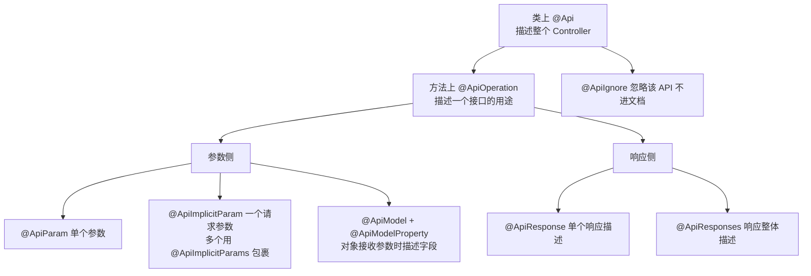

# Swagger 常用注解：类、方法、参数各用哪一套

Swagger 集成完毕，环境就绪，但它并不会因此就替你生成一份可用的文档。框架不可能知道这个工程里谁是 Controller、每个方法是什么意思、有没有参数、返回什么，这些信息必须由开发者写在代码里告诉它，载体就是 Swagger 提供的一整批注解。它扫描这些注解，把注解里的内容组装成文档页面。把这套注解的位置和用法理顺，文档才有原料可用。

## 先给结论

- 注解按落点分两大类：写在类上描述 Controller，写在方法上描述接口，方法级的参数与响应注解都是围绕方法展开的。
- 起步三件套：`@Api` 描述类、`@ApiOperation` 描述方法、`@ApiImplicitParam` 描述参数。
- 参数可以描述得很细：名字、含义、类型、是否必填、传参方式、默认值，都有对应属性。
- 多个参数要用 `@ApiImplicitParams` 把多个 `@ApiImplicitParam` 包起来；对象接收参数时用 `@ApiModel` 与 `@ApiModelProperty` 描述字段。
- `@GetMapping`、`@PostMapping` 这类 Spring MVC 注解不属于 Swagger，但同样会被扫描，路径与请求方式不用重复描述。

## 注解为什么不可省略

接口文档要呈现四类信息：路径、参数、返回值、请求方式。路径与请求方式 Spring MVC 的映射注解里已经有了，Swagger 顺手就能读到；但「这个接口是干嘛的」「参数代表什么含义」「返回的响应里有什么」，这些语义信息代码本身表达不了，只能靠注解补上。一个注解都不写的 Controller，文档页面里只剩方法名和参数列表，调用方依旧要回来翻源码，自动生成等于没生成。

注解数量不少，好在不用背。写业务时常用的就那几个，写个几次自然熟悉，其余的按讲义查表即可。

## 注解地图：按落点各就各位

按描述对象分层，整套注解的关系如下：



整表对照如下，作用描述与课程讲义一致：

| 注解 | 落点 | 作用 |
|---|---|---|
| `@Api` | 类 | 修饰整个类，描述 Controller 的作用 |
| `@ApiOperation` | 方法 | 描述类中的一个方法，或者说一个接口 |
| `@ApiParam` | 参数 | 单个参数的描述信息 |
| `@ApiModel` | 实体类 | 用对象来接收参数时标注该实体 |
| `@ApiModelProperty` | 实体字段 | 用对象接收参数时，描述对象的一个字段 |
| `@ApiImplicitParam` | 方法 | 一个请求参数 |
| `@ApiImplicitParams` | 方法 | 多个请求参数的描述信息，包裹若干 `@ApiImplicitParam` |
| `@ApiResponse` | 方法 | HTTP 响应其中 1 个的描述 |
| `@ApiResponses` | 方法 | HTTP 响应整体描述 |
| `@ApiError` | 方法 | 发生错误返回的信息 |
| `@ApiIgnore` | 类或方法 | 使用该注解忽略这个 API，不出现在文档里 |

两张面孔容易混：`@ApiParam` 与 `@ApiImplicitParam` 都描述参数。区别在用法上，`@ApiParam` 直接标在方法参数前面；`@ApiImplicitParam` 写在方法上方，适合描述那些没有以方法形参出现、但请求里会带的参数，本课示例用的正是它。

## 动手写：从无参 hello 到带参 hi

用户中心的 `ConsumerController` 是课程留下的标准示范。起始状态只有无参的 hello 接口，类与方法各一个注解：

```java
package com.study.finance.consumer.controller;

import io.swagger.annotations.Api;
import io.swagger.annotations.ApiOperation;
import org.springframework.web.bind.annotation.GetMapping;
import org.springframework.web.bind.annotation.RestController;

@Api(value = "用户服务的Controller", tags = "Consumer", description = "用户服务API")
@RestController
public class ConsumerController {

    @ApiOperation("测试hello")
    @GetMapping(path = "/hello")
    public String hello(){
        return "hello";
    }
}
```

类上的 `@Api` 用 `value` 一句话说清这个 Controller 是干嘛的，`tags` 是标签分组，`description` 再补充更详细的描述。这些内容都是开发者自己加的，加得越贴切文档越好读。方法上的 `@ApiOperation` 给一个字符串，说明这个方法干什么，比如实现登录的接口就写「登录功能」。hello 没有参数，注解到此为止。

接下来写带参的 hi，把参数侧注解用上。方法本体很朴素，返回一句打招呼的字符串：

```java
package com.study.finance.consumer.controller;

import io.swagger.annotations.Api;
import io.swagger.annotations.ApiImplicitParam;
import io.swagger.annotations.ApiOperation;
import org.springframework.web.bind.annotation.GetMapping;
import org.springframework.web.bind.annotation.PostMapping;
import org.springframework.web.bind.annotation.RestController;

@RestController
@Api(value = "用户服务的Controller", tags = "Consumer", description = "用户服务API")
public class ConsumerController {

    @ApiOperation("测试hello")
    @GetMapping(path = "/hello")
    public String hello(){
        return "hello";
    }

    @ApiOperation("测试hi")
    @ApiImplicitParam(name = "name", value = "姓名", required = true, dataType = "String")
    @PostMapping(path = "/hi")
    public String hi(String name){
        return "hi," + name;
    }
}
```

这个注解是逐步补齐的。方法上先加 `@ApiOperation` 对整个方法做描述；发现方法有参数，就加 `@ApiImplicitParam` 说明参数。属性按需追加：`name` 指定参数名叫 name；`value` 描述参数是什么意思，这里写「姓名」；`required` 是必填项，布尔类型写 `true`，表示发请求时这个值必须传；`dataType` 给参数的数据类型，这里写 `"String"`。路径用 `@PostMapping` 配上，这个注解不属于 Swagger，但 Swagger 照样扫描它，请求方式与路径由此进入文档。

`@ApiImplicitParam` 的完整属性表如下：

| 属性 | 取值 | 作用 |
|---|---|---|
| `paramType` | `path` | 以地址的形式提交数据 |
| | `query` | 直接跟参数完成自动映射赋值 |
| | `body` | 以流的形式提交，仅支持 POST |
| | `header` | 参数在 request headers 里提交 |
| | `form` | 以 form 表单的形式提交，仅支持 POST |
| `dataType` | `Long` / `String` 等 | 参数的数据类型，只作为标志说明，并没有实际验证 |
| `name` | | 接收参数名 |
| `value` | | 接收参数的意义描述 |
| `required` | `true` / `false` | 参数是否必填 |
| `defaultValue` | | 默认值 |

`paramType` 决定框架按哪种方式展示这个参数的传递位置，RESTful 路径参数选 `path`，普通查询串选 `query`，请求头选 `header`，JSON 体选 `body`。`dataType` 只影响文档展示，框架并不据此做类型校验，真正的类型约束由后端代码自己保证。

## 多参数与对象参数怎么写

单参数用 `@ApiImplicitParam`，两个以上就必须换成 `@ApiImplicitParams` 把它们包起来。下面的多参数写法与实体描述写法为本课写法的补全示例：

```java
import io.swagger.annotations.ApiImplicitParam;
import io.swagger.annotations.ApiImplicitParams;
import io.swagger.annotations.ApiOperation;
import org.springframework.web.bind.annotation.PostMapping;
import org.springframework.web.bind.annotation.RestController;

@ApiOperation("注册用户（示例）")
@ApiImplicitParams({
        @ApiImplicitParam(name = "mobile", value = "手机号", required = true, dataType = "String", paramType = "query"),
        @ApiImplicitParam(name = "age", value = "年龄", required = false, dataType = "Long", paramType = "query")
})
@PostMapping(path = "/register")
public String register(String mobile, Integer age){
    return "ok";
}
```

用对象接收参数时，类标 `@ApiModel`，每个字段标 `@ApiModelProperty`，文档会把字段含义一并列出：

```java
import io.swagger.annotations.ApiModel;
import io.swagger.annotations.ApiModelProperty;

@ApiModel(value = "用户注册入参（示例）")
public class UserRegisterDTO {

    @ApiModelProperty(value = "手机号", required = true)
    private String mobile;

    @ApiModelProperty(value = "年龄")
    private Integer age;

    // getter/setter 省略
}
```

注解多但结构简单，记住落点即可：类、方法、参数、响应四个位置，各用各的那一套。没有演示到的注解后面陆续会用到，用到再说。

## 常见误区

- **`required` 写成字符串。** 错例：`@ApiImplicitParam(..., required = "true")`，编译器直接报错。正解：这个属性是 boolean，写 `required = true`，不带引号。
- **把 `dataType` 当类型校验。** 错例：写了 `dataType = "Long"` 就以为传字符串会被拦下。正解：`dataType` 只作为文档里的标志说明，没有实际验证，类型约束要靠后端代码。
- **多参数仍写单个 `@ApiImplicitParam`。** 错例：在方法上贴两三个 `@ApiImplicitParam`。正解：一个参数用它，多个参数必须用 `@ApiImplicitParams` 包裹。
- **注解写成「接口」「测试1」。** 错例：`@ApiOperation("测试1")`，文档里一片占位符。正解：注解是文档的唯一语义来源，value 写清业务含义，比如「用户注册」。

## 面试可能被问到的问题

1. 面试官追问：「Swagger 集成好了，为什么还要写注解？」
   答：框架能自动拿到路径与请求方式，但接口用途、参数含义、响应结构这些语义信息代码本身表达不了，只能通过注解提供给 Swagger。没有注解，文档只剩方法名和参数列表，基本不可用。
2. 面试官追问：「`@ApiParam` 和 `@ApiImplicitParam` 有什么区别？」
   答：`@ApiParam` 直接标注在方法形参上，描述单个参数；`@ApiImplicitParam` 写在方法上方，一个注解描述一个请求参数，还能描述没有以形参出现但请求会带的参数。多个 `@ApiImplicitParam` 要用 `@ApiImplicitParams` 包裹。
3. 面试官追问：「`@ApiImplicitParam` 常用哪些属性？」
   答：name 指定参数名，value 描述参数含义，required 说明是否必填，dataType 标注数据类型，paramType 指定传参位置如 path、query、body、header、form，还有 defaultValue 设默认值。dataType 只作标志说明，没有实际验证。
4. 面试官追问：「用对象接收参数时怎么生成可读的文档？」
   答：实体类上加 `@ApiModel`，字段上加 `@ApiModelProperty` 并写清每个字段的含义和是否必填，Swagger 会把字段说明列进文档，前端按字段含义直接组装 JSON。
5. 面试官追问：「`@ApiIgnore` 什么场景下用？」
   答：某个接口只想内部使用、不想暴露到对外文档时，加 `@ApiIgnore` 让它被文档忽略。比如调试用接口或尚未定稿的接口，避免调用方误用。
6. 面试官追问：「Spring MVC 的 `@GetMapping` Swagger 会处理吗？」
   答：会。它虽然不是 Swagger 的注解，但 Swagger 扫描 Controller 时会连同 Spring MVC 的映射注解一起读，请求方式、路径、参数名都能自动进入文档，这些不需要再用 Swagger 注解重复描述。

## 配套资料

- 代码：`materials/code/10/wanxinp2p/wanxinp2p/`，`wanxinp2p-consumer-service` 模块 `controller` 包下的 `ConsumerController.java` 为真实文件，正文示例与其逐行对应；内层目录沿用原始命名，与正文 `com.study.finance` 改写口径不一致，引用路径到工程目录为止。
- 讲义：`materials/docs/10/万信金融-第1章-讲义-开发环境搭建v1.0.md`，其中 2.1.3 节 Swagger 常用注解（含注解一览与 `@ApiImplicitParam` 属性表）为本课出处。
- 说明：多参数与对象参数两段为课程未演示部分，按本课写法补全的示例；正文包名统一为 `com.study.finance` 系。
