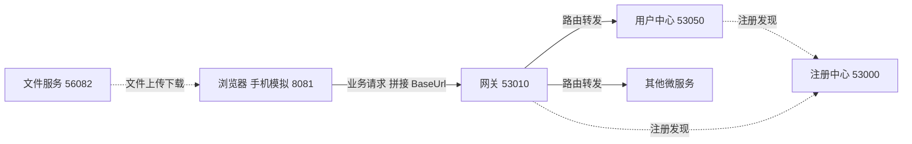

# 把现成的前端工程跑起来：uni-app H5 环境搭建与 8081 访问

微服务基础工程与配置中心都验证通过之后，后端环境就算齐了。但这个项目是前后端分离架构，前端也是现成提供的工程，后端开发者的任务不是写前端，而是把它在本机跑起来，让浏览器里的页面能打到自己的后端接口上做联调。很多初学者在这一步掉坑：工程打开方式不对、SCSS 编译插件没装、页面打开变形以为前端坏了。本课把前端环境的搭建路径一次走通。

## 先给结论

- 前端工程课程直接提供，不需要开发、不需要编码，但必须能在本机运行起来，参与前后端集成测试。
- 前端工程基于 uni-app 框架，本阶段以 H5 形态在浏览器中运行；开发工具用 HBuilder X，浏览器建议 Chrome。
- 打开工程用「打开目录」而不是导入；运行前要给 HBuilder X 装好 SCSS/SASS 编译插件，插件在线安装，全程需要联网。
- 启动后前端占用 8081 端口，该端口写在工程的 `manifest.json` 的 `h5.devServer.port` 里。
- 浏览器打开页面后按 F12 调出开发者工具，用设备模拟按钮切换成手机屏幕尺寸，才能看到接近手机 APP 的真实效果。

## 这个前端工程是什么

万信金融的前端不是传统 PC 网站，而是按手机 APP 形态做的应用，基于 uni-app 框架开发。uni-app 的卖点是一套代码编译到多个端：H5、安卓、iOS、微信小程序都能覆盖，本课程受条件所限，选择其中门槛最低的 H5 形态在浏览器里运行，后续联调都基于这个形态。

工程结构是标准的 uni-app 项目布局，拿到工程先扫一遍目录，知道每块东西放哪：

```text
前端工程根目录
├── components        可复用组件，如输入框、按钮
├── pages             业务页面目录，按 user、lend、borrow、main 等业务划分
├── static            图片等静态资源
├── store             Vuex 全局状态
├── utils             公共脚本，统一请求封装 request.js、工具函数 utils.js
├── App.vue           应用配置，全局样式与生命周期
├── main.js           Vue 初始化入口
├── manifest.json     应用名称、版本、各端打包与 devServer 配置
├── pages.json        页面路由与导航条配置，pages 数组第一项是启动页
├── service.js        账号信息本地存取
└── uni.scss          全局 SCSS 变量
```

`pages.json` 里注册了登录、出借、借钱、开通存管等全部页面路由，数组第一项 `pages/main/main` 是启动页；`pages/user/login` 就是后面开户业务要反复用到的登录页。这两个配置文件是读陌生 uni-app 工程的钥匙，路由和页面标题都在里面。

## 导入工程与插件安装

HBuilder X 之于前端，相当于 IDEA 之于后端。安装包解压后双击可执行文件即可用，无需复杂安装流程，浏览器建议装 Chrome，用别的浏览器也能跑，只是演示口径统一为 Chrome。

打开工程有个小细节容易踩：菜单里用的是「文件 → 打开目录」，选中前端工程文件夹直接打开，不是「导入」。打开后左侧能看到上面那份目录树，工程里现成的代码暂时不用读，能跑起来再说。

运行之前必须装一个插件。路径是「工具 → 插件安装」，在插件列表里找到 SCSS/SASS 编译插件点安装。这个插件是运行前端工程的硬依赖，因为工程的样式用了 SCSS 语法（`uni.scss` 就是全局变量文件），没有编译插件页面样式起不来。注意插件是在线安装，必须保证电脑联网，装完会有提示。

如果不习惯 HBuilder X 的可视化方式，工程说明里也给出了脚手架方案：全局安装 vue-cli，用 uni-app 官方模板创建工程，把现有工程内容替换进新工程的 src 目录，再用命令行启动：

```bash
npm install -g @vue/cli
vue create -p dcloudio/uni-preset-vue my-project
# 用现有工程内容替换新项目的 src 目录后启动
npm run dev:h5
```

两种方式选一种即可，课程主线走 HBuilder X，命令行方式作为了解，知道前端工程本质也是 Node 进程在编译服务就够了。

## 启动与移动端模拟

HBuilder X 里点「运行 → 运行到浏览器 → Chrome」，底部控制台开始输出编译日志，首次编译会慢一些，等它跑完：

```text
项目 'p2pFront' 开始编译...
INFO Starting development server...
App running at: http://localhost:8081
- Local:   http://localhost:8081
- Network: http://192.168.25.128:8081
项目 'p2pFront' 编译成功。
```

正常情况下 Chrome 会自动打开这个地址，没有自动打开就手动访问。8081 这个端口不是随机的，写在工程的 `manifest.json` 里：

```json
"h5" : {
    "devServer" : {
        "disableHostCheck" : true,
        "port" : 8081
    }
}
```

这段配置就是 uni-app H5 模式下内置开发服务器的开关，`port` 指定端口，`disableHostCheck` 关闭 host 校验方便本机联调。要是 8081 被其他进程占了，改这里就行。

打开页面后很多人会愣一下：布局看起来是「坏」的，输入框挤成一团。这不是前端团队的问题，而是这个工程本质是手机 APP，浏览器按 PC 宽屏渲染自然变形。让它恢复本相只要一步：按 F12（或菜单里的开发者工具）打开调试面板，点设备模拟按钮，切换成某个手机尺寸，页面立刻变成手机端 APP 的样子。后续所有前端操作都在这个模拟器状态下进行。

此刻的登录页只是壳，输什么都会失败，因为后端的开户、登录接口还没开发。前端跑起来这一步的意义在于：页面能渲染、静态资源正常、编译链路通畅，为接下来的前后端联调铺好路。

## 前端请求打向哪里：后端地址与跨域

前端跑在 8081，后端服务在别的端口，页面发出的请求到底打到哪，由工程里的统一请求封装决定。`utils/request.js` 开头两个常量就是答案：

```javascript
// 后端地址和文件服务地址
const BaseUrl = 'http://127.0.0.1:53010/'
const FileServiceUrl = 'http://127.0.0.1:56082/farming'
```

所有业务请求都拼在 `BaseUrl` 后面发出，53010 正是网关的端口，也就是说前端从不直连具体微服务，全部流量走网关转发，微服务的拓扑对前端透明。文件上传下载则走 56082 的文件服务。这个封装还统一处理了两件事：从本地缓存读取 `access_token` 并塞进 `Authorization` 请求头；响应里的令牌过期标记出现时清空缓存并跳回登录页。前端工程导入后不需要改这里的地址，本机联调默认就是这套端口约定。

请求从浏览器到网关属于跨域调用（端口不同即跨源），这个问题的解法不在前端，而是后端网关已经在启动时注册了最高优先级的 CORS 过滤器全路径放行，基础工程篇配置过，前端什么都不用做。工程里另有一段被注释掉的 `devServer` 代理配置残留，那是早期对接外部 mock 平台用的模板，本地联调不启用它，记住「前端直发网关，跨域网关扛」这个分工即可。



这张图是前端联调期的全部拓扑：页面在 8081 渲染，业务请求统一打到 53010 网关，由网关按路由规则分发给用户中心等微服务，文件类请求单独走文件服务。把这张图和前端工程的两个地址常量对上，前端环境的来龙去脉就闭环了。

## 常见误区

- **以为要会写前端才能开工。** 错例：打开工程逐个读 vue 文件想看懂每一行。正解：前端是现成资产，后端开发者的义务是让它跑起来并配合联调，页面代码按需查阅即可。
- **打开工程用了「导入」。** 错例：在菜单里选导入工程，结果目录结构识别异常。正解：uni-app 工程不是 Maven 工程那套导入逻辑，用「打开目录」选中文件夹即可。
- **没装 SCSS/SASS 编译插件就直接运行。** 错例：控制台报样式编译错误或页面无样式。正解：先在插件安装里装好 SCSS/SASS 编译插件再运行，安装过程需要联网。
- **浏览器里直接看页面就下结论「前端坏了」。** 错例：PC 全屏下页面错位，以为工程有问题。正解：工程按手机 APP 形态开发，F12 打开设备模拟切换手机尺寸再看。
- **8081 被占用时去改后端端口。** 错例：发现端口冲突，去动网关或用户中心的端口。正解：前端端口归 `manifest.json` 的 `h5.devServer.port` 管，改它即可，后端端口约定保持不变。

## 面试可能被问到的问题

1. 面试官追问：「你们项目前端是什么技术栈，后端工程师需要掌握吗？」
   答：前端基于 uni-app，一套代码可以编译到 H5 和各家小程序、原生 APP，本阶段以 H5 形态运行。后端工程师不需要开发前端，但要会导入、运行前端工程，理解它的请求封装和后端地址配置，能独立完成前后端联调。
2. 面试官追问：「前后端分离项目，前端开发服务器的跨域问题你们怎么解决的？」
   答：两种常见思路，一是前端 devServer 配 proxy 代理转发，二是后端统一开 CORS。我们的做法是后端在网关层注册了一个最高优先级的 CORS 过滤器，对所有路径放行，前端零配置直连网关，跨域处理收敛在统一入口，避免每个微服务重复配。
3. 面试官追问：「前端怎么知道该请求哪个后端地址？切换环境怎么办？」
   答：前端把后端地址收敛在统一请求封装的常量里，本机联调指向网关端口，业务请求全部经网关转发，不直连具体微服务。切换环境改这一个地址即可，也可以进一步抽到环境变量里按构建注入。
4. 面试官追问：「uni-app 这类跨端框架你了解多少？」
   答：它以 Vue 语法为基础，通过编译器把同一份代码编译成 H5、小程序、原生 APP 等多端产物，页面路由由配置文件集中声明。代价是部分平台特有能力要走条件编译，调试时要分别看对应端的运行效果。
5. 面试官追问：「前端跑起来但所有请求都失败，你的排查思路是什么？」
   答：按链路排查，先看前端控制台编译是否成功、请求实际发到的地址和端口对不对；再看网关是否启动、路由是否覆盖该路径；然后确认对应微服务已注册到注册中心；最后检查跨域响应头和令牌头是否符合预期，逐步缩小范围。

## 配套资料

- 代码：`materials/code/10/wanxinp2p_front/`，uni-app H5 前端工程，正文引用的目录结构、`manifest.json` 的 `h5.devServer` 配置、`utils/request.js` 的后端地址与令牌处理、`pages.json` 路由、脚手架启动命令均出自该工程真实文件；内层目录保留原始命名，引用路径列到工程目录为止。
- 讲义：`materials/docs/10/万信金融-第1章-讲义-开发环境搭建v1.0.md` 含后端环境与基础工程内容；前端运行的操作截图类讲义未随本套资料归档，本课步骤以工程 README 与真实工程文件为准。
- 说明：该阶段资料归档在 `materials/docs/10/` 与 `materials/code/10/`，目录编号与相邻阶段共用。
