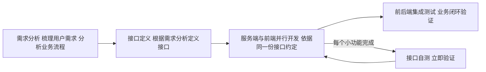

# 四步开发法与编码规范：前后端并行协作怎么才不乱

环境全部就绪，多数人会摩拳擦掌直接开写。但在企业场景里，前端团队与后端团队凑到一起，各写各的、各测各的，最后拼不上才是常态。动手之前先把两件事说清楚：活怎么一步步干（开发步骤），代码按什么标准写（编码规范）。这两条立住了，后面每个功能、每一章业务都按同一套节奏推进。

## 先给结论

- 开发步骤固定四步：需求分析、接口定义、服务端与前端并行开发、前后端集成测试，每个业务都重复这个循环。
- 接口定义是并行开发的前提：契约先定下来，前后端各自依据接口开工，谁也不等谁。
- 后端每完成一个小功能就立刻用接口文档工具与调试工具自测，完成一个测一个，绝不攒批。
- 集成测试是验收线：前后端连起来跑通业务闭环，功能才算真的完成。
- 编码规范动手前立：可参考公开的《Java 开发手册》七个维度，再叠加项目自己的开发规范，其中第八项在本项目开发中会反复用到。

## 从需求到上线的四步开发法

前后端分离架构下，开发通常是多人或多团队并行推进。没有统一节奏，并行的代价就是返工。这套四步法把「谁先干什么」钉死：



**第一步，需求分析。** 分析用户的真实诉求、业务的流转过程、业务里涉及哪些数据。这一步的分量怎么强调都不过分：后续所有编码都依据需求分析展开，需求理解出偏差，后面一整队人的投入都会打水漂。宁可在这里多花时间反复确认，也不要带着模糊的印象开工。

**第二步，接口定义。** 根据需求分析把接口定下来：接口实现什么功能、接收哪些参数、返回什么结果。这是四步里承上启下的一环，也是前后端并行的基础设施。

**第三步，服务端和前端并行开发。** 前后端拿到同一份接口约定同时开工：后端按接口实现业务逻辑，每个功能完成后立即自测；前端按接口制作操作界面、发起请求、处理响应。并行之所以可行，正是因为双方对齐的是接口而不是对方的代码。

**第四步，前后端集成测试。** 自测通过不等于完成。前后端分别开发完，要集成到一起连调，从页面操作走到数据库再走回来，业务闭环没问题才算结束。自测验证的是零件，集成测试验证的是整机。

## 接口是并行的前提

接口定义的价值在于把「猜」变成「约定」。前端工程的统一请求封装里，写死了一组接口路径：

```javascript
// 免令牌放行的接口白名单：登录、发验证码、按手机号查用户
if (url === 'uaa/oauth/token' ||
    url === 'account/sms' || url.search('account/sms/') == 0 ||
    url === 'account/mobiles' || url.search('account/mobiles/') == 0){
    state = false
}
```

前端代码在开发时就知道这些路径、参数与响应结构，因为它依据的是接口约定而不是后端源码。约定放在 `finance-api` 模块里，服务方与调用方共用一份，接口定义往往就是远程调用的客户端契约。下一课要开发的开户业务，讲义里已经给出了它的接口定义形态：

```java
package com.study.finance.depository;

import org.springframework.http.ResponseEntity;

/**
 * 生成开户请求数据
 * @param consumerRequest 开户信息
 */
ResponseEntity<GatewayRequest> createConsumer(ConsumerRequest consumerRequest);
```

一个方法签名，功能（生成开户请求数据）、入参（开户信息对象）、出参（可提交给存管系统的网关请求）全部浮出水面。前端可以照着做跳转页，后端可以照着写实现，互不阻塞。这就是接口定义要达到的效果。

## 完成一个测一个

后端开发的纪律只有一条：每个小功能开发完，立刻借助接口文档与调试工具（本课程使用 Swagger 与 Postman，用法在配套工具篇详述）做功能测试，然后才进入下一个功能。

反面教材值得推演一遍：闷头写了两个月，攒出五十个功能，再抽一天集中测试。这一天里发现的 bug 会互相纠缠，定位一个问题的范围是两个月的工作量，人是会崩溃的。而完成一个测一个，问题出现的范围永远是当天几十行代码，修复成本极低。自测的另一个附带收益是接口文档随代码同步更新，联调时前后端看到的永远是最新契约。

集成测试与自测的分工也要分清：自测是后端拿着调试工具直接打接口，验证业务逻辑正确；集成测试是前端页面发起真实操作，验证参数传递、鉴权、跳转这些跨越前后端的东西。两者都不能省。

## 编码规范立什么

一个人写代码风格无所谓，一个团队里每个人 style 不同，变量名各起各的、分层各放各的，代码合到一起就没法读。编码规范要在开发之前立起来，团队所有人照着执行。两个层次：

**第一层，业界公开规范打底。** 阿里巴巴公开的《Java 开发手册》是业内流传最广的一套，涵盖编码规范、异常日志、单元测试、安全规约、MySQL 数据库、工程结构、设计规范七个维度，值得完整读一遍，看看成熟团队的规矩长什么样。它的理念一句话概括：码出高效，码出质量。

**第二层，项目自己的规范落地。** 本项目也制定了一套开发规范文档，覆盖分层职责、命名方式、数据载体约定等条目，其中第八项与后续每一章开发直接相关，务必逐条认真看。落到工程上，规范长这样：

```text
finance-consumer-service
└── com.study.finance.consumer
    ├── ConsumerService.java   启动类，指定扫描 agent 包的 Feign 客户端
    ├── controller             对外 REST 接口，只做参数校验与转发
    ├── service                业务接口与实现，业务逻辑的唯一归属地
    ├── agent                  Feign 客户端，跨服务调用的统一出口
    └── config                 配置类，如接口文档开关配置
```

命名约定配合分层使用：对外传输对象以 DTO、VO 结尾并集中放在 api 模块；接口定义在 api 模块、实现类放在服务模块并以 Impl 结尾；Feign 客户端接口统一收进 agent 包，启动类的包扫描与它呼应。这些约定本身不复杂，难在全员一致，恰恰是规范存在的意义。

## 常见误区

- **需求没吃透就动手。** 错例：看了两眼页面就开始建表写代码。正解：需求分析先行，业务流程与数据没理清之前不写一行实现，编码永远依据需求分析进行。
- **接口不先定义，前后端互相等。** 错例：后端写完接口再口头告知前端字段。正解：契约先行，接口定义落成双方共用的约定（方法签名、参数、返回值），前后端依据它并行开工。
- **功能攒一批再测。** 错例：连续实现十几个接口才打开调试工具。正解：完成一个测一个，用接口文档与调试工具当场验证，把问题锁死在当天代码范围内。
- **把自测当成集成测试。** 错例：后端调试工具返回正确就宣布功能完成。正解：自测只验证服务端逻辑，必须再做前后端集成测试，业务闭环通过才算交付。
- **规范看一遍就扔。** 错例：编码规范文档读个标题了事。正解：逐条过，尤其是与日常开发直接相关的条目（本项目的第八项），并对照自己的代码持续自查。

## 面试可能被问到的问题

1. 面试官追问：「前后端分离项目里，你们是怎么保证前后端并行开发的？」
   答：靠契约先行。需求分析完成后先定义接口，明确功能、入参、返回值，前后端基于同一份接口约定同时开工；接口集中放在公共 api 模块，服务方与调用方共用，任何变更都从约定改起而不是口头传递。
2. 面试官追问：「后端开发过程中你如何保证质量？」
   答：小步自测加集成验收。每完成一个小功能立即用接口文档与调试工具自测，问题在当天范围内消化；功能层面完成后再与前端做集成测试，验证参数传递、鉴权与跳转等跨层链路，业务闭环通过才算完成。
3. 面试官追问：「为什么要给团队定编码规范？定好的规范怎么落地？」
   答：统一风格降低协作与维护成本，规范里沉淀的还有踩坑经验（异常处理、安全规约、数据库规约）。落地靠三件事：动手前全员过一遍规范、代码评审时对照检查、能自动化的部分交给格式化与静态检查工具，让机器兜底风格问题。
4. 面试官追问：「你了解哪些公开的 Java 编码规范？」
   答：《Java 开发手册》流传最广，覆盖编码规范、异常日志、单元测试、安全规约、MySQL 数据库、工程结构、设计规范七个维度，核心理念是码出高效、码出质量。企业通常在它基础上裁剪出内部版本，再叠加框架与业务相关的专项约定。
5. 面试官追问：「需求频繁变更时，你们的流程怎么应对？」
   答：变更先回到需求分析环节确认影响面，再同步修改接口约定，前后端按新契约调整；已经自测通过的功能针对变更点补充自测，最后重新做集成测试。接口约定集中管理的好处在这里体现，改一处约定即可让双方对齐，而不是到处改代码。

## 配套资料

- 讲义：`materials/docs/10/万信金融-第2章-讲义-开户v1.0.md`，其 3.3 节「接口定义」是「接口先行」的真实落法，正文的 `createConsumer` 接口签名出自该节。
- 代码：`materials/code/10/wanxinp2p/`，微服务基础工程分层骨架（controller、service、agent、config 包划分与启动类扫描约定）；`materials/code/10/wanxinp2p_front/`，前端工程按接口约定编码的真实样例（统一请求封装中的接口白名单），内层目录保留原始命名，引用路径列到工程目录为止。
- 说明：项目配套的开发规范文档未随本套资料归档，正文中分层与命名约定为按课程口径整理；《Java 开发手册》为公开资料，请自行获取阅读。
