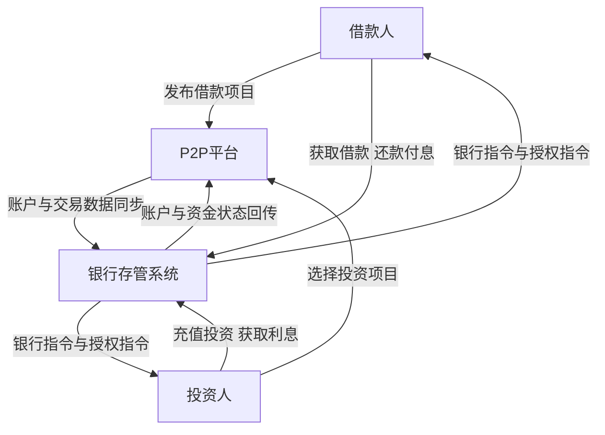

# 开户需求分析：为什么交易前必须开两个账户，注册与开户差在哪

从这一课开始进入第一块真正的业务：开户。听名字像是再普通不过的功能，真动手前必须把需求掰开：谁要开户、开几个户、开户和注册是不是一回事。这三个问题答不清楚，后面接口定义就会跑偏，所以先老老实实做需求分析。

## 先给结论

- 开户就是开通账户，借款人和投资人都需要；不开户就无法交易，开户是整个平台交易的前提条件。
- 一个用户要开两个账户：平台账户与银行存管系统的个人存管账户，两侧账户数据必须同步。
- 背后的根本原因是银行存管模式：交易发生在平台，资金往来发生在银行侧，资金不经过平台账户。
- 注册与开户是两件事：注册只保存手机号这类基本信息，可以登录、可以浏览；要交易必须开户，提供身份证、银行卡等要素信息。
- 整块业务拆成三块推进：注册、登录、开户，本阶段的开发都围绕这个划分展开。

## 银行存管模式与两个账户

为什么开个户要涉及两个账户？答案藏在项目的资金模式里。平台采用银行存管模式，这是当前 P2P 平台最常见的一种模式：资金不能放在平台自己手里，平台一旦出问题，投资人的钱就打了水漂，所以资金统一交由银行存管系统管理，平台只负责撮合交易。用大白话说，交易在平台谈，钱在银行走。

这笔账要在图上看才清楚，借款人、投资人、平台与银行存管系统的关系如下：



平台与银行存管系统之间的双向数据同步是这张图的命门：交易状态在平台侧，资金状态在银行侧，两边数据对不上，业务就是错的。借款人和投资人的资金动作（充值、投资、收款、还款）全部发生在银行侧，平台只发出指令与接收回执。想借钱或想投资，就得在平台开一个账户（记录业务身份），同时到银行存管系统开一个个人存管账户（资金载体），两个账户缺一不可。

多开一个户、多维护一套同步，成本确实变高了，但换来的好处同样明确：资金不流向平台，模式上更保险更安全。这笔账在需求层面就算算清楚了。

## 三层系统角色：存管系统、存管代理、开卡银行

需求里还藏着几个系统角色，分清「谁属于谁」才能理解后续的接口调用链：

- **存管系统**：不属于平台，属于银行侧，部署在银行，专门负责对接平台的账户与交易，平台的交易主要与它交互。它由银行提供，项目里无需开发，直接拿来用，要做的是本地部署并熟悉它的接口。
- **存管代理服务**：属于平台侧，是平台专门设立的一个微服务，用来与存管系统对接。之所以单独设一个代理，是为了让平台各业务服务与银行存管系统松耦合：用户中心、交易中心等各服务都不直接碰银行接口，统一经由存管代理转发。
- **开卡银行**：属于银行侧，是银行管理储蓄卡信息的系统，为了使用方便在本项目中合并进了存管系统。

理解存管代理的存在理由对后面写代码很关键：假如每个微服务都自己调银行接口，银行的加签规则、报文格式就会散落各处，银行侧一变全部要改。收敛到一个代理服务，银行对接的复杂度被封装在一个点上。

## 注册与开户的边界

日常用的电商、社交平台大多只有注册，注册完登录就能用，没有「开户」一说。金融平台为什么多出这道工序？因为平台跟资金打交道，银行侧的账户与划转都以真实身份为前提，光有一个手机号不足以支撑资金操作。

两者的边界可以用一句话划开：**注册解决「你是谁」，开户解决「你的钱走哪条通道」。** 注册只保存用户的基本信息（例如手机号），配合短信验证码就能完成，此时可以登录、可以浏览信息，但不能交易；要交易必须开户，提供身份证、银行卡等要素信息，完成银行侧的实名核验。前端的登录页把注册与登录合并成了同一个表单，只输入手机号和验证码，背后按手机号是否已注册自动分流：

```javascript
// 登录页提交逻辑：先校验验证码与手机号是否已注册，再决定登录还是注册
if (!this.codeKey) {
    this.codeKey = 'codeKey'
}
this.request({
    url: `account/mobiles/${this.mobile}/key/${this.codeKey}/code/${this.password}`
}).then(res => {
    if(res.data.result == 1){
        this.log(data)   // 手机号已注册，走登录换取令牌
    } else {
        this.reg(data)   // 新手机号，自动注册后再登录
    }
})
```

手机号已存在就直接登录，不存在就顺手注册，一气呵成，用户体验上感知不到「注册」这个独立步骤。但登录成功只代表拿到了业务身份，浏览没问题，页面上真正的交易入口（充值、投资、借款）要等开户完成后才解锁，这就是两者在业务上的分层。

## 开户需求的接口拆解

按既定开发步骤，需求理清后要把接口拆出来。开户虽然发生在用户侧，链路却横跨平台与银行两侧，需求阶段就要把接口归属想清楚：

| 环节 | 接口 | 归属 |
|---|---|---|
| 生成并保存开户数据 | 用户中心 `ConsumerAPI` 的 `createConsumer` | 平台侧，用户中心服务 |
| 生成开户请求数据（含签名） | 存管代理 `DepositoryAgentApi` 的 `createConsumer` | 平台侧，存管代理服务 |
| 个人绑卡开户 | 银行存管系统的「个人绑卡开户」接口 | 银行侧，接口说明文档约定 |

用户中心接口接收的开户信息，字段从前端真实提交项就能看出来（对象命名沿用讲义口径，字段与前端页面一致）：

```java
/** 开户信息请求对象（字段取自前端开户页真实提交项） */
public class ConsumerRequest {
    private String fullname;     // 客户姓名
    private String idNumber;     // 证件号码，身份证 18 位
    private String mobile;       // 银行预留手机号
    private String cardNumber;   // 银行卡号，本人储蓄卡
    private String role;         // 用户角色标识
    private String callbackUrl;  // 开户成功后的回跳地址
}
```

开户页的提交按钮有个前置校验，四项要素齐了才允许点击：

```javascript
// 开户页：姓名、身份证、手机号、银行卡号全部合规才能提交
inputHandle: function (event) {
    this.data[event.target.id] = event.target.value
    const {fullname, idNumber, mobile, cardNumber} = this.data
    if (fullname != '' && idNumber.length == 18 && mobile.length == 11 && cardNumber.length >= 16){
        this.submitOpen = true
    }
}
```

这一组接口在需求阶段只需要定下职责与边界：用户中心管业务身份与开户数据落库，存管代理管银行报文与签名，银行存管系统管实名核验与账户开立。具体实现留给后面的开发章节。

## 常见误区

- **以为注册完成就能交易。** 错例：拿到令牌就去调投资接口，被拒之后以为代码有 bug。正解：注册只建立业务身份，可登录可浏览；交易能力要等开户完成、银行侧存管账户开立之后才开放。
- **以为开户只开平台一个账户。** 错例：只在用户中心存了一条用户记录就宣布开户完成。正解：必须同时开通平台账户与银行存管系统个人存管账户，且两侧数据同步，缺一侧资金链路就是断的。
- **以为资金存在平台账户里。** 错例：把充值、放款设计成平台内部账户加余额。正解：银行存管模式下资金在银行侧流转，平台侧只有交易状态，充值投资等动作最终都体现为银行侧的账户变动。
- **把开户当成单纯的表单提交。** 错例：填完信息点确定就认为开户结束。正解：开户要经银行实名核验并设置交易密码，链路横跨平台与银行，表单只是起点。

## 面试可能被问到的问题

1. 面试官追问：「P2P 平台为什么一定要接银行存管？」
   答：资金安全是这类平台的生死线。没有存管时资金沉淀在平台账户，平台挪用或出事用户资金无从保障；银行存管模式让资金往来全部发生在银行侧，平台只做信息撮合与交易指令，从模式上隔离了资金风险。
2. 面试官追问：「开户为什么开两个账户，两个账户的数据怎么保持一致？」
   答：平台账户承载业务身份与交易状态，银行存管账户承载资金，两者缺一不可。一致性靠两侧数据同步保证：开户、交易等关键动作平台与存管系统之间互相同步状态，资金侧以银行为准，业务侧以平台为准，定期核对差异。
3. 面试官追问：「注册和开户为什么要分成两个阶段？」
   答：两者目的不同。注册门槛低，只要手机号加验证码，尽快让用户进来浏览，降低流失；开户涉及实名要素与银行核验，成本高，只对真正要交易的用户要求。分开设计兼顾了转化率与合规要求。
4. 面试官追问：「平台里为什么单独设一个存管代理服务，而不是各微服务直接调银行接口？」
   答：为了让业务服务与银行存管系统松耦合。银行的报文格式、加签规则、接口变更全部收敛在存管代理这一个点上，业务服务只面向代理的通用接口，银行侧变动时代码改动被限制在一个服务内。
5. 面试官追问：「让你负责开户需求，你会怎么拆接口？」
   答：按调用链拆三层：用户中心负责接收前端开户信息并落库，提供生成开户数据接口；存管代理负责生成银行要求的签名报文；银行侧按其接口说明实现个人绑卡开户，再经异步通知回传结果。每个接口的入参出参在需求阶段定清楚，前后端即可并行开发。

## 配套资料

- 讲义：`materials/docs/10/万信金融-第2章-讲义-开户v1.0.md`，3.1 需求分析（开户定义、两个账户与数据同步、存管系统与存管代理服务与开卡银行的系统介绍）与 3.3.2 接口定义为本课出处。
- 代码：`materials/code/10/wanxinp2p_front/`，前端真实工程，正文的登录分流逻辑、开户页四要素校验与开户信息字段出自 `pages/user/login.vue` 与 `pages/lend/openStorage.vue`；`materials/code/10/wanxinp2p/`，用户中心服务骨架；内层目录保留原始命名，引用路径列到工程目录为止。
- 说明：该阶段资料归档在 `materials/docs/10/` 与 `materials/code/10/`，目录编号与相邻阶段共用；`ConsumerRequest` 对象字段整理自前端真实提交项，类名为按讲义口径的示例。
