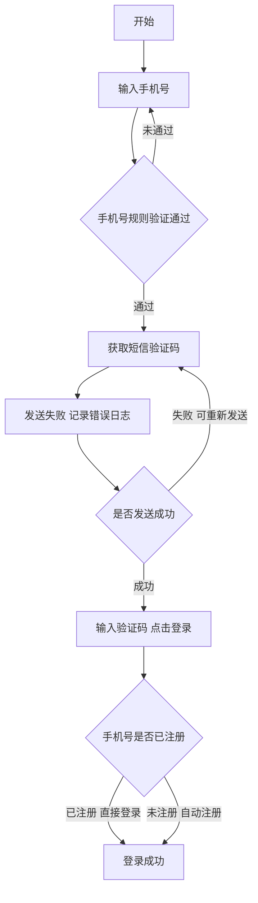
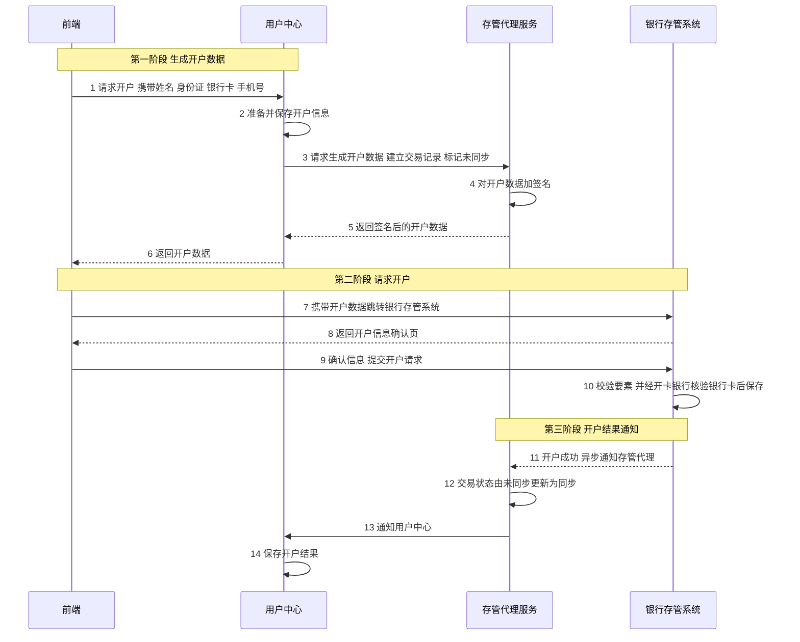

# 开户流程走读：注册登录合一与平台到存管银行的三阶段链路

需求分析回答了「做什么」，业务流程回答「按什么顺序做」。开发时要盯着业务流程图写代码，第一步干什么、第二步干什么、异常分支怎么走，全在图上。开户这块业务的流程分两段看：注册登录是一段，开户本身是另一段，两段合起来才是完整的用户旅程。

## 先给结论

- 整体流程分三块：注册、登录、开户；注册与登录共用一个表单，按手机号是否已注册自动分流，一气呵成。
- 注册登录的核心只有短信验证码：手机号规则校验、发送验证码、失败记录错误日志可重发、验证码校验通过即登录成功。
- 登录成功只能浏览，不能交易；交易前要走开户：先判断是否已开户，未开户则填写要素信息、平台校验、设置交易密码。
- 平台与银行侧的开户链路分三阶段：生成开户数据、请求开户、开户结果通知，全链路 14 步。
- 状态贯穿始终：存管代理生成交易记录时标记「未同步」，收到银行异步通知后才更新为「同步」，这个状态是判断开户是否真正完成的依据。

## 注册与登录合一的流程

传统做法是注册一个接口、登录一个接口，用户先注册再登录。这个项目做了简化：登录页只有一个表单，输入手机号、点「点击发送」获取短信验证码、输入验证码点登录，后端按手机号是否已存在自动分流，新用户顺手注册，老用户直接登录。流程图如下：



发送验证码这一步看似简单，工程细节都藏在真实代码里：

```javascript
getCode(){
    if(this.mobile.length == 11){
        this.start = false
        this.setTime()   // 启动 60 秒倒计时，防止频繁发送
        this.request({
            url: `account/sms/${this.mobile}`,
            method: 'GET',
        }).then(res => {
            if (res.data.code == 0) {
                if (res.data.result) {
                    this.codeKey = res.data.result.key   // 记录验证码 key，登录提交时要带上
                }
                // 验证码获取成功提示
            } else {
                // 验证码获取失败提示，可稍后重试
            }
        })
    }else{
        // 手机号格式不正确提示
    }
}
```

三处细节对应流程图上的三个节点：手机号长度校验对应「手机号规则验证」；请求失败走 catch 提示对应「记录错误日志」并允许重发；服务端返回的验证码 `key` 要暂存起来，登录提交时与验证码一并送往后端比对。倒计时按钮则压住用户连点，避免短信通道被刷。

## 用户视角的开户流程

注册登录成功后，用户可以浏览标的、查看信息，但交易入口是锁着的。点开交易相关的功能，页面会引导进入「开通存管」，这才是开户的入口。开户的用户操作分四步：

**第一，判断是否已开户。** 已开过户的直接去交易；未开户的进入开户流程。前端进入开户页时会先查询已保存的开户信息，填过就直接回显可以修改，没填过就白纸一张，这正好对应后面链路里「前端先查询开户信息」的约定。

**第二，填写要素信息。** 页面要求提供客户姓名、身份证号、本人储蓄卡卡号、银行预留手机号，四项是银行实名核验的最小集合，任何一项填错，银行侧核验都过不去。

**第三，提交校验。** 提交不是直接入账，平台与银行会做要素一致性核验，防止冒用他人身份证或银行卡开户；核验通过银行侧才真正开立存管账户。

**第四，设置交易密码。** 开户过程中要单独设置交易密码，后续投资、提现等资金操作都用它确认，与登录密码是两套密码，登录密码管进门，交易密码管掏钱。

## 平台与存管银行的三阶段链路

用户看到的四步，落到系统上是一条横跨前端、用户中心、存管代理服务、银行存管系统的完整链路，讲义把它切成三个阶段：



第一阶段在平台侧完成。前端请求用户中心，用户中心把开户信息落库，再调存管代理生成交易记录，这条记录初始状态是「未同步」，存管代理按银行要求对数据加签后原路返回。为什么要签名：银行要确认这份数据确实来自合作平台且途中未被篡改，签名是双方约定的信任凭证。

第二阶段的开关在前端手里，真实代码把跳转逻辑写得明明白白：

```javascript
// 开户页提交（节选）：先向用户中心换取签名数据，再整页跳转到存管系统确认页
_this.request({
    url: 'consumer/my/consumers',
    method: 'POST',
    params: {..._this.data}
}).then(res => {
    store.commit('setOpenStorageData', res.data.result)
    const urlData = res.data.result
    const url = `${urlData.depositoryUrl}?serviceName=${urlData.serviceName}&platformNo=${urlData.platformNo}&reqData=${urlData.reqData}&signature=${urlData.signature}`
    window.location.href = url
})
```

用户中心的响应里带着存管系统地址 `depositoryUrl` 与四样跳转参数（服务名、平台编号、加密数据、签名），前端用整页跳转把用户带到银行页面。注意这一步是离开平台的：确认页与最终提交都发生在银行存管系统侧，银行校验银行卡信息（背后会问开卡银行）无误后保存开户信息。`data` 里还有一个 `callbackUrl` 指向工程的开户成功页，银行处理完毕把浏览器送回平台，用户看到「开户成功」。

第三阶段是数据闭环。用户看到成功页只是体验层面的结束，真正的状态同步靠银行异步通知：存管系统通知存管代理，代理把交易记录从未同步改成同步，再通知用户中心保存开户结果。哪怕用户拿到成功页后立刻关掉浏览器，这条通知链也会走完，平台侧的开户状态终究是准的。

## 常见误区

- **以为开户全程发生在平台站内。** 错例：把银行确认页做成平台自己的表单直接提交给用户中心。正解：第二阶段必须整页跳转到银行存管系统，要素核验与账户开立在银行侧完成，平台只负责准备签名数据与接收结果。
- **漏掉异步通知阶段。** 错例：用户跳转银行后平台就不再处理，交易记录永远停在未同步。正解：必须实现第三阶段的通知接收，状态从未同步更新为同步后开户才算闭环，否则用户在平台侧永远是未开户。
- **把交易密码与登录密码混为一谈。** 错例：开户时复用登录密码作为交易密码。正解：两套密码职责不同，登录密码用于身份认证，交易密码用于资金操作确认，银行侧单独设置、单独校验。
- **前端不做要素校验直接提交。** 错例：身份证位数、手机号长度都不管，全靠银行端报错。正解：进入银行页之前先在平台侧做格式校验并要求要素齐全，把明显无效的请求挡在第一跳之前，减少无效跳转。
- **把流程图当装饰。** 错例：编码时凭感觉写，异常分支（验证码发送失败、已开户重复开户）漏实现。正解：流程图上每个菱形判断都要有对应的代码分支，编码严格依据需求与流程图执行。

## 面试可能被问到的问题

1. 面试官追问：「开户为什么要把用户跳转到银行页面完成，平台代填不行吗？」
   答：不行。存管账户的开立主体是银行，实名核验、银行卡校验必须发生在银行侧，这既是合规要求也是防篡改手段。平台只准备签名后的开户数据并引导用户跳转，银行完成核验后经异步通知把结果回传平台。
2. 面试官追问：「签名在开户链路里起什么作用？」
   答：银行要确认请求确实来自合作平台且数据未被篡改。平台侧由存管代理服务按约定算法对开户数据加签，随报文一起提交；银行验签通过才受理。签名同时也能定位责任，验签失败的请求根本不会进入银行业务逻辑。
3. 面试官追问：「银行的开户结果通知如果一直没到达，平台侧会怎样？」
   答：交易记录会停留在未同步状态，用户在平台侧视为未开户，无法交易。工程上要靠通知重发与主动查询双保险：银行侧对未确认的通知定期重发，平台侧也可以按交易记录主动向存管代理或银行查询结果，最终把状态补齐。
4. 面试官追问：「注册登录合一，新用户和老用户走同一个接口，怎么区分处理？」
   答：接口内部先校验验证码，再按手机号查询是否已存在账户：存在则直接认证发令牌，不存在则先创建账户再认证。对用户表现为一步登录，对系统是注册与登录两个动作的条件组合，互不影响。
5. 面试官追问：「如果让你实现开户功能，你会按什么顺序开发？」
   答：按三阶段顺序推进：先做用户中心的生成开户数据接口与信息落库，再做存管代理的签名与交易记录，然后打通前端跳转银行确认页的链路，最后实现银行异步通知的接收与状态更新。每完成一个接口立即自测，三阶段全部通了再做前后端集成测试。

## 配套资料

- 讲义：`materials/docs/10/万信金融-第2章-讲义-开户v1.0.md`，3.1 需求分析中的开户业务流程图、三阶段业务流程（生成开户数据、请求开户、开户结果通知）为本课出处。
- 代码：`materials/code/10/wanxinp2p_front/`，前端真实工程，正文引用的验证码发送逻辑出自 `pages/user/login.vue`，开户信息回显、要素校验与跳转存管系统代码出自 `pages/lend/openStorage.vue`，「开通存管、确认开通存管、开户成功」页面路由见 `pages.json`；内层目录保留原始命名，引用路径列到工程目录为止。
- 说明：该阶段资料归档在 `materials/docs/10/` 与 `materials/code/10/`，目录编号与相邻阶段共用；用户中心与存管代理服务的实现代码在后续开发章节的工程中给出。
