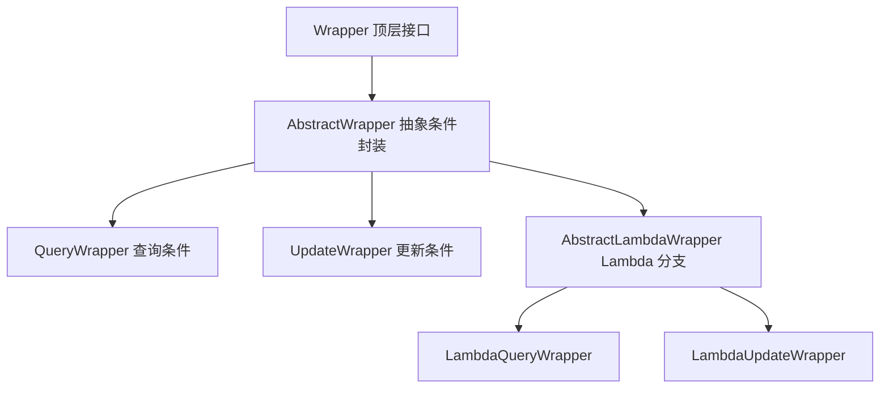

# MyBatis-Plus 条件构造器：把 WHERE 条件搬进 Java 方法调用

> 🔒 安全提示：文中示例的口令/密钥均为课程教学环境演示口径，生产环境的安全要求见《安全与合规须知》。

通用 CRUD 解决的是「无条件」的操作，而实际业务里大多数查询都带着条件：判断用户名是否已被注册要按用户名查，登录校验要按用户名加密码查，列表页要按年龄、时间区间筛选。这些条件落在 SQL 里是 WHERE 子句，落在 MyBatis-Plus 里就是一个专门的角色：条件构造器。它把 WHERE 后面能出现的比较、模糊、排序与逻辑组合全部封装成方法，调用方法等于拼接条件，拼好的对象交给查询方法，SQL 由框架自动生成。

## 先给结论

- 条件构造器顶层是 Wrapper 接口，查询用 QueryWrapper，更新用 UpdateWrapper；两条分支之外还有以方法引用代替字符串列名的 Lambda 版本，列名写错能在编译期暴露。
- 条件方法与 SQL 关键字一一对应：eq、ne、gt、ge、lt、le、between、in、notIn，模糊查询的 like 系列自动补百分号，排序用 orderByAsc 与 orderByDesc。
- 固定套路三步：new 一个带实体泛型的 wrapper，链式调用条件方法，再把 wrapper 传给 selectOne、selectList 或 selectCount。
- 三个查询方法差别只在结果形态：selectOne 最多返回一条，命中多条直接抛 TooManyResultsException；selectList 返回集合；selectCount 返回条数。
- 条件之间默认以 and 连接，需要 or 必须显式调用 or()；每个条件方法都有带 condition 参数的重载，false 时不拼接，动态条件靠它实现。

## 条件构造器是什么，配哪三个查询方法

带条件的操作在 MP 里不用写 SQL，也不用碰映射文件，靠的是一套专门封装条件的类型体系。顶层是 Wrapper 接口，往下分成两条分支：一条以 AbstractWrapper 为骨架，条件列名用字符串描述，子类包括面向查询的 QueryWrapper 与面向更新的 UpdateWrapper；另一条支持 Lambda 写法，条件列名换成方法引用。视频主线集中在字符串列名的 QueryWrapper 上，Lambda 版本在真实工程的测试类里已有用例，稍后一并对照。



凡是能出现在 WHERE 与 ORDER BY 里的要素，wrapper 里都有同名方法，eq 等于、ne 不等于、gt 大于、ge 大于等于、lt 小于、le 小于等于、between 区间、in 与 notIn 集合匹配，一一对应 SQL 关键字。封装好的 wrapper 自己不执行任何操作，它是纯粹的条件容器，真正的查询动作由 BaseMapper 的三个方法承担：

```java
// 按条件查一条，命中多条抛 TooManyResultsException
T selectOne(Wrapper<T> queryWrapper);

// 按条件查列表，返回集合，命中几条装几条
List<T> selectList(Wrapper<T> queryWrapper);

// 按条件查总数，返回条数
Integer selectCount(Wrapper<T> queryWrapper);
```

三个方法的参数都是 wrapper，差别只在返回形态。使用套路因此完全固定：先 new 一个 QueryWrapper 并把实体类作为泛型传入，接着链式调用条件方法把条件装进去，最后把 wrapper 扔给对应的查询方法。条件构造器不挑查询方法，selectOne、selectList、selectCount 之外，带条件的更新与删除同样以 wrapper 为参，这一点在分页一篇还会用到。

## 比较操作实测

用一个三条件查询把最常用的比较器过一遍：密码等于 123456，年龄大于等于 20，姓名限定在几个人选之中。测试方法照套路写：

```java
@Test
public void testEq() {
    QueryWrapper<User> wrapper = new QueryWrapper<>();
    // SELECT id,user_name,password,name,age,email FROM tb_user
    // WHERE password = ? AND age >= ? AND name IN (?,?,?)
    wrapper.eq("password", "123456")
           .ge("age", 20)
           .in("name", "李四", "王五", "赵六");
    List<User> users = userMapper.selectList(wrapper);
    for (User user : users) {
        System.out.println(user);
    }
}
```

三个方法各对应一个条件片段。eq 接两个参数，前者是数据库列名，后者是期望值；ge 表示大于等于，参数形式相同；in 的第二个参数起是可变参数，直接把候选值依次传入，生成 IN (?,?,?) 占位。方法可以一直链式点下去，调用顺序就是条件书写顺序。对照注释里的目标 SQL 能看出对应关系：条件方法只负责往 WHERE 里添片段，语句的列清单仍由实体注解决定。

跑完测试对照控制台日志，占位符与参数一一对应，结果集里只有同时满足三个条件的记录。ne、lt、le、between、notBetween、notIn 这些方法没有单独演示，参数形式与已演示的完全一致，见名知义，需要时直接取用。

## 模糊查询与排序

模糊查询在 MP 里也做成了方法，like 系列一共四个：like 表示包含，likeLeft 表示以给定值结尾，likeRight 表示以给定值开头，notLike 表示不包含。百分号不用手写，方法内部按语义自动补齐：

```java
@Test
public void testLike() {
    QueryWrapper<User> wrapper = new QueryWrapper<>();
    // WHERE name LIKE ?  参数：%曹%
    wrapper.like("name", "曹");
    List<User> users = userMapper.selectList(wrapper);
    for (User user : users) {
        System.out.println(user);
    }
}
```

传进去的是纯关键字「曹」，实际参数是 `%曹%`。若要查以曹开头的姓名，换成 likeRight 即可，对应参数 `曹%`。测试数据里此前插入过几条姓名带曹的记录，这次全部命中，结果集与表数据核对一致。

排序对应 orderByAsc 与 orderByDesc，参数是可变长度的列名，传多个列就是多字段排序：

```java
@Test
public void testOrderBy() {
    QueryWrapper<User> wrapper = new QueryWrapper<>();
    // ORDER BY age DESC
    wrapper.orderByDesc("age");
    List<User> users = userMapper.selectList(wrapper);
    for (User user : users) {
        System.out.println(user);
    }
}
```

输出按年龄降序排列，28、21、20、18 依次出现，与表内数据核对无误。orderByDesc 的可变参数重载传入两个列名时，生成 ORDER BY age DESC, id DESC，年龄相同再按主键排，写法与 SQL 里的多字段排序同构。

## 逻辑拼接与动态条件

多个条件之间的逻辑关系，MP 的默认约定是 and：前面 testEq 里三个条件没调任何逻辑方法，生成的就是 AND 连接。想要 or 关系必须显式调用 or()，它把紧随其后的条件用 OR 连接：

```java
@Test
public void testOr() {
    QueryWrapper<User> wrapper = new QueryWrapper<>();
    // WHERE name = ? OR age = ?
    wrapper.eq("name", "李四").or().eq("age", 24);
    List<User> users = userMapper.selectList(wrapper);
    for (User user : users) {
        System.out.println(user);
    }
}
```

更复杂的组合嵌套，and 与 or 都有接收函数式参数的重载，把一组条件写进 lambda 传入，生成时会被括号包成一组，等价于 SQL 里用括号控制优先级。or() 只影响相邻两个条件的连接词，优先级复杂时优先考虑嵌套写法，不要靠心算 SQL 的 and or 优先级。

还有一个工程里高频出现的场景：条件要不要拼，取决于调用方传没传值。查询页的用户名输入框留空时，`name = ?` 这个条件就不该出现。每个条件方法都提供了带 condition 参数的重载，第一个参数为 true 才拼接本条件。真实工程的测试类里正好有这样的用例：

```java
@Test
public void testEq3() {
    LambdaQueryWrapper<User> queryWrapper = new LambdaQueryWrapper<>();
    String name = null;
    Integer age = 20;
    // 第一个参数为 true 才拼接，name 为 null 时该条件不参与生成
    queryWrapper.eq(name != null && !name.equals(""), User::getName, name);
    queryWrapper.gt(age != null, User::getAge, age);
    List<User> users = userMapper.selectList(queryWrapper);
    System.out.println(users);
}
```

这个用例同时示范了 Lambda 版本的写法：列名不再是字符串，而是 `User::getName` 这样的方法引用，字段名写错或改名漏改会在编译期直接报错，字符串列名则要等到运行期才炸。字符串版与 Lambda 版的条件方法同名同义，会一套等于会两套，新代码建议默认用 Lambda 版。

## 常见误区

- **把实体属性名当列名传。** 错例：eq 的第一个参数写成实体属性名 userName，执行时报列不存在。正解：字符串版的参数是数据库列名，应写 `user_name`；换 LambdaQueryWrapper 用 `User::getUserName` 由编译器把关。
- **给 like 手工加百分号。** 错例：像写 SQL 那样给 like 的关键字参数手工加上两个百分号，实际生成的参数变成百分号套百分号，匹配行为不符合预期。正解：like 系列自动补百分号，只传关键字；前缀匹配用 likeRight，后缀匹配用 likeLeft。
- **想要 or 却没调 or()。** 错例：连着两个 eq 以为第二个是「或者」关系，实际生成 AND。正解：默认全是 and，or 关系必须显式调用 or()，复杂组合用函数式嵌套。
- **把 selectOne 当列表查询用。** 错例：条件可能命中多条仍用 selectOne，运行时抛 TooManyResultsException。正解：selectOne 只用于业务上保证唯一的结果，存在多条可能就改用 selectList 并收紧条件。
- **只在字符串版上花时间，列名改名没有防护。** 正解：实体字段重构时字符串列名不会被 IDE 提示，Lambda 版方法引用能跟随重构自动更新，工程代码优先选它。

## 面试可能被问到的问题

1. 面试官追问：「QueryWrapper 里的条件是怎么变成 SQL 的？」
   答：wrapper 只是一个条件容器，每个条件方法调用都往里登记一个片段和对应参数。查询方法执行时，MP 把这些片段合并成 WHERE 子句拼进按实体注解生成的语句骨架，参数以预编译占位符绑定，不直接拼进 SQL 字符串，因此不引入注入风险。
2. 面试官追问：「selectOne 遇到多条结果会怎样，怎么处理？」
   答：直接抛 TooManyResultsException。selectOne 的语义是按条件查一条，调用前必须确认业务上结果唯一，比如按唯一索引列查询；可能出现多条的查询应改用 selectList，再按业务取第一条或收紧条件。
3. 面试官追问：「动态条件的 condition 参数怎么用，解决什么问题？」
   答：它是每个条件方法的重载首参，为 true 才拼接该条件。列表查询里常有可选筛选，传了值才查、没传就跳过，用 condition 参数一行搞定，省去手工 if 判断和拼接字符串的旧写法，语句结构仍然清晰。
4. 面试官追问：「LambdaQueryWrapper 相比 QueryWrapper 的优势是什么？」
   答：列名从字符串换成方法引用。字符串写错只能靠运行期报错发现，方法引用在编译期就能查出问题，实体字段重命名时引用会随重构自动更新，类型不匹配同样编译不过。代价是需要方法引用语法，两者条件方法完全同名，可以平滑切换。
5. 面试官追问：「or() 与 and 的优先级怎么控制？」
   答：默认所有条件以 and 连接，or() 只把紧随其后的条件改为 or 连接，等价于 SQL 里不加括号的写法，and 优先级天然高于 or。需要括号语义时用 and 或 or 的函数式重载，把一组条件包在 lambda 里，生成时会被括号包裹，优先级一目了然。

## 配套资料

- 讲义：`materials/docs/10/Mybatis-Plus讲义v1.0.md`，条件构造器一节的比较操作、模糊查询、逻辑查询、select 指定字段与排序小节为正文出处，比较器与 like 系列的语义对照表以讲义为准。
- 代码：`materials/code/10/mp-springboot/`，MP 测试工程归档，测试类里另有 testEq2 与 testEq3 的 LambdaQueryWrapper 用例、testWrapper 的 select 指定字段用例，以及按条件更新与条件删除的写法可对照；内层目录保留原始命名，引用路径列到工程目录为止。
- 说明：正文代码与日志按视频画面线与讲义样例整理，包名按 `com.study.finance` 系改写；示例中的人名、密码均为测试数据，Lambda 版本在视频主线里未展开，用例取自工程归档。
