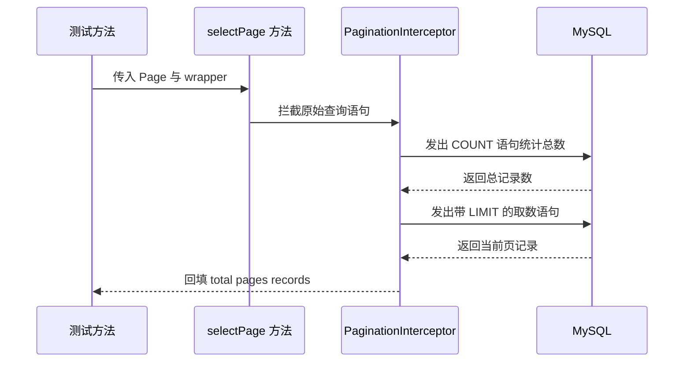

# MyBatis-Plus 分页查询：一个插件、一个 Page 对象、两条 SQL

列表类页面几乎都带着分页：账户记录一页一页翻，标的列表按页加载，后台管理的查询结果更是离不开页码。MyBatis 时代做分页，要么在映射文件里手写 LIMIT 与 COUNT 两条语句，要么引入第三方分页助手。MyBatis-Plus 把这件事做成了内置插件：注册一个 Bean，调用方法时传一个 Page 对象，物理分页需要的两条 SQL 自动发出，总条数、总页数、当前页数据一并回填。条件构造器刚讲完，分页正好是它的第一个大型应用场景。

## 先给结论

- `selectPage(IPage, Wrapper)` 两个参数：Page 对象封装当前页码与每页条数，wrapper 封装查询条件，无条件时传 null。
- 分页插件 PaginationInterceptor 必须以 @Bean 注册进容器，否则 LIMIT 拼不上、总条数不回填，分页形同虚设。
- 返回的 IPage 里 `getTotal()` 是总记录数，`getPages()` 是总页数，`getRecords()` 是当前页集合，传入的 page 对象本身也会被回填。
- 物理分页的证据在日志：先发一条 COUNT 语句统计总数，再发一条带 LIMIT 的语句取当前页。
- 带条件的分页就是把条件构造器作为第二个参数传入，条件会同时出现在 COUNT 与 LIMIT 两条 SQL 的 WHERE 里。

## selectPage 的两个参数

BaseMapper 里负责分页的方法签名如下：

```java
/**
 * 根据 entity 条件，查询全部记录（并翻页）
 * @param page 分页查询条件
 * @param queryWrapper 实体对象封装操作类（可以为 null）
 */
IPage<T> selectPage(IPage<T> page, @Param(Constants.WRAPPER) Wrapper<T> queryWrapper);
```

两个参数各有分工。第一个参数是 IPage 类型，它是一个专门描述分页信息的接口：要查第几页、每页显示多少行这些入参由它带入，查完之后总记录数、总页数、当前页记录也回填进它。第二个参数仍是条件构造器，与查询三件套里的用法完全一致，于是「带条件的分页查询」不需要任何新知识，把 wrapper 照常传进来即可；不需要条件时传 null，生成的语句不带 WHERE。

IPage 的常用实现类是 Page，构造方法的前两个参数就是页码与每页条数。读它的源码能看到 total、pages、records 等字段的定义，正好与前面的三个 getter 对应，这也是方法返回类型选 IPage 而不是 List 的原因：分页查询要交还的不只是数据，还有分页元信息。

## 分页插件：不配置就没有分页

调用 selectPage 之前有一件必须完成的事，注册分页插件。工程的配置类里加一个 @Bean 方法：

```java
@Configuration
@MapperScan("com.study.finance.mp.mapper")
public class MybatisPlusConfig {

    // 分页插件
    @Bean
    public PaginationInterceptor paginationInterceptor() {
        return new PaginationInterceptor();
    }
}
```

PaginationInterceptor 是一个 MyBatis 拦截器，单词 interceptor 就是拦截器的意思。它挂在 SQL 执行的必经之路上，分页查询发生时做三类自动化工作：入参侧校验分页数据的合法性，比如页码小于 1 的一律按第 1 页处理；执行侧把原始语句改写为 COUNT 与 LIMIT 两条 SQL 并分别执行；返回侧把统计到的总条数、总页数与当前页记录回填进 IPage 对象。这些事情都不需要调用方参与，但前提是这个 Bean 真的注册进了容器，MP 启动时收集所有 MyBatis 拦截器，没注册的插件等于不存在。

## 带条件的分页实测

条件与分页参数各自就位后，测试方法非常短：

```java
@Test
public void testSelectPage() {
    // 条件：年龄大于 20
    QueryWrapper<User> wrapper = new QueryWrapper<>();
    wrapper.gt("age", 20);
    // 参数 1 当前页码，小于 1 的按 1 算；参数 2 每页记录数
    Page<User> page = new Page<>(1, 2);
    IPage<User> iPage = userMapper.selectPage(page, wrapper);
    System.out.println("数据总条数：" + iPage.getTotal());
    System.out.println("总页数：" + iPage.getPages());
    List<User> users = iPage.getRecords();
    for (User user : users) {
        System.out.println(user);
    }
}
```

测试数据里年龄大于 20 的有王五、赵六、孙七三条，每页两条，执行结果打印出数据总条数 3、总页数 2，当前页只列出前两条。控制台日志是验证分页是否真生效的第一现场：

```text
==>  Preparing: SELECT COUNT(1) FROM tb_user WHERE age > ?
==>  Parameters: 20(Integer)
==>  Preparing: SELECT id,user_name,password,name,age,email FROM tb_user WHERE age > ? LIMIT ?,?
==>  Parameters: 20(Integer), 0(Long), 2(Long)
<==      Total: 2
```

两条语句一目了然。第一条 COUNT 统计满足条件的总记录数，供 total 与 pages 计算；第二条才是取数据，LIMIT 后面两个占位符分别是偏移量与每页条数，第 1 页对应偏移 0，翻到第 2 页偏移变为 2。条件构造器封装的年龄条件在两条语句的 WHERE 里都出现了，这就是条件构造器与分页插件协同的结果。整个流程画出来是这样的：



COUNT 在前取数在后，两段各自独立执行，中间穿插的正是插件做的工作。对照日志逐条核对，比在页面上反复翻页验证可靠得多。

## 顺带补齐：带条件的更新与删除

条件构造器不只为查询服务。BaseMapper 里的 update 与 delete 两个方法同样以 wrapper 为参，把条件装进 wrapper 传进去，就能实现按条件的批量更新与删除，语义与 selectList 一脉相承：

```java
// 按条件更新：entity 提供要改的值，wrapper 提供条件
User user = new User();
user.setAge(100);
user.setPassword("12222");
QueryWrapper<User> wrapper = new QueryWrapper<>();
wrapper.eq("name", "曹操");
int rows = userMapper.update(user, wrapper);

// UpdateWrapper 可以直接 set，把字段更新为 null
UpdateWrapper<User> updateWrapper = new UpdateWrapper<>();
updateWrapper.eq("name", "曹操").set("birthday", null);
int rows2 = userMapper.update(null, updateWrapper);
```

第一个用例里实体对象携带新值、wrapper 携带条件，仍是「非空字段才进 SET 子句」的老规矩。第二个用例换了 UpdateWrapper，它额外提供 set 方法直接指定「列等于某值」，想把某列清空就 set 一个 null，此时第一个参数传 null，更新值完全由 wrapper 供给。上一节按主键更新留的「做不到置空」的尾巴，在这里收掉。

## 常见误区

- **忘了注册分页插件。** 错例：selectPage 照常调用，但查询返回了全部数据，total 也没有被正确回填。正解：插件不注册，LIMIT 不会拼上，分页退化为全量查询，检查配置类里的 PaginationInterceptor Bean。
- **页码从 0 开始传。** 错例：想查第一页传了 0，或者负数。正解：页码从 1 起，插件对小于 1 的值按 1 处理，但代码里应按语义传正确值。
- **把 getRecords 当全量数据用。** 错例：拿 records 去算总数或判断数据是否全部存在。正解：records 只包含当前页，总数看 getTotal，页数看 getPages。
- **分页逻辑分页不分家。** 错例：以为 selectPage 先查全表再在内存里截取，担心大表性能。正解：MP 的分页是物理分页，LIMIT 在数据库端生效，只取当前页的数据量；真正要防的是自己手写「查全表再 subList」的逻辑分页。
- **在映射文件里再手写一遍 LIMIT。** 正解：插件负责改写语句，自定义 SQL 的分页也应交给插件处理，手工再拼 LIMIT 会与插件行为叠加，页码与偏移错乱。

## 面试可能被问到的问题

1. 面试官追问：「物理分页和逻辑分页的区别是什么？」
   答：物理分页依赖数据库的 LIMIT 之类的语法，每次只取当前页的数据，内存占用小，大表也能稳定表现；逻辑分页先取全量结果再在内存里截取，数据量大时内存与传输都是灾难。MP 的分页插件是物理分页，MyBatis 原生的 RowBounds 属于逻辑分页。
2. 面试官追问：「分页插件的实现原理是什么？」
   答：它是一个 MyBatis 拦截器，注册后在语句执行的环节把原始 SQL 拦下来，先改写一条 COUNT 语句拿到总记录数，再按数据库方言把原语句加上 LIMIT 执行取当前页，最后把总数、页数与记录回填进 IPage 对象。调用方全程无感，写分页等同写普通查询。
3. 面试官追问：「selectPage 为什么返回 IPage 而不是 List？」
   答：分页查询的产出除了当前页记录，还有总条数、总页数这些分页元信息，前端翻页控件全靠它们。IPage 把记录与元信息封装在一起返回，同时传入的 page 参数也会被回填，调用方拿到任意一个引用都能取到完整结果。
4. 面试官追问：「怎么验证分页真的生效了？」
   答：开 DEBUG 日志看语句。生效的标志是一次 selectPage 发出两条 SQL：一条 COUNT 统计总数，一条带 LIMIT 的取数语句，LIMIT 的两个参数分别对应偏移量与每页条数，翻页时偏移量按页码递增。没有 COUNT、没有 LIMIT 就说明插件没起作用。
5. 面试官追问：「带条件的分页和普通分页写法上有区别吗？」
   答：只差第二个参数。条件装进 QueryWrapper 传入即可，插件会把条件同时用于 COUNT 与取数两条语句，保证 total 与 records 的口径一致。条件构造器的所有能力，包括动态条件与排序，在分页里原样可用。

## 配套资料

- 讲义：`materials/docs/10/Mybatis-Plus讲义v1.0.md`，查询操作小节的 selectPage 方法定义、分页插件配置与两段式 SQL 日志样例为正文出处，页码小于 1 按 1 处理的说明亦出自讲义。
- 代码：`materials/code/10/mp-springboot/`，MP 测试工程归档，`MybatisPlusConfig` 的分页插件配置与测试类里 testSelectPage、按条件更新、UpdateWrapper 置空字段的用例均可对照；内层目录保留原始命名，引用路径列到工程目录为止。
- 说明：正文代码与日志按视频画面线与讲义样例整理，包名按 `com.study.finance` 系改写，总条数与总页数按讲义数据口径还原；示例中的条件值均为测试数据。
