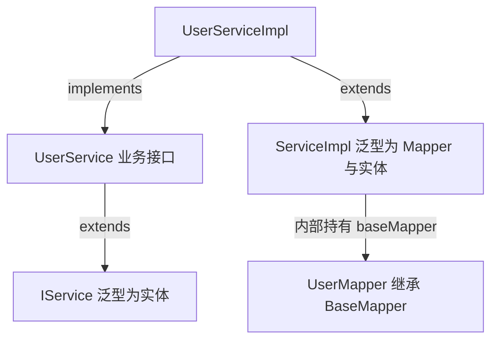

# MyBatis-Plus 业务层封装：继承两个类型，省掉一整层样板代码

> 🔒 安全提示：文中示例的口令/密钥均为课程教学环境演示口径，生产环境的安全要求见《安全与合规须知》。

三层架构里业务层的常规剧本高度雷同：接口里声明一批增删改查方法，实现类注入 Mapper，方法体一行转发。没有任何业务逻辑的方法也要走「接口声明、实现转发」两道工序，模块越多这道工序重复越多。MyBatis-Plus 把通用业务层也封装了：业务接口继承 IService，实现类继承 ServiceImpl，空着的接口和实现类直接拥有全套通用方法。BaseMapper 解决数据访问层的重复，这一层封装解决业务层的重复，思路一脉相承。

## 先给结论

- 业务接口继承 `IService<实体>`，实现类继承 `ServiceImpl<Mapper, 实体>` 并实现自己的业务接口，再加上 @Service 注解，改造只要这几行。
- 空接口空实现照样拥有全套方法，但命名换成另一套体系：insert 对应 save，selectById 对应 getById，deleteById 对应 removeById，selectPage 对应 page。
- ServiceImpl 内部已经持有泛型指定的 Mapper，通用方法最终仍落在 BaseMapper 的能力上，业务层封装没有绕开 Mapper 另起炉灶。
- 自定义业务方法照旧写在自己的接口与实现里，该注入 Mapper 注入 Mapper，通用方法与手写方法在同一个类里并存。
- 实现类漏加 @Service，容器里没有这个 Bean，注入时报 NoSuchBeanDefinitionException，这是本节实测踩到的真实错误。

## 传统业务层在重复什么

先看改造前的样子。业务实现类注入 Mapper，把通用操作逐个转发一遍：

```java
@Service
public class UserServiceImpl implements UserService {

    @Autowired
    private UserMapper userMapper;

    @Override
    public void save(User user) {
        userMapper.insert(user);
    }

    @Override
    public User getById(Long id) {
        return userMapper.selectById(id);
    }
}
```

接口 UserService 里还得对应声明 save 与 getById。这两个方法体没有一行业务逻辑，纯粹是把 Mapper 的方法换个名字转出去，而 BaseMapper 里这样的方法有十几个。每一个新模块、每一个新服务都要把这套声明加转发的动作重演一遍，写的人机械，审的人无聊，收益接近于零。MP 对此的回答很直接：既然大家都这么写，框架替你写。

## 两步改造：继承 IService 与 ServiceImpl

改造分两步，全在继承关系上做文章。

业务接口继承 MP 提供的 IService，实体类作为泛型传入：

```java
public interface UserService extends IService<User> {
}
```

实现类继承 ServiceImpl，两个泛型分别是 Mapper 接口与实体类，同时实现刚才的业务接口，并保留 @Service 注解：

```java
@Service
public class UserServiceImpl extends ServiceImpl<UserMapper, User> implements UserService {
}
```

到这里改造完成。接口里一个方法没声明，实现类里一行代码没写，增删改查能力却已经齐备。层级关系画出来是这样：



IService 里声明的通用方法，全部在 ServiceImpl 中实现，实现方式正是调用泛型指定的那个 Mapper。表里列一组两套命名体系的对照，从 Mapper 世界切换到 Service 世界时按这张表换名字即可：

| BaseMapper 侧 | IService 侧 | 说明 |
|---|---|---|
| insert | save | 保存单条 |
| deleteById | removeById | 按主键删除 |
| updateById | updateById | 按主键更新 |
| selectById | getById | 按主键查询 |
| selectOne | getOne | 按条件查一条 |
| selectList | list | 按条件查集合 |
| selectCount | count | 按条件查总数 |
| selectPage | page | 按条件分页 |

IService 侧还有 saveBatch 批量保存、saveOrUpdate 存在则更新否则保存等组合方法，是把多个 Mapper 调用按常见业务动作打包的结果。方法名从「数据库动作」换成了「业务动作」，这层封装顺带把业务层的语言风格也统一了。

## 测试验证与那次报错

测试类与 Mapper 的测试写法一致，注入的对象换成 UserService：

```java
@RunWith(SpringRunner.class)
@SpringBootTest
public class TestUserService {

    @Autowired
    private UserService userService;

    @Test
    public void testInsert() {
        User user = new User();
        user.setEmail("123@example.com");
        user.setAge(301);
        user.setUserName("caocao1");
        user.setName("曹操1");
        user.setPassword("123456");
        userService.save(user);
    }
}
```

第一次运行并没有通过。容器启动时在注入环节报错：

```text
Caused by: org.springframework.beans.factory.NoSuchBeanDefinitionException:
No qualifying bean of type 'UserService' available:
expected at least 1 bean which qualifies as autowire candidate
```

报错含义直白：容器里找不到 UserService 类型的 Bean。原因出在实现类忘了加 @Service 注解，类没有被扫描进容器，继承体系再完整也没有实例可注入。补上注解再跑，测试转绿，表里多出一行新记录，数据核对无误。继承解决的是「方法从哪来」，注解解决的是「Bean 从哪来」，两件事互不替代。

## 原理与边界

ServiceImpl 的泛型声明是 `<M extends BaseMapper<T>, T>`：M 必须是操作同一实体的 BaseMapper 子接口，T 是实体类型。类内部有一个 baseMapper 字段指向 M 的代理对象，save 内部调 baseMapper.insert，getById 内部调 baseMapper.selectById，通用方法一层也没有脱离前面讲过的 BaseMapper 能力，只是加了一层转发与若干业务化封装，比如批量保存会分批提交。

封装有明确的边界。通用方法覆盖的是单表常规操作，业务编排类的方法，比如注册流程里「校验用户名、发验证码、创建账户」这种多步骤带规则的逻辑，IService 不可能预知，仍然要在自己的业务接口里声明、在自己的实现类里编写，需要 Mapper 时通过 baseMapper 或常规注入获取。通用方法与手写方法在同一个实现类里并存，互不妨碍。判断标准与 BaseMapper 一致：无业务逻辑的单表转发交给框架，有业务语义的逻辑自己写。

## 常见误区

- **实现类忘了加 @Service。** 错例：继承关系写对了，注入时报 NoSuchBeanDefinitionException。正解：实现类必须标注 @Service 进入容器，继承只提供方法，不提供 Bean。
- **ServiceImpl 的两个泛型写反。** 错例：写成 `ServiceImpl<User, UserMapper>`，编译报类型不匹配。正解：顺序是 Mapper 在前、实体在后，M 在前 T 在后，与类声明 `<M extends BaseMapper<T>, T>` 对齐。
- **以为还要自己注入一遍 Mapper。** 正解：ServiceImpl 内部已有 baseMapper 字段，通用方法与自定义方法都可以直接用它，无需重复注入。
- **在业务接口里重新声明一遍通用方法。** 错例：接口里又写了 save、getById，实现类再转发一次，封装形同虚设。正解：IService 已声明的通用方法直接调用，接口里只放自定义业务方法。

## 面试可能被问到的问题

1. 面试官追问：「IService 与 ServiceImpl 的泛型分别是什么含义？」
   答：IService 只有一个泛型，是业务操作的实体类型；ServiceImpl 有两个泛型，第一个是该实体对应的 Mapper 接口且必须继承 BaseMapper，第二个是实体类型。框架靠这两个泛型把业务层与数据访问层绑定起来，通用方法的实现内部就是调用这个 Mapper。
2. 面试官追问：「save 和 insert、getById 和 selectById 只是改名吗？」
   答：本质上是同一能力在业务层的表述，但 Service 侧不完全是简单转发。saveBatch、saveOrUpdate 这类方法在 Mapper 调用之上做了批量分批、存在性判断等组合逻辑。单个的 save、getById 与对应 Mapper 方法行为一致，命名统一成业务语言是这层封装的附加价值。
3. 面试官追问：「ServiceImpl 里的 baseMapper 是怎么来的？」
   答：ServiceImpl 内部声明了泛型类型的 baseMapper 字段，Spring 装配这个 Bean 时由框架注入对应的 Mapper 代理对象。业务代码里可以直接使用，也可以通过 getBaseMapper 方法获取，不必自己在实现类里再注入一次。
4. 面试官追问：「有了 Service 封装，什么时候还要自己写方法？」
   答：涉及业务规则与流程编排的操作都要自己写，比如注册要查重、发验证码、加事务控制，这些逻辑框架无法预知。封装只覆盖无业务逻辑的单表通用操作，两类的分界与 BaseMapper 的使用原则一致：转发交给框架，业务留给自己。
5. 面试官追问：「测试里注入 UserService 报 NoSuchBeanDefinitionException，怎么排查？」
   答：先确认实现类上有没有 @Service 注解，没有注解的类不会进入容器；再确认实现类所在包是否在启动类的组件扫描范围内；最后看继承与实现关系是否写全，实现类必须同时继承 ServiceImpl 并实现业务接口，缺一个接口注入的类型就对不上。

## 配套资料

- 代码：`materials/code/10/资料/Mybatis-Plus/代码/`，MP 测试工程的完整归档，service 包下的 UserService、UserServiceImpl 与测试类 TestUserService 是正文代码的直接出处；内层目录保留原始命名，引用路径列到工程目录为止。
- 讲义：`materials/docs/10/Mybatis-Plus讲义v1.0.md`，课程目标将 Service 封装列为专题；讲义正文对该节未展开，接口与实现细节以工程代码与视频画面为准。
- 说明：正文代码按视频画面线与工程归档整理，包名按 `com.study.finance` 系改写，示例邮箱替换为 `example.com` 占位；命名对照表按 MP 3.1.0 的接口方法整理。
