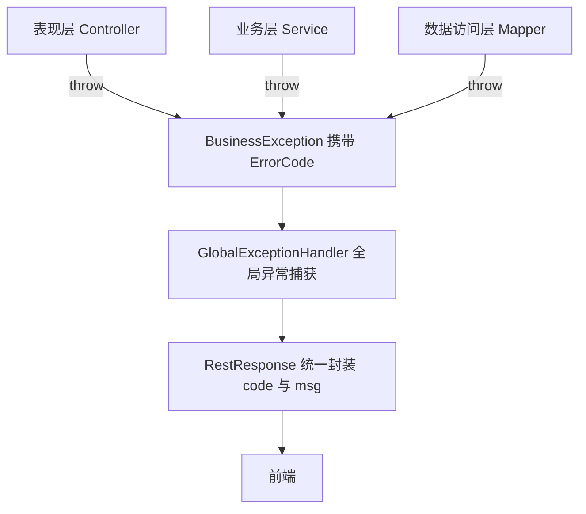

# 项目级异常处理机制：统一抛、统一捕、统一响应

注册功能马上要进入编码阶段，校验手机号格式、验证码是否正确、用户名是否已被占用，每一项不通过都是一次异常。Java 自带的处理手段是 try-catch，小工具里用它没有问题，放进多模块、多微服务的项目里就会失控：每个开发者的写法不一样，每个接口的报错格式不一样，用户看到的提示一半是英文一半是黑话。万信金融项目为整套系统设计了一套异常处理机制，讲义专门成文，后续每个微服务直接复用这套约定。

## 先给结论

- 传统 try-catch 方式在项目里的三个问题：处理代码到处书写、抛出与处理的方式不统一、提示信息不统一也不友好。
- 机制由四条约定组成：自定义异常类与错误代码；表现层、业务层、数据访问层只抛异常不处理异常，建议集中在业务层抛；捕获与处理统一交给 Spring MVC 的全局异常处理器；返回给前端的错误信息统一封装成 RestResponse。
- ErrorCode 是接口，只有 getCode 与 getDesc 两个方法；通用错误码放 CommonErrorCode，各微服务再按业务定义自己的枚举，如统一账户服务的 AccountErrorCode。
- BusinessException 继承 RuntimeException，核心属性只有一个 ErrorCode，抛出时把错误码传进构造方法。
- 全局异常处理器用 @ControllerAdvice 加 @ExceptionHandler(Exception.class) 捕获一切异常，按 instanceof 分派处理，最后以 UNKNOWN 未知错误兜底。

## 传统方式的三宗罪

对照项目场景逐条看传统 try-catch 的问题。**第一，代码冗余且难维护。** 一个大项目里需要进行异常处理的位置成百上千，每个位置都包一层 try-catch，样板代码大量繁殖，后期调整处理策略要改遍所有位置。**第二，处理方式不统一。** 有的开发者在业务层抛异常，有的在数据访问层就地处理；有的方法签名上 throws 一路传递，有的在方法内部直接 catch 掉；抛的方式和处理的方式五花八门，排查问题时没有固定路径可循。**第三，提示信息不统一也不友好。** 没有一套统一设计时，成功提示有人写「操作成功」有人写 OK，失败提示有人写 sorry 有人写错误码；框架抛出的异常信息还常常是面向开发者的英文描述，用户根本看不懂。三条都指向同一个结论：异常处理需要项目级的设计，而不是各自为政的编码技巧。

## 机制总览：一张图的四条约定

整套机制的数据流如下，三层只负责抛，捕获与封装由专门的组件完成：



四条约定分别对应图上的四段。**第一，自定义异常类与错误代码。** 不用 Java 与框架自带的异常类型和提示语，错误代码与提示信息全部自己定义，统一且面向用户友好。**第二，三层只抛不捕。** 表现层、业务层、数据访问层按业务规则判断，该抛就抛，抛出的统一是携带 ErrorCode 的 BusinessException；建议抛出动作尽量集中在业务层，因为业务规则住在这里。**第三，统一捕获。** Spring MVC 的全局异常捕获类 GlobalExceptionHandler 负责接住项目里冒出来的所有异常，三层因此可以完全不管 catch。**第四，统一封装。** 项目是前后端分离架构，后端无论成功还是失败，响应统一封装成 RestResponse 交给前端，异常信息也不例外。

## 错误代码与提示信息：一个接口加两类枚举

错误代码的设计从一个接口开始，它规定任何错误码都要能给出代码值与提示语：

```java
public interface ErrorCode {
    int getCode();    // 错误代码
    String getDesc(); // 错误提示信息
}
```

通用错误码用枚举实现，供整个项目使用：

```java
public enum CommonErrorCode implements ErrorCode {
    SUCCESS(0, "成功"),
    E_100101(100101, "传入参数与接口不匹配"),
    E_100102(100102, "验证码错误"),
    E_100103(100103, "验证码为空"),
    E_100104(100104, "查询结果为空"),
    E_100105(100105, "ID格式不正确或超出Long存储范围"),
    CUSTOM(999998, "自定义异常"),
    UNKNOWN(999999, "未知错误");

    private int code;
    private String desc;

    @Override
    public int getCode() { return code; }

    @Override
    public String getDesc() { return desc; }

    private CommonErrorCode(int code, String desc) {
        this.code = code;
        this.desc = desc;
    }
}
```

通用枚举覆盖不了各服务的业务差异，每个微服务再按自己的业务提供专属枚举。统一账户服务负责注册与登录，它的错误码全部围绕这条业务线：

```java
public enum AccountErrorCode implements ErrorCode {
    E_130101(130101, "用户名已存在"),
    E_130104(130104, "用户未注册"),
    E_130105(130105, "用户名或密码错误"),
    E_140141(140141, "注册失败"),
    E_140151(140151, "获取短信验证码失败"),
    E_140152(140152, "验证码错误");
    // 字段、构造方法与接口实现与通用枚举一致
}
```

六位数字的错误码自带分段语义：前两位标识服务，中间两位标识模块，后两位标识异常，看到 130101 就知道是统一账户服务的用户模块报了「用户名已存在」。开发中遇到枚举里没有的业务错误，往对应服务的枚举里加一个常量即可，扩展点清晰。

## 自定义异常类：BusinessException

异常类继承 RuntimeException，核心属性只有一个 ErrorCode：

```java
public class BusinessException extends RuntimeException {

    private static final long serialVersionUID = 5565760508056698922L;

    // 错误代码与提示信息的载体
    private ErrorCode errorCode;

    public BusinessException(ErrorCode errorCode) {
        super();
        this.errorCode = errorCode;
    }

    // 错误码之外再补一条自定义消息
    public BusinessException(ErrorCode errorCode, String message) {
        super(message);
        this.errorCode = errorCode;
    }

    public ErrorCode getErrorCode() {
        return errorCode;
    }

    public void setErrorCode(ErrorCode errorCode) {
        this.errorCode = errorCode;
    }
}
```

工程里这组构造方法还有多个重载，覆盖带原因异常、带消息加原因异常等各种组合，最常用的就是传一个 ErrorCode 的版本。继承 RuntimeException 是刻意选择：运行时异常不强制方法声明与调用方捕获，三层的代码里不会出现成串的 throws；同时它符合事务回滚的默认语义，业务异常抛出后事务按预期回滚。

抛异常的动作发生在业务层，按业务规则判断，一行完成：

```java
// 注册流程中校验用户名是否已占用，示例按本课机制补全
Account account = accountMapper.findByUsername(username);
if (account != null) {
    throw new BusinessException(AccountErrorCode.E_130101);
}
```

## 全局异常处理器与统一响应结构

最后一块拼图是捕获者。GlobalExceptionHandler 挂上两个注解，@ControllerAdvice 声明它是一个面向所有控制器的增强组件，@ExceptionHandler(value = Exception.class) 声明这个方法处理 Exception 及其全部子类，自定义的 BusinessException 自然在覆盖范围内：

```java
@ControllerAdvice
@Slf4j
public class GlobalExceptionHandler {

    @ExceptionHandler(value = Exception.class)
    @ResponseBody
    public RestResponse<Nullable> exceptionGet(HttpServletRequest req, HttpServletResponse response, Exception e) {
        if (e instanceof BusinessException) {
            BusinessException be = (BusinessException) e;
            if (CommonErrorCode.CUSTOM.equals(be.getErrorCode())) {
                // 错误码为自定义时，提示信息取异常自带的 message
                return new RestResponse<Nullable>(be.getErrorCode().getCode(), be.getMessage());
            } else {
                return new RestResponse<Nullable>(be.getErrorCode().getCode(), be.getErrorCode().getDesc());
            }
        } else if (e instanceof NoHandlerFoundException) {
            return new RestResponse<Nullable>(404, "找不到资源");
        } else if (e instanceof HttpRequestMethodNotSupportedException) {
            return new RestResponse<Nullable>(405, "method 方法不支持");
        } else if (e instanceof HttpMediaTypeNotSupportedException) {
            return new RestResponse<Nullable>(415, "不支持媒体类型");
        }
        log.error("【系统异常】" + e.getMessage());
        return new RestResponse<Nullable>(CommonErrorCode.UNKNOWN.getCode(), CommonErrorCode.UNKNOWN.getDesc());
    }
}
```

方法体是一串 instanceof 分派。业务异常取错误码的 code 与 desc 组装响应，这里藏着 CUSTOM 的妙用：错误码为自定义异常时，提示信息改取异常对象自带的 message，业务代码就能用固定的错误码配上运行期才确定的动态文案。404、405、415 三个分支处理请求路径、方法与媒体类型不匹配这类框架级异常，提示语统一转成中文。所有分支都不匹配的异常走到最后，记一条 error 日志留痕，以 UNKNOWN 的 999999 与「未知错误」兜底，保证任何异常都会以统一的 RestResponse 形态出去。

RestResponse 是项目公共包里的响应封装，三个字段构成前后端共同语言：

```java
public class RestResponse<T> {
    private int code;    // 响应错误编码，0 为正常
    private String msg;  // 响应错误信息
    private T result;    // 响应内容
    // success 等静态工厂与构造方法省略
}
```

code 为 0 表示成功，非 0 的值直接来自错误码，msg 面向用户展示，result 携带业务数据。成功与失败共用一个结构，前端的响应解析只写一次。这套 API 在项目里直接提供，各微服务引入公共模块即用，遇到新的异常场景按分派结构继续加分支扩展。

## 常见误区

- **三层里又忍不住 try-catch。** 错例：业务层把异常捕住后返回 null 或吞掉，全局处理器什么都收不到，前端拿到一个语义含糊的成功响应。正解：三层只抛不捕，让异常一路冒到全局处理器。
- **把 e.getMessage() 直接返回给前端。** 错例：非业务异常的信息里带着类名、SQL 片段，暴露内部实现。正解：常规分支的提示信息走错误码的 desc，只有 CUSTOM 语义下才使用自定义 message，且文案按用户视角编写。
- **错误码用散落的数字与字符串。** 错例：`throw new BusinessException(130101, "用户名已存在")` 到处硬编码，改文案要全局搜索。正解：统一用 ErrorCode 枚举常量，新错误先加枚举再使用。
- **全局处理器只声明了具体异常类型。** 错例：@ExceptionHandler 只配了 BusinessException，空指针之类未预见的异常直接 500 裸奔。正解：保留 Exception.class 的顶层兜底分支，配合 UNKNOWN 错误码与日志。
- **漏掉 @ResponseBody。** 错例：方法返回的 RestResponse 被当作视图名解析，前端收到跳转或乱码。正解：类上用 @RestControllerAdvice，或方法上保留 @ResponseBody，确保响应体走 JSON 序列化。

## 面试可能被问到的问题

1. 面试官追问：「@ControllerAdvice 的原理是什么，为什么能捕获所有控制器的异常？」
   答：它是 Spring MVC 的控制器增强组件，容器启动时被注册为全局配置，配合 @ExceptionHandler 标注的方法，形成一个作用于所有处理器的异常解析增强。任何控制器抛出的异常在渲染响应前都会经过异常解析器链，匹配到该组件里的处理方法后由它接管，效果等价于给每个控制器都加了一段统一的异常处理逻辑。
2. 面试官追问：「BusinessException 为什么继承 RuntimeException 而不是 Exception？」
   答：受检异常强制方法声明与逐层捕获，三层只抛不捕的约定会被 throws 链条破坏，代码也会被 try-catch 重新污染；运行时异常免声明、免强制捕获，与「只抛不捕」天然契合，且 Spring 的事务默认对运行时异常回滚，业务失败即回滚的语义不需要额外配置。
3. 面试官追问：「CUSTOM 这样的自定义错误码有什么用？」
   答：它是动态文案的出口。枚举错误码的提示信息在编码期固定，遇到提示内容依赖运行期数据的场景，比如提示哪个字段超长，业务层抛异常时选用 CUSTOM 错误码并把动态文案放进异常 message，全局处理器识别到 CUSTOM 后改取 message 返回，错误码体系与灵活性兼得。
4. 面试官追问：「前后端分离架构下，错误响应如何做到统一？」
   答：约定唯一的响应结构 RestResponse，code 承载错误码、0 表示成功，msg 承载面向用户的提示，result 承载数据；正常返回与异常返回都封装成这个结构，异常侧由全局异常处理器统一转换。前端只需一套解析逻辑，错误提示的风格与语言也由后端统一控制。
5. 面试官追问：「兜底分支为什么必要，它处理什么？」
   答：业务代码永远无法穷举所有异常，空指针、连接超时等未预见异常如果没有人接，会以容器的默认错误页直接暴露。Exception.class 的顶层兜底保证任何异常都被转成统一响应，同时记 error 日志留存现场，用户看到友好的未知错误提示，开发者能从日志定位问题。
6. 面试官追问：「六位错误码的分段设计有什么好处？」
   答：前两位服务、中间两位模块、后两位异常的分段让错误码自带定位信息，看到码就知道出问题的服务与模块，跨服务排查时不用先查映射表；分段也天然划分了各服务的枚举扩展空间，不同微服务的错误码不会冲突。

## 配套资料

- 讲义：`materials/docs/10/万信金融-异常处理机制.md`，机制的四条约定、ErrorCode 接口、CommonErrorCode 与 AccountErrorCode 枚举、BusinessException 与 GlobalExceptionHandler 的 API 设计均出自该讲义。
- 代码：`materials/code/10/资料/公共类/`，课程归档的公共类目录，含 GlobalExceptionHandler.java、AccountErrorCode.java、ConsumerErrorCode.java，正文处理器的分派结构以该源码为准；另有统一账户相关实体与 DTO 可对照。
- 参照：`materials/code/10/shanjupay/`，common 模块下的 ErrorCode、CommonErrorCode 与 RestResponse 是同一套设计的后续演进版本，错误码分段注释与 RestResponse 字段定义可对照；引用路径列到工程目录为止。
- 说明：正文代码按讲义与课程公共类整理，包名按 `com.study.finance` 系改写；业务层抛异常的用例为按本课机制补全，枚举常量的拼写与注释按正文规范做了微调。
