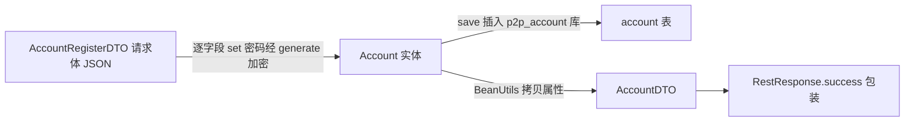

# 统一账户注册功能实现：一次保存背后的两次对象转换与一套密码口径

> 🔒 安全提示：文中示例的口令/密钥均为课程教学环境演示口径，生产环境的安全要求见《安全与合规须知》。

接口契约立好，Controller 里的空实现等着填。表面上这是个「往表里插一条数据」的功能，MyBatis-Plus 一行 `save` 就能收工，真写起来却有两道绕不开的工序：`save` 只认与表建立映射的实体类，DTO 里的三个字段得先手工倒腾进去；密码不能明文入库，加密的口径之外还藏着一个手机号兜底的细节。写完业务层，再把 DO 转回 DTO、Controller 收口包装，整条链才闭环。

这节课把统一账户的注册功能从接口填到数据库。代码本身不长，值得花力气的是三个点：为什么要倒腾对象、密码到底怎么存、哪些注解忘了会出大事。

## 先给结论

- 业务层方法签名从表现层拷贝后「降级」：去掉 `RestResponse` 包装，直接返回 `AccountDTO`，业务层不感知 HTTP 响应结构。
- MP 的 `save` 只吃与表映射的实体 `Account`，DTO 数据要逐字段 set 进实体；实体的 `@TableName`、`@TableField` 注解正是它有资格进 `save` 的原因。
- 密码绝不存明文：统一调 `PasswordUtil.generate` 加密，32 位 MD5 摘要与 16 位随机盐交错排成 48 位密文，盐藏进密文，不用单独存列。
- 短信验证码功能开启时（Apollo 开关 `sms.enable` 为 true），注册时把手机号加密后作为默认密码存入，为将来切换密码登录模式留好入口。
- `domain` 写死 `c` 表示 C 端普通用户；保存后实体转回 `AccountDTO`，Controller 用 `RestResponse.success` 包装返回；`@RequestBody` 是整段代码里最不能忘的注解。

## 业务层落位：签名拷贝与一层降级

业务方法的骨架不用凭空想，把 Controller 里已经实现接口的方法签名拷进业务接口，改两处就是成品：返回值从 `RestResponse` 换成 `AccountDTO`，注释补上参数说明。这个「降级」不是偷懒，是分层的本意：`RestResponse` 是表现层对前端的响应包装，业务层要面对的是「注册」这个业务动作本身，做完后交出结果对象，包装成什么格式轮不到它操心。

```java
// 业务接口：新增注册方法，签名与表现层对齐但返回值降为 DTO
public interface AccountService {

    RestResponse getSMSCode(String mobile);

    Integer checkMobile(String mobile, String key, String code);

    /**
     * 账户注册
     * @param accountRegisterDTO 注册信息
     * @return 注册后的账户信息
     */
    AccountDTO register(AccountRegisterDTO accountRegisterDTO);
}
```

实现类 `AccountServiceImpl` 此前已经继承了 `ServiceImpl<AccountMapper, Account>`，MP 的业务层封装让通用方法现成可用，`save`、`getById` 这些名字直接就能调，其中 `save` 对应数据访问层的 `insert`。注册实现里要做的只有三件事：组装实体、调 `save`、把实体转回 DTO。

```java
@Service
public class AccountServiceImpl extends ServiceImpl<AccountMapper, Account>
        implements AccountService {

    // 短信验证码功能开关，来自 Apollo，与验证码服务共用同一个配置项
    @Value("${sms.enable}")
    private Boolean smsEnable;

    @Override
    public AccountDTO register(AccountRegisterDTO accountRegisterDTO) {
        Account account = new Account();
        // 逐字段从 DTO 取值，倒腾进与表映射的实体
        account.setUsername(accountRegisterDTO.getUsername());
        account.setMobile(accountRegisterDTO.getMobile());
        // 开关打开时把手机号作为默认密码加密存入，验证码功能关闭后用户可用手机号登录
        if (smsEnable) {
            account.setPassword(PasswordUtil.generate(accountRegisterDTO.getMobile()));
        } else {
            account.setPassword(PasswordUtil.generate(accountRegisterDTO.getPassword()));
        }
        // 域取 c，表示 C 端普通用户
        account.setDomain("c");
        save(account);
        return convertAccountEntityToDTO(account);
    }
}
```

## save 只认实体：DTO 到 DO 的一次倒腾

初看这段代码最想不通的就是开头几行 set：明明手上已经有装好数据的 `AccountRegisterDTO`，为什么还要 new 一个 `Account` 再挨个搬一遍？答案在 MP 的方法签名里。`save` 的参数类型是泛型 `T`，而这个 `T` 在实现类上已经固定为 `Account` 实体。实体不是普通的 Java 类，它靠一组注解跟数据库表绑定了映射关系：

```java
@Data
@TableName("account")
public class Account implements Serializable {

    private static final long serialVersionUID = 1L;

    /** 主键 */
    @TableId("ID")
    private Long id;

    /** 用户名 */
    @TableField("USERNAME")
    private String username;

    /** 手机号 */
    @TableField("MOBILE")
    private String mobile;

    /** 密码 */
    @TableField("PASSWORD")
    private String password;

    /** 加密盐 */
    @TableField("SALT")
    private String salt;

    /** 账号状态 */
    @TableField("STATUS")
    private Integer status;

    /** 域(c：c端用户；b：b端用户) */
    @TableField("DOMAIN")
    private String domain;
}
```

`@TableName("account")` 声明这张表的名字，`@TableField` 把 Java 字段对到数据库列上，MP 拼插语句时全靠这套映射。DTO 是接口层的数据契约，没有也不该有这些注解，它根本没有资格被 `save` 接受。这层「倒腾」看着机械，实际是分层的防火墙：表结构将来加列、改名，波及范围被压在实体这一层，接口契约纹丝不动。

`domain` 的取值值得单独一提。实体的注释写明 c 端用户与 b 端用户两种取值，注册进来的都是普通客户，直接写死 `c`。企业客户将来走另一条注册入口，到时再议。

## 密码落库的口径：MD5 加盐交错，手机号兜底

密码处理是整个功能里唯一有点「算法味」的地方，工程公共模块里备好了工具类，核心方法是 `generate`：

```java
/**
 * 生成含有随机盐的密码
 */
public static String generate(String password) {
    Random r = new Random();
    StringBuilder sb = new StringBuilder(16);
    // 两个 8 位随机数拼接，不足 16 位补 0，得到 16 位盐
    sb.append(r.nextInt(99999999)).append(r.nextInt(99999999));
    int len = sb.length();
    if (len < 16) {
        for (int i = 0; i < 16 - len; i++) {
            sb.append("0");
        }
    }
    String salt = sb.toString();
    // 原始密码拼接盐后取 MD5，得到 32 位摘要
    password = md5Hex(password + salt);
    // 48 位字符数组，按「摘要两位 + 盐一位」交错排列
    char[] cs = new char[48];
    for (int i = 0; i < 48; i += 3) {
        cs[i] = password.charAt(i / 3 * 2);
        char c = salt.charAt(i / 3);
        cs[i + 1] = c;
        cs[i + 2] = password.charAt(i / 3 * 2 + 1);
    }
    return new String(cs);
}
```

三步看清结构：先造 16 位随机盐，再把「原始密码加盐」算出 32 位 MD5 摘要，最后把摘要与盐按 3 位一组交错排列，输出 48 位密文。交错的妙处在校验那一侧：`verify` 方法把 48 位密文按同样的节奏反向拆开，摘要与盐各自归位，重新计算 MD5 与摘要比对，盐根本不需要单独的存储列。

课程资料里的种子数据可以作证这套口径：`p2p_account` 库的 `account` 表里，`PASSWORD` 列存的正是一串 48 位密文，`SALT` 列全部为空。数据库里不存在任何明文密码，连「密码撞库」最常见的字典攻击也被随机盐挡住，同样的明文每次生成的密文都不一样。

手机号兜底是这个功能的隐藏细节。注册功能上线时短信验证码是主用模式，但验证码服务依赖外部短信通道，开发与演示环境常把它关掉；`sms.enable` 一旦配成 false，系统切到密码登录模式，此时用户拿什么登录？课程的做法是注册时就把手机号加密后当默认密码存进去，将来验证码功能一关，老用户可以用手机号当密码直接登录，不需要任何人补录数据。判断开关的 `if` 写在设置密码的那一行，两个分支最终都过 `PasswordUtil.generate`，加密口径只有一套。

## 出参回转：DO 变 DTO 与 Controller 收口

`save` 执行完，实体 `account` 的主键已被数据库回填，现在要把 DO 转回 DTO 交给表现层。手工 set 又要写五遍，这里用 Spring 的 `BeanUtils.copyProperties` 一行替代：

```java
/**
 * 将账户实体转换为数据传输对象
 * @param entity 账户实体
 * @return 账户 DTO
 */
private AccountDTO convertAccountEntityToDTO(Account entity) {
    if (entity == null) {
        return null;
    }
    AccountDTO dto = new AccountDTO();
    // 反射按字段名拷贝属性，两个类字段名一致是前提
    BeanUtils.copyProperties(entity, dto);
    return dto;
}
```

`copyProperties` 用反射把源对象里同名字段的值批量拷给目标对象，Spring 与 Apache 都各有一个同名工具，课程用的是 Spring 版本，效率更好一些。它的隐含前提是两侧字段名对齐，名字对不上的字段会被静默跳过，这也是它偶尔背锅「拷丢了字段」的原因。

表现层这边把空实现补成一行委托加一层包装：

```java
@Override
@PostMapping(value = "/l/accounts")
public RestResponse<AccountDTO> register(@RequestBody AccountRegisterDTO accountRegisterDTO) {
    return RestResponse.success(accountService.register(accountRegisterDTO));
}
```

与获取验证码接口同一个套路：`RestResponse.success` 把 DTO 装进 result。最后把整条数据流走一遍：



关键路径上最容易断的一环是 `@RequestBody`。漏掉它，SpringMVC 会退回表单方式绑定参数，JSON 请求体原样躺在流里没人解析，DTO 字段全是 null，数据库里插进一条空账号而不报任何错。这类问题编译器查不出来，测试时发现「注册成功但查无此人」，第一反应就该去看这个注解。

## 常见误区

- **密码明文入库，或者加密后又把盐单独存一列却不会用。** 错例：`account.setPassword(dto.getPassword())` 直插明文。正解：统一走 `PasswordUtil.generate`，48 位密文里已交错藏着盐，校验时反向拆解，`SALT` 列在这个口径下不参与存储。
- **业务层返回 `RestResponse`。** 错例：把表现层的响应包装一路带进业务层，远程调用方拿到的是 HTTP 风格结构，业务结果取不出来。正解：业务层只出 DTO，包装是 Controller 的职责。
- **忘写 `@RequestBody`。** 错例：Postman 用 JSON 提交，接口返回成功，表里全是空数据。正解：JSON 请求体必须由 `@RequestBody` 接住，写完接口逐个核对注解。
- **`domain` 忘写或乱取值。** 错例：实体里 `domain` 留 null，后续按域鉴权的逻辑全部失效；或误写成 b 端取值。正解：注册入口面向普通客户，固定写 `c`，取值口径以实体注释为准。

## 面试可能被问到的问题

1. 面试官追问：「MD5 已经不安全了，为什么这里还在用 MD5 加盐？」
   答：单纯 MD5 确实挡不住彩虹表与撞库，加固点在于随机盐与交错存储：盐每次随机生成，同样明文得到不同密文，彩虹表失效；盐混进 48 位密文里不单独落列，攻击者拿不到盐的明确位置。这个方案的强度对教学项目够用，生产环境应换 bcrypt、PBKDF2 这类专为密码设计的慢哈希，思路相同但代价更高。
2. 面试官追问：「DTO 与实体（DO）的区别是什么，为什么不直接用实体接参数？」
   答：DTO 是接口契约，字段按调用方的读写需求裁剪，随接口演进；实体是表映射，字段跟着数据库走，带着 `@TableName` 这类持久化注解。实体接参数等于把表结构直接暴露给外部，多传一个敏感字段就可能被恶意填充，接口也无法在表结构变化时保持稳定。两者转换的成本换来的是边界清晰。
3. 面试官追问：「`BeanUtils.copyProperties` 有什么坑？」
   答：它靠反射按字段名拷贝，名字对不上的字段静默跳过，不报错；源与目标参数顺序在不同工具版本里相反，写反了会拷出空对象；大量对象频繁转换时反射开销可观，高并发链路可以用手工 set 或 MapStruct 这类编译期生成代码的方案。字段名对齐、参数顺序核对是使用它的两条纪律。
4. 面试官追问：「注册时把手机号作为默认密码，这样设计你怎么评价？」
   答：它是为「验证码登录切换密码登录」设计的过渡方案，保证验证码功能关闭后老用户无感登录，数据上不欠账。代价是手机号即密码，知道手机号就能试出登录口令，安全性依赖验证码模式的持续开启。生产上更稳妥的做法是首次登录强制设置密码或短信验证身份后重置，把兜底逻辑从「固定手机号」升级为「受控重置流程」。
5. 面试官追问：「`save` 方法返回什么？怎么拿到插入后的主键？」
   答：MP 的 `save` 返回布尔值表示成败，主键回填发生在实体对象上：插入成功后，实体里映射主键的字段自动带上数据库生成的值。这正是本课保存完成后能直接把实体转成 DTO 返回的原因，DTO 的 id 字段因此有值，不需要再查一次库。
6. 面试官追问：「如果注册请求并发重复提交，账号表会出现什么问题？」
   答：手机号上如果没有唯一索引，并发下会插入两条同手机号的账号，后续按手机号查询的鉴权逻辑直接错乱。兜底手段是给 MOBILE 列加唯一约束，代码里捕获重复键异常转成友好提示，或者注册前先按手机号查询再插入，查询加唯一约束双保险，只靠查询挡不住并发窗口。

## 配套资料

- 代码：`materials/code/10/资料/公共类/`，`Account.java`（实体原件，`@TableName` 与 `@TableField` 映射齐全）、`AccountDTO.java`、`AccountRegisterDTO.java`（正文两个 DTO 的出处）。
- 代码：`materials/code/10/wanxinp2p_apollo/`，公共工程 `wanxinp2p-common` 内含 `PasswordUtil.java` 加密工具原件，`generate`、`verify`、`md5Hex` 三个方法与正文一致（对应正文的 `finance-common`）；内层目录保留原始命名，引用路径列到工程目录为止。
- 代码：`materials/code/10/_散落资料/`，其中开户讲义的归档副本附有测试种子数据 SQL，向 `p2p_account` 库插入的密码列即 48 位密文、密码即手机号的口径可对照，文件名含引流后缀为归档原样，路径只列到该层级。
- 讲义：`materials/docs/10/万信金融-第2章-讲义-开户v1.0.md`，注册与登录环节在开户链路中的衔接，密码登录模式的背景可对照。
- 说明：`finance-account-service` 业务层实现随课程编码完成，归档未单独收录，正文按画面线与口播整理成可编译示例，包名按 `com.study.finance` 系改写；`sms.enable` 开关的注入方式与验证码服务保持同一配置项，Apollo 中的具体键值以配置中心实际配置为准。
