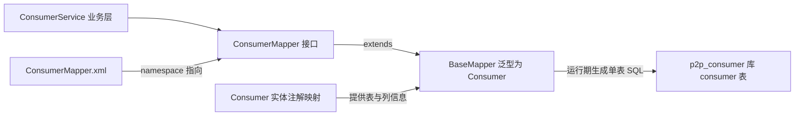

# 用户中心 Mapper：继承 BaseMapper 的空接口与占位 XML 怎么落地

保存用户信息的需求蓝图已经画定：请求先进用户中心，用户信息落 `p2p_consumer` 库，账号信息经远程调用落 `p2p_account` 库。真正动工时从哪一层切入，项目里的惯例是数据访问层、业务层、表现层自底向上推进。用户中心这一侧的 MyBatis-Plus 环境此前已随工程搭建就绪，依赖、扫描配置与实体都不缺，数据访问层剩下的工作量浓缩成两个文件：一个继承 `BaseMapper` 的接口，一个占位的 XML 映射文件。

## 先给结论

- 数据访问层只产两件东西：`ConsumerMapper` 接口继承 `BaseMapper<Consumer>`，外加一个空壳 `ConsumerMapper.xml`。
- 实体 `Consumer` 已用 `@TableName`、`@TableId`、`@TableField` 与 `consumer` 表逐列对齐，接口泛型传实体后，单表增删改查方法全套随继承到位。
- XML 的 `namespace` 必须写成接口的全限定名，哪怕是空文件，这一行也要写对，后续自定义 SQL 才有挂载点。
- 接口上加 `@Repository` 声明数据访问层身份，配合工程的 Mapper 扫描配置，Bean 的来源才清晰。
- 用了 MyBatis-Plus 之后数据访问层几乎没有代码量，两份产物加上 IDE 里的模板，几分钟收工。

## 分层动工的顺序与数据访问层的份量

涉及数据库操作的功能，项目里固定的推进顺序是数据访问层、业务层、表现层。这套顺序不是教条，而是依赖方向决定的：业务层要调数据访问层的方法，表现层要调业务层的方法，先把被依赖的一层立起来，上层编码时才有东西可调。反过来写也能写，只是每往下一层都免不了回头补方法，节奏会乱。

数据访问层在 MyBatis-Plus 的加持下份量骤减。原生 MyBatis 写一个模块，接口、XML、SQL 一个都不能少，增删改查全部手写；MP 接管之后，常规单表操作的接口方法与 SQL 都由框架按实体映射自动生成，开发者只剩两件事：声明一个继承 `BaseMapper` 的接口，配一个命名空间正确的 XML。讲义里这一节的标题就叫「3) Mapper」，属于注册功能编码步骤里的第三小步，内容短到只有两段代码。

## 实体已就位：Consumer 怎么对准 consumer 表

接口的泛型要用到实体类，`Consumer` 在准备阶段已经写好，它才是整层映射的核心。节选核心注解如下：

```java
package com.study.finance.consumer.entity;

import com.baomidou.mybatisplus.annotation.IdType;
import com.baomidou.mybatisplus.annotation.TableField;
import com.baomidou.mybatisplus.annotation.TableId;
import com.baomidou.mybatisplus.annotation.TableName;
import lombok.Data;
import java.io.Serializable;
import java.math.BigDecimal;

@Data
@TableName("consumer")
public class Consumer implements Serializable {

    private static final long serialVersionUID = 1L;

    // 主键：对应 ID 列，自增
    @TableId(value = "ID", type = IdType.AUTO)
    private Long id;

    // 用户名
    @TableField("USERNAME")
    private String username;

    // 真实姓名
    @TableField("FULLNAME")
    private String fullname;

    // 用户编码，生成唯一，用户在存管系统标识
    @TableField("USER_NO")
    private String userNo;

    // 平台预留手机号
    @TableField("MOBILE")
    private String mobile;

    // 是否已绑定银行卡
    @TableField("IS_BIND_CARD")
    private Integer isBindCard;

    // 可贷额度
    @TableField("LOAN_AMOUNT")
    private BigDecimal loanAmount;

    // 其余字段：ID_NUMBER、USER_TYPE、ROLE、AUTH_LIST、STATUS、REQUEST_NO 等，结构一致
}
```

三个注解各司其职：`@TableName("consumer")` 把类钉在表上；`@TableId` 标出主键并声明自增策略，插入时主键交给数据库生成；`@TableField` 逐一声明列名，列名与属性名对不上的大小写差异全靠它抹平。MP 生成 SQL 时读的就是这张映射关系，`selectOne` 拼出来的 `WHERE MOBILE = ?`，源头在实体的 `@TableField("MOBILE")`。

## 两个产物：Mapper 接口与映射配置文件

在用户中心服务的 `mapper` 包下新建接口，继承 MP 的 `BaseMapper` 并把实体传入泛型：

```java
package com.study.finance.consumer.mapper;

import com.baomidou.mybatisplus.core.mapper.BaseMapper;
import com.study.finance.consumer.entity.Consumer;
import org.springframework.stereotype.Repository;

@Repository
public interface ConsumerMapper extends BaseMapper<Consumer> {

}
```

接口体一个方法都没有，但这不是「空接口」。`BaseMapper<Consumer>` 里声明了 insert、deleteById、updateById、selectById、selectOne、selectList 等一整套单表方法，泛型把操作对象锁定为 `Consumer`，全部实现由 MP 在运行期注入。随后在同一目录新建映射文件 `ConsumerMapper.xml`：

```xml
<?xml version="1.0" encoding="UTF-8"?>
<!DOCTYPE mapper PUBLIC "-//mybatis.org/dtd/mybatis-3-mapper.dtd"
        "http://mybatis.org/dtd/mybatis-3-mapper.dtd">
<mapper namespace="com.study.finance.consumer.mapper.ConsumerMapper">
</mapper>
```

现在看不到一条 SQL，它是给未来留的扩展位。通用方法覆盖不到的查询，比如带关联条件或多表 join 的语句，都会以 `<select>` 等标签的形式写进这个文件，接口里补一个同名方法即可生效。MP 的入门工程里 `UserMapper` 与 `UserMapper.xml` 就是这一对组合的模板写法，工程里提前配置过文件模板的话，新建 XML 连 DOCTYPE 都不用手敲。

## namespace 对上接口，继承换来全套方法

两份产物之间靠 `namespace` 绑定。MyBatis 加载映射文件时，按 `namespace` 找到对应的接口，把 XML 里的语句挂到接口方法上；`namespace` 写错一个字母，报错要到调用时才炸出来，而且提示相当隐晦。所以空文件的 `namespace` 也必须一字不差地写成 `com.study.finance.consumer.mapper.ConsumerMapper`。

整层的关系画出来是这样：



图的右下角是终点：SQL 由 MP 依据实体注解在运行期拼装，落向 `p2p_consumer` 库的 `consumer` 表。业务层接下来调 `getOne`、`save` 这类方法，穿透 `ServiceImpl` 内部持有的 `baseMapper` 字段，最终走到这里。数据访问层到此完工，两个文件，没有一行业务逻辑，这正是封装充分的标志。

## 常见误区

- **把空接口当成真的什么都没干。** 错例：看接口体是空的，随手不写泛型，写成 `extends BaseMapper`，运行期所有方法拿到的是 `Object`，SQL 拼不出表名。正解：泛型 `Consumer` 必须带上，它是 MP 生成 SQL 的依据。
- **XML 的 namespace 手抄接口名抄错。** 错例：包名少一段或多一个点，启动不报错，一调方法就报「Invalid bound statement」。正解：从接口文件复制全限定名粘贴过去，别手敲。
- **以为还要写增删改查的 SQL。** 正解：继承 `BaseMapper` 后单表操作全自动生成，XML 里只放通用方法覆盖不了的自定义语句，占位文件保持空壳即可。
- **实体列名注解漏写导致查询字段对不上。** 错例：`USER_NO` 列没有 `@TableField`，MP 默认按驼峰转下划线，某些全局配置下会拼出错列名。正解：列名与属性名有差异的一律显式标注，与本工程实体的写法保持一致。

## 面试可能被问到的问题

1. 面试官追问：「继承 BaseMapper 的空接口，方法实现是怎么来的？」
   答：MyBatis-Plus 在启动阶段扫描这些 Mapper 接口，为每个接口生成代理实现，通用方法按泛型实体的注解映射在运行期拼装 SQL。开发者声明接口、实体对准表结构，剩下的由框架完成，这也是它能把数据访问层压到两个文件的原因。
2. 面试官追问：「XML 映射文件里一条 SQL 都没有，还要它做什么？」
   答：它是接口的语句挂载点与扩展位。MyBatis 按 namespace 把 XML 语句与接口方法绑定，通用方法虽然不需要 XML，但复杂查询、动态 SQL 迟早要写，提前把文件与命名空间立好，后续只加内容不加结构。
3. 面试官追问：「@TableId 的 IdType.AUTO 和 ASSIGN_ID 有什么区别？」
   答：AUTO 依赖数据库自增列，插入后由数据库回填主键；ASSIGN_ID 由框架按雪花算法在应用侧生成，不依赖数据库特性。本项目主键是自增列，所以选 AUTO；分库分表场景一般换 ASSIGN_ID。
4. 面试官追问：「@Repository 在 Mapper 接口上起什么作用？」
   答：主要作用是声明数据访问层语义。MP 场景下接口实现由框架生成并注册，@MapperScan 或自动配置已经能把它扫进容器，@Repository 不是必需项，但保留它层次语义清晰，也让 IDE 与静态检查不再把注入点标记为找不到 Bean。
5. 面试官追问：「如果两个实体的 Mapper 写了同一个 namespace 会怎样？」
   答：MyBatis 加载时会把两份 XML 的语句注册到同一个命名空间下，重名方法直接冲突报错，轻则启动失败，重则语句被错误挂载。namespace 的唯一性约定就是接口全限定名，一个接口一个文件，不要共用。

## 配套资料

- 代码：`materials/code/10/资料/公共类/Consumer.java`，用户中心实体的归档单文件，`@TableName`、`@TableId`、`@TableField` 注解与正文节选一致，正文省略的同名结构字段以它为准；包名按 `com.study.finance` 系口径改写。
- 代码：`materials/code/10/资料/Mybatis-Plus/代码/`，MP 入门工程归档，`mapper/UserMapper.java` 与 `resources/mybatis/UserMapper.xml` 是正文两个产物的模板原型；内层目录保留原始命名，路径列到工程目录为止。
- 讲义：`materials/docs/10/Mybatis-Plus讲义v1.0.md`，BaseMapper 通用方法清单与 Mapper 使用约定的出处。
- 讲义：`materials/docs/10/万信金融-第2章-讲义-开户v1.0.md`，注册功能编码步骤中 Mapper 小节的背景；讲义在后续小节直接沿用本单元产出的 `ConsumerMapper` 与映射文件。
- 说明：本单元按画面线整理，接口与 XML 的包名按 `com.study.finance` 系改写；`@Repository` 注解按讲义代码保留，仓库中无该模块的完整源码包。
