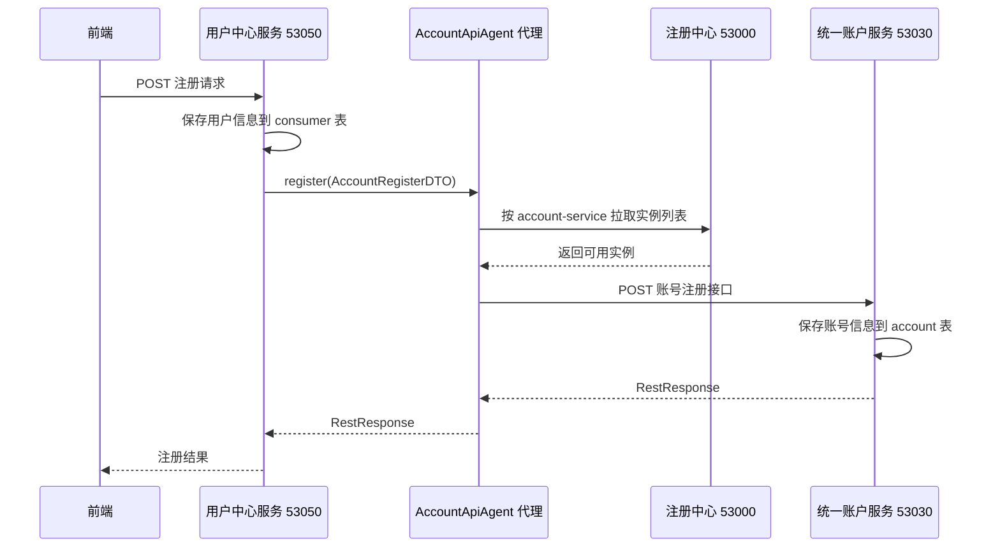

# 用户中心远程调用统一账户：Feign 代理接口三要素与注册闭环的最后一段

盘点一下进度：统一账户服务实现了注册保存，用户中心实现了自己的保存，两端各自落库的代码都齐了。可是对照注册流程图，链路还断在中间：用户中心保存完用户信息之后，应该发起远程调用把账号信息送到统一账户服务，这一步没实现，注册就只是半截事，`account` 表永远等不到新行。补上这一段要用到 Feign：在用户中心定义一个代理接口，框架按接口生成代理对象，远程发请求、负载均衡这些杂务全部由代理接管。

## 先给结论

- 用户中心建 `agent` 包，定义 `AccountApiAgent` 接口：类上 `@FeignClient(value = "account-service")` 指明目标服务名，方法签名从统一账户侧的接口定义照搬，路径补上对端的基本路径。
- 方法参数必须加 `@RequestBody`，这是 Feign 调用最容易遗漏的细节，漏了之后参数绑定不上，对端收到的就是空对象。
- 启动类要有 `@EnableFeignClients(basePackages = "com.study.finance.consumer.agent")`，框架据此扫描 agent 包并生成代理类与代理对象。
- 调用处把 `ConsumerRegisterDTO` 的属性复制进 `AccountRegisterDTO` 后发起调用，返回的 `RestResponse` 判 `code` 不等于 `SUCCESS` 就抛 `BusinessException(ConsumerErrorCode.E_140106)`，注册整体按失败处理。
- 远程发请求、从注册中心找实例、负载均衡都发生在代理内部，业务代码只面向接口编程。

## 流程盘点：缺了远程调用，闭环就差最后一段

把注册流程图摊开对一遍账。前端发注册请求，先进用户中心；用户中心校验新用户、组装实体、落库 `consumer` 表，这段已经完成；接下来用户中心要远程调用统一账户服务，统一账户保存账号信息到 `account` 表，最后返回注册结果。两段保存之间的连线，就是现在缺的东西。

这条连线的方向没有商量余地：统一账户服务不面向前端，前端请求到不了它，它只能被用户中心调。调用发起方是用户中心，被调方是统一账户服务，这是一次服务与服务之间的 HTTP 调用。实现方式上，早期 Spring Cloud 体系里常见两条路：自己拿 RestTemplate 拼地址发请求，或者用声明式的 Feign。本项目选 Feign，理由很直接，调用方只需要写一个接口，路径、参数、序列化都由注解描述，代理对象在运行期把方法调用翻译成 HTTP 请求，代码里看不到一行发请求的样板。



这张时序图把缺的最后一段补齐了：代理对象接到调用后，先向注册中心要 `account-service` 的可用实例，再把请求打到统一账户服务，响应原路返回。依赖关系上，用户中心工程要引入 openfeign 的 starter，随 Spring Cloud 版本管理走：

```xml
<dependency>
    <groupId>org.springframework.cloud</groupId>
    <artifactId>spring-cloud-starter-openfeign</artifactId>
</dependency>
```

## 代理接口：@FeignClient、方法映射与 @RequestBody 三件事

用户中心新建 `agent` 包，代理接口统一放这里，包名里 agent 就是代理的意思，后续所有远程调用代理都归这个包管。接口命名 `AccountApiAgent`，看名字就知道它代理的是统一账户（account）的 API：

```java
package com.study.finance.consumer.agent;

import com.study.finance.api.account.model.AccountDTO;
import com.study.finance.api.account.model.AccountRegisterDTO;
import com.study.finance.common.domain.RestResponse;
import org.springframework.cloud.openfeign.FeignClient;
import org.springframework.web.bind.annotation.PostMapping;
import org.springframework.web.bind.annotation.RequestBody;

// value 为目标服务在注册中心登记的名字
@FeignClient(value = "account-service")
public interface AccountApiAgent {

    // 路径 = 统一账户服务的基本路径 /account + 注册端点
    @PostMapping(value = "/account/l/accounts")
    RestResponse<AccountDTO> register(@RequestBody AccountRegisterDTO accountRegisterDTO);
}
```

接口上要做对三件事。第一件，`@FeignClient` 的 value 填目标服务在注册中心的名字 `account-service`，统一账户服务启动时就以这个名字注册，代理按名字找实例，写错名字到调用时才报找不到服务。第二件，方法声明从统一账户侧照搬：返回值 `RestResponse<AccountDTO>`、方法名 `register`、参数 `AccountRegisterDTO`，这些直接从对端的接口定义复制过来，签名一致才谈得上代理转发。第三件，请求路径不能只写对端 Controller 里的端点，还要把统一账户服务配置的基本路径 `account` 拼在最前面，对端完整路径是基本路径加方法映射，少一截就 404。

最容易翻车的是参数注解。Feign 发请求时如何序列化参数，完全看注解：`@RequestBody` 声明参数走请求体 JSON 序列化；不加注解的复杂对象，Feign 会尝试拆成查询串或表单，对端用 `@RequestBody` 接收自然对不上，表现出来就是参数全空、校验报错。课程里这一点被反复强调，写代理接口时参数上一个 `@RequestBody` 都不能省。

## 启动类扫描：@EnableFeignClients 圈定 agent 包

代理接口写完不会自动生效，启动类上必须声明去哪里扫描：

```java
package com.study.finance.consumer;

import org.springframework.boot.SpringApplication;
import org.springframework.boot.autoconfigure.SpringBootApplication;
import org.springframework.cloud.client.discovery.EnableDiscoveryClient;
import org.springframework.cloud.openfeign.EnableFeignClients;

@SpringBootApplication
@EnableDiscoveryClient
@EnableFeignClients(basePackages = {"com.study.finance.consumer.agent"})
public class ConsumerService {

    public static void main(String[] args) {
        SpringApplication.run(ConsumerService.class, args);
    }
}
```

`@EnableFeignClients` 的 basePackages 指向 `agent` 包，框架启动时扫描包内所有带 `@FeignClient` 的接口，为每个接口生成代理类与代理对象并注册进容器。这份启动类三件套是用户中心工程的真实结构：`@SpringBootApplication` 管自动配置，`@EnableDiscoveryClient` 管服务注册，`@EnableFeignClients` 管代理扫描。工程里新建了代理接口却没加或加错这个注解，注入 `AccountApiAgent` 时会直接报找不到 Bean，排查时先看这里。

## 在 register 里发起调用并判定结果

发起调用的位置在 `register` 方法内部、`save(consumer)` 之后，本地保存成功才轮到远程调用：

```java
// 远程调用统一账户服务创建账号
AccountRegisterDTO accountRegisterDTO = new AccountRegisterDTO();
BeanUtils.copyProperties(consumerRegisterDTO, accountRegisterDTO);
RestResponse<AccountDTO> restResponse = accountApiAgent.register(accountRegisterDTO);
// 远程保存失败：注册整体按失败处理
if (restResponse.getCode() != CommonErrorCode.SUCCESS.getCode()) {
    throw new BusinessException(ConsumerErrorCode.E_140106);
}
```

第一步是 DTO 的转换。代理接口的参数类型是 `AccountRegisterDTO`，手头却是 `ConsumerRegisterDTO`，两者属性名高度重合（用户名、手机号、密码），但类型不能混用，跨服务的传输对象各归各的 API 工程。转换沿用 `BeanUtils.copyProperties` 的套路，把属性值从用户中心的 DTO 复制进账号注册 DTO。

第二步注入代理对象。字段声明 `@Autowired private AccountApiAgent accountApiAgent;`，注进来的实际是框架生成的代理对象，不是什么手写的实现类。调用 `accountApiAgent.register(accountRegisterDTO)` 这一行，就是整段远程调用的全部代码。

第三步判定响应。返回的 `RestResponse` 里 `code` 为 0 表示统一账户处理成功，非 0 就是远端出了问题，此时本地 `consumer` 表里已经插入了数据，但注册约定两边都成功才算成功，所以这里抛出 `ConsumerErrorCode.E_140106`「注册失败」，让全局异常处理器把失败结果统一封装给前端。抛出异常意味着本次请求按失败计，本地的补偿与一致性处理属于分布式事务的议题，后续专题再展开。

## 原理：从接口到 HTTP 请求的整条链路

代理接口的一个方法调用，背后是一整条装配好的链路。容器启动时，`@EnableFeignClients` 触发扫描，为 `AccountApiAgent` 生成代理类，方法体被改写为「组装请求并发送」。真正发起调用时，代理先从注册中心拉取 `account-service` 的实例列表，客户端负载均衡器按策略挑一个实例，把方法上的 `@PostMapping` 路径拼上实例地址组成完整 URL，参数经 `@RequestBody` 序列化成 JSON 放进请求体，请求发出后把响应反序列化回 `RestResponse<AccountDTO>`。

这条链路里没有一行业务代码参与，每一环都可替换：负载均衡策略、超时与重试、日志级别，都能在配置层调整。业务侧只面向 `AccountApiAgent` 接口编程，这正是声明式调用的价值，把「调远程」的复杂度关进了代理，接口签名就是契约。注册闭环的最后一段就此接通，整条链路只剩验证。

## 常见误区

- **@FeignClient 的 value 写成对端 IP 或随意名字。** 错例：value 写 `http://localhost:53030`，代理不再走注册中心，负载均衡失效，实例一换就断。正解：value 填服务注册名 `account-service`，地址解析交给注册中心与负载均衡器。
- **代理方法路径漏拼对端基本路径。** 错例：只写对端方法上的端点，请求到达对端后命中不了任何映射，返回 404。正解：完整路径等于对端基本路径加方法映射，从对端 Controller 一路抄全。
- **参数忘加 @RequestBody。** 错例：参数裸奔，对端 `@RequestBody` 收到空对象，报「传入对象为空」类错误。正解：Feign 代理方法的对象参数一律补 `@RequestBody`，这个细节在定义接口时就钉死。
- **启动类漏加 @EnableFeignClients 或包路径写错。** 错例：代理接口在 `agent` 包，basePackages 却写的别的路径，注入时报找不到 Bean。正解：basePackages 必须覆盖代理接口所在包，新建接口后先确认扫描范围。
- **远程失败后不判定响应继续走。** 错例：拿到 `RestResponse` 不看 `code`，直接往下执行，账号没建成功却返回注册成功。正解：`code` 非 `SUCCESS` 立即抛 `E_140106`，注册整体按失败处理。

## 面试可能被问到的问题

1. 面试官追问：「Feign 和 RestTemplate 比好在哪？」
   答：RestTemplate 是命令式调用，URL、参数拼接、反序列化都要手写，服务地址还常被硬编码；Feign 是声明式的，接口加注解就是契约，动态地址、负载均衡、编解码全部由代理处理。调用方代码只剩一行方法调用，改契约时改注解即可，维护成本明显更低。
2. 面试官追问：「@FeignClient 里的服务名是怎么变成真实请求地址的？」
   答：代理发起调用时先按服务名向注册中心查询可用实例列表，客户端负载均衡组件从中选一个实例，把实例的 IP 与端口拼到方法声明的路径前面得到完整 URL。服务重启换端口、多实例扩缩容都不影响调用方，因为每次调用都实时解析。
3. 面试官追问：「代理对象是什么时候创建的，业务代码注入的是它吗？」
   答：容器启动阶段由 @EnableFeignClients 触发扫描，为每个 @FeignClient 接口生成代理实现并注册为 Bean，业务代码 @Autowired 注入的就是这个代理对象。调用方法时被拦截改写为组装 HTTP 请求，业务代码全程无感知。
4. 面试官追问：「用户中心本地保存成功但远程调用失败，数据怎么办？」
   答：本单元的处理是抛出注册失败异常，响应按失败计，此时两库已经不一致， consumer 表有数据而 account 表没有。根治要靠分布式事务或最终一致性方案，比如本地消息表加补偿重试，让两次保存最终对齐，项目在注册流程的后续会专门处理这个事务问题。
5. 面试官追问：「为什么 DTO 要区分 ConsumerRegisterDTO 和 AccountRegisterDTO，共用一个不行吗？」
   答：两个 DTO 属于不同服务的 API 契约，字段会随各自业务独立演进，共用一个类型会让两个服务的发布互相牵制。属性重合的转换交给 BeanUtils 完成，契约独立、传输时转换，这是微服务间保持松耦合的标准做法。

## 配套资料

- 代码：`materials/code/10/wanxinp2p/`，P2P 工程归档，用户中心服务模块在其中，启动类的 `@EnableFeignClients(basePackages)` 扫描配置与正文一致，可对照其工程结构与依赖组成；内层目录保留原始命名，路径只列到该层级。
- 代码：`materials/code/10/资料/公共类/AccountRegisterDTO.java`，账号注册 DTO 的归档单文件，属性清单与正文转换代码一致；同目录 `ConsumerErrorCode.java` 的 `140106 注册失败` 亦为正文出处。
- 讲义：`materials/docs/10/万信金融-第2章-讲义-开户v1.0.md`，agent 包内新建远程调用代理的步骤说明与 Feign 使用约定。
- 说明：`AccountApiAgent` 接口代码、openfeign 依赖声明按视频画面线整理，仓库无该模块实现层源码；包名与 DTO 路径按 `com.study.finance` 系改写，服务名 `account-service` 与端口 53050、53030、53000 按项目既定口径。
