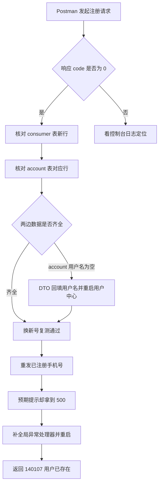

# 保存用户信息功能测试：两库核对揪出空用户名，再给异常一个友好出口

注册的三个小功能（发送并获取短信验证码、校验手机号和验证码、保存用户信息）连同两服务之间的远程调用已经全部实现，该验货了。功能测试用 Postman 直发请求，看似只是点几下发送，真正的收获藏在两轮核对里：新用户注册暴露出一个用户名丢失的 bug，重复注册暴露出 500 响应的不友好，两个问题分别对应「数据正确性」与「异常体验」两条验收线。

## 先给结论

- 测试入口是用户中心的注册接口，`POST http://localhost:53050/consumer/consumers`，请求体为 JSON，只传 `mobile` 一个字段即可，其余字段由业务层补默认值。
- 只有手机号不存在的场景才能走通注册；已注册的手机号会命中 `checkMobile` 抛出的业务异常，这正是要测的第二条路径。
- 成功的判据不在响应里，在库里：`p2p_consumer` 库 `consumer` 表与 `p2p_account` 库 `account` 表各出现一行，字段值逐项核对。
- 第一轮核对揪出 bug：`account` 表新行用户名为空，根因是远程调用的 DTO 复制发生在用户名赋值之前，修复只需一行回填。
- 重复注册返回 HTTP 500，缺的是全局异常处理器；把统一账户侧的 `GlobalExceptionHandler` 原样复制进用户中心，异常就变成 `140107`「用户已存在」的友好提示。

## 测试前的服务清单与请求准备

功能测试的第一件事是清点要启动的服务，养成习惯可以避免「请求发出去没反应才发现服务没起」的尴尬。本次涉及配置中心 Apollo、注册中心（53000）、统一账户服务（53030）、用户中心服务（53050）与网关（53010）；Redis 与短信验证码服务本次用不到，注册保存环节不直接依赖它们，不必启动。全部起完后把各服务控制台清空，一旦出错，新打出来的日志一目了然。

Postman 里在用户中心集合下新建请求「注册」，方法与地址按 Controller 的映射拼：

```bash
POST http://localhost:53050/consumer/consumers
Content-Type: application/json

{"mobile": "13xxxxxxxxx"}
```

路径由三段组成：协议加用户中心端口 `53050`，服务上下文路径 `consumer`，方法映射 `consumers`。Controller 的注册方法参数标了 `@RequestBody`，所以 Postman 里选 body、raw、JSON，格式不能选错。请求体只给 `mobile` 一个字段，用户编号、用户名、绑卡状态这些值业务层会代为生成或补默认值。测试手机号统一以 `13xxxxxxxxx` 占位，注意各轮测试都要选用未注册过的新号，发请求前先看一眼两边的表。

## 第一轮：新用户注册与两库核对

选一个两边库都不存在的手机号发出请求，响应里 `code` 为 0，表示接口执行成功：

```json
{"code": 0}
```

响应成功只是第一关，数据落没落对要回数据库核对。两边各查一条：

```sql
-- 用户中心侧：应出现新行，用户编号带 usr- 前缀，是否绑卡为 0
SELECT ID, USERNAME, USER_NO, MOBILE, IS_BIND_CARD
FROM p2p_consumer.consumer
WHERE MOBILE = '13xxxxxxxxx';

-- 统一账户侧：应出现对应行，密码为密文，DOMAIN 为 c 表示 C 端用户
SELECT ID, USERNAME, MOBILE, PASSWORD, DOMAIN
FROM p2p_account.account
WHERE MOBILE = '13xxxxxxxxx';
```

`consumer` 表这侧数据完整：新行手机号对得上，`USER_NO` 是工具类生成的带 `usr-` 前缀的编号，`USERNAME` 也是代为生成的值，`IS_BIND_CARD` 为 0，与业务层补默认值的逻辑一一吻合。`account` 表这侧行也进来了：密码是密文，`DOMAIN` 是 C 端标识，主键是统一账户侧自动生成的。可是对着一列一列看下去，`USERNAME` 是空的。同一部手机号，用户中心那边有名有姓，统一账户这边却没记下用户名，远程调用传丢了东西。

## 揪出的 bug：用户名复制早于赋值

顺着远程调用传的参数查。统一账户保存的 `username` 来自 `AccountRegisterDTO`，它是由 `ConsumerRegisterDTO` 复制而来的，而 `ConsumerRegisterDTO` 里的用户名从头到尾没被赋过值。回看 `register` 的执行顺序就清楚了：属性复制 `copyProperties(consumerRegisterDTO, consumer)` 排在最前，用户名是复制之后才设置到 `consumer` 实体上的，DTO 自己仍然空着；等到组装 `AccountRegisterDTO` 再从 DTO 复制时，拿到的自然还是 null。功能上不报错，数据上却缺了一块，这是典型的时序型 bug。

修复只需要一行，把生成好的用户名回填到注册 DTO，再做远程侧的复制：

```java
// 远程调用统一账户服务创建账号
// 修复：把生成好的用户名回填到注册 DTO，账号侧复制时才有值可拿
consumerRegisterDTO.setUsername(consumer.getUsername());
AccountRegisterDTO accountRegisterDTO = new AccountRegisterDTO();
BeanUtils.copyProperties(consumerRegisterDTO, accountRegisterDTO);
RestResponse<AccountDTO> restResponse = accountApiAgent.register(accountRegisterDTO);
if (restResponse.getCode() != CommonErrorCode.SUCCESS.getCode()) {
    throw new BusinessException(ConsumerErrorCode.E_140106);
}
```

改动只涉及用户中心服务，重启它，其余服务不动。换一个未注册的新号重发请求，两边表里各进一行，这一次 `account` 表的用户名有值了，与 `consumer` 表的 `USERNAME` 一致，注册链路的两段保存才算真正对齐。这一轮测试的价值就在这里：接口返回 0 不等于功能正确，跨服务的每一份落库记录都要眼见为实。

## 第二轮：重复注册的 500 与全局异常处理器

正常路径通了，接着测异常路径。把已注册的手机号再发一次，按代码预期应该看到「用户已存在」，实际返回的却是 HTTP 500。看用户中心控制台，栈里抛的确实是业务异常 `BusinessException`，来自 `checkMobile` 判定为已存在后的 `E_140107`，异常本身抛得没错，问题在于没人接：用户中心工程里没有全局异常处理器，异常穿透到容器，Spring MVC 只能回一个 500。

统一账户服务测试时遇到过一模一样的问题，解法也是现成的：把那边的 `GlobalExceptionHandler` 整体复制进用户中心的 `common` 包，代码一行不用改：

```java
package com.study.finance.consumer.common;

import com.study.finance.common.domain.BusinessException;
import com.study.finance.common.domain.CommonErrorCode;
import com.study.finance.common.domain.RestResponse;
import lombok.extern.slf4j.Slf4j;
import org.springframework.lang.Nullable;
import org.springframework.web.bind.annotation.ControllerAdvice;
import org.springframework.web.bind.annotation.ExceptionHandler;
import org.springframework.web.bind.annotation.ResponseBody;
import javax.servlet.http.HttpServletRequest;
import javax.servlet.http.HttpServletResponse;

@ControllerAdvice
@Slf4j
public class GlobalExceptionHandler {

    // 捕获所有异常：业务异常按错误码组装响应，其余兜底返回未知错误
    @ExceptionHandler(value = Exception.class)
    @ResponseBody
    public RestResponse<Nullable> exceptionGet(HttpServletRequest req, HttpServletResponse response, Exception e) {
        if (e instanceof BusinessException) {
            BusinessException be = (BusinessException) e;
            // 自定义错误码时用异常自带的消息，否则用枚举里的描述
            if (CommonErrorCode.CUSTOM.equals(be.getErrorCode())) {
                return new RestResponse<Nullable>(be.getErrorCode().getCode(), be.getMessage());
            }
            return new RestResponse<Nullable>(be.getErrorCode().getCode(), be.getErrorCode().getDesc());
        }
        // 真实类中还有 404、405、415 等分支，此处从略
        log.error("【系统异常】" + e.getMessage());
        return new RestResponse<Nullable>(CommonErrorCode.UNKNOWN.getCode(), CommonErrorCode.UNKNOWN.getDesc());
    }
}
```

`@ControllerAdvice` 把这个类挂成全局的异常拦截面，`@ExceptionHandler(Exception.class)` 声明接住所有异常，`@ResponseBody` 让返回值直接序列化成 JSON。`BusinessException` 会被识别出错误码对象，`140107` 与「用户已存在」组装进 `RestResponse` 返回；其余异常兜底记日志、返回未知错误。无需修改的原因也简单：两个服务共用同一套公共域模型（`RestResponse`、`BusinessException`、错误码接口），处理器的依赖在用户中心同样齐备。

再次重启用户中心，重发同一个已注册的手机号，这次拿到的是友好的业务响应：

```json
{"code": 140107}
```

状态不再是 500，响应体里的错误码是 `140107`，提示信息正是错误码枚举里的「用户已存在」，前端拿去弹窗即可直接用。到此三个测试场景全部过关：新号注册两库落数正确，缺用户名的 bug 修复，老号重复注册返回业务级提示。



这张图把整轮功能测试的推进与两处修复串成了闭环：一次全链路请求，两库逐项核对，发现偏差先修代码再复测，异常场景同样要有业务级的出口。

## 常见误区

- **只看响应 code 为 0 就宣布测试通过。** 错例：接口返回成功即收工，`account` 表用户名为空的 bug 带病上线。正解：跨服务写操作必须两库各自核对，响应成功只代表链路没抛异常。
- **异常路径不测或只测到不报错。** 错例：重复注册看到 500，认为「反正拒绝了」就算过。正解：拒绝方式也是需求，业务异常要返回错误码与提示，500 是系统级故障的表达，不能当业务结果用。
- **改完 bug 忘了重启服务就复测。** 错例：代码已改，Postman 重发仍是旧行为，怀疑修复无效。正解：本地服务是启动时加载类的，代码变更后先重启对应服务再测，本次只改了用户中心就只重启它。
- **测试号随手用库里已有的数据。** 错例：拿已注册手机号测注册，走了老用户分支，越测越糊涂。正解：测试前先查两边表确认手机号状态，新号测注册、旧号测重复注册，各归各位。

## 面试可能被问到的问题

1. 面试官追问：「保存用户信息的测试要验证哪些点？」
   答：三块。接口响应层面，新用户返回成功码、老用户返回业务错误码；数据层面，用户中心与统一账户两库各有一行，用户编号、默认值、密码密文逐项核对；异常层面，重复注册与参数缺失都要有业务级响应而不是 500。跨服务功能的验收以两库数据一致为准。
2. 面试官追问：「DTO 复制早于赋值导致的空字段 bug，怎么预防？」
   答：把「组装完整数据」与「发起复制」在方法里就近排列，赋值完成后立即复制；更稳的做法是让组装步骤返回完整对象，复制只消费成品。测试上跨服务字段要做对端核对，单端断言测不出这类时序问题。
3. 面试官追问：「GlobalExceptionHandler 为什么能跨服务直接复制使用？」
   答：它依赖的 RestResponse、BusinessException、错误码接口都来自公共工程，两个服务的公共依赖版本一致，处理器本身不含业务逻辑，识别异常类型后按错误码组装响应的规则是全局统一的。放在每个服务的 common 包下，行为即可预期。
4. 面试官追问：「@ControllerAdvice 的生效范围是什么，能精确到部分控制器吗？」
   答：默认对所有 @RequestMapping 处理器生效，属于全局切面。可以指定 basePackages 或 assignableTypes 把拦截范围收窄到某些包或类，也支持对特定异常类分别定义多个 @ExceptionHandler，按最匹配的异常类型优先执行。
5. 面试官追问：「测试发现两库数据不一致，除了修 bug 还该做什么？」
   答：先补数据一致性的兜底，比如对账号侧的落库结果做校验、失败时标记补偿；再把这类场景固化成回归用例，防止后续改动重蹈覆辙。根本上这是跨服务写一致性问题，长期要靠分布式事务或最终一致性方案收口，项目后续会专门展开。

## 配套资料

- 代码：`materials/code/10/资料/公共类/GlobalExceptionHandler.java`，全局异常处理器的归档单文件，正文节选的判定分支与兜底逻辑以它为准；该类来自统一账户侧 common 包，复制进用户中心后包名按 `com.study.finance` 系口径改写。
- 代码：`materials/code/10/资料/公共类/ConsumerErrorCode.java`，`140107 用户已存在`、`140106 注册失败` 的登记出处；同目录 `Consumer.java`、`AccountRegisterDTO.java` 可对照两库数据核对涉及的字段。
- 讲义：`materials/docs/10/万信金融-第2章-讲义-开户v1.0.md`，注册功能实现后的前后端集成测试章节为本次测试安排的背景。
- 说明：Postman 请求与响应、两库核对 SQL 按视频画面线与主流写法整理，仓库无测试脚本归档；测试手机号统一以 `13xxxxxxxxx` 占位，各轮测试使用不同的未注册新号。
