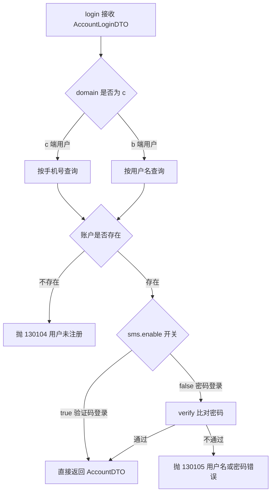

# 传统登录的功能实现：两步校验与一个开关，两种登录方式收进同一个 login

> 🔒 安全提示：文中示例的口令/密钥均为课程教学环境演示口径，生产环境的安全要求见《安全与合规须知》。

接口契约立好，Controller 里的空实现等着填业务。登录实现看着就是一次查询，动手前却有三个问题要回答：密码在库里是加密后的密文，SQL 里没法直接比；账户分 C 端与 B 端，用户名的含义不一样；系统还有验证码登录与密码登录两种模式，靠 Apollo 上的一个开关切换。把这三件事理顺，`login` 方法一次成型，实现过程中也正好看清了传统方式的天花板在哪。

## 先给结论

- 实现思路选「先查用户、再比密码」的两步走：密文无法进 SQL 直接比对，必须查出记录后交给工具类校验。
- 用户名一词两义：C 端用户用户名就是手机号，B 端用户用户名才是账号，按请求里的 `domain` 分流查询。
- 查无此人抛 `E_130104`「用户未注册」，密码比对失败抛 `E_130105`「用户名或密码错误」，错误码与提示全部来自统一账户的错误码枚举。
- `sms.enable` 开关为 true 时是验证码登录模式，验证码此前已在用户中心侧校验过，查到账户即可直接返回，密码比对整段跳过。
- 传统方式在单机视角下是完整的，放到分布式场景立刻暴露单点登录、会话保持、认证方式单一三个硬伤，这为引入独立认证服务埋下伏笔。

## 两种实现思路：一步查与两步查

业务层接口 `AccountService` 里新增 `login` 方法，签名与表现层对齐但返回值降为 `AccountDTO`，套路与注册时一模一样。真正要想清楚的是实现思路，常见的有两种。

**第一种，用户名和密码一次查询。** 把账号与密码都拼进查询条件，查到数据就是登录成功，查不到就是失败，一步到位。

**第二种，先按用户名查，再比对密码。** 查询时只带用户名，查到记录后单独比对密码，分两步走。

本项目选第二种，理由藏在密码的存储方式里。注册时密码经 `PasswordUtil.generate` 处理成 48 位密文：32 位 MD5 摘要与 16 位随机盐交错排列，同样的明文每次生成的密文都不同。这样的密文根本没法出现在 SQL 的等值条件里，数据库里也永远不存在「与明文相等的列」，比对只能在应用层做，用工具类把密文里的盐拆出来重新计算。顺带的收益是排障友好：用户名查不到与密码不对是两种不同的业务结果，两步走让它们天然分开。

```java
/**
 * 用户登录
 * @param accountLoginDTO 封装登录请求数据
 * @return 登录成功的账户信息
 */
AccountDTO login(AccountLoginDTO accountLoginDTO);
```

数据访问层不用新建，统一账户此前已搭好 MyBatis-Plus 环境，实现类继承了 `ServiceImpl<AccountMapper, Account>`，`getOne` 这些通用方法现成可用，直接从业务层动笔。

## 用户名分身：C 端手机号与 B 端账号

实体 `Account` 的 `domain` 字段注释写明取值 `c` 与 `b`，两类用户在登录这件事上的差异就在用户名上：C 端用户拿手机号当用户名，B 端用户拿账号当用户名，密码是同一个。因此查询前先看请求里的 `domain`：

```java
// smsEnable 为 Apollo 配置项 sms.enable 注入的开关，注册功能实现时已引入
@Override
public AccountDTO login(AccountLoginDTO accountLoginDTO) {
    Account account = null;
    if ("c".equals(accountLoginDTO.getDomain())) {
        // C 端用户：用户名就是手机号
        account = this.getAccountByMobile(accountLoginDTO.getMobile());
    } else {
        // B 端用户：用户名就是账号
        account = this.getAccountByUsername(accountLoginDTO.getUsername());
    }
    // 用户名都没查到，没有必要往后走
    if (account == null) {
        throw new BusinessException(AccountErrorCode.E_130104);
    }
    // 开关打开表示验证码登录，验证码已在用户中心侧校验，直接放行
    if (smsEnable) {
        return convertAccountEntityToDTO(account);
    }
    // 密码登录：工具类比对明文与密文
    if (PasswordUtil.verify(accountLoginDTO.getPassword(), account.getPassword())) {
        return convertAccountEntityToDTO(account);
    }
    throw new BusinessException(AccountErrorCode.E_130105);
}
```

两个私有查询方法各管一种用户名，代码结构相同，只是条件字段不同。用 Lambda 写法指定字段，字段名以方法引用表达，写错编译不过，比手写字符串列名稳得多：

```java
private Account getAccountByMobile(String mobile) {
    return getOne(new LambdaQueryWrapper<Account>().eq(Account::getMobile, mobile));
}

private Account getAccountByUsername(String username) {
    return getOne(new LambdaQueryWrapper<Account>().eq(Account::getUsername, username));
}
```

B 端用户的分支写好但暂时跑不到，当前平台注册进来的全是 C 端的借钱人与投资人，B 端管理员走的是另一套后台入口。分支先占位，将来 B 端登录接入时业务层不用动结构，这是把 `domain` 判断收进来换来的扩展余地。

## 查无此人与密码比对

查询结果为空时抛 `BusinessException`，错误码取统一账户错误码枚举里的 `E_130104`，提示「用户未注册」，未注册与不存在在这里是同一个意思。异常一路向上穿透到全局异常处理器，组装成带 `130104` 的 `RestResponse` 返回，前端拿去弹窗即可。

密码比对交给公共工具类：

```java
public static boolean verify(String password, String md5) {
    char[] cs1 = new char[32];
    char[] cs2 = new char[16];
    // 按「摘要两位 + 盐一位」的节奏把 48 位密文反向拆开
    for (int i = 0; i < 48; i += 3) {
        cs1[i / 3 * 2] = md5.charAt(i);
        cs1[i / 3 * 2 + 1] = md5.charAt(i + 2);
        cs2[i / 3] = md5.charAt(i + 1);
    }
    String salt = new String(cs2);
    // 拿拆出的盐重新计算明文摘要，与原摘要比对
    return md5Hex(password + salt).equals(new String(cs1));
}
```

第一个参数是前端提交的明文密码，第二个参数是库里查出来的 48 位密文。`generate` 时怎么交错，`verify` 就怎么拆开，盐从密文里恢复出来，重新算一遍 MD5 与摘要对账，成功失败一目了然。比对通过，实体经 `convertAccountEntityToDTO` 转成 DTO 返回；不通过抛 `E_130105`，提示「用户名或密码错误」，出于安全考虑不区分到底是哪一项错了。`login` 的完整决策树可以画成下面这张图。



这张图是 `login` 的完整决策树，两个岔路口各有讲究：`domain` 决定查谁，开关决定要不要比密码。开关这个细节最容易漏，验证码登录模式下，前端传过来的「密码」输入框里装的其实是短信验证码，拿它去 `verify` 必然失败，用户会被永远挡在门外。判断必须放在密码比对之前，为真直接返回，因为验证码在用户中心侧的校验环节已经验过了，登录侧无需重复验证。

## 这套写法的天花板

单机视角下，这段代码把登录做完整了：查用户、验密码、给结果。可是 P2P 平台是前后端分离加微服务的架构，传统方式放上去就露怯了。每个微服务都要各自做一遍登录校验，登录状态散落在各处，用户希望的是登录一次全网通行；会话状态保持是另一个难题，服务多实例部署时上一次请求与下一次请求可能落在不同实例上；认证方式也锁死在账号密码上，扫码、指纹这类场景毫无扩展性。这些问题靠修补代码解决不了，解法是把认证抽成独立的服务，用标准协议签发凭证，让网关统一拦截校验，这正是下一阶段要引入的 UAA 认证服务的使命。传统方式的价值在此刻兑现：它先把「登录」这个业务跑通，让后续方案要替换什么、保留什么看得清清楚楚。

## 常见误区

- **把明文密码拼进 SQL 与密文列比对。** 错例：`where mobile = ? and password = ?`，永远匹配不上，因为库里存的是交错密文。正解：密文含随机盐，只能在应用层用 `PasswordUtil.verify` 拆解比对，SQL 只负责按用户名查记录。
- **漏掉验证码登录的开关分支。** 错例：`sms.enable` 为 true 时仍执行密码比对，验证码被当密码验，登录永远失败。正解：开关为 true 表示验证码已在前面环节校验过，查到账户即返回，比对整段跳过。
- **两类用户共用一个查询条件。** 错例：一律按 `username` 查，C 端用户用手机号登录时查无此人。正解：按 `domain` 分流，C 端按手机号查，B 端按账号查，查询方法各自独立便于扩展。
- **密码失败的提示随意细分。** 错例：用户名查到了却提示「密码错误」，甚至分别提示「用户名错」「密码错」，接口向攻击者暴露账号可用性与错项位置。正解：本项目对未注册单独给出 `130104`，是配合前端先校验再分流注册的设计；密码比对失败则统一用 `130105`「用户名或密码错误」，不区分具体错在哪一项。

## 面试可能被问到的问题

1. 面试官追问：「登录校验为什么拆成查用户和比密码两步，而不是一条 SQL？」
   答：密码存储用的是 MD5 加盐交错密文，同一明文每次密文不同，无法在 SQL 里与明文做等值比较，比对必须发生在应用层。两步走还让「用户不存在」与「密码错误」成为两个可区分的业务分支，错误处理与提示可以分别设计。
2. 面试官追问：「加盐的意义是什么，盐为什么可以和密文存在一起？」
   答：盐让相同明文产生不同密文，彩虹表与字典攻击随之失效。盐不需要保密，它参与的是摘要计算过程，攻击者拿到密文仍要用明文逐个试算；把盐交错混进密文只是免掉单独一列的存储，安全性取决于摘要算法与盐的随机性，不取决于藏盐。
3. 面试官追问：「MyBatis-Plus 的 Lambda 条件构造器相比字符串列名好在哪？」
   答：方法引用把字段名固化到编译期，实体字段改名时编译器直接报错，手写字符串则要到运行时才炸。Lambda 写法还避免列名拼写错误这类低级问题，配合实体注解的映射关系，代码可重构性与可读性都更好。
4. 面试官追问：「验证码登录和密码登录共用一个 login 方法合理吗？」
   答：合理，两者共享「按用户名查账户」的前半段，差异只在凭证校验一段，用开关分流比拆两个接口更内聚。前提是分支逻辑清晰，验证码模式的校验职责放在验证它的环节，登录侧不重复校验。如果两种模式的差异继续扩大，再考虑策略模式拆分。
5. 面试官追问：「传统登录方式在微服务架构下有哪些问题？」
   答：每个微服务都要各自实现登录校验，重复且难维护，用户期望的是一次登录全网通行，也就是单点登录；登录状态这类会话数据在多实例与多服务间难以保持一致；认证方式被锁死在账号密码上，扫码、指纹等场景难以接入。所以大型分布式系统会把认证抽成独立服务统一签发凭证，本项目后续引入的认证服务正是为此。
6. 面试官追问：「登录失败的提示为什么要做安全设计，直接写清楚错在哪不行吗？」
   答：把「用户名不存在」与「密码错误」分开提示，等于给攻击者一个批量探测有效账号的接口，配合撞库效率很高。本项目里未注册的判定有明确业务用途，服务前端先校验再分流注册的流程，属于有意保留的差异；而密码比对失败统一提示「用户名或密码错误」，不暴露具体错项。更严格的系统会把登录失败全部合并成一种提示，再叠加失败次数限制与图形验证码。

## 配套资料

- 代码：`materials/code/10/wanxinp2p/`，P2P 工程归档（目录保留原始命名，路径列到该层级），内层公共模块 common 下的 `PasswordUtil.java` 为 MD5 加盐交错加密与校验工具类，`generate` 与 `verify` 的真实实现以它为准。
- 代码：`materials/code/10/资料/公共类/AccountErrorCode.java`，统一账户错误码枚举，`E_130104`「用户未注册」、`E_130105`「用户名或密码错误」的登记出处。
- 代码：`materials/code/10/资料/公共类/Account.java`，账户实体归档，`domain` 字段的 C 端与 B 端取值注释可对照。
- 讲义：`materials/docs/10/万信金融-第2章-讲义-开户v1.0.md`，用户登录章节的功能实现步骤，以及传统实现方式在分布式场景下的问题清单。
- 说明：统一账户服务实现层源码未在仓库归档，`AccountServiceImpl.login` 按视频画面线与讲义整理，包名按 `com.study.finance` 系口径改写，Lambda 查询与开关判断为按本课写法的完整还原。
