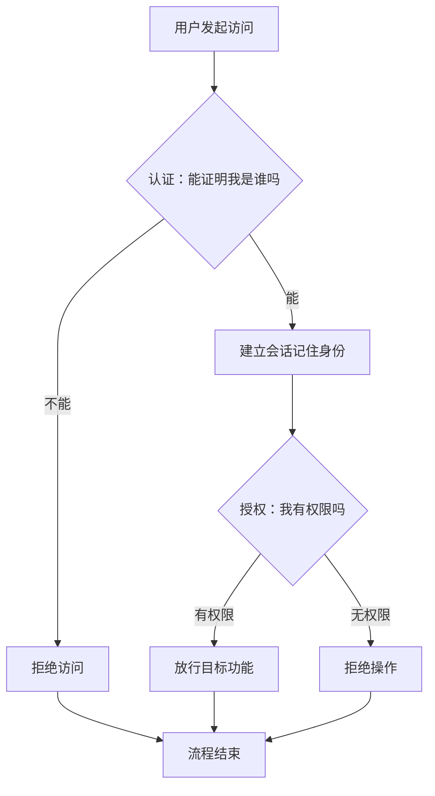
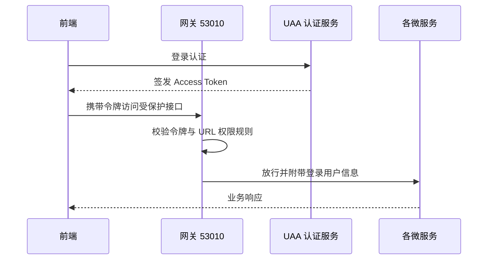

# 认证与授权：金融系统门口的两道关卡

> 🔒 安全提示：文中示例的口令/密钥均为课程教学环境演示口径，生产环境的安全要求见《安全与合规须知》。

接下来要学习 UAA 服务，并把它集成进 P2P 平台，整套东西的复杂度明显高于前面的功能开发。动工之前必须把两个高频术语钉死：认证与授权。这两个词在面试与文档里出现频率极高，概念含糊的话，后面网关、令牌、拦截器的每一项配置都只能照抄，出问题时无从下手。这一课不写代码，专门把概念、两者的关系以及项目里的授权蓝图讲透。

## 先给结论

- 认证回答「我是谁」：证明操作者是合法身份，登录只是认证方式中的一种，扫码、短信验证码、指纹、刷脸都是认证。
- 授权回答「我能干什么」：认证通过后决定哪些功能可用、哪些不可用，授权一定发生在认证之后。
- 会话（session）是两者的载体：登录之后系统要持续记住「你是谁」，状态保持的方式决定了架构形态。
- 项目把微服务接口细分为三类 URL 并配套网关拦截，授权判断落在 URL 规则与权限标识上，不是散落在业务代码里。
- 承接这套设计的是 UAA 认证服务，技术栈为 Spring Security 加 OAuth2.0 加 JWT，网关在其中扮演令牌解析与资源服务器两个角色。

## 认证：如何证明我是谁

认证这个词可以先用登录来对齐：认证就是登录。但要注意登录只是认证方式中的一种，概念上要分清「认证」与「账号密码登录」不能画等号。具体而言，认证解决的是「如何证明我是谁」这个问题，落到项目里就是：我到底是不是这个 P2P 平台的用户？登录成功，说明是平台用户；登录不成功，说明不是。这个验证身份的过程就叫认证。

认证方式远不止账号密码一种。最传统的是账号密码，如今常见的选择还有扫二维码、手机短信验证码、指纹，甚至刷脸。每一种方式回答的都是同一个问题「你是谁」，只是凭证形态不同。前端登录页上那个用手机号加验证码的表单，就是认证方式里「短信验证码登录」的落地形态，与后续密码登录属于同一问题的不同解法。把方式与概念分开记，后面引入新的认证手段时就不会觉得突兀。

## 授权：认证之后我能干什么

授权指的是「我能干什么」。注意措辞，不是「我想干什么就能干什么」，而是要问系统：我有没有足够的权限使用某个功能。授权有一条铁律：它一定发生在认证之后。身份都没验证通过，谈权限毫无意义；先证明你是谁，然后才有资格讨论你能用哪些功能、不能用哪些功能。

在 P2P 平台里这个概念很具体。平台有大量用户，删除用户这个功能显然不能人人都有，否则看谁不顺眼就把谁删了；它只属于平台管理员，用户违规了由管理员执行删除。普通用户登录后看不到、也调不通这个功能，这就是授权在起作用。

身边的例子能让这两个概念彻底落地。MySQL 数据库天天在用：连接数据库时输入账号密码，验证你是不是合法用户，这一步是认证；连上之后，用管理员账号登录可以对所有库表为所欲为，用普通账号登录就会发现有的库能看、有的操作被拒，这就是授权。本机开发环境用 `root/123456` 连接时感受不到限制，恰恰是因为 root 拿到了最大授权，权限差异一直存在，只是没被触发。

再看视频网站的会员体系：访问网站先登录，这是认证；登录之后分会员与非会员，最新剧集只有 VIP 会员能看，普通用户只能等更新，内容可见性的差异就是授权。此类例子俯拾皆是，碰到权限类名词，套一遍「先认人、再分权」的框架就能理顺。两道关卡在访问路径上的位置可以画成一张流程图。



这张图把两道关卡画在一条访问路径上：认证不过直接出局，认证通过才进入授权判定，授权再决定功能是否放行。顺序不可颠倒，这是理解一切认证授权框架的基础，后面要引入的 Spring Security 体系里，认证与授权也是两个独立模块，只是被框架串在了同一个过滤器链上。

## 会话：把登录状态接住

讲义里与认证、授权并列的第三个概念是会话（session）。它的意思是登录之后保持状态：请求是无状态的，一问一答之间系统本不记得你是谁，会话负责在后续请求里持续接住「已登录」这个事实。传统单体应用把会话存在服务端内存里，配合 Cookie 里的会话标识工作。放到前后端分离加微服务的架构下，这套做法开始吃力：状态存在哪一个实例上，其他实例与微服务如何共享，都是要重新设计的问题。会话的具体实现方案在本课不展开，这里只需要建立一条认知：认证授权体系必然要回答「状态存在哪、如何随请求传递」，它是后续令牌方案的伏笔。

## 万信金融的授权蓝图：URL 三分类与网关拦截

概念落到项目，授权被设计成一套 URL 规则。微服务内部的接口按访问要求细分为三类：

```text
1. 受保护的 C 端用户接口：/服务名称/my/资源名称/*，需携带 C 端用户认证获取的 Access Token
2. 受保护的 B 端用户接口：/服务名称/m/资源名称/*，需携带 B 端用户认证获取的 Access Token
3. 公开资源：/服务名称/资源名称/*，无限制
```

规则的价值在于授权判断可以机械化：一个发往用户中心的请求，URL 匹配 `/my/**` 就要求接入方权限范围里包含 `read`、权限列表里包含 `ROLE_CONSUMER`，这些信息与认证服务数据库里 `oauth_client_details` 表的数据一一对应。前缀即规则，网关扫一眼路径就知道该不该拦、要什么权限，业务代码里不需要散落 if 判断。

按这个蓝图，网关服务在认证授权体系里负责两件事：其一，令牌解析，校验通过后把当前登录用户的信息取出放进请求，转发给下游微服务使用；其二，作为 OAuth2.0 的资源服务器角色，对接入方做权限拦截。真正签发令牌的是独立的 UAA 服务，全称 User Account and Authentication，简称认证服务，技术栈为 Spring Security 加 OAuth2.0 加 JWT。传统登录方式的单点登录缺失、会话保持困难、认证方式单一三个问题，都由这套体系收口。目标形态可以画成下面这张时序图。



这张时序图是后续多节课的目标形态：认证在 UAA 完成，授权拦截压在网关，微服务安心做业务。当前网关还只有路由转发一个职责，离这张图还差令牌解析与资源服务器两块拼图，UAA 服务的集成就是把它们补上。

前端工程里其实已经能看到这套体系的预留痕迹。请求封装把登录与验证码相关的接口放进免登录白名单，其余请求统一携带令牌请求头：

```javascript
// 前端请求封装 utils/request.js：免登录白名单与令牌携带
if (url === 'uaa/oauth/token' ||
    url === 'account/sms' || url.search('account/sms/') == 0 ||
    url === 'account/mobiles' || url.search('account/mobiles/') == 0){
    state = false
}

if (token) {
    header = { ...header, 'Authorization': `Bearer ${token}` }
}
```

白名单里的三个接口分别是登录认证、获取验证码与手机号校验，它们发生在认证之前，天然不能要求携带令牌；白名单之外的请求一律在请求头里带上 `Authorization`，值以 `Bearer` 开头接令牌，这正是资源服务器读取凭证的标准位置。前端按住这套约定不动，后端认证方案落地时前端零改动。

## 常见误区

- **把认证等同于账号密码登录。** 错例：认为登录框消失了就没有认证，或者以为接入扫码登录要重写整个身份体系。正解：登录只是认证方式之一，认证是「证明我是谁」这个动作的抽象，方式可以随场景替换，概念不变。
- **先授权后认证，或者只授权不认证。** 错例：接口只判断「是否为管理员」就放行，管理员身份从请求参数里取，谁都能伪造。正解：授权依据的身份信息必须来自认证环节的可靠产物，例如校验过的令牌，请求参数里的身份声明不可信。
- **授权判断散落在各业务方法里。** 错例：每个接口都手写一遍「当前用户是否有权操作」。正解：按 URL 规则统一分类，拦截器在网关层按规则与权限标识机械化判断，业务代码不重复造权限轮子。
- **认为公开资源不需要设计。** 错例：新接口随手起路径，被网关按受保护规则拦下，前端调用 401。正解：公开资源的 URL 形态是设计出来的，暴露给前端的接口按无前缀规则放行，内部接口与受保护接口各有前缀，起路径前先想好它的访问级别。

## 面试可能被问到的问题

1. 面试官追问：「认证和授权的区别与联系是什么？」
   答：认证回答「我是谁」，验证操作者的合法身份；授权回答「我能干什么」，决定通过认证的身份能使用哪些功能。联系在于授权以认证为前提，身份验证通过后授权才有依据，两者在框架里通常是先后衔接的两个环节，例如 Spring Security 中认证管理器与访问决策器各司其职。
2. 面试官追问：「为什么说授权一定发生在认证之后，有没有例外？」
   答：授权判断的是「某个身份」的权限，没有可靠身份就没有判断对象，所以逻辑上授权必须以认证为前提。公开资源看似跳过了认证，实际上属于「无需授权即可访问」的设计类别，一旦进入受保护范围，认证与授权的先后顺序没有例外。
3. 面试官追问：「举例说明身边的认证与授权场景？」
   答：MySQL 是现成的例子，连接时输入账号密码是认证，root 与普通用户对库表操作权限的差异是授权。视频网站也类似，登录是认证，VIP 会员能看最新剧集、普通用户不能看是授权。两者的共同结构都是先验身份、再按身份分配能力范围。
4. 面试官追问：「会话在认证体系里解决什么问题，分布式下它的难点是什么？」
   答：HTTP 请求本身无状态，会话负责在登录后的多次请求里持续保持身份信息。分布式下的难点在于状态存放：会话存内存则多实例无法共享，存共享存储或改用令牌自带身份信息则引入一致性与性能的新考量，JWT 令牌方案正是为绕开会话共享而生。
5. 面试官追问：「你们项目里授权是怎么设计的？」
   答：接口按 URL 规则三分类，受保护的 C 端接口以 /my 为前缀、B 端接口以 /m 为前缀、公开资源无前缀。网关作为 OAuth2.0 资源服务器按 URL 匹配权限规则，要求令牌的权限范围与权限列表满足条件，校验通过后把用户信息随请求转发给微服务，业务层不再重复做权限判断。
6. 面试官追问：「UAA 服务在架构里扮演什么角色，为什么要把认证独立成服务？」
   答：UAA 即用户账户与认证服务，统一负责用户认证并签发令牌。独立成服务后，单点登录、会话保持、多种认证方式扩展这三个传统方案的硬伤一起解决：所有服务共享同一个认证出口，网关统一校验令牌，认证方式的演进收敛在一个服务内部，业务服务只消费认证结果。

## 配套资料

- 讲义：`materials/docs/10/万信金融-第2章-讲义-开户v1.0.md`，其中「问题思考」一节列出传统登录方式在分布式场景的问题清单，「认证拦截功能实现」一节给出 URL 三分类规则与网关的两项职责，正文授权蓝图出自该节。
- 代码：`materials/code/10/wanxinp2p_front/`，前端 uni-app 工程归档（目录保留原始命名，路径列到该层级），内层 `utils/request.js` 的免登录白名单与令牌请求头为正文代码节选的出处。
- 说明：UAA 服务集成指南在仓库讲义目录中未归档，认证、授权、会话的定义与超市示例按视频画面线整理；MySQL 与会员类生活化例子为按本课讲解口径的复述，无对应源码包。
