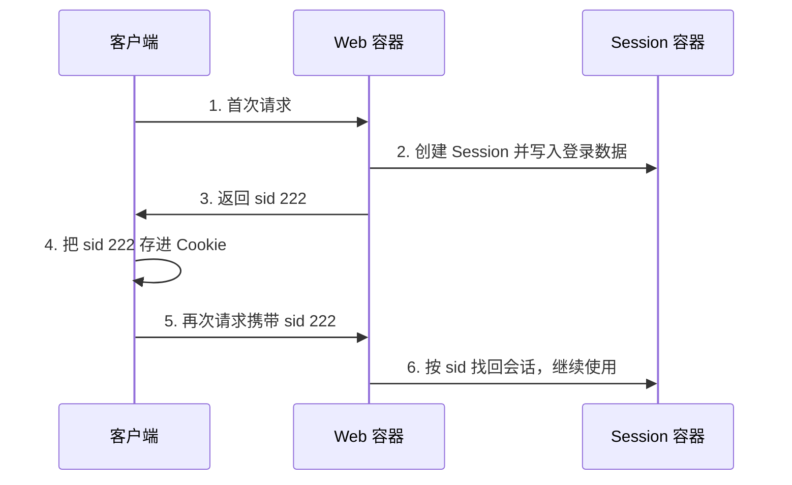
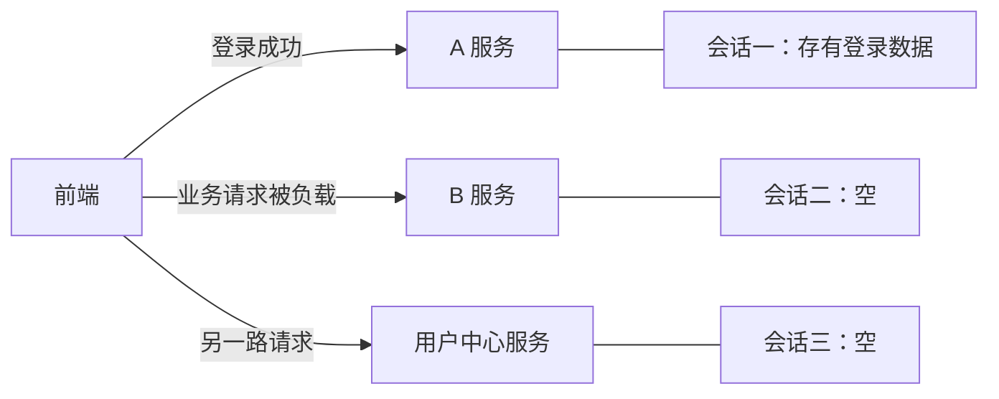

# 基于 Session 的认证机制：单体时代的宠儿，分布式时代的困局

前面理清了认证与授权的关系，顺序是一条铁律：认证在前，授权在后，认证通过之后才轮到授权登场，认证都没过，授权无从谈起。既然认证是起点，就得为项目选一套认证机制。课程项目采用前后端分离加微服务的架构，传统那套基于 Session 的认证方式在这种架构下能不能撑住，是本课要验证的命题。结论可以先透：单体应用里它最好用，分布式环境里它处处别扭，项目最终会放弃它，但理解它为什么失效，才能理解新方案为什么长成那个样子。

## 先给结论

- Session 认证的套路：登录成功后用户数据存进服务端 Session，服务端把 sessionId 通过 Cookie 返回给客户端，此后每次请求自动携带 sessionId，服务端凭它找到会话判断登录状态。
- 它天然只适用于单体应用：用户始终连着同一台服务器，会话与数据在一起，一切都顺理成章。
- 分布式环境的三个修补方案：session 复制、session 粘滞、session 集中存储，各有明显代价，集中存储相对最好。
- 移动端 APP 这类非浏览器客户端对 Cookie 机制支持薄弱，session 方案在多端时代先天不足。
- 课程项目的选择：在分布式、微服务、前后端分离架构下放弃 session 认证，转向 Token 与 OAuth2.0，本课先把 session 讲透，给后续对比打地基。

## Session 是怎么认人的

HTTP 协议本身无状态，服务器处理完一个请求就忘掉它，下一个请求来了不知道是不是同一个人。Session 就是给无状态协议补上「记忆」的机制：用户认证成功后，服务端把用户相关数据存进当前会话，同时生成一个 sessionId 发给客户端；客户端把它存进 Cookie，之后每次请求都自动带上；服务端拿到 sessionId 找回会话，会话里有登录数据就说明这个人之前认证过，没有就说明还没登录。会话过期或用户注销时，session 失效，认证状态随之作废。

一次完整的会话建立过程分六步，从首次请求到再次请求全部串起来：



注意数据的分布：真正的登录数据一步也没有离开过服务端，客户端手里只有一个 `sid 222` 这样的编号。会话数据在服务器上，凭证编号在客户端上，这是 Session 方案的根本形态，也是后面所有问题的根源。

## 代码视角：一个最小的 Session 登录

把流程落成代码更容易看清数据的流向（课程未提供本节源码，以下为按主流写法补全的示例，基于 Servlet 规范）：

```java
// 登录成功后把用户写入 Session
@WebServlet("/login")
public class LoginServlet extends HttpServlet {
    @Override
    protected void doPost(HttpServletRequest req, HttpServletResponse resp) throws IOException {
        String username = req.getParameter("username");
        String password = req.getParameter("password");
        if (checkUser(username, password)) {
            HttpSession session = req.getSession(); // 没有会话则创建
            session.setAttribute("loginUser", username); // 登录数据存在服务端
            resp.getWriter().write("login ok"); // sessionId 由容器通过 Set-Cookie 下发
        } else {
            resp.getWriter().write("login failed");
        }
    }
}
```

```java
// 后续请求按 sessionId 取回会话，有登录数据即放行
@WebFilter("/*")
public class AuthFilter implements Filter {
    @Override
    public void doFilter(ServletRequest request, ServletResponse response, FilterChain chain)
            throws IOException, ServletException {
        HttpServletRequest req = (HttpServletRequest) request;
        HttpSession session = req.getSession(false); // 只查找，不创建
        if (session != null && session.getAttribute("loginUser") != null) {
            chain.doFilter(request, response);
        } else {
            ((HttpServletResponse) response).sendError(401, "未登录");
        }
    }
}
```

两个类合起来就是那六步流程：登录时 `setAttribute` 写入数据，容器负责生成并下发 sessionId；后续请求过滤器用 `getSession(false)` 拿回会话，凭 `loginUser` 有无决定放行还是拦截。单体应用里这套代码跑得毫无问题，所有请求打在同一个 Web 容器上，会话永远找得到。

## 为什么分布式一上 Session 就失效

把单体换成微服务架构，问题立刻出现。课程项目里前端要访问的不止一个服务：登录请求落在 A 服务，A 与前端之间建立了会话，登录数据存在 A 的 Session 里；用户接着访问 B 服务、用户中心等其它服务，每个服务都会与前端各建一份自己的会话，这些会话彼此独立，B 的会话里没有登录数据，请求照样被拦。负载均衡还会火上浇油：第一次请求可能落到 A，下一次同样的请求可能落到 B，会话换了一个又一个，登录状态无从谈起。



这张图就是失效现场：同一个前端手里只有一个 sessionId，可它背后站着三个服务、三份互不相干的会话，只有会话一里有登录数据。session 认证的前提「所有请求都回到创建会话的那台服务器」在分布式下不成立了。

## 三种修补方案与各自的代价

Session 在分布式下并非无药可救，常见的思路有三种，课程的评估都很直接。

**第一，session 复制。** 让各服务节点之间把会话数据互相同步，前端与 A 的会话里有登录数据，就把这份数据复制到 B、用户中心与前端建立的会话里。想法直白，代价不小：需要在多台服务器之间持续同步 session 数据，节点越多同步开销越大，数据一致性也越难保证，一般靠容器集群能力实现，配置繁琐且伸缩性差。

**第二，session 粘滞。** 让负载均衡记住用户，把同一个用户的所有请求强制转发到他最初建立会话的那个节点，会话不就保住了。可行，但把负载均衡的灵活性好比没了：节点一挂，挂在上面的会话全部丢失；扩容缩容时会话映射跟着折腾；前端明明还有别的服务要访问，全粘在一个节点上也不合理。

**第三，session 集中存储。** 把会话数据的存储从各个服务里单独抽出来，做成一个独立的部分，所有服务都从那里读写会话数据。相对前两种这是最合理的：会话只有一份，服务无状态化，扩容缩容不受会话牵制。主流实现是 Spring Session 加 Redis，配置生效后容器自动把会话数据落到 Redis：

```yaml
# 示例为按主流写法补全：用 Spring Session 把会话集中到 Redis
spring:
  session:
    store-type: redis
  redis:
    host: localhost
    port: 6379
    password: example-redis-password
```

即便选了最优解，两道坎仍然过不去。一是集中存储引入了一个必须高可用的中心依赖，Redis 挂了全员下线，还得自己处理好会话过期与同步细节；二是 Cookie 这层根基没变，浏览器会自动携带 Cookie，移动端 APP 却没有这套天然机制，想在非浏览器客户端上用 session，各种兼容工作做得相当难受。课程给的最终评价是：面对分布式、微服务、前后端分离的架构，session 认证不管怎么修补都力不从心，项目选择放弃它。

## 课程项目的抉择

项目复盘讲义在「问题思考」一节把传统登录方式的账算得很清楚：每个微服务都要做登录校验，十分麻烦，需要的是单点登录；会话保持是绕不开的坑；认证方式单一，扫码、指纹这类认证场景毫无扩展性。P2P 网贷平台采用前后端分离、分布式、微服务架构，传统登录方式无法胜任，解法是引入独立的 UAA 认证服务，用 Spring Security 加 OAuth2 加 JWT 的技术栈统一实现认证授权，再配合网关完成令牌解析与权限拦截。

对照这段设计再看 session 方案的三种修补，会发现它们只是把单体思路往分布式上硬搬：复制保数据、粘滞保连接、集中存储保状态，全都围着「服务端保存会话」这个前提打转。新的思路干脆反其道而行，让服务端不再保存会话，把认证凭证交给客户端随请求携带，服务端只验不存，这就是下一课 Token 认证的出发点。把 session 的问题清单记牢，token 的每个设计选择才显得顺理成章。

## 常见误区

- **认为会话数据存在客户端。** 错例：说「用户的登录信息放在 Cookie 里」。正解：Cookie 里只有 sessionId 这张凭条，会话数据全在服务端；这一点与后文的 Token 方案正好相反，Token 是数据本身放在客户端。
- **认为 session 在分布式下完全不能用。** 错例：一提微服务就说 session 必须淘汰。正解：集中存储能救，代价是中心依赖与额外复杂度，而且 Cookie 对移动端不友好；说它力不从心，说的是综合成本，不是绝对不可行。
- **登录校验散落在每个微服务里各自实现。** 错例：每个服务都写一遍 session 校验逻辑。正解：这正是传统方式被诟病的问题之一，方向是统一认证、单点登录，校验收敛到认证服务与网关。
- **把注销当成「客户端删掉 Cookie 就行」。** 错例：前端清掉 sessionId 就认为登录态失效。正解：服务端的会话必须同步销毁，否则那份会话在有效期内仍可被使用，注销要在服务端调用 invalidate。

## 面试可能被问到的问题

1. 面试官追问：「描述一下基于 Session 的认证流程。」
   答：用户提交账号密码，服务端校验通过后把用户数据写入 Session，同时生成 sessionId 通过 Set-Cookie 返回；客户端存进 Cookie，此后每次请求自动携带，服务端按 sessionId 找回会话判断登录状态，会话过期或注销即失效。
2. 面试官追问：「分布式环境下 Session 有什么问题，怎么解决？」
   答：问题是各服务各建会话、负载均衡导致请求落到不同节点，登录态对不上。三种修补：session 复制在节点间同步数据，开销大；session 粘滞固定用户到单节点，牺牲均衡与可用性；session 集中存储把会话放到 Redis 等独立存储，效果最好但仍依赖中心节点，且 Cookie 对移动端不友好。
3. 面试官追问：「Session 和 Cookie 是什么关系？」
   答：Cookie 是客户端存储机制，Session 是服务端会话机制，sessionId 是两者的连接点。服务端把 sessionId 通过 Set-Cookie 写入客户端，客户端每次请求带回，服务端据此定位会话。数据在服务端，凭条在客户端。
4. 面试官追问：「你的项目为什么不用 Session 认证？」
   答：项目是前后端分离加微服务架构，每个微服务都做登录校验、会话保持、认证方式单一这三个传统问题在这里全部命中，还需要单点登录；移动端对 Cookie 支持也差。项目选择了独立的认证服务加 Token 方案，服务端不存会话，天然适配分布式与多端。
5. 面试官追问：「session 集中存储具体怎么落地？」
   答：引入 Spring Session，把 store-type 配置为 redis，容器对会话的读写自动落到 Redis，应用代码几乎不用改；会话过期由 Redis 的过期时间管理。要注意 Redis 本身的高可用和容量规划，中心依赖的可用性决定了全站登录态的可用性。
6. 面试官追问：「认证和授权的顺序能颠倒吗？」
   答：不能。认证确认你是谁，授权决定你能干什么，没有身份就无从分配权限。工程上的体现是认证失败直接返回未登录，根本不会进入权限判断环节，网关和认证服务的拦截器都是先认证后授权的顺序。

## 配套资料

- 讲义：`materials/docs/10/万信金融-第2章-讲义-开户v1.0.md`，1.2 节问题思考列出了传统登录方式在分布式、微服务场景的四个问题，并引出独立 UAA 认证服务（Spring Security + OAuth2 + JWT）的技术选型。
- 代码：`materials/code/10/wanxinp2p/`，原始命名的工程目录归档，网关与用户中心、统一账户等服务的工程结构可在该层级浏览；本课无 Session 认证相关源码。
- 说明：Servlet 会话示例与 Spring Session Redis 配置为按主流写法补全，课程未提供本节配套源码；会话编号以 `sid 222` 沿用课件示例。
