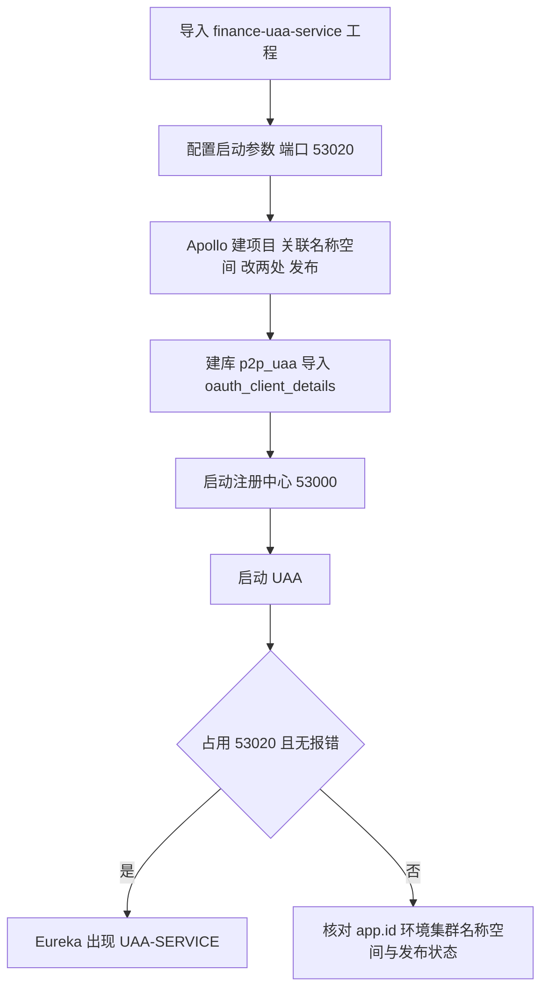

# 集成 UAA 服务：把统一认证中心挂进 P2P 平台

> 🔒 安全提示：文中示例的口令/密钥均为课程教学环境演示口径，生产环境的安全要求见《安全与合规须知》。

认证架构图里最核心的那一方就是 UAA 认证服务，它不在平台上，统一认证就无从谈起。集成它的好消息是：这一套东西 90% 的代码已经写好，课程直接提供整个工程，拿来导入即可。真正需要自己动手实现的功能只有两个：认证时远程调用统一账户服务校验账号密码，以及认证通过后生成并返回令牌。本课先不碰这两个功能，把基础环境搭起来，让 UAA 以自己的端口跑起来、注册进注册中心，与平台其余微服务站在同一条起跑线上。

## 先给结论

- UAA 是独立抽出的统一认证中心，集认证与授权功能于一身，技术栈为 Spring Security 整合 OAuth2.0，令牌采用 JWT。
- 工程由课程直接提供，导入即用；需自己实现的只有校验账号密码与签发令牌两个功能，其余代码过一遍即可。
- 关键参数一步到位：服务名 `uaa-service`、端口 53020、上下文路径 `/uaa`、数据库 `p2p_uaa`。
- Apollo 上新建 `uaa-service` 项目并关联公共名称空间，配置只改两处：上下文路径与数据源库名，改完必须发布。
- `oauth_client_details` 表登记接入客户端的标识、密钥与权限列表，是密码模式校验接入方合法性的数据源。

## UAA 的定位与本课的目标

讲义对 UAA 的定位一句话：作为 P2P 平台中独立的统一认证中心，集认证和授权功能于一身，主要技术是 Spring Security 整合 OAuth2.0 实现授权服务器角色。企业里这类认证服务同样是作为基础工程直接提供的，开发人员拿用即可，不会从零造轮子。所以本课的工作性质是环境搭建加定点开发：环境部分占大头，功能部分只有前面说的两处，而且这两个功能的实现分别安排在后续课程里，本课只要让它正常启动。

顺带明确它对谁的依赖：UAA 校验账号密码时不查自己的用户表，而是远程调用统一账户服务，这个调用通道要在下一课用 Feign 代理铺好；它自己的数据库里存的不是用户，而是接入客户端的信息。

## 工程导入与依赖

工程从资料文件夹拷贝进 P2P 工程目录，在 IDE 里通过 Project Structure 新增模块、按 Maven 方式导入，一路默认即可。导入后先看它的骨架：父工程沿用平台统一的 Spring Boot 环境，依赖了 API 工程，配置走 Apollo 客户端，日志、Swagger 这些公共件与既有微服务一脉相承。

```xml
<artifactId>finance-uaa-service</artifactId>
<dependencies>
    <!-- 平台 API 工程：DTO 与接口定义从这里取 -->
    <dependency>
        <groupId>com.study.finance</groupId>
        <artifactId>finance-api</artifactId>
        <version>${project.version}</version>
    </dependency>
    <!-- 注册进 Eureka -->
    <dependency>
        <groupId>org.springframework.cloud</groupId>
        <artifactId>spring-cloud-starter-netflix-eureka-client</artifactId>
    </dependency>
</dependencies>
```

认证框架相关依赖是它区别于普通微服务的部分，归档的同框架认证服务工程的依赖清单里可以核对：

```xml
<!-- Spring Security 整合 OAuth2.0，令牌采用 JWT -->
<dependency>
    <groupId>org.springframework.cloud</groupId>
    <artifactId>spring-cloud-starter-security</artifactId>
</dependency>
<dependency>
    <groupId>org.springframework.cloud</groupId>
    <artifactId>spring-cloud-starter-oauth2</artifactId>
</dependency>
<dependency>
    <groupId>org.springframework.security</groupId>
    <artifactId>spring-security-jwt</artifactId>
</dependency>
```

JWT 令牌的签名密钥经配置注入，认证配置类里用 `@Value` 读取签名密钥配置项，开发环境配置为占位值 `example-signing-key`。启动参数与平台其他微服务同一套约定，从部署文档的服务端口表里查出 UAA 的端口：

```bash
-Denv=dev -Dapollo.cluster=DEFAULT -Dserver.port=53020
```

三个参数各管一事：环境、集群、端口。端口表里 `uaa-service` 登记为 53020，与注册中心 53000、网关 53010、统一账户 53030、用户中心 53050 并列在案，照表执行不抢端口。

## Apollo 配置：建项目、关联、改两处、发布

UAA 的配置与其他微服务一样托管在 Apollo。控制台上还没有认证中心对应的项目，先创建：应用 ID 填 `uaa-service`，必须与工程里的 `app.id` 完全一致；应用名称填统一认证中心；环境与集群用默认。

项目建好后，通过关联 `common-template` 的公共名称空间把通用配置引进来，连接池、HTTP、注册中心这些名称空间按需关联，操作与此前每个微服务接入 Apollo 时相同。关联完成后并不是万事大吉，有两处必须修改：

```properties
# micro_service.spring-boot-http 名称空间：UAA 的访问路径
server.servlet.context-path=/uaa

# micro_service.spring-boot-druid 名称空间：数据源指向 UAA 自己的库
spring.datasource.url=jdbc:mysql://localhost:3306/p2p_uaa?useUnicode=true
```

模板里的上下文路径与库名都是按上一个微服务的样子填的，直接沿用就会出两类事故：路径不改，前端按 `/uaa/oauth/token` 发来的请求到不了 UAA；库名不改，UAA 启动后连到别人的库里找接入客户端数据。改完提交，再点发布，不发布的配置对客户端永远不可见。

## 数据库与客户端登记表

UAA 需要一个自己的数据库 `p2p_uaa`，执行资料里的脚本导入表。其中真正要关注的是 `oauth_client_details` 这一张，密码模式认证时客户端提交的标识与密钥，就是拿它与这张表对账的。字段不多，每个都有明确用途：

| 字段 | 用途 |
|---|---|
| `client_id` | 客户端标识，接入方请求认证时提交，主键 |
| `client_secret` | 客户端密钥，与标识成对校验 |
| `scope` | 权限范围，取值如 `read`、`write` |
| `authorized_grant_types` | 允许的授权模式，密码模式必须包含 `password` |
| `authorities` | 客户端权限列表，决定该客户端能访问哪些微服务 |
| `access_token_validity` | 访问令牌有效期，秒 |
| `refresh_token_validity` | 刷新令牌有效期，秒 |

按平台的接入规划，管理端、移动端、PC 端各登记一行，当前先登记 PC 端 H5 客户端，示例如下（密钥用占位值）：

```sql
INSERT INTO oauth_client_details
  (client_id, resource_ids, client_secret, scope, authorized_grant_types,
   authorities, access_token_validity, refresh_token_validity)
VALUES
  ('finance-web-h5', 'finance-resource', 'example-secret', 'read',
   'client_credentials,password,authorization_code,implicit,refresh_token',
   'ROLE_CONSUMER,ROLE_API', 7200, 259200);
```

这一行登记出了三层含义：客户端 `finance-web-h5` 是合法接入方，五种授权模式里只有表里列出的才放行，它携带 ROLE_CONSUMER 与 ROLE_API 两个权限去访问受保护资源。归档的认证库建表脚本里可以对照真实的客户端数据：标识是一串随机字符，密钥明文存放，五种授权模式全部开启，有效期 7200 秒与 259200 秒。

## 启动与验证

环境四件事做完，剩下的就是启动验证。启动顺序与依赖关系如下：



本课只验证环境，启动注册中心与 UAA 两个服务就够。控制台先出现从 Apollo 加载配置的过程，无报错后日志显示占用 53020，服务启动完成；打开 Eureka 控制台，实例列表里多出 `UAA-SERVICE`，注册关系一目了然。若日志里偶发配置同步失败后重试成功的记录，属于启动瞬时抖动，最终能拉到配置即可；持续失败就要回头核对 Apollo 项目的发布状态与客户端的 `app.id`、环境、集群、名称空间四项声明。到这一步，UAA 已经作为统一认证中心挂进了平台，与网关、统一账户服务同处一个注册中心，认证功能的实现随时可以开工。

## 常见误区

- **配置改完不发布。** 错例：在 Apollo 上改好上下文路径与数据源，提交后直接重启服务，客户端拉到的还是旧值。正解：Apollo 的修改要发布后才对客户端可见，改完配置点发布是固定动作。
- **数据源沿用模板库名。** 错例：关联公共名称空间后不改 `spring.datasource.url`，UAA 连到用户中心的库里。正解：库名必须是 `p2p_uaa`，接入客户端数据存于认证中心自己的库。
- **`app.id` 与 Apollo 项目对不上。** 错例：控制台建的项目叫别的名字，客户端取不到任何配置，启动即失败。正解：应用 ID 与工程 `app.id` 严格一致，这是取配置的钥匙。
- **不建库导表直接启动。** 错例：跳过数据库准备，启动时报数据源与表相关错误。正解：先建 `p2p_uaa` 库并执行脚本导入 `oauth_client_details`，再启动服务。

## 面试可能被问到的问题

1. 面试官追问：「集成 UAA 服务具体要做哪些事？」
   答：工程由基础团队直接提供，导入后配启动参数端口 53020；Apollo 上建同名项目、关联公共名称空间、修改上下文路径与数据源两处并发布；本地建认证库 `p2p_uaa` 导入客户端登记表；最后启动验证占用端口并注册进注册中心。需要实现的业务功能只有账号密码校验的远程调用与令牌签发两处。
2. 面试官追问：「`oauth_client_details` 表是做什么的？」
   答：登记接入客户端的信息，客户端标识、密钥、允许的授权模式、权限列表、令牌有效期。密码模式认证时，服务端拿请求里的 `client_id` 与 `client_secret` 与表里数据对账，验明接入方合法；`authorities` 字段决定该客户端能访问哪些受保护资源，是网关权限拦截的依据之一。
3. 面试官追问：「为什么 UAA 要单独建库，而不是复用账户库？」
   答：两张表职责完全不同，账户库存用户资产，认证库存接入客户端的登记信息。分开后认证中心的扩容、迁移、备份不影响账户数据，客户端接入信息的变化也不用动账户服务，边界清晰是微服务数据私有原则的体现。
4. 面试官追问：「UAA 的上下文路径设为 /uaa 有什么讲究？」
   答：网关按路径前缀路由，`/uaa` 前缀的请求经网关转发到 UAA，前端请求封装里的认证接口路径正与它对应；同时它把认证中心与各业务微服务的路径空间隔开，网关配置资源服务器拦截规则时能按服务逐个定义。
5. 面试官追问：「JWT 令牌的签名密钥在服务端如何管理？」
   答：密钥不放代码里，走配置中心按环境注入，认证配置类用 `@Value` 读取后设置给令牌转换器。对称密钥下签发与校验两侧持同一把，生产环境密钥独立保管并定期轮换，泄露风险与配置耦合一起被收敛到配置层。

## 配套资料

- 讲义：`materials/docs/10/万信金融-第2章-讲义-开户v1.0.md`，「认证拦截功能实现」的环境准备与相关配置小节：`p2p_uaa` 库、`oauth_client_details` 的 `authorities` 字段与网关路由配置的出处。
- 讲义：`materials/docs/10/万信金融-生产环境-部署文档.md`，服务端口表登记 `uaa-service` 端口 53020，启动参数端口约定的依据。
- 代码：`materials/code/10/代码/shanjupay-uaa/`，同框架认证服务工程归档（目录保留原始命名，路径列到该层级），pom 依赖清单、`JWTConfig` 签名密钥注入、`OauthClientDetails` 实体可对照。
- 代码：`materials/code/10/_散落资料/`，含认证库建表脚本（`oauth_client_details` 表结构与客户端数据样例，文件保留原始命名）。
- 说明：万信 UAA 模块由课程资料直接提供，仓库未归档，工程骨架与配置按视频画面线整理；工程名按 `finance-uaa-service` 中性化，包名按 `com.study.finance` 系改写，客户端标识与密钥为占位示例。
