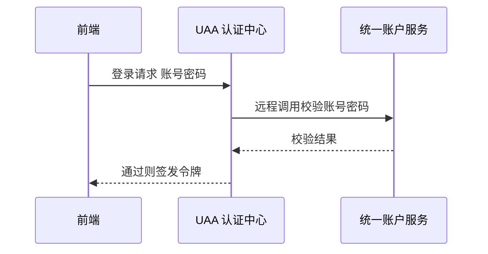

# UAA 的 Feign 代理：认证中心与统一账户之间那根线

UAA 工程导入、Apollo 配置、客户端登记表都就绪，登录功能该动笔了。动笔之前要把登录的时序再摊开看一眼：UAA 作为统一认证中心收下登录请求，可它自己手里没有账号密码，校验这步必须委托统一账户服务完成。于是整个认证功能的地基，是把 UAA 到统一账户这段远程调用先打通。注册功能实现时用户中心调用统一账户已经用过一次同款套路，这次照方抓药，唯一要先想清楚的问题是：谁调谁。

## 先给结论

- 登录链路里 UAA 只负责收认证请求与签发令牌，账号密码校验委托统一账户服务，方向是 UAA 调统一账户，不能反。
- 远程调用用 Feign：在 UAA 工程建 `agent` 包，定义 `AccountApiAgent` 接口，代理类与代理对象由框架生成。
- `@FeignClient` 的 value 填统一账户的注册名 `account-service`，方法路径补全为对端基本路径加 Controller 映射。
- 启动类要加 `@EnableFeignClients` 并把扫描包指向 `agent` 包，漏了或写错，注入时直接报找不到 Bean。

## 登录时序里缺的那段线

注册登录的完整时序此前画过：注册已经走通，登录这一段的起点同样是前端。注册成功后用户发起登录请求，请求直接发往 UAA，因为它就是统一认证中心；UAA 收到请求要校验账号密码是否正确，账号密码这套数据归统一账户管，所以 UAA 发起远程调用过去，校验通过后 UAA 生成令牌返回前端，登录成功；校验不通过则不生成令牌，登录失败。



图中 UAA 与统一账户之间那条线，就是本课要接的线。远程调用的工具还是 Feign，具体动作是写一个代理接口，实现类不写，代理对象由框架生成。

## agent 包与代理接口

UAA 工程里新建 `agent` 包，远程调用代理统一归这个包管，包名里的 agent 就是代理的意思。接口命名 `AccountApiAgent`，看名字就知道它代理的是统一账户的 API：

```java
package com.study.finance.uaa.agent;

import com.study.finance.api.account.model.AccountDTO;
import com.study.finance.api.account.model.AccountLoginDTO;
import com.study.finance.common.domain.RestResponse;
import org.springframework.cloud.openfeign.FeignClient;
import org.springframework.web.bind.annotation.PostMapping;

// value 指向统一账户服务在注册中心的名字
@FeignClient(value = "account-service")
public interface AccountApiAgent {

    // 路径 = 统一账户基本路径 account + Controller 完整映射 /l/accounts/session
    @PostMapping(value = "/account/l/accounts/session")
    RestResponse<AccountDTO> login(AccountLoginDTO accountLoginDTO);
}
```

接口上要做对三件事。第一件，`@FeignClient` 的 value 填目标服务注册进注册中心的名字 `account-service`，代理按名字找实例，写错名字到调用时才报找不到服务。第二件，方法声明从对端原样照搬：统一账户侧 `AccountAPI` 里定义的 `login` 方法，入参 `AccountLoginDTO`，返回 `RestResponse<AccountDTO>`，签名一致代理才有得转发。第三件，请求路径不能只写 Controller 方法上的那截，远程调用要拼出对端完整路径：统一账户服务的基本路径 `account`，加上类级与方法级映射合成的 `/l/accounts/session`，少一截请求就打空。

写法与用户中心那份 `AccountApiAgent` 完全同款，只是用户中心当时调的是 `register`，这里调的是 `login`。写接口不写实现，剩下的装配交给框架，这正是声明式调用的价值。

## 启动类扫描：把接口交给框架

代理接口写好了，还要让框架知道去哪找它。UAA 的启动类上加 `@EnableFeignClients`，扫描包指向 `agent` 包：

```java
@SpringBootApplication
@EnableDiscoveryClient
@EnableFeignClients(basePackages = "com.study.finance.uaa.agent")
public class UAAService {

    public static void main(String[] args) {
        SpringApplication.run(UAAService.class, args);
    }
}
```

`@EnableFeignClients` 的 basePackages 圈定扫描范围，框架启动时扫包内所有带 `@FeignClient` 的接口，逐个生成代理类与代理对象并注册进容器。接口建了、注解漏了或包路径写错，都是同一症状：注入 `AccountApiAgent` 时报找不到 Bean，排查时先看启动类。这一步做完，UAA 到统一账户的通道宣告打通，登录功能的编写只剩业务逻辑本身。

## 常见误区

- **路径只写方法映射，漏掉对端基本路径。** 错例：`@PostMapping("/accounts/session")`，代理发出的请求少了 `account` 这一截，统一账户返回 404。正解：远程调用路径必须是对端完整路径，基本路径加 Controller 映射一截都不能少。
- **`@FeignClient` 的 value 写成对端地址。** 错例：value 填 `http://localhost:53030`，代理绕开注册中心直连，实例一换就断。正解：value 填注册名 `account-service`，地址解析交给注册中心与负载均衡器。
- **启动类漏加 `@EnableFeignClients` 或包路径不对。** 错例：接口在 `agent` 包，扫描包却指向别的路径，启动正常，注入时才炸。正解：basePackages 覆盖代理接口所在包，新建接口后先核对扫描范围。
- **给代理接口写实现类。** 错例：习惯性补一个 `AccountApiAgentImpl`，实际上代理对象由框架动态生成，手写实现类反而把框架生成的 Bean 顶掉或引起冲突。正解：只声明接口，调用时直接注入使用。

## 面试可能被问到的问题

1. 面试官追问：「UAA 为什么不直接查账户库校验密码？」
   答：职责与数据归属决定的。账户数据与密码密文统一收在账户服务，一处存储一处维护；UAA 只负责认证流程与令牌签发，通过远程调用获取校验结果。账户模型变化时认证服务无感，两个服务可以独立演进，这也是微服务数据私有的基本要求。
2. 面试官追问：「Feign 代理的方法路径为什么要包含对端的基本路径？」
   答：对端服务的完整 URL 由上下文路径与 Controller 映射拼接而成，Feign 按服务名找到实例后拼的正是这个完整路径。只写方法映射那截，请求会打在错误的 URL 上，表现为 404，这个问题在直连测试时能立刻暴露。
3. 面试官追问：「`@EnableFeignClients` 在容器启动阶段做了什么？」
   答：它触发对 basePackages 指定包的扫描，找到所有标注 `@FeignClient` 的接口，为每个接口生成动态代理并注册为 Bean。业务代码 `@Autowired` 注入的就是这个代理对象，调用方法时被拦截改写为组装 HTTP 请求，经负载均衡发给目标服务。
4. 面试官追问：「这段准备工作不先做，直接写认证逻辑会怎样？」
   答：认证逻辑里校验账号密码这一步依赖远程调用通道，代理缺失时要么编译不过，要么运行时取不到代理对象。先把通道打通，认证方法的四步实现才能聚焦在流程与判断上，这也是先做准备的意义：把不确定的外部依赖固定下来，剩下的都是纯业务代码。

## 配套资料

- 代码：`materials/code/10/wanxinp2p/`，P2P 工程归档（目录保留原始命名，路径列到该层级），统一账户服务的接口定义与工程结构可对照，启动类注解三件套为真实结构。
- 讲义：`materials/docs/10/万信金融-第2章-讲义-开户v1.0.md`，远程调用代理的编写步骤与 Feign 使用约定，注册功能时的同款套路出处。
- 说明：UAA 工程 `agent` 包与 `AccountApiAgent` 接口源码未在仓库归档，按视频画面线整理；登录路径 `/l/accounts/session`、服务名 `account-service` 沿用统一账户接口定义的既定口径，包名按 `com.study.finance` 系改写。
