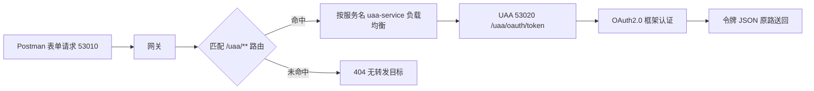

# 登录测试过网关：把令牌请求从直连切到网关转发

用 Postman 直连 53020 拿到令牌，认证功能在服务层面已经闭环。但用户永远不会拿着 Postman 访问系统：页面发出的每一个请求都先到网关，再由网关转发给对应微服务。登录请求能不能顺利穿过网关，必须在前端联调之前单独验证掉，否则路由缺失这类配置问题会一直潜伏到集成测试甚至生产环境才暴露。这一课的动作很小，把测试请求从 53020 换到 53010 让令牌请求走一遍网关；但这一课补上的配置很关键，缺了它，后面所有要过网关的认证请求都会趴在网关门口。

## 先给结论

- 过网关测试的本质：路径与参数一个不动，端口从 UAA 的 53020 换成网关的 53010，由网关按路由转发回 UAA。
- 前提是 Apollo 的网关应用里登记了到 uaa-service 的路由，此前只配过 account 与 consumer 两条，缺了这条请求直接 404。
- 路由表达式 `/uaa/**` 与 UAA 的上下文路径一致，配合 `stripPrefix=false` 原样转发，网关不改写任何路径。
- 测试用例从既有登录请求复制而来，只改端口号；网关端口以启动参数与部署文档端口表为准，53010。
- 这条路验通，前端过网关登录的地基才算打好，前后端集成测试才有得测。

## 为什么登录也要测过网关

**第一，网关是前端请求的唯一入口。** 项目采用前后端分离架构，立项时就定下规矩：前端发出的所有请求都要经过网关。直连测试证明的是 UAA 自己没问题，用户真实路径上还隔着网关这一层，路由配置是否齐全、登录这种表单提交能否原样透传，都只有过网关才知道。

**第二，为前后端集成测试打底。** 登录功能的验收终点是页面上点一下按钮能登进系统，那条链路必然经过网关。提前用 Postman 把网关这段验通，集成测试时就只剩前端本身这一个变量，出问题时排查范围小得多。

**第三，测试成本极低。** Postman 里复制一份现成的登录请求，改一个端口号就完事，收益却是把「网关能不能转发认证请求」这个疑问提前清零。

## 第一步：给网关补上 UAA 的路由

网关目前登记过的路由只有统一账户与用户中心两条，都是注册功能前后端集成测试时加的。UAA 是后来才挂进平台的微服务，路由表里还没有它，这条路由就是本次过网关测试能否成立的关键。配置托管在 Apollo 的网关应用里，在 application 名称空间中新增一条，写法照抄既有条目，只改服务标识与路径：

```properties
# Apollo 网关应用 application 名称空间新增：UAA 路由
zuul.routes.uaa-service.path = /uaa/**
zuul.routes.uaa-service.stripPrefix = false
```

工程归档里网关模块的配置底稿可以对照这些参数的真实写法，既有两条路由与全局开关都在其中：

```properties
# 网关配置底稿节选（wanxinp2p-gateway-server）
# 请求没有前缀，不用去除前缀进行请求转发
zuul.routes.consumer-service.stripPrefix=false
zuul.routes.consumer-service.path=/consumer/**
# 开启重试
zuul.retryable=true
# 网关会转发请求头信息
zuul.add-host-header=true
# 关闭自动路由匹配，全部手动匹配，更安全
zuul.ignoredServices=*
```

这几行各有讲究。`ignoredServices` 置为 `*` 关掉了按注册中心服务名自动生成路由的默认行为，路由表完全由手动声明，这正是每接入一个微服务都要到 Apollo 补一条路由的原因。`stripPrefix=false` 表示转发时保留路径前缀，UAA 的上下文路径就是 `/uaa`，前缀剥掉反而匹配不到。改完提交并发布，运行中的网关未必立即读到新配置，测试前重启一次网关是稳妥动作，注册功能集成测试时的那次 404 已经把这个坑演示过一遍。

## 第二步：复制请求，只改端口

Postman 里复制「登录获取令牌」的请求，另存为过网关版本的用例，两份用例并存便于对照。请求地址把 53020 改成 53010，路径 `/uaa/oauth/token` 与 grant_type、client_id 等七项表单参数全部原样保留。端口拿不准可以先核对网关的启动参数：

```bash
# 网关启动参数，端口取自部署文档的服务端口表
-Denv=dev -Dapollo.cluster=DEFAULT -Dserver.port=53010
```

三个参数分别声明环境、集群与端口，端口表里 gateway-server 登记为 53010，与注册中心 53000、UAA 53020 并列在案。服务清单核对一遍：Apollo、注册中心、网关、统一账户服务、UAA，五个都得起，用户中心不在登录链路上，可以不起。

## 请求旅程：网关这一棒发生了什么

这张图描述令牌请求过网关的完整旅程，核心环节是路由匹配与按服务名转发。



读图抓两条线：命中路由的请求，网关不做任何业务处理，从注册中心按服务名找到 UAA 实例，把路径与表单原样转交，认证与签发全部发生在 UAA 的框架层，响应按原路送回调用方；未命中的请求连微服务的门都摸不到，在网关层就吐 404。UAA 对请求是不是经过网关毫无感知，这是网关目前只做透明转发的现状，到认证拦截功能实现后这个「无感知」才会被打破。

发送请求，响应里照旧带回 `access_token`、`token_type`、`expires_in`、`refresh_token` 等字段，与直连测试的结果一致，过网关测试通过。

## 联调要点：三个高频故障位

过网关链路比直连多了网关一个环节，故障也就集中在这一层。

- **404，路由缺失或未生效。** 表现是请求发出后很快返回 404，连 UAA 的日志都没有动静。按「Apollo 有没有这条路由、有没有发布、网关重启过没有」三问排查，九成的问题出在这三处。
- **连接被拒，UAA 不在场。** 网关找到了路由但转发失败，检查 UAA 是否占用 53020、是否注册进了注册中心，网关是按服务名找实例的，注册中心里没有 `UAA-SERVICE` 就等于无米下锅。
- **超时，转发链路读不到响应。** 网关底稿里 ribbon 的读超时是 20 秒，UAA 正常情况下认证在毫秒级完成，长时间无响应多半是 UAA 启动未完成或数据库没连上，而不是网关的问题。另有一处设计细节：底稿把 `OkToRetryOnAllOperations` 设为 false，POST 这类不幂等的请求不做节点重试，登录请求失败就是失败，不会被网关悄悄重发一遍。

还有一条与前端联调直接相关：前端工程运行在自己的 8081 端口，向网关 53010 发请求属于跨域调用，网关的跨域配置类里注册了一个全局 CORS 过滤器，放行所有来源与方法，这层配置在网关工程里已经备好，集成测试时若遇跨域报错先确认网关的这份配置在生效。

## 常见误区

- **换端口时把路径也改了。** 错例：以为网关会代为补上 `/uaa` 前缀，把地址改成 `http://localhost:53010/oauth/token`，结果 404。正解：路由配置为 `stripPrefix=false`，路径前缀必须保留，过网关地址与直连地址只有端口号不同。
- **路由加了就立即测。** 错例：Apollo 上保存新路由后直接发送请求，收到 404 却去排查 UAA。正解：配置要发布，运行中的网关要重启确认读到新路由，注册功能集成测试时同样的坑已经出现过一次。
- **把网关层失败归因于 UAA。** 错例：404 后去 UAA 日志里找请求痕迹，翻遍日志一无所获。正解：先判断请求死在哪一层，网关找不到转发目标时请求根本到不了 UAA，UAA 无日志恰恰是路由问题的旁证。
- **多改一个参数证明自己「优化」了什么。** 错例：顺手把 `grant_type` 或 `client_id` 改成别的值再测。正解：过网关测试的唯一变量是端口，控制变量才能把结果归因到网关转发本身。

## 面试可能被问到的问题

1. 面试官追问：「为什么前端的所有请求都要经过网关，登录请求能不能直连 UAA？」
   答：网关是平台的统一入口，负责路由转发、统一的跨域处理，以及后续要加的令牌校验与权限拦截。技术上登录请求可以直连 UAA，但绕过网关等于绕过整个授权体系，令牌校验、接入方权限控制都无从谈起，所以前端只认网关一个地址。
2. 面试官追问：「Zuul 路由里 stripPrefix=false 是什么意思，什么时候必须这么配？」
   答：它决定转发时是否剥掉路由匹配用的路径前缀。当下游微服务的上下文路径本身就带这个前缀时必须保留，比如 UAA 的上下文路径是 /uaa，请求 /uaa/oauth/token 要原样送达；若下游服务不感知前缀，就用默认的剥前缀行为，按服务的 context-path 设计来定。
3. 面试官追问：「zuul.ignoredServices=* 这条配置的用意是什么？」
   答：Zuul 默认会按注册中心的服务名自动生成路由，服务名直接暴露为外部路径，路径格式不可控。置为星号后关闭自动映射，所有路由手动声明，外部路径与内部服务名解耦，接入方看到的路径稳定且可控，安全性也更好。
4. 面试官追问：「过网关测试与直连测试各自验证什么？」
   答：直连验证目标服务自身的功能正确性，网关验证路由配置、请求透传与跨服务转发这两层。两者叠加才能确认用户真实路径可用；集成测试前先做这两个测试，能把配置问题、服务问题、代码问题分层排掉。
5. 面试官追问：「网关对失败请求做自动重试有什么风险？」
   答：GET 这类幂等请求重试无害，POST 不幂等，重试可能造成重复下单、重复提交这类业务事故。项目配置里显式关闭了对所有操作的重试，只保留对连接失败的节点切换，这是网关设计里必须考虑的幂等性问题。

## 配套资料

- 代码：`materials/code/10/wanxinp2p/`，P2P 工程归档（目录保留原始命名，路径列到该层级），内层网关模块 resources 下的 `application.properties` 为路由底稿，启动类 `GatewayServer` 与跨域配置类为真实实现，正文配置片段出自其中。
- 讲义：`materials/docs/10/万信金融-生产环境-部署文档.md`，服务端口表登记 gateway-server 端口 53010，网关启动参数的端口依据。
- 讲义：`materials/docs/10/万信金融-第2章-讲义-开户v1.0.md`，「认证拦截功能实现」的环境准备小节，每新增一个微服务都需在 Apollo 网关应用新增路由配置的出处。
- 说明：Apollo 上为 UAA 补路由的操作过程与 Postman 过网关用例按视频画面线整理，仓库未归档 Apollo 导出配置；UAA 路由条目按既有 account 与 consumer 条目的写法补全，签名密钥与令牌样例均为占位。
