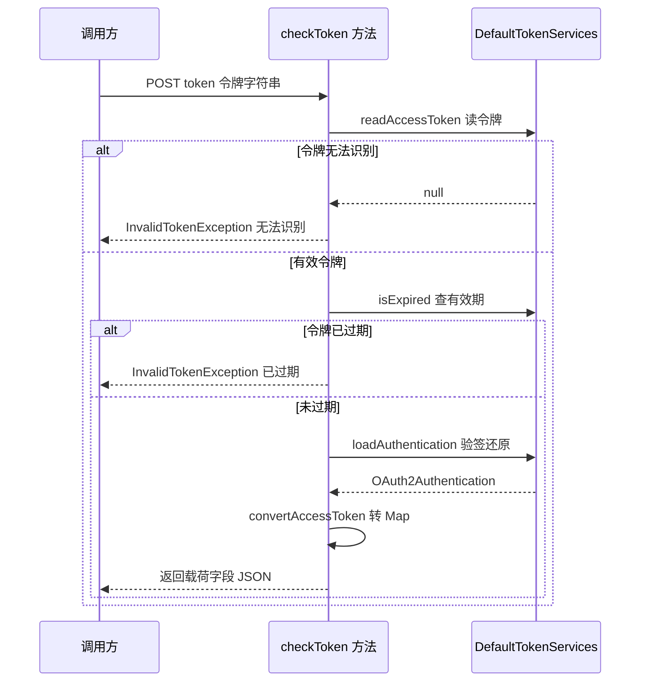

# 解析令牌功能测试：验明一段 JWT 的真身

登录测试通过，期待已久的令牌到手了，它长成三段以点号相连的编码串，肉眼看不出任何含义。这段字符串到底是不是一个装着用户信息的合法令牌，还是一串谁也读不懂的乱码，得有一个办法验明真身。解析令牌功能就是为此准备的：把令牌里存的原始内容读出来核对，用户名、手机号、客户端权限逐项对上，令牌的真假就再无悬念。

## 先给结论

- 解析令牌走 UAA 的 `POST /uaa/oauth/check_token` 端点，请求参数只有一个 `token`，值就是刚拿到的令牌字符串。
- 端点代码由课程直接提供，在 UAA 工程的控制器里，不需要自己实现，读懂即可。
- 方法内部三步：读令牌判断能否识别、判断是否过期、还原认证信息并转成 Map 返回，两处失败分别抛「令牌无法识别」与「令牌已过期」。
- 响应字段来源分两处：`user_name`、`mobile` 来自登录时写入令牌载荷的用户信息；`client_id`、`client_authorities`、`aud` 来自认证库里 oauth_client_details 的客户端登记。
- 过网关同样可用，端口从 53020 换成 53010 即可，解析结果与直连一致。

## 端点在代码里的样子

解析令牌不是去 UAA 工程里找一个新的待实现功能，它是已经提供好的。控制器里能看到一个映射到 `/oauth/check_token` 的方法，代码不长，值得逐行读懂，将来网关校验令牌用的就是同一套机制：

```java
@RequestMapping(value = "/oauth/check_token", method = RequestMethod.POST)
@ResponseBody
public Map<String, ?> checkToken(@RequestParam("token") String value) {
    DefaultTokenServices tokenServices = (DefaultTokenServices) tokenService;
    // 1. 读令牌：无法识别的字符串在这里就被拦下
    OAuth2AccessToken token = tokenServices.readAccessToken(value);
    if (token == null) {
        throw new InvalidTokenException("Token was not recognised");
    }
    // 2. 判断有效期：过期令牌直接拒绝
    if (token.isExpired()) {
        throw new InvalidTokenException("Token has expired");
    }
    // 3. 验签并还原认证信息，再把令牌内容转成 Map
    OAuth2Authentication authentication = tokenServices.loadAuthentication(token.getValue());
    Map<String, ?> rst = accessTokenConverter.convertAccessToken(token, authentication);
    return rst;
}
```

方法注入的是授权服务器的令牌服务与令牌转换器两个 Bean，返回值是 Map，方法上加了 `@ResponseBody`，Map 会转成 JSON 直接写给前端。与 `/oauth/token` 令牌端点由框架固定死不同，这条解析路径是控制器里真实定义出来的方法，看到代码就能对上路径。

## Postman 实测：新建请求，粘对令牌

测试动作与上一课同款：Postman 里新建一个请求，命名「解析令牌」，保存进统一认证中心集合。请求方式 POST，地址 `http://localhost:53020/uaa/oauth/check_token`，参数放 Body 的表单里，只有一项：

```bash
token=eyJhbGciOiJIUzI1NiJ9.example-payload.example-signature
```

参数名 `token` 见名知义，值就是登录测试响应里那串 `access_token`。粘贴环节要特别强调细心：令牌是三段 base64 编码拼接的长串，在 Postman 与浏览器之间来回复制，多一个字符、少一个字符都不行，令牌无法识别的错误十有八九是复制不全造成的。用 curl 表达这条请求就是：

```bash
curl -X POST http://localhost:53020/uaa/oauth/check_token \
  -d "token=eyJhbGciOiJIUzI1NiJ9.example-payload.example-signature"
```

发送后返回一段 JSON，内容是把令牌解开后的原始数据。

## 响应字段逐项核对

返回结果按来源分成三组，核对时逐项与已知数据对账：

```json
{
  "code": 0,
  "msg": "success",
  "user_name": "admin",
  "mobile": "13800138000",
  "active": true,
  "tenant_id": null,
  "client_id": "finance-web-h5",
  "client_authorities": ["ROLE_CONSUMER", "ROLE_API"],
  "aud": ["finance-resource"]
}
```

**第一组是状态字段。** `code` 为 0、`msg` 为 success，表示解析动作本身成功，`active` 为 true 表示令牌当前有效。

**第二组是用户信息，来自令牌载荷。** `user_name` 是登录用的账号，`mobile` 是登录成功时封装进 `UnifiedUserDetails` 的手机号，两者应与发起登录请求时的参数以及账户表里的数据一致。令牌在签发时把这些字段写进了 JWT 第二段，解析开能看到，证明载荷完整。

**第三组是接入客户端信息，来自认证库。** `client_id` 是登录时提交的客户端标识；`client_authorities` 是该客户端的权限列表，与 oauth_client_details 表 authorities 字段的登记一一对应；`aud` 是受众，即客户端登记的资源列表，签发令牌时写进载荷，解析时原样还原。这组数据证明签发时对客户端的校验依据被完整带进了令牌，网关将来做接入方权限拦截，判断依据正是它。`tenant_id` 目前为空，多租户特性后续用到再补。

令牌里还有一个 `jti` 字段值得一提，它是本次签发令牌的唯一编号，一次性使用，凭它就能识别重复提交，防重放的依据就在这里。

## 三步解析的内部流程

这张时序图把 checkToken 方法的三步与两种失败出口画在一起。



关键路径在第三步：`loadAuthentication` 不只是把 base64 解开，它要用配置里注入的签名密钥对令牌第三段验签，密钥不一致或内容被篡改的令牌在这里直接被判定非法，根本走不到返回 Map 那一行。所以「解析成功」背后隐含两层结论：签名验证通过，令牌是真的一手签发；载荷完整，里面的字段就是签发时写入的原始数据。

## 过网关再验一次

直连验通后，把同一请求的端口从 53020 改成网关的 53010，路径与参数不动，再发一次。响应与直连完全一致，说明网关对 POST 表单请求的转发与对令牌签发请求一样透明，上一课补的 UAA 路由对解析端点同样有效。至此解析令牌的功能测试全部完成：直连、过网关两条路都验通。

这一步的价值超出测试本身。后续实现认证拦截功能时，网关要在转发前校验每个请求携带的令牌，用的正是这里这套读令牌、验签、还原认证信息的机制，只是调用方从 Postman 换成了网关自己。先在 UAA 上把机制验通，网关侧的校验实现就等于站在了已验证的地基上。

## 常见误区

- **令牌放请求头而不是表单参数。** 错例：习惯性把令牌塞进 `Authorization` 头再调 check_token，服务端读不到 `token` 参数，报令牌无法识别。正解：这个端点按表单参数 `token` 接收令牌，放 Body 里提交。
- **复制令牌缺头少尾。** 错例：粘贴的字符串掉了末尾一段，返回 InvalidTokenException。正解：三段编码串全选全粘，解析失败先怀疑复制环节，再怀疑令牌本身。
- **把刷新令牌当访问令牌去核对载荷。** 错例：误粘 `refresh_token` 去解析，字段对不上就以为签发有 bug。正解：check_token 解析的对象是响应里的 `access_token`，两种令牌用途不同，核对要以访问令牌为准。
- **认为解析失败等于登录失败。** 错例：解析报令牌已过期，回头去查登录实现。正解：解析端点反映的是令牌当前状态，过期属于正常生命周期，有效期两小时的令牌搁置两小时后再解析自然失败，重新登录换新令牌即可。

## 面试可能被问到的问题

1. 面试官追问：「check_token 端点做了哪些事，与直接解开 JWT 有什么区别？」
   答：它先读令牌判断能否识别，再判断有效期，然后用签名密钥验签并还原认证信息，最后把载荷字段转成 Map 返回。直接解开 JWT 只能读内容不能验真伪，任何人都能 base64 解第二段；check_token 的核心价值是验签，篡改过的令牌过不了第三步。
2. 面试官追问：「解析出的令牌字段分别来自哪里？」
   答：用户名、手机号这类用户字段来自签发时写入 JWT 载荷的用户信息，由认证方法封装的 UnifiedUserDetails 提供；客户端标识、客户端权限、受众来自认证库 oauth_client_details 表的接入客户端登记，签发时对账校验的依据被一并写进令牌。
3. 面试官追问：「JWT 验签为什么能发现令牌被篡改？」
   答：JWT 第三段是用密钥对前两段内容计算出的签名，改了头或载荷的任意一个字符，重新计算的签名都与第三段对不上。校验方持同一把密钥重算比对，密钥不出服务端，伪造者拿不到密钥就算得出载荷也造不出合法签名。
4. 面试官追问：「jti 字段有什么用？」
   答：它是每次签发令牌的唯一编号，一次性使用。同一个令牌的 jti 固定，新签发的令牌 jti 必然不同，服务端凭它识别同一凭证的重复提交，防重放攻击的判断依据就是它。
5. 面试官追问：「网关校验令牌为什么能复用解析令牌这套机制？」
   答：网关与 UAA 约定用同一种令牌格式与同一把签名密钥，读令牌、判过期、验签、取用户信息的流程完全一致。网关本地完成校验不需要远程调 UAA，解析令牌测试验证过的机制原样搬到网关，只是调用方换成了过滤器。

## 配套资料

- 代码：`materials/code/10/代码/shanjupay-uaa/`，同框架认证服务工程归档（目录保留原始命名，路径列到该层级），控制器类 `UUAController` 的 `/oauth/check_token` 为真实实现，正文代码片段出自其中，包名按 `com.study.finance` 系改写。
- 代码：`materials/code/10/_散落资料/`，含认证库建表脚本（oauth_client_details 表结构与客户端数据样例，文件保留原始命名），client_authorities 与客户端登记的对应关系以它为准。
- 讲义：`materials/docs/10/万信金融-第2章-讲义-开户v1.0.md`，开户章节对应讲义，解析令牌的接口说明与响应字段口径以讲义及视频画面为准。
- 说明：UAA 接口测试文档与 Postman 用例未在仓库归档，测试过程按视频画面线整理；令牌串、签名密钥为占位样例，手机号以 `13xxxxxxxxx` 口径占位，响应字段名与归档工程及讲义保持一致。
