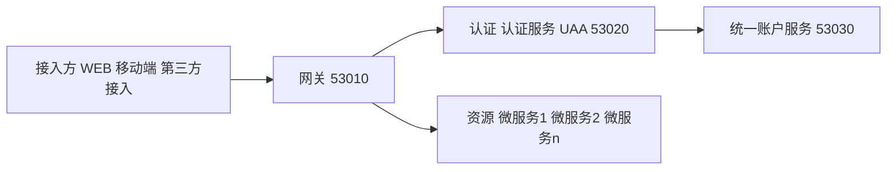
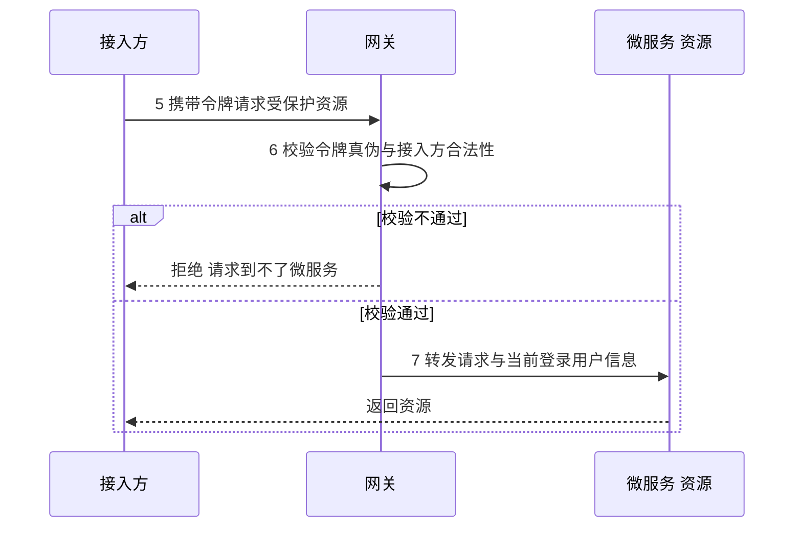

# 认证拦截功能需求分析：哪些请求必须带令牌，拦截为什么压在网关

登录功能收官时留了一个伏笔：令牌只证明了「你是谁」，还没回答「你能做什么」。用户中心还有 `Access token expired` 的处理逻辑在等着被触发，这些都要靠认证拦截功能来兑现。没有这一层，令牌就是一张没人查票的车票，登录与不登录访问资源毫无区别。动手写代码之前先把需求想透：哪些请求必须带令牌、拦截放在哪里做、网关要承担什么，这三问的答案决定了后面每一行代码的写法。

## 先给结论

- 架构图把全流程分两段：认证段四步已经实现；资源访问段三步，携带令牌请求、网关校验、转发微服务，正是本课要实现的需求。
- 微服务内部接口按 URL 规则分三类：`/my` 前缀的 C 端受保护接口、`/m` 前缀的 B 端受保护接口、无前缀的公开资源，令牌的有无由路径决定。
- 受保护接口不只要求带令牌，还要求令牌里的授权范围含 `read` 且接入客户端持有 `ROLE_CONSUMER`，判断依据是认证库 oauth_client_details 的登记数据。
- 校验放在网关做：所有请求必经之地，一份校验逻辑全平台复用；让每个微服务各自校验的方案因重复建设被否。
- 网关从此承担两件事：令牌解析并把当前登录用户信息转发给微服务；作为 OAuth2.0 资源服务器角色实现接入方权限拦截。

## 从令牌到拦截：架构图的后半段

认证架构图在需求分析时画过一次，当时的注意力集中在认证段：接入方提交账号密码请求认证，UAA 远程调用统一账户服务核对账号与接入客户端，校验通过签发令牌返回，四步走完，登录完成。令牌到手不是终点，拿令牌的目的是「闯天下」：此后访问任何受保护的微服务资源，都必须随身携带这张通行证。架构图的后半段画的正是这件事，整张图的结构如下。



网关居中，左接所有接入方，右侧分出认证与资源两大块：认证块里 UAA 依赖统一账户服务核对账号；资源块里一群微服务提供功能与数据。后半段的三步流程落在网关与资源之间。



这三步就是认证拦截功能的需求本体：第五步约定接入方必须带令牌，第六步是网关的校验动作，第七步是校验通过后的放行与转发。读图要点在 alt 分支：校验不通过的请求在网关层就被拒绝，根本到不了微服务，这正是「拦截」二字的含义。

## 需求一：URL 三分类，令牌的有无由路径决定

要拦截就得先说清拦谁、放谁。平台的约定是给微服务内部接口按前缀分三类，规则如下：

| 分类 | URL 格式 | 访问要求 |
|---|---|---|
| 受保护的 C 端用户接口 | `/服务名称/my/资源名称/*` | 必须携带 C 端用户认证获取的 Access Token |
| 受保护的 B 端管理员接口 | `/服务名称/m/资源名称/*` | 必须携带 B 端用户认证获取的 Access Token |
| 公开资源 | `/服务名称/资源名称/*` | 无限制 |

以用户中心为例，一个发往 `/consumer/my/**` 的请求，接入客户端的授权范围要含 `read`，authorities 里要含 `ROLE_CONSUMER`，这组数据与 oauth_client_details 表的登记一一对应。前缀即规则的好处是拦截判断不依赖任何业务语义，网关扫一眼路径就知道该不该拦、要什么权限；接口在定义阶段就要按前缀命名，规范从 Controller 的映射写起。

公开资源同样要有明确清单，前端请求封装里的免登录白名单与它一一呼应：

```javascript
// utils/request.js 节选：无令牌也可发出的请求，全部对应后端公开资源
if (url === 'uaa/oauth/token' ||
    url === 'account/sms' || url.search('account/sms/') == 0 ||
    url === 'account/mobiles' || url.search('account/mobiles/') == 0) {
    state = false   // 不做登录态检查
}
```

获取令牌、发送验证码、校验手机号这三类请求发生在认证之前，用户手里还没有令牌，它们必须落进公开资源一类，否则登录本身就会被拦截器挡住，形成死循环。白名单与 URL 三分类是同一个设计在前端与网关两侧的两次落地。

## 需求二：拦截放在网关，两个方案比一比

校验令牌这件事交给谁做，动工前必须论证。方案一是让微服务各自校验：请求转发到哪个微服务，哪个微服务自己验令牌。推演一遍就能看出毛病，用户中心的请求要校验，后续的投标、放款、还款每个微服务都得各写一遍校验逻辑，校验规则一旦调整，所有服务跟着改，重复建设且难维护。

方案二是把校验压在网关。项目采用前后端分离架构，前端发出的所有请求都必须经过网关，这个「必经之地」的位置正是为校验准备的：请求在入口处验一次，通过后放行到任意微服务，全平台一份校验逻辑，一处维护。本项目选方案二，网关在认证授权体系里从此承担两件事：

**第一，令牌解析并转发用户信息。** 校验通过意味着令牌可信，网关顺手把当前登录用户的信息从令牌里取出来放进请求，转发给下游微服务。微服务拿到请求就能知道操作者是谁，不需要再查库，更不需要自己再解一次令牌。

**第二，作为 OAuth2.0 资源服务器角色实现接入方权限拦截。** OAuth2.0 的角色模型里，网关在这一层扮演资源服务器，按 URL 三分类的规则逐个定义拦截配置：哪个前缀要求什么授权范围、什么客户端权限，`/my/**` 这类表达式写进配置类，`denyAll`、`permitAll` 控制完全禁止与完全放行，框架按规则机械执行。同框架网关工程里这类配置的真实写法如下：

```java
// 网关按微服务逐个定义资源服务器拦截规则，写法与同框架归档工程一致
http.sessionManagement()
        .sessionCreationPolicy(SessionCreationPolicy.IF_REQUIRED)
        .and()
        .authorizeRequests()
        .antMatchers("/consumer/druid/**").denyAll()
        // 受保护的 C 端接口：授权范围含 read 且接入客户端持有 ROLE_CONSUMER
        .antMatchers("/consumer/my/**")
            .access("#oauth2.hasScope('read') and #oauth2.clientHasRole('ROLE_CONSUMER')")
        // 其余路径公开放行
        .antMatchers("/consumer/**").permitAll();
```

这一段配置回答了「校验什么」：`hasScope` 验授权范围，`clientHasRole` 验接入客户端的权限，两者都来自令牌载荷，与 oauth_client_details 的登记同源。网关验的是接入方合法性与令牌真伪两件事，用户级的细粒度授权在后续阶段再往这套底座上加盖。

## 网关现状与要补的拼图

需求清楚了，对照网关现状看差距。网关工程目前只有路由转发与跨域配置，启动类上 `@EnableZuulProxy` 管转发，配置类里注册了全局 CORS 过滤器，讲义对它的评价很直白：目前只是做了路由转发，并没有起到真正网关的作用，现在终于有了用武之地。要补的拼图按清单列出来：工程新增 Spring Security 整合 OAuth2.0 与 JWT 相关依赖；从资料中拷入资源服务器配置、令牌转换器、拒绝处理器等一组配置类；Apollo 上按资源服务器的口径补充网关配置。这些属于实现层面的动作，按环境准备、功能实现、功能测试的节奏分课推进，本课只把需求钉牢。

## 常见误区

- **把拦截做进微服务。** 错例：在用户中心的控制器或过滤器里写令牌校验，认为服务自己管自己更内聚。正解：所有请求必经网关，校验在网关做一次，微服务只消费网关转发来的用户信息，重复校验是重复建设。
- **公开资源也被拦下。** 错例：把获取验证码的请求也纳入拦截，用户没登录收不到验证码，登录死循环。正解：认证之前的接口按公开资源一类放行，前端的免登录白名单与网关的放行规则必须对齐。
- **只验令牌真伪不验接入方权限。** 错例：令牌验签通过就放行，任何客户端凭合法令牌都能访问全部微服务。正解：真伪之外还要按 URL 规则检查授权范围与客户端权限，令牌合法不代表这个接入方有权访问这个资源。
- **受保护前缀想用就用，接口定义不守规范。** 错例：新接口随手命名，网关规则配好了路径却对不上。正解：URL 三分类是接口定义阶段的硬约定，Controller 映射按 `/my`、`/m` 前缀写，网关配置才有路径可拦。

## 面试可能被问到的问题

1. 面试官追问：「令牌校验为什么放在网关，而不是让每个微服务自己校验？」
   答：微服务各自校验意味着每个服务重复实现一遍校验逻辑，规则调整时要全量修改。网关是所有请求的必经之地，入口校验一次即可放行到任意微服务，一份逻辑一处维护，位置天然合适；校验不通过的请求在网关层就被拒绝，微服务收到的请求默认可信。
2. 面试官追问：「接口按 /my 与 /m 前缀分类的设计有什么好处？」
   答：拦截判断退化为纯路径匹配，不依赖业务语义，网关用 antMatchers 表达式就能定义规则，配置清晰且零业务代码。同时它把权限要求写进了 URL 本身，C 端与 B 端接口一眼可辨，接口定义阶段遵守命名约定即可被体系自动保护。
3. 面试官追问：「网关作为 OAuth2.0 资源服务器是什么意思？」
   答：OAuth2.0 里资源服务器托管受保护资源，负责验证访问令牌并执行权限判断。网关把微服务群挡在身后，以资源服务器角色统一验证令牌真伪、授权范围与接入客户端权限，stateless 配置下不保留会话状态，每次请求都凭令牌说话，天然适配微服务横向扩容。
4. 面试官追问：「网关校验通过后，下游微服务还需要再做校验吗？」
   答：常规业务不需要，网关已验真伪与接入方权限，并把当前登录用户信息随请求转发，微服务直接取用。但涉及资金操作这类高敏感接口，服务端按纵深防御原则仍可做二次校验，多一层防线不是重复建设，边界由安全等级决定。
5. 面试官追问：「令牌校验和用户权限判断是不是一回事？」
   答：不是。令牌校验解决认证问题，证明这个请求来自合法登录且令牌未被伪造篡改；权限判断解决授权问题，决定这个身份能访问哪些资源。本项目的网关两者都做：真伪与有效期靠验签与令牌服务，接入方权限靠 URL 规则与令牌里的权限标识匹配。

## 配套资料

- 讲义：`materials/docs/10/万信金融-第2章-讲义-开户v1.0.md`，「认证拦截功能实现」的需求分析小节，网关两项职责、URL 三分类规则与 `/my/**` 权限表达式的出处。
- 代码：`materials/code/10/代码/shanjupay-gateway/`，同框架网关工程归档（目录保留原始命名，路径列到该层级），`ResouceServerConfig` 按微服务逐个定义资源服务器拦截规则、`AuthFilter` 为令牌信息转发过滤器，正文配置片段出自其中的用户中心相关写法。
- 代码：`materials/code/10/wanxinp2p/`，P2P 工程归档（目录保留原始命名，路径列到该层级），网关模块启动类与路由底稿为现状依据。
- 代码：`materials/code/10/wanxinp2p_front/`，前端 uni-app 工程归档（内层为同名目录），`utils/request.js` 的免登录白名单是公开资源清单在前端的对应实现。
- 说明：本课为需求分析课，仓库未归档独立的 PPT 页面与拦截实现代码；网关依赖清单与配置类拷入清单出自讲义，正文拦截规则示例按同框架归档工程的写法结合 `com.study.finance` 包名口径整理。
