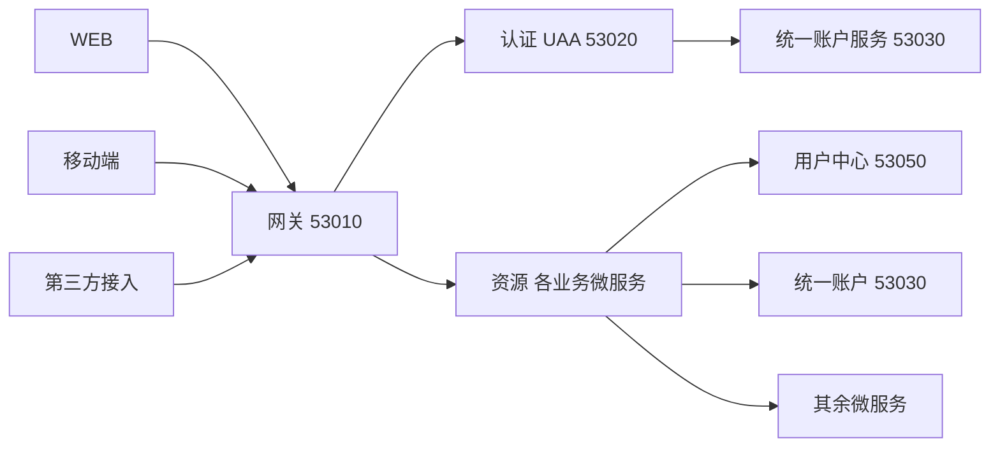

# 认证拦截功能环境准备：把网关补成资源服务器

网关工程此前只干一件事：按路径前缀把请求转发给对应的微服务。认证体系接进来之后，它的职责清单变长了。需求分析已经明确，网关要在 P2P 认证授权体系里负责两件事：校验令牌的真伪，校验接入方的权限。这两件事都依赖 Spring Security 整合 OAuth2.0，与 UAA 用的是同一套框架，于是熟悉的套路再次上演：框架相关的大部分代码由课程直接提供，动手实现之前，先把网关工程的环境准备到位。

## 先给结论

- 认证拦截功能落在网关工程实现，依赖 Spring Security OAuth2 与 JWT，需要给网关补齐 security、oauth2、jwt 相关依赖。
- 课程提供的配置类整体拷进网关 config 包：资源服务配置、JWT 配置、令牌转换器，外加两个错误响应处理器，拷入即可，不必逐行读懂。
- Apollo 路由配置与 `oauth_client_details` 客户端数据此前均已备好，按讲义核对即可；`authorities` 字段与拦截规则直接挂钩，值得再看一眼。
- OAuth2.0 语境里各业务微服务都是资源服务器，项目把它们的资源服务配置统一收拢到网关一个类里集中管理，新微服务接入时在这里加一段配置。
- 微服务接口按路径分三类：`/my/**` 保护 C 端接口、`/m/**` 保护 B 端接口、其余公开；l 前缀路径仅服务间内部调用。

## 依赖先行：给网关补框架包

认证拦截的执行者是 Spring Security OAuth2 的资源服务器组件，网关工程现有依赖里没有它们。打开网关工程的 pom 文件，对照讲义逐项核对：可能此前已经加过，也可能没有，有的不重复加，没有的补上。

```xml
<!-- Spring Security 整合 OAuth2.0：资源服务器能力从这里来 -->
<dependency>
    <groupId>org.springframework.cloud</groupId>
    <artifactId>spring-cloud-starter-security</artifactId>
</dependency>
<dependency>
    <groupId>org.springframework.cloud</groupId>
    <artifactId>spring-cloud-starter-oauth2</artifactId>
</dependency>
<dependency>
    <groupId>org.springframework.security</groupId>
    <artifactId>spring-security-jwt</artifactId>
</dependency>
```

注册中心客户端、Redis 等依赖网关此前已经具备，核对一遍确认在列即可。核对的意义不只是走流程：框架类依赖重复引入或版本不齐，报错往往滞后到启动那一刻才冒出来，先把依赖对齐能省一轮排查。

## 配置类拷进 config 包

讲义把要拷入网关 `config` 包的类连同职责列成了清单：

- `ResourceServerConfig`：Spring Security OAuth2 资源服务实现，用于网关对接入客户端的权限拦截，可以指定某个接入客户端只允许访问部分资源服务。
- `RestAccessDeniedHandler`：访问被拒时输出与平台整体风格一致的错误响应，无需深究。
- `RestOAuth2AuthExceptionEntryPoint`：认证未通过时输出统一风格的错误响应，同上。
- `JWTConfig`：配置 JWT 令牌的存储与转换方式，网关凭同一把签名密钥本地验签。
- `ClientDefaultAccessTokenConverter`：明文令牌与 Spring Security 认证对象的相互转换，并补充对客户端权限的支持。

拷贝动作本身没有技术含量，从资料文件夹选中这几个类，粘到网关工程的 `config` 包里，打开确认没有标红报错就算就位。这些代码暂时不必读懂，讲到具体功能时再回来看对应的部分。

## 核对两处既有配置

依赖与配置类就位后，还有两类配置要按讲义要求检查，它们大概率在此前的课程里已经配好。

**第一处是 Apollo 上的网关路由配置。** 网关要把请求转发到哪个微服务，靠路由规则决定，`/uaa/**` 转给 UAA、`/consumer/**` 转给用户中心这些条目在接入各微服务时陆续配过。归档的网关工程配置里可以看到路由的写法：

```properties
# 关闭自动路由匹配 全部手动声明 更安全
zuul.ignoredServices=*
# 用户中心路由 /consumer/** 前缀的请求转发到 consumer-service
zuul.routes.consumer-service.path=/consumer/**
zuul.routes.consumer-service.stripPrefix=false
```

Apollo 上没有配的条目补上，配过的核对无误即可。

**第二处是认证库的客户端登记数据。** `p2p_uaa` 库的 `oauth_client_details` 表此前在集成 UAA 时已经导入了登记数据，本课不用动它，但表里的 `authorities` 字段要留意：它是客户端携带的权限列表，稍后网关配置拦截规则时写的那些角色，正是照着这列数据来的，两边必须能对上。

## 资源服务器为什么集中放进网关

拷进来的配置类里最核心的是 `ResourceServerConfig`，看懂它的结构，网关这轮改造的思路就全明白了。类上有 `@Configuration`，内部又套了若干个配置类，每个内部类对应一个微服务，整体骨架如下：

```java
package com.study.finance.gateway.config;

@Configuration
public class ResourceServerConfig {

    public static final String RESOURCE_ID = "finance-resource";

    private AuthenticationEntryPoint point = new RestOAuth2AuthExceptionEntryPoint();
    private RestAccessDeniedHandler handler = new RestAccessDeniedHandler();

    /**
     * 用户中心 资源拦截
     */
    @Configuration
    @EnableResourceServer
    public class ConsumerServerConfig extends ResourceServerConfigurerAdapter {

        @Autowired
        private TokenStore tokenStore;

        @Override
        public void configure(ResourceServerSecurityConfigurer resources) {
            resources.tokenStore(tokenStore).resourceId(RESOURCE_ID).stateless(true);
            resources.authenticationEntryPoint(point).accessDeniedHandler(handler);
        }

        @Override
        public void configure(HttpSecurity http) throws Exception {
            http.sessionManagement()
                    .sessionCreationPolicy(SessionCreationPolicy.IF_REQUIRED)
                    .and()
                    .authorizeRequests()
                    .antMatchers("/consumer/druid/**").denyAll()
                    .antMatchers("/consumer/my/**").access(
                            "#oauth2.hasScope('read') and #oauth2.clientHasRole('ROLE_CONSUMER')")
                    .antMatchers("/consumer/m/**").access(
                            "#oauth2.hasScope('read') and #oauth2.clientHasRole('ROLE_ADMIN')")
                    .antMatchers("/consumer/**").permitAll();
        }
    }
}
```

**先解释资源服务器这个角色。** OAuth2.0 体系里，UAA 充当认证服务器，负责发令牌；持有受保护资源、接收令牌并校验令牌的一方叫资源服务器。对照平台架构，后端各个微服务，用户中心、统一账户等等，全都是资源服务器。按 Spring Security OAuth2 的规矩，谁要当资源服务器，谁就得带上 `@EnableResourceServer` 注解并写一段资源服务配置。

**再解释为什么这段配置不放微服务自己那里。** 注解和配置类完全可以分散写到各个微服务工程里，consumer 的一段、account 的一段，功能上一模一样。问题是配置散落后管理不便，改一条规则要动好几个工程。平台采取的策略是把所有微服务的资源服务配置全部抽出来，集中放到网关的一个类里，一个内部类管一个微服务。将来新增微服务，就在这个类里再加一个内部类，把它的路径前缀和权限规则补进去，管理动作收敛到了一个位置。

**权限规则的写法有讲究。** 每个内部类的 `configure(HttpSecurity)` 里按 `antMatchers` 从具体到宽泛依次声明：`/my/**` 要求 C 端角色与 read 权限，`/m/**` 要求 B 端管理员角色与 read 权限，最后一条宽泛匹配直接放行。拦截拒绝时分别交给两个错误响应处理器，输出与平台统一响应结构一致的 JSON，前端拿到的是能正常解析的报错，不是一堆框架默认的错误页。至于 l 前缀的路径，那是平台约定的服务间内部接口，不面向前端暴露，网关没有为它们配置权限要求，只有微服务之间远程调用时才会走到。

把平台认证架构与网关在其中的位置画出来：



图里网关承上启下：接入方的所有请求先到网关，网关凭拷入的配置类对接入方做权限校验、对令牌做验签，两道关都过了才谈得上把请求送给后面的资源服务器。本课环境准备到位后，这两道校验的代码其实已经在工程里了，它们如何运转、还要补什么，下一课展开。

## 常见误区

- **权限规则的声明顺序写反。** 错例：把 `.antMatchers("/consumer/**").permitAll()` 放在 `/my/**`、`/m/**` 规则前面，宽泛匹配先命中，受保护接口全被放行，拦截形同虚设。正解：从具体到宽泛依次声明，兜底的 `permitAll` 必须放在最后。
- **以为资源服务配置要分散到每个微服务。** 错例：往 consumer、account 各工程里分别加资源服务配置类，改规则时来回切换工程。正解：平台把资源服务配置集中收拢在网关的 `ResourceServerConfig` 里，一个内部类管一个微服务，统一改、统一看。
- **重复添加已有依赖。** 错例：不核对 pom 直接把讲义依赖整段粘贴，与既有依赖重复，引入冲突隐患。正解：先检查网关工程现有依赖清单，缺什么补什么。
- **忽略 `authorities` 字段与拦截规则的对应关系。** 错例：拦截规则里随手写角色名，与 `oauth_client_details` 登记的权限对不上，合法客户端也被拒。正解：规则里的角色与 scope 照客户端登记表来写，两边保持一致。

## 面试可能被问到的问题

1. 面试官追问：「网关在认证授权体系里负责哪两件事？」
   答：一是校验令牌真伪，凭与 UAA 同一把签名密钥本地验签，不用每次回源认证服务；二是校验接入方权限，按请求路径匹配拦截规则，核对接入客户端的 scope 与角色。两道校验都通过，请求才会被转发到受保护的微服务。
2. 面试官追问：「什么是 OAuth2.0 里的资源服务器，这个项目里谁是？」
   答：资源服务器是持有受保护资源、负责接收并校验令牌的一方，与认证服务器相对。项目里 UAA 是认证服务器，其余业务微服务全是资源服务器；它们的资源服务配置统一收拢在网关，集中管理。
3. 面试官追问：「为什么把各微服务的资源服务配置抽到网关统一放？」
   答：分散配置功能上可行，但规则散落在多个工程里，维护时容易漏改、错改。收拢到网关一个类里，按微服务划分内部类，新增或调整规则只动一个位置，管理成本明显降低，这也是配置集中化思想的一次落地。
4. 面试官追问：「平台的接口路径为什么约定 /my、/m 前缀分类？」
   答：为了便于网关按统一规则拦截。/my 前缀是 C 端用户登录后才能访问的接口，/m 前缀是 B 端管理员登录后才能访问的接口，其余是公开资源。网关据此为三类路径分别配置权限表达式，开发 Controller 时按业务归属选前缀即可。
5. 面试官追问：「网关校验令牌为什么不需要调用 UAA？」
   答：令牌是 JWT，签发时用对称签名密钥加了签。网关通过配置注入同一把密钥构建 JwtTokenStore 与令牌转换器，本地即可完成验签与载荷解析，既省了一次远程调用，也避免了认证服务成为全链路的单点瓶颈。

## 配套资料

- 讲义：`materials/docs/10/万信金融-第2章-讲义-开户v1.0.md`，「认证拦截功能实现」的环境准备小节：依赖清单、网关 config 包配置类职责、接口三分类与拦截规则出处。
- 代码：`materials/code/10/代码/shanjupay-gateway/`，同框架网关工程归档（目录保留原始命名，路径列到该层级），`ResouceServerConfig` 的多内部类结构、`JWTConfig`、`ClientDefaultAccessTokenConverter`、两个错误响应处理器均为真实实现，正文代码片段与之同构。
- 代码：`materials/code/10/wanxinp2p/`，P2P 工程归档（目录保留原始命名，路径列到该层级），网关工程的启动类、Zuul 路由配置（`zuul.routes.consumer-service.path=/consumer/**` 等）出自其中的 `application.properties`。
- 讲义：`materials/docs/10/万信金融-生产环境-部署文档.md`，服务端口表：注册中心 53000、网关 53010、UAA 53020、统一账户 53030、用户中心 53050。
- 说明：万信网关改造后的完整 `ResourceServerConfig` 源码未在仓库归档，正文 consumer 内部类按视频画面线与讲义整理，包名按 `com.study.finance` 系改写，资源标识与客户端密钥均为占位示例。
