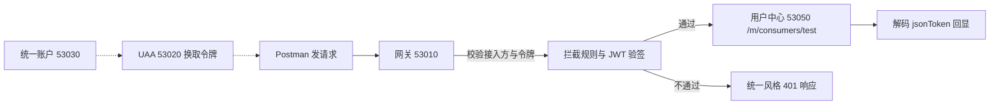
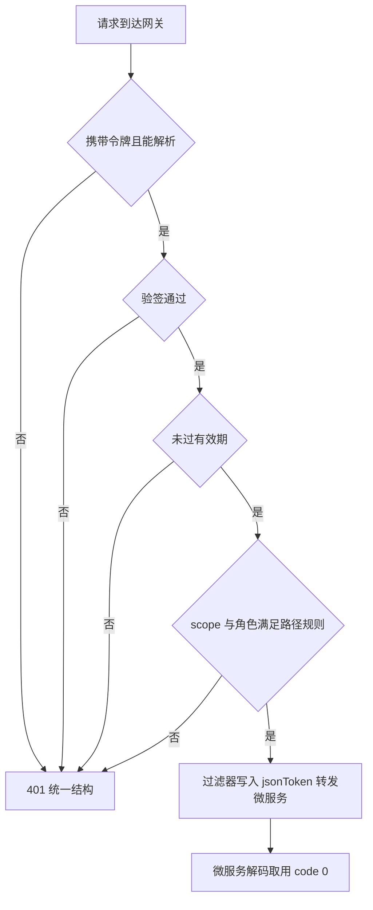

# 认证拦截功能测试：从搭台到正反用例实测

> 🔒 安全提示：文中示例的口令/密钥均为课程教学环境演示口径，生产环境的安全要求见《安全与合规须知》。

认证拦截的代码已经就位，但代码写完不等于功能可用，测试才是验收的标尺。这次测试有个先天的难点：拦截逻辑大半藏在框架里，网关里没有一段看得见的 if else 供人检查，能直接观察的只有请求的进出与响应的样子。好在网关校验通过后会把用户信息随转发请求递出去，我们只要在微服务侧把这条数据接住并回显，整条链路的通与不通就能自己说话。测试分两步走：先搭台，在用户中心补一个受保护的测试接口；再实测，用有效令牌、无令牌、篡改令牌、过期令牌四类输入把网关的两道关卡正反两面试个遍。

## 先给结论

- 拦截差异只在受保护路径上能体现，测试必须挑 `m` 或 `my` 开头的接口；结合库中现有数据选了 `m` 开头的 B 端接口。
- 用户中心现有接口都是公开路径，为测试在 `ConsumerController` 新增受保护方法 `/m/consumers/test`，把网关转发来的 `jsonToken` 解码后原样回显。
- 请求必须过网关 53010，令牌以 `access_token` 为参数名跟在 URL 查询串里，参数名不能自造。
- 正用例返回 code 0 与一串用户数据；无令牌、篡改令牌、过期令牌三类反用例全部被拒，响应统一为 401。
- 测试数据要与表对得上：接入客户端要带 `ROLE_ADMIN` 权限，登录账号要是 B 端，令牌过了有效期就重新登录换新。

## 测试对象选谁：受保护路径才测得出东西

用 Postman 随便挑一个接口发请求固然也能得到响应，但那样的测试毫无效度。公开资源没有任何访问限制，任何接入方都能调，发一百次也检验不出拦截功能是否存在。要检验拦截，就必须挑受保护的路径，让规则有机会说「不」。

平台对微服务接口的三分类此时派上用场：`/my/**` 是受保护的 C 端接口，`/m/**` 是受保护的 B 端接口，其余是公开资源。网关拦截规则里，`/consumer/m/**` 这条的表达式要求接入客户端持有 read 权限范围，并且带 `ROLE_ADMIN` 角色：

```text
/consumer/m/**  ->  #oauth2.hasScope('read') and #oauth2.clientHasRole('ROLE_ADMIN')
```

那么用哪个客户端、哪个账号去测，答案不在代码里，在数据库里。认证库 `oauth_client_details` 登记的接入客户端中，只有管理端那一行的 `authorities` 列包含 `ROLE_ADMIN`，此前登录功能实测换令牌时用的正是这条登记数据；账户表里的测试账号 admin 是 B 端账号，用户域为 b。数据摆在这里，测试对象自然就定了：挑 `m` 开头的路径，用管理端客户端换令牌，用 B 端账号登录，三方数据环环对应。

## 搭台：用户中心补一个受保护资源方法

对象定了，新的问题来了：用户中心现有代码里根本没有 `m` 开头的接口。归档的 `ConsumerController` 里只有两个老面孔：

```java
package com.study.finance.consumer.controller;

@RestController
@Api(value = "用户服务的Controller", tags = "Consumer", description = "用户服务API")
public class ConsumerController {

    @ApiOperation("测试hello")
    @GetMapping(path = "/hello")
    public String hello() {
        return "hello";
    }

    @ApiOperation("测试hi")
    @ApiImplicitParam(name = "name", value = "姓名", required = true, dataType = "String")
    @PostMapping(value = "/hi")
    public String hi(String name) {
        return "hi," + name;
    }
}
```

`/hello` 与 `/hi` 都落在公开资源的宽泛匹配里，测不出拦截。为测试专门在类里新增一个受保护的资源方法，讲义对此的定位说得很清楚：新定义一个受保护资源方法用来测试，方法本身不做任何业务，只负责接收网关转发过来的数据，解析后响应回去：

```java
/**
 * 过网关受保护资源 进行认证拦截测试
 * m 前缀路径 B 端管理员登录后才可访问
 */
@ApiOperation("测试受保护资源")
@ApiImplicitParam(name = "jsonToken", value = "访问令牌", required = true, dataType = "String")
@GetMapping(value = "/m/consumers/test")
public RestResponse<String> testResources(String jsonToken) {
    // 网关转发时对用户信息做了 Base64 编码 这里做相反操作还原明文
    return RestResponse.success(EncryptUtil.decodeUTF8StringBase64(jsonToken));
}
```

方法的参数名 `jsonToken` 与网关过滤器写入转发请求时用的键名严格一致，这是两端约定。网关把用户信息转 JSON、Base64 编码后放进查询参数转发过来，微服务这边做一次相反的解码，还原出明文 JSON 直接放进响应。方法体一行核心代码，价值却很高：请求若能走到这里并带回用户数据，说明网关两道校验、过滤器递送、路由转发全部工作正常；数据若是缺了错了，回显的内容就是最直接的诊断线索。

## 台前清点：要起的服务与要对的数据

服务启动清单每次测试都要过一遍，这次的答案与登录功能实测时不同，差别就在用户中心要不要起。

必起的有六个：Apollo 配置中心；注册中心 53000；统一账户服务 53030，UAA 校验账号密码要远程调它；UAA 53020，换取令牌的入口；网关 53010，所有被测请求的必经之路；用户中心 53050，这次非起不可，因为受保护的测试方法就定义在它的 Controller 里，服务不起，请求转发过去就是无米之炊。

数据侧核对两处：`p2p_uaa` 库 `oauth_client_details` 里管理端客户端那一行，`authorities` 列含 `ROLE_ADMIN`，五种授权模式包含 `password`；`p2p_account` 库账户表里的 admin 账号，`domain` 列登记为 b。MySQL 本机连接用的是 root 账号、密码 123456，查表核对即可。测试服务与请求的流转关系如下图：



虚线部分是登录取令牌的环节，实线部分是被测的拦截链路，两者在 Postman 里先后发生。

## 用例一：有效令牌，一路绿灯

**先解决令牌从哪来的问题。** 此前登录实测拿到的令牌放置已久，访问令牌的有效期在 UAA 令牌服务里配置为 7200 秒，两个多小时一过，旧令牌就是一张废票。所以测试第一步是重新登录：用管理端客户端的登记数据，走表单参数向令牌端点发请求，授权类型 password，账号 admin、密码 123456、用户域 b，拿到一枚崭新的 `access_token` 复制备用。

**再发被测请求。** 在 Postman 里新建请求，归入用户中心目录，命名为认证拦截测试。请求地址按讲义给的格式拼装：

```bash
# 过网关访问用户中心的受保护资源
GET http://localhost:53010/consumer/m/consumers/test?access_token=<此处粘贴新令牌>
```

三段各有讲究：53010 说明请求过网关而不是直连用户中心；`/consumer` 前缀是网关路由用户中心的匹配路径，网关会按它找到目标服务；`/m/consumers/test` 才是用户中心里那个测试方法的映射。参数名 `access_token` 是框架认的固定写法，写成别的名字，框架读不到令牌，效果等同于无令牌。

**看响应。** 发送后返回平台统一结构，code 为 0，result 是解码还原出来的用户信息字符串：

```json
{
  "code": 0,
  "message": null,
  "result": "{\"grant_type\":\"password\",\"client_id\":\"finance-web-admin\",\"domain\":\"b\",\"authenticationType\":\"password\",\"user_name\":\"admin\",\"mobile\":\"13800000000\",\"scope\":[\"read\"]}"
}
```

逐项核对着看：`user_name` 是登录账号，`client_id` 是换令牌的接入客户端，`mobile` 是用户手机号，`scope`、`grant_type` 这些来自登录时的请求参数。这份内容正是网关过滤器从认证上下文里整理出来的那份 Map，转 JSON、编码、转发、解码，一路无损耗。字段里眼下用得上的还不多，暂时空着不处理，后续功能需要哪个再取哪个，回显的价值在于证明数据完整送达，而不是立刻全量消费。到这里，请求路径上 `m` 开头受保护接口、带 `ROLE_ADMIN` 的客户端、有效令牌三个条件全部满足，网关两道关卡放行，链路完整走通。

## 用例二：无令牌，当场被拒

正用例证明「该进的能进」，反用例要证明「不该进的进不来」。最基础的反用例是什么都不带：把 `access_token` 参数整个删掉，直接向同一个地址发请求。

预期结果是响应码 401。推导一下网关里发生的事：请求没有令牌，框架完成不了认证，安全上下文里没有认证对象，过滤器判空后直接返回，不写入任何用户信息；请求继续走到拦截规则，`/m/consumers/test` 命中受保护路径的表达式，而当前请求连认证都没有，权限核对无从谈起。此时接管响应的是认证入口点，归档的真实实现如下：

```java
package com.study.finance.gateway.config;

public class RestOAuth2AuthExceptionEntryPoint extends OAuth2AuthenticationEntryPoint {
    @Override
    public void commence(HttpServletRequest request, HttpServletResponse response,
                         AuthenticationException e) throws IOException, ServletException {
        // 认证未通过 输出平台统一结构的 401 与失败原因
        RestResponse restResponse = new RestResponse(HttpStatus.UNAUTHORIZED.value(), e.getMessage());
        HttpUtil.writerError(restResponse, response);
    }
}
```

它继承框架的认证入口点，把 401 状态与失败原因包装成 `RestResponse` 写回，前端拿到的不是框架默认的错误页，而是平台统一的 JSON 结构：

```json
{
  "code": 401,
  "message": "具体失败原因随场景不同"
}
```

这正是环境准备阶段拷入的那两个错误响应处理器存在的意义：拒绝也要拒得有礼貌，格式与业务响应一致，前端按统一方式解析即可。

## 用例三：篡改令牌，验签不过

第二类反用例针对令牌本身的真实性。拿一枚有效令牌，随手删掉中间几个字符，或者改掉一段，再发请求。

结果仍是 401。JWT 令牌第三段是签名，签发时用签名密钥对头部与载荷计算而来；令牌被改动后，网关本地用同一把密钥重新验签，计算结果与令牌携带的签名对不上，直接判为非法令牌，抛出令牌无效异常，入口点接管输出统一 401。这个用例背后的安全逻辑值得展开一句：攻击者想伪造或篡改载荷，必须同时拿到签名密钥才能让签名重新对上，而密钥只在服务端配置里，改几个字符就想过关，在数学上不成立。有效期校验同样发生在这一层，解析出的过期时间早于当前时间即判过期，两者都在网关本地完成，不产生任何远程调用。

## 用例四：过期令牌，时限不认人情

第三类反用例最省事，因为素材是现成的：测试开始前那次重新登录，恰恰说明旧令牌已经过期，把它从历史请求里翻出来再发一次，就是一个标准的过期令牌用例。

结果同样是 401。令牌有效期为 7200 秒，过期后无论令牌本身保存得多完整、签名多正确，时间一栏过不了关，框架按令牌过期处理，响应统一被入口点包装。四种用例的输入与预期汇总成一张表：

| 用例 | 请求输入 | 网关行为 | 预期响应 |
|---|---|---|---|
| 有效令牌 | 新令牌 + 受保护路径 | 验签通过、核对权限、写入 jsonToken 并转发 | code 0，回显用户信息 |
| 无令牌 | 删除 access_token 参数 | 无认证对象，受保护路径拒绝 | 401 统一结构 |
| 篡改令牌 | 改动令牌部分字符 | 验签不通过 | 401 统一结构 |
| 过期令牌 | 使用超期旧令牌 | 有效期比对失败 | 401 统一结构 |

四个用例合起来，把网关认证拦截的需求完整覆盖了一遍：合法请求畅通，四类非法输入各有各的失败点，但收敛到同一个出口。整条判定链路画出来是这样的：



图上四个菱形就是四类用例各自的落点，任何一个判断不过关，都汇入同一个 401 出口，这正是统一入口点存在的原因。

## 测试之外，两条值得带走的纪律

**第一，测试数据必须与表对上。** 这次测试从头到尾都在对数据：客户端要在 `oauth_client_details` 里带 `ROLE_ADMIN`，账号要在账户表里是 B 端，路径前缀要匹配对应的权限表达式。任何一处错位，比如拿只有 C 端角色的客户端去访问 `m` 开头接口，得到的都是 401，而代码没有任何问题。集成测试的排障顺序里，查数据永远排在改代码前面。

**第二，令牌是有寿命的消耗品。** 有效期机制决定了测试用例之间有时序依赖：新令牌在手尽快测，放置超时就得重登。生产环境的用户体验靠刷新令牌续命，开发环境的测试则靠勤换令牌，理解了有效期配置，这类「昨天还好好的今天就 401」的现象就不再神秘。

## 常见误区

- **拿公开接口测拦截。** 错例：用 `/consumer/hello` 验证认证拦截，永远返回正常，误以为功能没生效。正解：公开路径在拦截规则里被兜底放行，测试必须挑 `my` 或 `m` 开头的受保护接口。
- **令牌参数名自造。** 错例：把参数写成 `token`，框架按 `access_token` 读取，读不到等同于无令牌，得到 401 还以为令牌坏了。正解：过网关访问受保护资源时参数名固定为 `access_token`。
- **直连微服务测受保护资源。** 错例：请求直接发往用户中心 53050 的 `/m/consumers/test`。正解：拦截发生在网关，绕过网关等于绕过考场，集成测试必须走 53010。
- **令牌过期了反复调接口。** 错例：拿到 401 后反复重发同一枚旧令牌。正解：先确认令牌是否过了有效期，过期就重新登录换新，再谈别的排查。

## 面试可能被问到的问题

1. 面试官追问：「认证拦截功能怎么证明它真的生效了？」
   答：设计正反两组用例。正用例带有效令牌访问受保护路径，返回 code 0 并能回显网关转发的用户信息；反用例分别输入无令牌、篡改令牌、过期令牌，全部得到统一的 401。正反两面都对上，才能说校验、放行、拒绝三条路径都按设计工作。
2. 面试官追问：「为什么无令牌和篡改令牌的响应都是 401，网关怎么区分？」
   答：对客户端呈现统一结构，失败原因体现在 message 里。内部路径不同：无令牌是安全上下文里没有认证对象，走认证入口点；篡改令牌是验签不通过，抛令牌无效异常。统一出口让前端只按一种格式解析，内部原因留有痕迹可查。
3. 面试官追问：「篡改 JWT 令牌为什么过不了网关的校验？」
   答：JWT 第三段签名是服务端用签名密钥对头部与载荷计算的结果，网关持同一把对称密钥本地重算比对，任何字符改动都会使签名对不上。攻击者拿不到密钥就无法伪造出能通过验签的令牌，这是令牌防篡改的核心。
4. 面试官追问：「测试时挑选接口的依据是什么？」
   答：看拦截规则覆盖哪些路径。受保护的 `my`、`m` 前缀路径上配置了权限表达式，只有它们能触发拦截逻辑；公开路径被兜底放行，测不出差异。同时用例的数据要与库对齐，客户端权限、账号用户域、路径前缀三者一致才能构造出有效正用例。
5. 面试官追问：「令牌过期导致的 401 和权限不足导致的 401，客户端应该怎么处理？」
   答：过期 401 应触发刷新令牌或引导重新登录，拿到新令牌后原请求可以重发；权限不足 401 是接入方越权访问，重试无意义，应提示用户无权操作。客户端区分两者要看响应 message 与令牌自身的过期时间，而不是只看状态码。
6. 面试官追问：「测试前如何确定要启动哪些服务？」
   答：沿着请求链路数：换令牌要 UAA 与它依赖的统一账户，被测请求要过网关，测试方法所在的用户中心必须在线，配置与注册中心是所有服务的前置。链路上没有的服务不起，既省资源也缩小排障范围。

## 配套资料

- 讲义：`materials/docs/10/万信金融-第2章-讲义-开户v1.0.md`，「认证拦截功能实现」的功能测试小节：受保护测试方法、`access_token` 参数约定、请求地址格式与正反用例说明。
- 代码：`materials/code/10/wanxinp2p/`，P2P 工程归档（目录保留原始命名，路径列到该层级），用户中心 `ConsumerController` 的 `/hello`、`/hi` 接口为真实实现，`wanxinp2p-common` 的 `EncryptUtil` 解码方法真实可用。
- 代码：`materials/code/10/代码/shanjupay-gateway/`，同框架网关工程归档（目录保留原始命名，路径列到该层级），`RestOAuth2AuthExceptionEntryPoint`、`RestAccessDeniedHandler` 为认证失败统一响应的真实实现。
- 讲义：`materials/docs/10/万信金融-生产环境-部署文档.md`，服务端口表：网关 53010、UAA 53020、统一账户 53030、用户中心 53050。
- 说明：测试方法的完整源码与 Postman 用例文件未在仓库归档，正文按视频画面线与讲义整理；包名按 `com.study.finance` 系改写，令牌样例、客户端标识、手机号均为占位示例，测试账号与客户端登记取自课程提供的测试数据。
