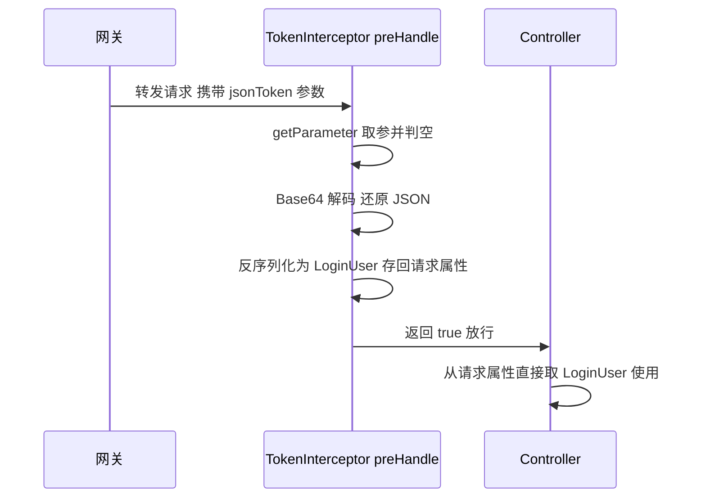

# 微服务从请求中取数据：一个拦截器喂饱所有 Controller

网关把 `jsonToken` 放进转发请求之后，认证拦截还差最后一环：请求到了微服务，当前登录用户的信息怎么取出来用。取数动作本身不难，`request.getParameter` 一行的事，真正要花心思的是设计。一个微服务里往往有三四个 Controller，业务上都可能用到当前用户，取数代码写在每个方法里就是成倍的重复。这一课用 Spring MVC 的拦截器把取数动作收拢到一处，Controller 需要时直接拿现成的对象。

## 先给结论

- 取数代码用 Spring MVC 拦截器实现一次，所有 Controller 复用，避免在多个方法里重复编码。
- 拦截器类 `TokenInterceptor` 实现 `HandlerInterceptor` 接口，重写 `preHandle` 方法，它先于 Controller 执行。
- 取参、Base64 解码、JSON 转对象三步之后，把 `LoginUser` 对象以原来的键名 `jsonToken` 存回请求属性，返回 true 放行。
- 拦截器必须经配置类向 Spring MVC 注册并拦截 `/**` 全部路径，不注册就等于白定义。
- 其他微服务需要同样能力时，把拦截器与配置类两个文件拷过去，做法完全一致。

## 方案长什么样：请求先进拦截器再进 Controller

正常情况下，网关转发来的请求直接落在 Controller 方法上。引入拦截器后，请求会先被拦截器截住：它从请求里取出 `jsonToken` 参数，解码、还原成用户对象，放回请求，然后放行。请求到达 Controller 时，数据已经是整理好的对象，拿来就用。整条链路如下：



关键在中间三次自我调用：解码还原这一步只发生这一次，后面的 Controller 无论多少个，取到的都是同一个现成对象，这正是把取数动作放进拦截器的全部动机。

## 拦截器实现：preHandle 里的四步

定义拦截器要实现 Spring MVC 的 `HandlerInterceptor` 接口，核心是 `preHandle` 方法，它在 Controller 之前执行。代码如下，包名按平台口径改写：

```java
package com.study.finance.consumer.interceptor;

/**
 * Token 拦截处理 解析网关转发的用户信息
 */
public class TokenInterceptor implements HandlerInterceptor {

    @Override
    public boolean preHandle(HttpServletRequest httpServletRequest,
                             HttpServletResponse httpServletResponse, Object o) {
        // 1. 键名与网关写入转发请求时严格一致
        String jsonToken = httpServletRequest.getParameter("jsonToken");
        if (StringUtils.isNotBlank(jsonToken)) {
            // 2. 先 Base64 解码还原 JSON 字符串 与网关的编码互为逆操作
            // 3. 再反序列化成 LoginUser 对象
            LoginUser loginUser = JSON
                    .parseObject(EncryptUtil.decodeUTF8StringBase64(jsonToken),
                            new TypeReference<LoginUser>() {
                            });
            // 4. 以原键名存回请求属性 Controller 按此键取出即用
            httpServletRequest.setAttribute("jsonToken", loginUser);
        }
        return true; // 放行 请求继续走向 Controller
    }
}
```

**参数与返回值先认清楚。** `preHandle` 带着当前的请求与响应对象，返回值是 boolean：返回 true 表示放行，请求最终会到达 Controller；返回 false 表示拦住不放，请求到此为止。这里的场景永远放行，公开资源的请求没有 `jsonToken` 参数，判空后原样放行即可，拦它没有意义。

**取参键名是跨端契约。** `getParameter("jsonToken")` 里的键名与网关过滤器写入转发请求的键名是同一个值，两端写死、不可各自发挥，这一点与网关侧的约定逻辑完全相同。

**判空保护必须存在。** `isNotBlank` 一行挡住了两类请求：压根没经过网关校验的公开资源请求，以及不带 `jsonToken` 的内部调用。没有这层判断，`getParameter` 返回 null，后面的解码与反序列化直接空指针，整个服务的所有公开接口都会被拖下水。

**转对象是为了下游好用。** 网关传来的是 Base64 编码的 JSON 字符串，字符串解出来还要再解析，Controller 里每用一次解析一次又是重复劳动。拦截器里用 fastjson 的 `TypeReference` 反序列化成 `LoginUser` 对象，一步到位。用户信息模型是现成的，字段与令牌载荷对应：

```java
package com.study.finance.consumer.common.util;

@Data
public class LoginUser {
    private String mobile;                        // 手机号
    private Map<String, Object> payload = new HashMap<>(); // 令牌载荷原文
    private String clientId;                      // 接入客户端标识
    private String username;                      // 用户名
}
```

`@Data` 由 Lombok 生成存取器。存回请求属性时键名没有另起炉灶，还叫 `jsonToken`：请求参数阶段它代表编码字符串，属性阶段它代表解析后的对象，一个键名贯穿两端，取的时候不会认错门。

## 注册拦截器：不注册就是一段死代码

拦截器类定义好只是半成品，Spring MVC 并不认识它，必须显式注册。增加一个 MVC 配置类：

```java
package com.study.finance.consumer.config;

@Configuration
public class WebConfig implements WebMvcConfigurer {

    @Override
    public void addInterceptors(InterceptorRegistry registry) {
        // 注册拦截器 拦截所有路径 网关转发的请求一律先经过它
        registry.addInterceptor(new TokenInterceptor()).addPathPatterns("/**");
    }
}
```

配置类实现 `WebMvcConfigurer`，在 `addInterceptors` 里把拦截器实例挂进注册器，路径模式写 `/**`，意思是所有请求都先被它拦一道，网关转发来的自然不例外。类上的 `@Configuration` 保证它被容器扫描到。少了这份配置，拦截器类静静躺在工程里不会工作，请求直接冲进 Controller，取到的永远是没有解析的原始参数。

## Controller 怎么用：取出来就是对象

拦截器放行之后，Controller 方法里取用户信息只剩一行。典型的场景是登录成功后的页面右上角显示欢迎语，用户名与手机号都来自令牌：

```java
// 示例 按本课写法补全 Controller 中的取用姿势
LoginUser loginUser = (LoginUser) request.getAttribute("jsonToken");
String username = loginUser.getUsername();
String mobile = loginUser.getMobile();
```

对比一下没有拦截器的写法：每个 Controller 方法里 getParameter、判空、解码、反序列化再来一遍。取数逻辑写在拦截器里一遍，全服务受益，这就是重复代码被消灭后的样子。同平台的其余微服务要取当前用户时，把 `TokenInterceptor` 与 `WebConfig` 两个类拷进自己的 `interceptor` 与 `config` 包即可，机制与做法完全一样，不做任何特殊化。

## 常见误区

- **只拷类不注册。** 错例：把 `TokenInterceptor` 拷进工程就期待生效，请求里始终取不到用户对象。正解：拦截器必须经 `WebConfig` 注册并声明拦截路径，注册动作是让它活起来的开关。
- **在公开接口上空指针。** 错例：`preHandle` 里不判空直接解码，未登录访问公开接口时服务端抛异常。正解：`isNotBlank` 判空后放行，只有带了 `jsonToken` 的请求才做解析。
- **解码与反序列化顺序搞反。** 错例：拿到参数直接当 JSON 解析，实际上它还包着一层 Base64。正解：先 `decodeUTF8StringBase64` 还原明文，再 `parseObject` 转对象，与网关侧的编码顺序严格互逆。
- **每个 Controller 自己取参解析。** 错例：三四个方法里各写一遍 getParameter 加解码，改一处漏三处。正解：取数逻辑集中在拦截器，Controller 只从请求属性取现成对象。
- **两端键名不一致。** 错例：网关写入 `jsonToken`，微服务取 `token`，永远取到 null。正解：键名是跨服务契约，两端使用同一个固定值，改要一起改。

## 面试可能被问到的问题

1. 面试官追问：「为什么用 Spring MVC 拦截器而不是 Servlet 过滤器做取数？」
   答：取数结果要给 Controller 层用，拦截器由 Spring MVC 提供，与控制器同处一个体系，能把解析后的对象放进请求属性供 Controller 直接读取，还能按路径模式灵活配置；过滤器在 Servlet 层，面向更底层的请求处理，做这个收拢动作不如拦截器贴合。
2. 面试官追问：「preHandle 的返回值有什么含义？」
   答：boolean 语义，true 放行，请求继续走向 Controller，后续的 postHandle 与 afterCompletion 也随之执行；false 拦截，请求到此为止，Controller 不会收到它。本场景统一返回 true，因为取数是旁路动作，不该阻拦任何请求。
3. 面试官追问：「为什么拦截器里要把字符串转成对象再存回请求？」
   答：为了让 Controller 零成本取用。字符串转对象涉及 Base64 解码与 JSON 反序列化，这些动作若留给每个业务方法，等于把重复代码从取参升级成了重复解析。拦截器做一次，全服务的 Controller 拿到的都是类型安全的 LoginUser。
4. 面试官追问：「没有经过登录的请求经过这个拦截器会怎样？」
   答：请求参数里没有 jsonToken，isNotBlank 判空后直接放行，请求属性里不会写入用户对象。Controller 在需要用户的场景下取属性并判空即可，公开资源与受保护资源的差异由网关的拦截规则负责，微服务侧的拦截器只管解析，不做拒绝。
5. 面试官追问：「网关的 AuthFilter 和微服务的 TokenInterceptor 分工是什么？」
   答：AuthFilter 在网关侧，面向已通过校验的认证对象，负责整理用户信息、编码并放进转发请求；TokenInterceptor 在微服务侧，负责取参、解码、还原对象存回请求属性。两端以固定键名衔接，一写一读，校验、搬运、解析、取用四个动作各自归属清晰。

## 配套资料

- 讲义：`materials/docs/10/万信金融-第2章-讲义-开户v1.0.md`，「认证拦截功能实现」的微服务获取请求数据小节：采用 Spring MVC 拦截器实现取数的原因、拦截器代码与注册配置。
- 代码：`materials/code/10/_散落资料/`，含 `LoginUser` 真实定义（`mobile`、`payload`、`clientId`、`username` 字段与 Lombok `@Data`，文件保留原始命名），正文用户信息模型出自其中，包名按 `com.study.finance` 系改写。
- 代码：`materials/code/10/_散落资料/`，含同框架工程同机制的 `TokenAuthenticationFilter` 与 `SecurityUtil` 实现，可对照取数与转换的另一种工程写法（该变体经请求头传递并含租户与权限解析）。
- 代码：`materials/code/10/wanxinp2p/`，P2P 工程归档（目录保留原始命名，路径列到该层级），`wanxinp2p-common` 的 `EncryptUtil` 为解码方法真实出处。
- 说明：`TokenInterceptor` 与 `WebConfig` 的源码文件未在仓库归档，正文按视频画面线整理；Controller 取用示例为按本课写法补全；包名按 `com.study.finance` 系改写。
