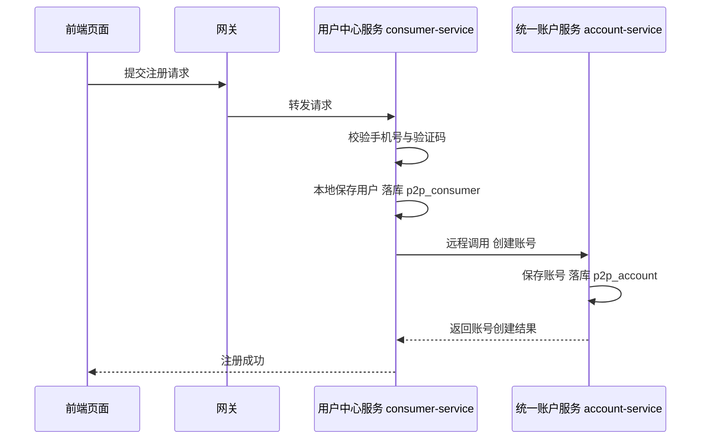

# 注册的事务盲区：两个服务两套数据库，一步失败数据就裂开

注册与登录功能已经交付，Postman 单测过了，前后端联调也过了，看起来没什么可挑剔的。可是这个项目是 P2P 网贷平台，业务跟着钱走，万信金融这类金融系统的要求是事无巨细、万无一失。用这个标准重新审视注册功能，会发现一条裂缝：注册横跨两个独立微服务、两个独立数据库，中间隔着一次远程调用，任何一步失败都会留下半截数据。这一课先把问题现场复现出来，再回答「为什么会这样」。

## 先给结论

- 注册链路横跨用户中心 consumer-service（端口 53050）与统一账户服务 account-service（端口 53030），两个进程相互独立、独立部署，各自操作各自的数据库 `p2p_consumer` 与 `p2p_account`。
- 用户中心先本地保存用户信息，再远程调用统一账户服务创建账号，第二次落库发生在另一个进程的数据库里。
- 把统一账户服务停掉再走一遍注册，实测结果是 `p2p_consumer` 存进了用户数据，`p2p_account` 里什么都没有，出现「有用户、没账号」的脏数据。
- 根因是两边的本地事务互不知晓，谁也回滚不了谁，本地事务的管辖范围到不了另一个进程的数据库。
- 期望的语义是两个服务要么都成功、要么都失败，这正是后续引入分布式事务框架 Hmily 要解决的问题。

## 注册链路回顾：一次请求踩过两个服务

把注册流程的时序拉出来，只看后半段就够了。前端发起注册请求，经网关到达用户中心服务；用户中心先完成手机号与验证码校验，然后本地保存用户信息，再远程调用统一账户服务，由它把账号信息保存到账号库，最后把结果一路返回给前端。整条链路如下：



关键就在中间那一次远程调用：注册这件「大事」被拆成了两个落库动作，分属两个进程。用户中心与统一账户服务虽然业务上联系紧密，但工程上是两个完全独立的微服务，各占各的端口，各自启动各自的服务，将来也可以部署在不同服务器上。谁也不隶属于谁，这正是后面所有问题的根源。

## 注册代码长什么样：先保存用户再远程开户

用户中心侧的注册实现，核心动作就两步：本地保存，然后远程开户。代码按视频画面线整理，包名按 `com.study.finance` 系改写：

```java
public void register(ConsumerRegisterDTO dto) {
    Consumer consumer = new Consumer();
    BeanUtils.copyProperties(dto, consumer);  // 用户名 手机号 密码 角色 逐项映射
    consumer.setIsBindCard(0);                // 初始状态 未绑定银行卡
    save(consumer);                           // 第一步 本地落库 p2p_consumer

    // 第二步 远程调用统一账户服务创建账号
    AccountRegisterDTO accountRegisterDTO = new AccountRegisterDTO();
    BeanUtils.copyProperties(consumer, accountRegisterDTO); // 取用户名 手机号 密码
    RestResponse<AccountDTO> restResponse = accountApiAgent.register(accountRegisterDTO);
    if (restResponse.getCode() != CommonErrorCode.SUCCESS.getCode()) {
        throw new BusinessException(ConsumerErrorCode.E_140106); // 注册失败
    }
}
```

几个细节值得盯住。`ConsumerRegisterDTO` 是前端提交的注册信息载体，字段有用户名、手机号、密码、用户角色与验证码 key；`AccountRegisterDTO` 是发给账户服务的载体，只取用户名、手机号、密码三项，用 `BeanUtils.copyProperties` 完成同名属性拷贝。`AccountApiAgent` 是 Feign 代理，负责把调用转成对 account-service 的 HTTP 请求。返回码不是成功就抛 `BusinessException`，错误码 `E_140106` 在 `ConsumerErrorCode` 里定义为「注册失败」。

注意 `save(consumer)` 执行完，用户数据在 `p2p_consumer` 里已经是落库状态；`accountApiAgent.register` 一旦失败抛异常，这行代码本身没有任何机制把刚才那条用户记录撤销掉。裂缝就埋在这里。

## 故障注入实测：把账户服务停掉再注册

口说无凭，直接复现。网线挖断模拟不了，一台机器上做等价替换：把统一账户服务停掉，就等于它宕机了，也可以理解为网络断了，两者对调用方而言是同一种结局。

测试有个小技巧。注册流程是连续的：先获取短信验证码，再提交注册，而验证码接口恰恰由统一账户服务提供。要是从头就不启动它，验证码都拿不到，后面的注册无从测起。所以正确姿势是让所有服务先正常跑起来，在用户中心 `ConsumerServiceImpl` 发起远程调用的那一行加断点，并以调试模式启动。前端走完验证码流程，提交注册后请求停在断点上，此时手动停掉统一账户服务，再放行代码，让那次远程调用真实地打向一个已经死掉的服务。

结果直接查两张表。`p2p_consumer` 刷新，新手机号的用户记录躺在里面；`p2p_account` 刷新，空的。一次注册，一半成功一半失败：


出现这种结果正常吗？一点都不正常。当初做账号与用户信息分离设计时就定过规矩：账号与用户两份数据放在两个库，但必须保持同步。现在用户中心里存在一个「竟然没有账号」的用户，他连登录都做不到，这条数据就是纯粹的脏数据。

## 为什么本地事务救不了：两个进程两套数据库连接

问题想通了不难：`save(consumer)` 的本地事务跑在用户中心进程、`p2p_consumer` 的数据库连接上；账号保存的本地事务跑在统一账户服务进程、`p2p_account` 的数据库连接上。数据库事务的边界由数据库连接决定，两个连接分属两个进程、两个库，互相完全不知晓对方的存在。

远程调用是一条网络请求，不在任何一个数据库事务的管辖之内。网络一断、服务一死，调用方收到的是连接失败或超时，可它自己数据库里已提交的那条记录，数据库不会因此回滚。哪怕给远程调用配好超时（基础工程里 ribbon 的连接超时 3 秒、读超时 20 秒就是干这个的），超时也只是把失败暴露出来，不修复一致性。这跟「在事务方法里发 HTTP 请求」是同一个坑：事务管得了 SQL，管不了网络。

有人会想：异常抛出来的时候，用户中心不是可以回滚吗？可以，前提是异常发生在 `save` 所在的本地事务提交之前。可这个场景里 `save` 早就连同它的数据库连接一起提交结束了，事务已不存在，回滚无从谈起。失败点离得越远，能兜底的东西就越少。

## 想要的语义：要么都成功要么都失败

网络故障、服务宕机这类意外避免不了，能做的是约定失败时的行为。期望的合法结果只有两种：注册成功，两个库都有数据；注册失败，两个库都没有数据，用户中心已保存的那条也要回滚，将来用户重新注册一次就好。唯独「一个库有、一个库没有」不被允许。

把两个落库动作捆绑成一个整体，要么全成、要么全败，这个动作就是事务控制。只是这里要捆的两个动作分属两个服务两个库，以前接触过的本地事务在这里使不上力，需要的就是分布式事务。它是怎么定义的、凭什么能做到跨服务的成败一致，接下来几课把理论地基补齐，再用 Hmily 框架把注册功能的事务控制真正加上来。

## 常见误区

- **联调通过就认为功能没有问题。** 错例：Postman 与前后端集成测试全绿，注册功能就算验收了。正解：常规测试跑的全是正常路径，故障场景（网络断、依赖服务死）只有人为注入才暴露得到，金融系统必须把异常路径也纳入测试范围。
- **把远程调用包进本地事务就以为安全了。** 错例：给注册方法加上 `@Transactional`，认为从此跨服务也有事务保障。正解：本地事务的边界是数据库连接，远程调用是网络行为，事务回滚时 HTTP 请求该发已经发出、对端的库该提交已经提交，什么都撤销不了。
- **拿手工修数据当长期方案。** 错例：发现半截数据后，运维定期比对新增用户补建账号。正解：对账修复只能兜底，不能替代事务语义，脏数据在两次修复之间依然对外可见，正确做法是从机制上保证失败即整体回滚。
- **只防服务宕机不防网络故障。** 错例：给依赖服务做健康检查，认为服务活着就万事大吉。正解：注册中心与服务都健康、调用链路照样可能出问题，网线、交换机、机房故障都要算在「意外」里，二者对调用方来说结局等价，都得纳入考虑。

## 面试可能被问到的问题

1. 面试官追问：「注册功能的数据不一致是怎么产生的？」
   答：注册链路横跨用户中心与统一账户服务两个独立微服务，用户中心先本地保存用户再远程调用账户服务创建账号。远程调用因网络故障或服务宕机而失败时，用户中心的本地事务已经提交，无法回滚，账户服务的库没有写入，于是出现有用户没账号的脏数据。
2. 面试官追问：「为什么不直接用 Spring 的 `@Transactional` 解决？」
   答：`@Transactional` 是本地事务，边界是当前服务持有的数据库连接，只能保证本进程内多条 SQL 的成败一致。跨服务的数据操作发生在另一个进程的数据库连接里，本地事务既感知不到它，也控制不了它的提交与回滚，所以必须引入分布式事务方案。
3. 面试官追问：「怎么在一台开发机上模拟这种故障？」
   答：先让包括账户服务在内的全部服务正常运行，保证验证码等前置流程可用；在用户中心发起远程调用的代码行加断点，以调试模式启动；前端走完验证码与注册提交后，请求停在断点上，此时停掉统一账户服务再放行代码，等价于调用打到网络不通或服务宕机的场景。
4. 面试官追问：「给远程调用配置超时能避免数据不一致吗？」
   答：不能。超时配置让调用方在依赖方无响应时尽快失败，属于故障暴露手段。失败被感知后，调用方本地已提交的数据依然无法自动回滚，对端也可能处于未知状态。超时是分布式事务方案的辅助前提，不是解决方案本身。
5. 面试官追问：「这个场景期望的最终行为是什么？」
   答：两个服务的数据操作要么都成功、要么都失败。成功即两库都有数据，注册完成；失败即两库都无数据，用户中心侧已写入的记录也要回滚。只允许这两种终态，不允许出现一个库有数据另一个库没有数据的中间态。

## 配套资料

- 讲义：`materials/docs/10/万信金融-第2章-讲义-开户v1.0.md`，「注册功能中的分布式事务」节：一次注册请求由用户中心服务与统一账号服务协调完成，一方操作失败导致数据不一致，由此产生事务问题，注册功能使用 Hmily 框架解决。
- 代码：`materials/code/10/资料/公共类/`，含 `Consumer.java`（`consumer` 表实体，`IS_BIND_CARD` 等字段真实出处）、`ConsumerRegisterDTO.java`、`AccountRegisterDTO.java`（两个注册 DTO 的字段定义）、`ConsumerErrorCode.java`（`E_140106` 注册失败的真实出处），文件保留原始包名。
- 代码：`materials/code/10/wanxinp2p/`，P2P 工程归档（目录保留原始命名，路径列到该层级），其 `wanxinp2p-consumer-service` 的 `application.properties` 含远程调用超时与异常处理等真实配置。
- 说明：用户中心注册实现 `ConsumerServiceImpl` 的完整源码未在仓库归档，正文代码按视频画面线整理；包名按 `com.study.finance` 系改写。
