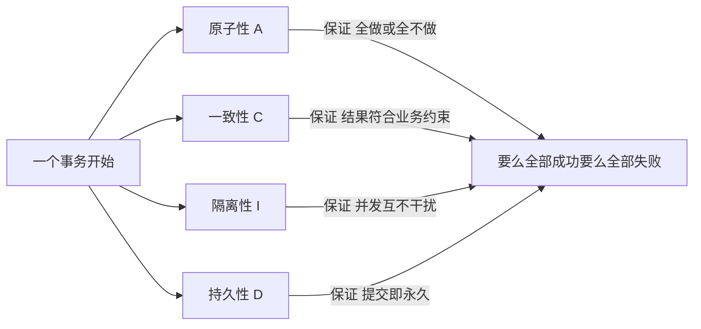

# ACID 四大特性：本地事务的四条底线

事务的定义是「要么全部成功，要么全部失败」，可这份保证不是凭空来的，它由四个具体特性支撑，就是大名鼎鼎的 ACID。这个概念数据库课程里学过，但在分布式事务的讨论里它要反复被引用：本地事务靠 ACID 打天下，分布式事务恰恰是因为 ACID 够不着另一台服务器才成为难题。趁现在把四条特性逐条讲透，后面讨论分布式场景才有对照的基准。

## 先给结论

- 原子性 A：事务不可再分，构成事务的所有操作要么全部执行成功，要么全部不执行，不存在部分成功部分失败。
- 一致性 C：事务执行前后，数据库的一致性约束没有被破坏，转账前后两账户总额不变就是最直观的形态。
- 隔离性 I：多个并发事务之间互不干扰，一个事务看不到另一个事务的中间状态。
- 持久性 D：事务一旦提交，数据的改变是永久性的，之后不能被回滚。
- 这四条说的是本地事务，也就是数据库事务：应用与数据库同机部署的单体时代，事务控制完全依赖关系型数据库自身。

## 本地事务这个名字怎么来的

本地事务听起来像新名词，其实就是最熟悉的那个事务。常规情况下，软件系统里的事务由关系型数据库来控制，利用数据库自身的事务特性实现，所以它有个名字叫数据库事务。转账里扣钱、加钱都是 `update`，全是数据库操作，事务自然由数据库负责。

以前的应用是单体应用，应用和数据库部署在同一台服务器上，数据库与应用离得近、同属一个进程体系，这种架构下的事务又被称作本地事务。本地二字不是修饰词，它是相对于分布式事务而言的：等到应用拆成微服务、数据库各自独立部署在不同节点，事务跨越了机器边界，本地二字就罩不住了。这一相对关系先立住，后面的讨论才有落点。

## A 原子性：不可再分的执行单元

原子性说的是事务必须当作一个不可分割的整体处理：构成事务的所有操作要么全部执行成功，要么全部不执行。张三向李四转 100 元，扣钱与加钱两个操作捆绑在同一个事务里，只能出现「张三少 100 且李四多 100」或「两边都没动」两种终态，绝不允许一边动了另一边没动。

```sql
-- 张三向李四转 100 元 示例为按本课写法补全
begin transaction;
update account set balance = balance - 100 where username = 'zhangsan';
update account set balance = balance + 100 where username = 'lisi';
commit transaction; -- 两条都执行成功才提交 中途任何失败改走 rollback 整体撤销
```

原子性管的是「执行不执行」这个动作层面的问题。哪怕第二条 `update` 因为字段溢出、锁冲突等任何原因失败，第一条已经改过的余额也会被回滚抹平，数据库不留痕迹。

## C 一致性：约束在事务前后不被破坏

一致性说的是事务执行前后，数据库的一致性约束没有被破坏。转账前张三 1000 元、李四 500 元，总额 1500 元；转账后张三 900 元、李四 600 元，总额还是 1500 元，数据是正确的，一致性保持住了。要是出现张三转出 100 元、李四账户却没有增加 100 元，总额凭空缩水，这就出现了数据不一致。

原子性与一致性经常被混为一谈，两者的分工要分清：原子性保证操作全部执行或全部不执行，是手段；一致性保证结果符合业务约束，是目的。多数情况下全部执行成功或全部不执行，结果自然一致，但一致性还涵盖触发器、外键、业务规则等更多约束，范围比原子性更大。金融平台对这条最敏感：前面注册功能两库数据必须同步，本质就是平台级的一致性诉求，账户与用户信息对不上账，业务上就是事故。

## I 隔离性：并发事务互不干扰

数据库要面对并发，多个事务可能同时操作同一张表。隔离性指的是多个事务并发执行时互不干扰：一个事务在执行过程中，另一个事务看不到它的中间状态，也影响不了它的内部处理。张三的转账还没提交，李四此刻查自己的余额，不应该看到那笔尚未确定的扣款。

隔离的程度可以调节。数据库课程里讲过的隔离级别就是干这个的，从读未提交、读已提交到可重复读、串行化，隔离越严数据越安全，并发性能越低，MySQL 默认落在可重复读。工程上按业务容忍度选级别，是这条特性留给应用的调参空间。

## D 持久性：提交之后永不丢失

持久性最直白：事务一旦全部完成并提交，对数据的改变就是永久性的，此后不能被回滚，哪怕数据库重启、进程崩溃，提交过的数据也在。这份「落袋为安」由数据库的日志机制保障，提交动作意味着修改已经记录到可恢复的存储里。

持久性同时划定了回滚的时间窗口：`rollback` 只对未提交的事务有效，提交之后想要撤销，不存在任何回滚语句可用，只能再写一条反向的 SQL 做业务补偿。理解了这一点，就明白为什么注册功能里那句远程调用失败后无法撤销本地已提交的数据，时间窗口早就关上了。

## 四条特性合起来看



四条特性各自站一个岗：原子性管动作完整，一致性管结果正确，隔离性管并发秩序，持久性管提交后果。它们合起来把「要么全部成功，要么全部失败」这八个字落成可执行的机制。用一句话收拢：数据库在实现事务时，会把事务涉及的所有操作当成一个不可分割的执行代理，要么所有操作都成功，只要有一个失败，整个事务就回滚撤销。

回到注册功能：两个服务各自内部能做到 ACID，跨服务跨库就谁也顾不上谁，缺的正是把两个本地事务再捆一层的机制。这个缺口如何补，分布式事务系列接着讲。

## 常见误区

- **把一致性和原子性当成一回事。** 错例：认为只要事务回滚了数据库就自动一致。正解：原子性只是不留下半截执行，一致性还要求事务前后满足总额不变、外键成立等业务与数据库约束，两者是手段与目的的关系，不是同一条。
- **把隔离性理解成串行排队。** 错例：以为隔离就是所有事务一个接一个执行。正解：隔离性是并发事务互不干扰的程度，通过隔离级别在安全与性能之间取舍，绝大多数业务不需要最严格的串行化。
- **认为提交后还能回滚。** 错例：`commit` 之后发现问题，试图用 `rollback` 撤销。正解：持久性保证提交即永久，回滚窗口随提交关闭，事后纠正只能靠反向 SQL 做业务补偿，代价远高于事务内回滚。
- **认为 Spring 事务对所有异常都回滚。** 错例：方法里抛了自定义的受检异常，事务却照常提交了。正解：Spring 声明式事务默认只对 `RuntimeException` 与 `Error` 回滚，受检异常要显式声明 `rollbackFor`，这一条属于框架行为而非数据库行为（本条说明为按 Spring 通用写法补全）。

## 面试可能被问到的问题

1. 面试官追问：「ACID 分别指什么？」
   答：A 原子性，构成事务的所有操作要么全部执行要么全部不执行；C 一致性，事务执行前后数据库的一致性约束不被破坏；I 隔离性，并发事务之间互不干扰、看不到彼此的中间状态；D 持久性，事务提交后数据的改变是永久性的，不能回滚。
2. 面试官追问：「原子性和一致性的区别是什么？」
   答：原子性关注动作层面，保证事务内的操作全部执行或全部不执行，不留半截；一致性关注结果层面，保证事务前后数据满足约束，例如转账前后总额不变。原子性是实现一致性的手段之一，但操作全做了结果仍可能违反其他约束，所以一致性涵盖面更宽。
3. 面试官追问：「本地事务为什么叫本地？」
   答：因为它相对于分布式事务而言。单体应用里应用与数据库部署在同一台服务器，事务由关系型数据库自身特性控制，作用范围限于本机这一个数据库连接，所以叫本地事务，也叫数据库事务。等应用拆成微服务、数据库分布在不同节点，事务跨出机器边界，本地事务就无能为力了。
4. 面试官追问：「事务提交后发现逻辑错了怎么办？」
   答：持久性决定了提交后无法回滚，只能走补偿：再执行一条反向 SQL 把数据改回去，并把它包装成新的业务操作与异常处理逻辑。也正因为补偿代价高、还可能再失败，工程上要求把事务边界设计在业务校验充分之后，尽量让错误在提交前暴露。
5. 面试官追问：「注册功能的脏数据和 ACID 里哪一条有关？」
   答：和一致性与原子性都有关，但根源是范围问题。用户中心的保存与统一账户服务的保存是两个独立本地事务，各自满足 ACID，却没有机制把它们捆成一个整体，跨服务的一致性没有承载者。本地事务的原子性只覆盖本库操作，跨库的原子性需要分布式事务来提供。

## 配套资料

- 讲义：`materials/docs/10/万信金融-第2章-讲义-开户v1.0.md`，「注册功能中的分布式事务」节：注册链路涉及用户中心服务与统一账号服务，本课的 ACID 回顾是分布式事务章节的铺垫内容。
- 代码：`materials/code/10/资料/公共类/`，含 `Consumer.java`、`AccountErrorCode.java` 等真实错误码与实体定义，可对照账号与用户分离设计中的一致性诉求，文件保留原始包名。
- 说明：本课为概念讲解课，ACID 各条定义出自课程视频画面线（PPT 原文）；转账 SQL 与 Spring 事务行为示例为按本课写法补全，未对应独立源码包。
