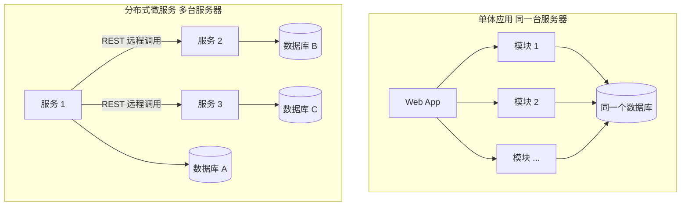
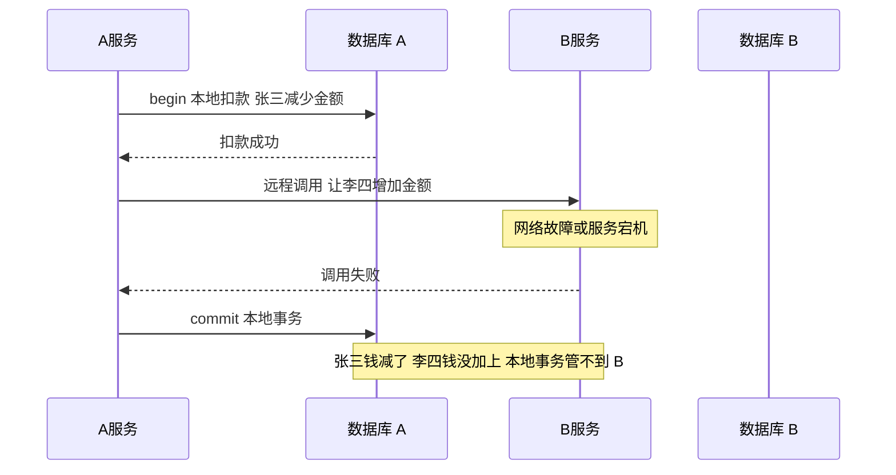

# 分布式事务：本地事务管不住跨服务的数据一致性

事务的定义与 ACID 都复盘完了，可以正面回答注册功能那个问题了：为什么本地事务在单体应用里百试百灵，到了微服务架构里就管不住两个库的数据？答案是架构变了。单体时代多个操作落在同一个数据库、同一个事务边界内，ACID 全程覆盖；拆成微服务之后，操作跨进程、跨网络、跨数据库，本地事务的管辖半径远远够不着。这一课把分布式事务的由来与它要解决的问题讲清楚。

## 先给结论

- 本地事务与分布式事务是相对概念，分野在架构：单体应用一个应用配一个数据库，用本地事务就够；应用拆成独立部署的多个服务，事务就跨出了单库边界。
- 分布式系统把一个应用系统拆分为可独立部署的多个服务，服务与服务之间远程协作才能完成事务操作，这种分布式系统环境下的事务机制就是分布式事务。
- 单体下转账是一段 `begin ... commit` 包住的本库操作；微服务下同样的转账变成 A 服务扣钱、远程调用 B 服务加钱，第二步不在 A 的数据库事务管辖之内。
- 远程调用遇上网络故障或 B 服务宕机，A 已提交、B 未执行，且双方互不隶属谁也回滚不了谁，张三钱减了、李四钱没加上。
- 这与注册功能遇到的问题一模一样：用户中心与统一账户服务的关系，就是 A 与 B 的关系。解决方案是专门面向这种架构的分布式事务，课程后续用 Hmily 框架落地。

## 架构变了，事务问题跟着变

分布式事务的出现不是技术炫技，是被架构演变逼出来的。以前是单体应用：一个项目里装着前端接口与各种业务模块，不管里面拆了多少功能，它们都属于同一个工程，部署在同一台服务器上，操作同一个数据库。这种应用用之前学的本地事务，也就是数据库事务，就能搞定一切。

随着互联网业务膨胀，单体满足不了需求，项目开始往微服务、分布式架构演变：一个大项目被拆成若干个微服务，分别部署在不同的服务器、不同的节点上。这些微服务可能共用一个数据库，也可能各自用各自的数据库，但都是独立占有端口号、独立启动、独立操作的个体，业务上有联系就通过网络互相调用。



左边这张图里，所有功能挤在一个事务边界内，本地事务说一句「都成或都败」就全办妥了。右边每个服务各管一个数据库，事务边界被切成好几段，中间隔着网络。同样的功能，事务问题就从一道题变成了三道互相不知晓的题。

## 本地事务在单体里为什么行

拿转账功能做左右对比。单体应用里，转账的两个操作写在同一个应用、打向同一个数据库，一段事务全包住（PPT 原文伪代码）：

```sql
begin transaction;
-- 1.本地数据库操作：张三减少金额
-- 2.本地数据库操作：李四增加金额
commit transaction;
```

两条语句共用一个数据库连接，ACID 全程护送：要么全部成功，要么任何一步失败整体回滚。这里没有网络、没有第二个进程，数据库一个人就能把话说死，这就是本地事务的舒适区。

## 拆成微服务后，同样的逻辑失效了

还是转账功能，改造成分布式架构后会变成这样（PPT 原文伪代码）：

```sql
begin transaction;
-- 1.A服务操作本地数据库：张三减少金额
-- 2.A服务远程调用B服务：让李四增加金额
commit transaction;
```

A 服务负责让张三的账户减少金额，B 服务负责让李四的账户增加金额，两件小事合起来实现转账这件大事。顺序上 A 先操作本地数据库，再远程调用 B。问题出在第二步的性质变了：它不再是一条本库 SQL，而是一次跨网络的远程调用，完全不在 A 的数据库事务管辖之内。

意外偏偏最爱在跨网络这一段发生。A 调用 B 时网络出现故障，或者 B 服务直接挂掉，结果就是很容易想到的那一种：张三的钱减了，李四的钱没加上。想回滚？滚不了。A 和 B 是两个完全独立的服务，各在一台服务器上，相互独立谁也不搭理谁，只是业务上有联系。A 的 `commit` 提交的只有它自己库里的扣款，B 那边连事务都没开起来，让谁去撤销什么？整条失败链路如下：



对照一下就明白：单体的两个操作是「一个事务里的两条语句」，分布式下变成「两个事务之间的一次网络调用」，保护等级骤降。这个场景跟注册功能的现场一模一样：注册里的用户中心相当于 A，统一账户服务相当于 B，用户保存是扣款那一步，账号创建是远程那一步，用户中心远程调用统一账户的过程同样通过网络交互，同样会遇到各种意外。前面复现出的「有用户没账号」，正是这张时序图的现实版。

## 分布式事务要解决什么问题

本地事务碰上微服务架构，结局就是一个词：无能为力。既然架构回不去，就只能给这种架构配一套新的事务管理方案：专门针对分布式场景，把分散在多个服务、多个数据库上的小活动重新捆绑起来，要么全部成功，要么全部失败，或者退一步达到最终一致。这套方案就是分布式事务。

它的难度恰恰来自架构本身：跨进程无法共享一个数据库事务，跨网络随时可能失败，参与者还可能中途宕机，所以分布式事务没法简单照搬 ACID 的实现，催生了一系列基础理论与具体方案。这些内容在后面的篇章展开，包括 CAP 与 BASE 等理论以及对应的解决模式。落到这个项目上，注册功能选用 Hmily 框架解决，工程父 POM 里已经管理了 `hmily-springcloud` 的依赖，具体怎么用它把用户中心与统一账户服务的两个本地事务串成一体，后续课程动手实现。

学完这一课，问题的边界已经画清楚：单体一个库，本地事务包打天下；微服务多库跨网络，必须分布式事务接手。注册功能的修复方案，就挂在后者上面。

## 常见误区

- **给跨服务方法加 `@Transactional` 就以为有保障。** 错例：在 A 服务的转账方法上标注本地事务注解，认为 B 服务的加钱也被覆盖。正解：注解只圈住 A 自己的数据库连接，远程调用是网络行为，B 的提交与回滚由 B 的连接决定，A 回滚时管不到 B。
- **把网络问题当成小概率不值得处理。** 错例：内网环境稳定，远程调用失败基本不会发生。正解：网络故障、服务宕机、发布重启都是常态事件，调用一旦跨进程，失败就是接口契约的一部分，不处理等于把数据一致性押给运气。
- **把分布式事务等同于「分布式数据库提供的事务」。** 错例：认为换一个支持跨节点的数据库产品，现有微服务就自动获得分布式事务。正解：分布式事务首先是一个业务协调问题，参与方是彼此独立的服务与库，无论底层是什么数据库，都需要应用层的协调机制把各方事务串起来。
- **认为两阶段提交照搬过来就万事大吉。** 错例：听说分布式事务就是全局事务，锁住所有参与者一起提交。正解：跨网络的同步阻塞在高并发下代价极高，还有协调者单点问题，所以工程上发展出多种理论与模式，按业务对强一致与可用性的取舍来选，不是无脑套用某一种。

## 面试可能被问到的问题

1. 面试官追问：「为什么有了本地事务还会出现分布式事务？」
   答：根源是软件架构从单体演变为分布式微服务。单体下一个应用操作一个数据库，本地事务就能保证成败一致；拆分成多个独立部署的服务后，一次业务操作要跨多个服务与数据库，中间隔着网络，本地事务的边界只覆盖本机数据库连接，跨服务的数据一致性失去承载者，分布式事务就是为这种架构提出的解决方案。
2. 面试官追问：「A 服务远程调用 B 服务失败，A 本地回滚了，数据为什么还是不一致？」
   答：因为失败点决定终态。若 A 在本地提交前失败，两边都能干净回退；若 A 已提交后才失败，A 的数据落库已成事实，B 没有执行也谈不上回滚。A 的本地事务无论回不回滚都影响不了 B，张三扣了款、李四没到账的不一致就此固化，这正是本地事务无能为力的场景。
3. 面试官追问：「分布式事务要解决的核心问题是什么？」
   答：把分布在多个服务、多个数据库上的小活动重新纳入统一的事务语义，要么全部成功，要么全部失败，或者达到最终一致。它要对抗的难点包括网络不可靠、参与方独立提交、宕机后状态未知，核心是在跨进程的前提下重建类似 ACID 的整体性保证。
4. 面试官追问：「注册功能的问题和 A、B 两个服务的转账问题是一回事吗？」
   答：是同构问题。用户中心先本地保存用户再远程调用统一账户服务创建账号，对应 A 服务本地扣款后远程调用 B 服务加钱；网络故障或账户服务宕机导致用户库有数据、账号库没数据，对应张三钱减了、李四钱没加上。两者都是本地事务跨服务失效，解法也同源，项目里用 Hmily 框架解决注册场景。
5. 面试官追问：「本地事务和分布式事务的分界线到底在哪里？」
   答：在事务操作是否跨越数据库连接。操作全部落在同一个数据库连接内，无论语句多少，都是本地事务；一旦业务链条上有操作发生在另一个进程的数据库上，哪怕只有一个，整体就已经是分布式事务问题，需要协调机制而非单个数据库事务来保证一致性。

## 配套资料

- 讲义：`materials/docs/10/万信金融-第2章-讲义-开户v1.0.md`，「注册功能中的分布式事务」节：一次注册请求需要用户中心服务和统一账号服务协调完成，一方操作失败导致数据不一致，注册功能使用 Hmily 框架解决分布式事务问题。
- 代码：`materials/code/10/wanxinp2p/wanxinp2p/pom.xml`，父工程依赖管理中真实存在 `org.dromara:hmily-springcloud:2.0.4-RELEASE`，是课程选定分布式事务框架的出处（目录保留原始命名）。
- 代码：`materials/code/10/wanxinp2p/`，P2P 工程归档（目录保留原始命名，路径列到该层级），`wanxinp2p-consumer-service` 与账号服务同属注册链路的两端。
- 说明：单体与分布式对比图、两段事务伪代码出自课程视频画面线（PPT 原文）；mermaid 架构图与时序图为按本课口径重绘，节点命名与平台其余篇章一致。
