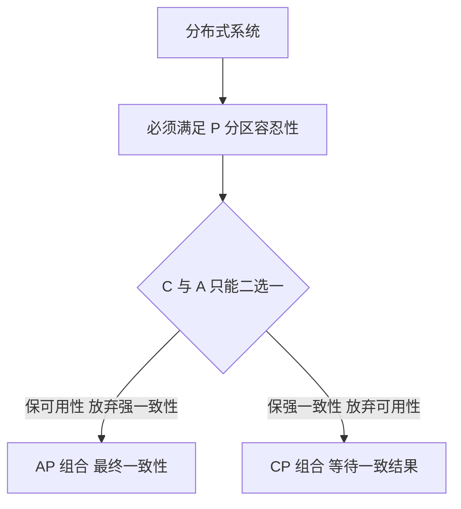

# CAP 理论：分布式系统为什么只能三选二

数据放在一台数据库里的时候，事务从来不是难题；数据一拆到多个节点，麻烦就换了一副面孔。拆库的动机很朴素：任何一台数据库服务器的最大连接数、负载、吞吐量都有极限，业务做大之后单机必然扛不住，横向加机器、做主从、上读写分离几乎是必经之路。这条路换来了性能，也带来了新的隐忧：主库与从库之间隔着一条网络，同步永远存在时间窗，读从库的那一刻未必读得到刚写入的数据。前辈们对这类现象做过很深入的研究分析，留下了成套的知名理论，CAP 理论就是其中最基础的一套，它是 Consistency（一致性）、Availability（可用性）、Partition tolerance（分区容忍性）三个单词的缩写。这一课先立住「网络分区」这个分布式独有的名词，再用电商商品服务的主从读写分离场景，把 C、A、P 逐个对号入座，最后回答那个绕不开的问题：为什么三个特性只能取二，实际工程里又该怎么组合。

## 先给结论

- 网络分区是分布式事务独有的名词：提供服务的节点分布在不同的机器上，彼此靠网络交互，网络故障导致节点间通信失败，这种场景就叫网络分区。本地事务在同一工程、同一节点内完成，不经过网络，没有这个概念。
- CAP 是 Consistency（一致性）、Availability（可用性）、Partition tolerance（分区容忍性）的缩写，P 里的「分区」指的就是网络分区。
- 一致性要求写操作之后的读操作能拿到最新数据；可用性要求任何操作都能得到响应结果，不超时、不出错；分区容忍性要求部分节点宕机或网络异常时，系统仍能对外提供服务。
- 分布式系统必须满足 P；在 P 成立的前提下，C 与 A 无法同时满足，三个特性只能三选二，实际可行的组合是 AP 与 CP。
- AP 不是不管一致性，而是放弃强一致性、保证最终一致性；CA 意味着不分区，那是单机关系数据库的地盘；选哪种组合没有定式，看具体业务场景。

## 先立一个名词：网络分区

理解 CAP 之前要先接住一个前置概念。分布式系统提供服务的各个节点分布在不同的机器上，节点之间通过网络进行交互。网络这东西谁也不敢打包票，故障避免不了，一旦网络断开，节点之间就断了联系，这种场景在术语里叫网络分区。

听起来平平无奇，但它值得单独立一个名词，原因在于它是分布式事务特有的概念。本地事务跑在一个工程里，程序和数据库在同一个节点上，压根不需要经过网络，自然也谈不上「网络一断把事务拆成两半」。而分布式事务的一切麻烦几乎都从这个词开始：微服务之间的远程调用、数据库之间的主从同步，走的都是网络，都可能遇到分区。CAP 里 P 的「分区」二字，出处就是这里。

## 场景搭台：商品服务与主从读写分离

抽象的理论名词直接背很容易背成天书，理解这类内容最好的办法是配一个具体的例子。课程给 CAP 找了一个最熟悉的考场：电商平台。平时网购下单、买商品，背后就是一套商品服务在支撑，对商品的增删改查天天都在发生。这场戏开演之前，要先交代两块业务背景。

**第一，一台数据库扛不住，要分主从。** 每台数据库服务器的能力都有最大值，最大连接数、负载、吞吐量都有自己的天花板，超过极限就扛不住。而业务的胃口只会越来越大，类比淘宝、京东这个量级，指望一台数据库撑住全场并不现实。办法是横向加几台数据库。机器多了就要分主从：有主数据库，有从数据库，机器配置可以一模一样，但角色分了主次，从数据库分担主数据库的压力。

**第二，写和读相互拖累，要读写分离。** 增删改是写操作，查询是读操作，写通常比读更耗时。如果服务对数据库的需求是 IO 密集型的，读写非常频繁，写操作就会影响到查询的效率。解决办法是给主从分工：写入找主数据库，查询找从数据库，这就是读写分离。

分工之后又冒出一个绕不开的动作：主从数据库之间要做数据同步。写全落在主库上，主库的数据变了，不同步给从库，将来从库查出来的就不是最新数据。主从加读写分离这套架构至今仍然常见，它最终的目标只有一个：突破单机的性能瓶颈，扛住更多连接、更高负载、更大吞吐量。架构与数据流向如下图：


商品的写入走主库，查询走从库，两条线在「数据同步」处汇合。以删除商品为例走一遍执行流程：商品服务请求主数据库，删除一行商品数据，主数据库响应写入成功；主数据库把这次变更同步给从数据库，从数据库也删除对应的一行；之后商品服务查询商品信息时，请求打到从数据库上。这条链路接下来就是检验 C、A、P 的考场，两个写入与读取动作在代码层面大致是下面的样子：

```java
// 示例 按本课写法补全 写主库与读从库是两条独立的路径
public void addProduct(Product product) {
    productMapper.insert(product);   // 写入走主库
}

public Product getProduct(Long id) {
    // 查询走从库 主从同步未完成时 这里可能拿到旧数据
    return productSlaveMapper.selectById(id);
}
```

## C：一致性，写完就得能读到

一致性的一句话定义：写操作之后的读操作，可以读取到最新的数据状态；当数据分布在多个节点上时，从任意节点读取到的数据都是最新的状态。落到主从场景，商品信息的读写要满足一致性，就要实现两个目标：商品服务写入主数据库成功，则向从数据库查询新数据也成功；商品服务写入主数据库失败，则向从数据库查询新数据也失败。

听起来像句废话，实际是个苛刻的要求，难点就在主从同步的时间窗上。看一段示意：

```sql
-- 示例 主从架构下「写后立刻读」的时间窗问题
-- 时刻 T1 写请求打到主库
INSERT INTO product (id, name, price) VALUES (1001, '示例商品', 99.00);
-- 主库响应写入成功 此刻变更可能还没同步到从库
-- 时刻 T2 读请求打到从库
SELECT id, name, price FROM product WHERE id = 1001;
-- 同步未完成时这条查询查不到刚写入的商品 数据不是最新状态 一致性被打破
```

写成功与读最新之间，隔着的正是「数据同步」那一步。一致性并不苛求同步瞬间完成这种物理上做不到的事，而是要求系统把「读不到最新」当作不允许发生的情况：要么让读等一等同步，要么在同步完成前把这次读判为失败。目标里那句「写主库失败，从库查询也失败」就是这层意思，宁可让读失败，也不给旧数据。

## A：可用性，每个请求都要有响应

可用性的定义：任何事务操作都可以得到响应结果，且不会出现响应超时或响应错误。落到场景上同样是两个目标：从数据库接收到数据查询的请求，立即能够响应数据查询结果；从数据库不允许出现响应超时或响应错误。

想想什么时候做不到。只有一台服务器时，这台服务器一旦宕机，或者网络一旦出问题，请求要么得不到想要的响应，要么直接超时，可用性无从谈起。所以保证可用性的常规做法是增加服务节点：数据库可以多部署几台从库，微服务也可以集群部署，一个节点挂了，请求切到另一个节点接着处理。节点越多，可用性越有底气，这与前面「从库分担主库压力」的扩容动机是同一个方向。

## P：分区容忍性，坏几个节点也要活着

分区容忍性的定义要顺着网络分区说：分布式系统的各个节点通常部署在不同的子网里，这就是网络分区，网络故障导致节点之间通信失败不可避免。分布式系统在遇到某个节点或网络分区故障的时候，仍然能够对外提供满足一致性与可用性的服务，这就是分区容忍性。换个说法：一部分机器宕掉了，剩下的机器还能正常运转满足系统需求；或者机器之间网络异常，系统被分隔成几个独立的部分，各个部分还能维持运作，这样的系统就具有较好的分区容忍性。

落到商品服务场景，两个目标：主数据库向从数据库同步数据失败，不影响读写操作；其中一个节点挂掉，不影响另一个节点对外提供服务。

这一条对分布式系统来说几乎是天赋属性：只要架构是分布式的，微服务和数据库本来就部署在各个节点上，设计目标天然就是「坏了几个节点，其余照常干活」。反过来说，不满足 P 的系统连讨论 CAP 的资格都没有。

## 三选二：C 与 A 在 P 面前不能共存

理想状态是三个特性全都达标，实践给出的结论却是：在所有分布式事务场景中，不会同时具备 CAP 三个特性。原因可以分两步推出来。

**P 必须保留。** 分区容忍性是分布式系统的入场券。不满足 P，系统就退回单体应用，一个服务一个数据库，本地事务就能搞定，也就失去了讨论 CAP 的意义。万信金融这类 P2P 平台是典型的分布式系统，注册链路里用户中心与统一账号服务各管各的库、彼此远程调用，这样的架构里 P 是默认要保的。

**P 成立时，C 与 A 冲突。** 要提高可用性，就要增加多个节点；要保证一致性，就要让每个节点的数据都一致。节点越多，可用性越好，但数据同步的链路越长，一致性越难保证。反过来推最清楚：只有一台数据库时，增删改查都在同一台机器上完成，永远不需要考虑一致性问题；变成两台，就要做数据同步；三台、四台、五台、六台，节点越多，保证一致就越难。可用性与一致性此消彼长，鱼和熊掌不可兼得。



取舍图上的两条岔路就是工程里真实存在的两种选择。三个不能全占，就要搞组合、搞平衡，有舍才有得，这就是「三选二」的全部含义。

## AP、CP、CA：三种组合的实际面孔

常用的组合方式有三种，各自的面孔差别很大。

**AP：放弃强一致性，保可用性与分区容忍。** 这是很多分布式系统设计时的选择。订单退款是最直观的例子：网购退货时，退款不会当场到账，往往隔一天两天才收到。从退货成功到退款到账之间的这段时间，退货状态与账户余额是不一致的；过了这段时间，钱最终到了，数据最终一致。AP 不是对一致性撒手不管，而是放弃「立即一致」这个强一致性要求，转而保证最终一致性，这条思路后面的 BASE 理论会专门展开。

**CP：放弃可用性，保一致性与分区容忍。** 典型代表是 Zookeeper，它追求的就是强一致性。金融场景也常见这种取舍：有的银行转账承诺 24 小时之内到账，之所以能让用户等，是因为系统要等待双方银行系统都完成整个事务，才给出最终的确定结果。宁可让请求等待，也不给一个错的结果。

**CA：放弃分区容忍。** 不进行分区，系统就不再是分布式，组合退化为单机系统的属性。常见的关系数据库本身就满足 CA：在自己的电脑上装一个 MySQL，一致性与可用性都由本地事务保证。有人会问给关系数据库加节点部署行不行？一旦分布式化，数据库本地事务的保证就不再完整，此时它只能满足 C，CA 的承诺作废，系统又变回一个服务一个数据库的单体形态，不在分布式事务的讨论范围。所以分布式系统实际可选的只有 AP 与 CP 两种。

| 组合 | 保住的特性 | 放弃的特性 | 典型场景 |
|---|---|---|---|
| AP | 可用性、分区容忍性 | 强一致性 | 订单退款、大多数互联网业务 |
| CP | 一致性、分区容忍性 | 可用性 | 转账、Zookeeper 这类强一致系统 |
| CA | 一致性、可用性 | 分区容忍性 | 单机关系数据库，非分布式 |

选 AP 还是 CP，没有任何规定或一成不变的答案，要看具体业务场景：有的业务必须强一致，有的业务必须随时可用。在互联网应用覆盖面越来越广的背景下，大多数场景牺牲不起可用性，所以最常用的是保 P 与 A 的 AP 组合。这里要重申一个最容易被问住的点：选 AP 绝不是数据可以不一致，数据都不一致了系统就没法用了；放弃的只是强一致性，换来的是最终一致性。

## 常见误区

- **把 AP 理解成完全不管一致性。** 错例：选了 AP 之后认为从库什么时候查到新数据都无所谓。正解：AP 放弃的是强一致性，保证的是最终一致性，同步完成后数据必须一致，退款过了两天必须到账。
- **在单机系统上套用 CAP 做取舍。** 错例：本地只跑一个 MySQL，也开始纠结保 C 还是保 A。正解：CAP 讨论的是分布式系统，单机数据库天然满足 CA，没有分区就没有取舍。
- **以为主从同步是瞬间完成的。** 错例：写完主库立刻读从库，拿不到新数据就怀疑代码有 bug。正解：同步存在时间窗，窗口内从库就是旧数据，一致性方案要为这个窗口负责。
- **无脑堆节点提可用性。** 错例：为了可用性把从库加到十几台，主从同步延迟持续变大，读到的旧数据越来越多。正解：节点越多一致性越难保证，可用性与一致性要放在一起权衡，而不是只看一头。

## 面试可能被问到的问题

1. 面试官追问：「什么是网络分区？为什么说它是分布式事务特有的概念？」
   答：分布式系统的节点部署在不同机器上，节点之间靠网络交互，网络故障导致节点之间通信失败、彼此隔断，这种场景就是网络分区。本地事务在同一工程同一节点内完成，不经过网络，不存在被网络断开拆散的可能，所以这个概念只在分布式场景下有意义，它也是 CAP 中 P 一词的出处。
2. 面试官追问：「CAP 分别指什么？结合主从架构说明一下。」
   答：一致性指写操作后的读操作能读到最新数据，主库写入成功后从任意节点都要能读到新数据；可用性指任何操作都能得到响应结果，不超时不出错，查询打到从库必须立即有结果；分区容忍性指部分节点宕机或网络异常时系统仍能对外提供满足一致性与可用性的服务，比如主从同步失败不影响读写、一个节点挂掉另一个照常服务。
3. 面试官追问：「为什么分布式系统三个特性只能取二？」
   答：分布式系统必须满足分区容忍性，否则就退回单体应用，不在讨论范围。在保 P 的前提下，一致性与可用性无法兼顾：可用性靠增加节点提升，而节点越多，保证各节点数据一致越难；节点越少越好保一致，可用性又塌了。两者此消彼长，只能组合取舍。
4. 面试官追问：「AP 和 CP 各举一个例子，说说分别放弃了什么。」
   答：AP 典型如订单退款，退货后退款隔一两天才到账，期间数据不一致，放弃的是强一致性，保住可用性，最终钱到账数据一致；CP 典型如转账和 Zookeeper，转账要等待双方系统都完成事务才给出确定结果，宁可让用户等待，放弃的是即时响应的可用性，换强一致性。
5. 面试官追问：「CA 组合在什么系统里存在？为什么分布式系统不考虑它？」
   答：CA 存在于不分区的单机系统，典型是单机关系数据库，一致性与可用性由本地事务保证。分布式系统一旦不满足 P 就不再是分布式；给关系数据库加节点部署后，本地事务的保证也不完整，只剩 C。所以分布式事务的讨论里 CA 只是背景板，实际可选的只有 AP 与 CP。
6. 面试官追问：「你们的项目选了 AP 还是 CP，怎么权衡的？」
   答：按业务逐个场景权衡，没有一刀切。对一致性要求严格、执行时间短的业务偏向 CP 型方案，比如注册链路里用户信息与账号信息必须一致落库；对可用性敏感、允许短暂不一致的业务偏向 AP 型方案，比如退款到账、结果通知这类容忍延迟的场景。理论给的是约束，真正落点永远在具体业务上。

## 配套资料

- 讲义：`materials/docs/10/day16-项目总结&就业指导v1.0.md`，「3.4.1 什么是分布式事务」与「3.3.3 什么是读写分离」小节：分布式事务的定义，以及主库负责增删改、从库负责查询的读写分离工程解释，与本课主从场景互为印证。
- 讲义：`materials/docs/10/万信金融-第2章-讲义-开户v1.0.md`，「注册功能中的分布式事务」小节：说明注册链路存在分布式事务问题，课程配套的「分布式事务」讲义即本课 CAP 理论部分的原始出处。
- 说明：CAP 理论属通用分布式理论，课程未提供该节配套源码；主从库写入与查询的 SQL、Java 示例为按本课写法补全，包名按 `com.study.finance` 系口径改写。
