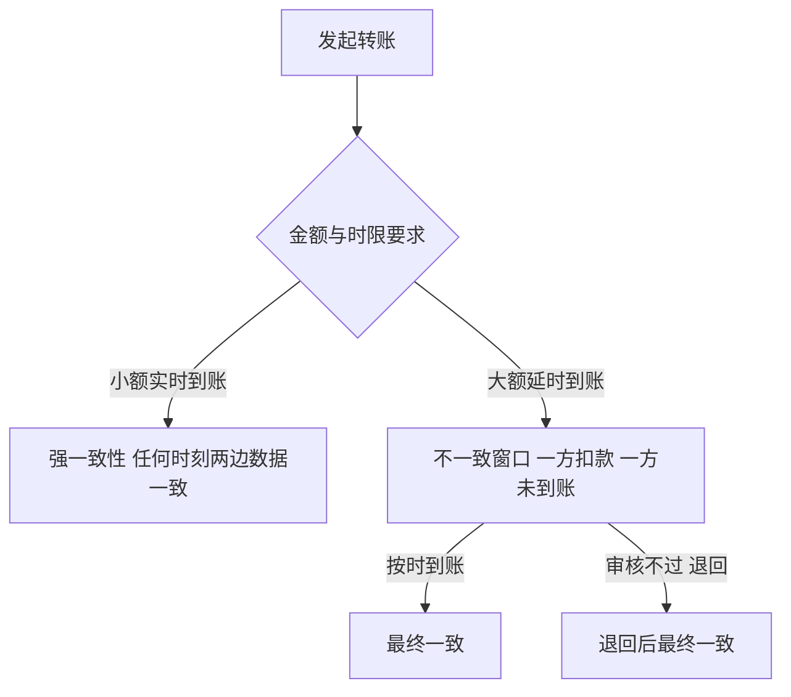

# BASE 理论：放弃强一致性，换最终一致性

CAP 的组合取舍里，AP 被描述成「放弃一致性」，很多人读到这里心里发毛：数据不一致，系统还能用？这其实是个误伤。AP 放弃的是强一致性，后面还垫着最终一致性这个底线，把它讲清楚的理论叫 BASE 理论。BASE 建立在 CAP 的基础上，可以看成对 CAP 中 AP 组合的补充与延伸，重点研究的就是一致性这件事怎么在分布式场景下落地。

## 先给结论

- BASE 是 Basically Available（基本可用）、Soft state（软状态）、Eventually consistent（最终一致性）三个短语的缩写，核心诉求是最终一致性。
- 任何系统都要求数据一致性，数据不一致系统就没法用了；差别只在处理方式，分成强一致性与最终一致性两种。
- 强一致性要求任何时间点查任何数据都一致，CP 组合里默认说的就是它；最终一致性允许一段时间内数据不一致，过了这段时间必然一致。
- 基本可用指出现故障时允许部分非核心功能丧失，核心功能保住；软状态指转账中、退款中这类中间状态，允许软状态存在的事务也叫柔性事务。
- 到底选强一致还是最终一致，看具体业务场景，没有统一答案。

## 为什么说它是 CAP 的补充

CAP 讲组合时，AP 的标签是「放弃一致性」，不把这个说法澄清，后面没法展开。课程里介绍 AP 时反复强调过：放弃一致性不是对数据死活不管，而是放弃强一致性，最终仍要保证一致性。CP 组合里的一致性默认指强一致性，也就是任何时间点、任何节点上查询任何数据，结果都是一致的。

BASE 理论从 AP 的这个缺口里生长出来，专门补上另一半论述：如果有些业务做不到、也不必做到强一致，可以用「最终一致」这个更现实的标尺。这里有一条前提要先立住：任何系统，不管分布式还是单体、什么架构什么项目，都要求一致性，数据不一致系统就失去了存在价值。BASE 并不推翻这条底线，它只是把「怎么保证一致」分成两种处理手段，让 AP 组合的取舍有据可依。

## 两个转账例子：1000 元与 1000 万

理解强一致与最终一致，两个银行转账的例子比定义好用得多。

**1000 元转账，实时到账，这是强一致性。** 这边一扣钱，那边立即收到钱，中间顶多几秒钟的时差，几乎可以忽略。任何时刻查询，两边数据都是对得上的，这就是强一致性。客户体验最好，但系统层面并不总能保证，尤其金额、链路复杂起来之后。

**1000 万转账，延时到账，这是最终一致性。** 页面提示两小时以内到账。这边账户可能已经扣了钱，立刻打电话问对方，对方说还没收到，这段时间数据就是不一致的；两个小时之内钱到了，一扣一加对上账，数据又一致了。之所以快不了，是因为大额交易银行要做监管甚至人工审核，审核没通过这笔钱还会退回来，退回同样是数据一致。系统不追求当场出结果，只承诺在时限内收敛到一致，这就是最终一致性。



这张图把两条路分开画：实时到账的路没有中间态，延时到账的路明确承认中间有一段不一致窗口，但两条路的终点都是数据一致。

## 基本可用与软状态

BASE 的另外两个词，是为了支撑最终一致性而存在的。

**基本可用。** 追求最终一致的系统，允许在出现故障时部分功能丧失，只要核心功能可用就成立。典型的样子是流量高峰或故障期间，一些非核心能力被降级甚至临时关掉，下单、支付这类主干流程照常运转。可用性打了折，但没伤筋骨。

**软状态。** 这是与最终一致性关系最密切的概念。转账延时到账的例子里，两小时之内查询这笔交易，系统会告诉一个状态叫「转账中」，意思是这笔业务还没处理完：这边的钱扣了，那边的钱没到，中间过程被明确地呈现出来。日常见到的「支付中」「退款中」都是同类：在电商平台退货退款，商家不可能实时把钱打回来，查询时显示「退款中」，这就是软状态。对照着想，强一致性不会产生软状态，因为它当场就要出结果，出结果就是终态。允许软状态存在的事务，也被称作柔性事务。

```java
// 示例 按本课写法补全 软状态在数据层的落点
public enum TransferStatus {
    PROCESSING("转账中"),   // 软状态 最终一致性的中间态
    SUCCESS("转账成功"),    // 终态
    FAILED("转账失败");     // 终态

    private final String desc;
    TransferStatus(String desc) { this.desc = desc; }
}
```

```sql
-- 示例 按本课写法补全 交易单用状态字段表达软状态
CREATE TABLE transfer_record (
    id           BIGINT      NOT NULL COMMENT '主键',
    from_account VARCHAR(64) NOT NULL COMMENT '付款账户',
    to_account   VARCHAR(64) NOT NULL COMMENT '收款账户',
    amount       DECIMAL(16, 2) NOT NULL COMMENT '金额',
    status       VARCHAR(16) NOT NULL COMMENT '状态 PROCESSING SUCCESS FAILED',
    PRIMARY KEY (id)
) COMMENT '转账记录表';
```

转账单创建后先落 PROCESSING，处理完再推进到 SUCCESS 或 FAILED，中间态可查询、可追踪，这是软状态在实现层的通常落点。

## 强一致还是最终一致，看业务

BASE 理论确实是对 CAP 中 AP 组合的扩展，最终一致性在现实产品里随处可见：转账中、支付中、退款中，背后都是 BASE 式的取舍。但不要把它读成「所有业务都该最终一致」。有的业务必须强一致，一笔都不能错；有的业务必须追求最终一致，因为强一致的根本做不到，比如跨行大额转账受监管审核约束，强求实时只会把系统拖死。强一致性还是最终一致性，CP 组合怎么用、AP 组合怎么用，永远回到具体业务场景上做决定。

## 常见误区

- **把 AP 等同于数据可以不一致。** 错例：选了 AP 之后对账不一致也置之不理。正解：放弃的是强一致性，最终一致性是底线，不一致只存在于有明确时限的窗口内。
- **把软状态当成系统异常。** 错例：查询到「转账中」就认为出故障了，反复重发请求。正解：软状态是有意设计的中间态，可查询、会收敛到终态，重发请求只会制造重复业务。
- **认为所有业务都能接受最终一致。** 错例：把账务扣减这类强一致需求也改成延时到账。正解：对一致性有硬性要求的业务不能妥协，选型先看业务约束再谈理论。
- **把基本可用理解成可以随便不可用。** 错例：故障时直接停服，等着事后恢复。正解：基本可用只允许牺牲非核心功能，下单支付这类核心链路必须保住。

## 面试可能被问到的问题

1. 面试官追问：「BASE 理论的三要素是什么？」
   答：Basically Available 基本可用，故障时允许损失部分非核心功能；Soft state 软状态，允许数据存在中间状态；Eventually consistent 最终一致性，中间态经过一段时间后必然收敛到一致。核心是用最终一致性替代强一致性来支撑大规模分布式场景。
2. 面试官追问：「强一致性和最终一致性的区别是什么？举个例子。」
   答：强一致性要求任何时间点查任何数据都一致，比如小额转账实时到账，扣款与到账同时成立；最终一致性允许一段时间内不一致，比如大额转账延时到账，扣了款对方两小时内才收到，窗口期过后数据必然一致。差别在于是否允许不一致窗口的存在。
3. 面试官追问：「什么是软状态？强一致性下存在软状态吗？」
   答：软状态是业务处理过程中公开呈现的中间态，如转账中、支付中、退款中，表示事务还没处理完。强一致性当场出结果，结果即终态，没有中间态可言；只有走最终一致路线的系统才需要软状态，允许软状态存在的事务也叫柔性事务。
4. 面试官追问：「BASE 理论和 CAP 是什么关系？」
   答：BASE 建立在 CAP 之上，是对 AP 组合的补充和延伸。CAP 说清了分布式系统只能三选二，AP 放弃强一致性；BASE 接着回答放弃强一致之后怎么守住一致性的底线，用基本可用、软状态支撑最终一致性，把 AP 从一句「放弃」变成了可操作的工程方案。
5. 面试官追问：「你们的业务选强一致还是最终一致，怎么判断？」
   答：看两个约束：业务上能不能容忍不一致窗口，技术上强一致的成本能不能承受。资金扣减、账号一致这类业务偏强一致或软状态时间很短的方案；退款到账、结果通知这类能容忍延迟的业务用最终一致。结论永远从具体业务场景推出来。

## 配套资料

- 讲义：`materials/docs/10/万信金融-第2章-讲义-开户v1.0.md`，「注册功能中的分布式事务」小节：课程配套「分布式事务」讲义的出处说明，BASE 理论为该讲义 2.2 节内容，注册功能最终按该讲选用 TCC 方案落地。
- 讲义：`materials/docs/10/day16-项目总结&就业指导v1.0.md`，「3.4 分布式事务解决方案」小节：分布式事务定义与「TCC 方案的软状态时间很短，一致性较强」等表述，与本课软状态、最终一致性概念互为印证。
- 说明：BASE 理论属通用分布式理论，课程未提供该节配套源码；转账状态枚举与建表语句为按本课写法补全的示例，包名按 `com.study.finance` 系口径改写。
