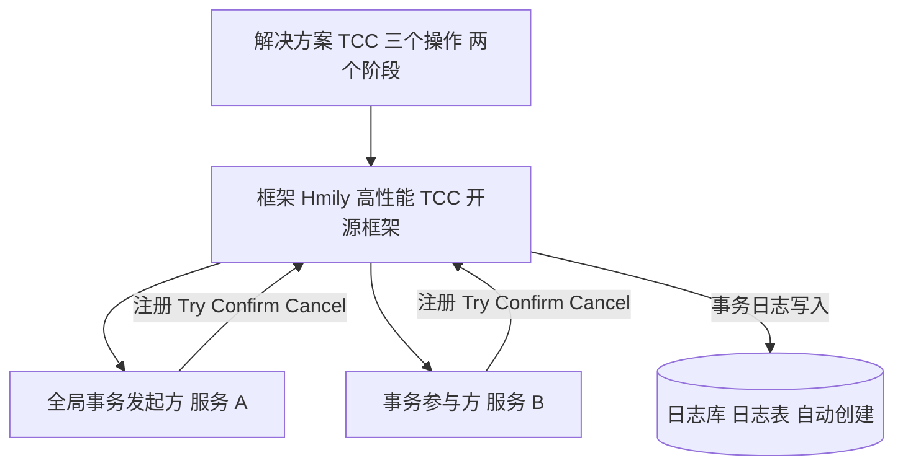

# Hmily 框架简介：TCC 方案的落地框架长什么样

> 🔒 安全提示：文中示例的口令/密钥均为课程教学环境演示口径，生产环境的安全要求见《安全与合规须知》。

TCC 的三操作两阶段已经拿转账案例完整走过一遍，Try 里做什么、Confirm 与 Cancel 各自怎么安排、失败分支怎么回滚，账目都核对过了。但模型离能跑的工程还差一层：谁来拦截方法、谁来记录事务状态、谁来推进两个阶段的切换？这些问题如果每个项目都手写一遍，协调器就要重复造无数次。行业里对此早有现成答案，也就是 TCC 框架。这一课把课程选定的 Hmily 框架整体认识一遍，后面转账入门案例的实操与注册链路的落地，全部建立在它之上。

## 先给结论

- 理论催生解决方案，解决方案要靠框架落地。行业里基于 TCC 的框架不止一个，常见的有 tcc-transaction、Hmily、ByteTCC、EasyTransaction 四种，课程选定 Hmily。
- Hmily 是一个高性能分布式事务 TCC 开源框架，基于 Java 语言开发（JDK 1.8），支持 dubbo、motan、springcloud 等 RPC 框架接入。
- 使用 Hmily 不需要单独再部署一个事务协调服务，框架本身就充当全局事务发起方与事务管理器，协调、监控、推进都由它完成。
- 框架正常运转有一个前提：额外提供一个数据库和一张事务日志表。它内部做事务监控管理协调时主要靠日志，很多关键操作全部记录在日志里。
- 日志存储支持 mysql、redis、mongodb、zookeeper、file 等多种方式，课程案例采用 MySQL，日志表由框架自动创建。

## 从理论到框架，TCC 的四个现成选择

**框架是这条递进链路的最后一环。** 前面几课铺了一条线：CAP 与 BASE 是理论，TCC 是从理论里长出来的解决方案，而开发过程中真正使用的是框架。理论管不了代码，解决方案也只是套路，把套路变成可复用、可运行的代码，就是框架要干的活。

**候选框架有四个。** 基于 TCC 解决方案实现的框架不止一种，课程 PPT 上列出了四种：tcc-transaction、Hmily、ByteTCC、EasyTransaction，都是 GitHub 上的开源项目，地址一查便得。它们实现的是同一个模型，差异在接入方式、性能表现与生态适配。课程从中选定 Hmily，理由直白：它性能出众，而且与本项目 Spring Cloud 微服务体系天然合拍。

**名字是个缩写梗。** Hmily 在词典里查不到，它不是英语单词，作者取自 how much I love you 的首字母，四个字母拼成 HMILY。记住这个由来不重要，重要的是别把名字认岔了，它就是一个 TCC 框架的代号。

## 能力清单：高性能三个字的底气

**第一，语言与启动方式。** 基于 Java 语言开发，要求 JDK 1.8；提供 Spring Boot starter，工程里加依赖、写少量配置就能启动，接入成本低，这一点从转账案例里可以亲身体会。

**第二，RPC 适配面广。** dubbo、motan、springcloud 等主流 RPC 框架都在支持列表里，不管项目用哪套调用体系，事务管理都能挂上去。

**第三，事务日志异步写入。** 内部用 Disruptor 做事务日志的异步写入，写日志的开销被移出业务主流程，官方的说法是与 RPC 框架的性能无差别，分布式事务没有拖慢接口响应，这是「高性能」三个字的主要来源。

**第四，日志存储与序列化选择多。** 事务日志可以存 mysql、redis、mongodb、zookeeper，甚至本地 file；序列化支持 java、hessian、kryo、protostuff 几种。课程案例选用 kryo，它的性能比 Java 原生序列化高出不少，在同类工具里也靠前。

**第五，工程集成友好。** 采用 AspectJ AOP 实现代理，与 Spring 无缝集成；天然支持补偿，内置事务恢复、RPC 事务重试、超时异常重试，还支持嵌套事务与集群部署。这些特性在日常使用里不一定全用得上，但知道框架手里有这些牌，出问题时知道往哪里找答案。

## 最关键的一条：协调器不用单独部署，日志必须有着落

**Hmily 自带协调能力。** 讲 TCC 模型时反复出现过「全局事务发起方」「事务管理器」「协调管理」这几个角色。直觉上容易以为要为它单独部署一个协调服务，让这个服务去推进各参与方。Hmily 的设计恰恰不需要：框架本身就充当全局事务发起方，本身就充当事务管理器，监控、协调、管理都在框架内部完成，不用为这件事再单独起一个服务、单独搭一套环境。

**代价是要给日志一个家。** 框架做监控协调管理靠的是日志，它的很多关键操作全部存储在日志里：全局事务什么时候开的、Try 执行得怎么样、接下来该走 Confirm 还是 Cancel，都要从日志里查。所以使用 Hmily 必须额外提供一个数据库与一张日志表，这是整个框架最关键的一点。好在这一步负担极轻：表不用手工建，框架运行时会自动创建，后面转账案例的数据库里就能亲眼看到这张表凭空出现，功能测试时还要专门进去看它记了什么。

## 它怎么把 TCC 三操作挂到代码上

Hmily 对三操作两阶段的承接可以概括成一句话：一个注解注册三个方法。在 Try 方法上标注 `@Hmily`，通过 `confirmMethod` 与 `cancelMethod` 两个属性指明配套的确认与回滚方法，剩下的推进由框架接管。注解与配置的形态大致如下（示例，按本课写法补全，后面转账案例给出完整可用版本）：

```java
// Try 方法上加注解 声明配套的 Confirm 与 Cancel 方法名
@Hmily(confirmMethod = "commit", cancelMethod = "rollback")
public void prepare(String accountNo, double amount) {
    // Try 阶段的业务 检查 预留 主操作
}

public void commit(String accountNo, double amount) {
    // Confirm 阶段 由框架在 Try 全部成功后推进
}

public void rollback(String accountNo, double amount) {
    // Cancel 阶段 由框架在 Try 失败时推进
}
```

框架自身的运行参数走一段 `org.dromara.hmily` 前缀的配置：

```yaml
org:
  dromara:
    hmily:
      serializer: kryo        # 序列化工具
      retryMax: 30            # 最大重试次数
      repositorySupport: db   # 事务日志持久化方式
      started: true           # true 表示全局事务发起方
      hmilyDbConfig:          # 事务日志库的连接信息
        driverClassName: com.mysql.cj.jdbc.Driver
        url: jdbc:mysql://localhost:3306/p2p_undo_log?useUnicode=true&characterEncoding=utf8
        username: root
        password: 123456
```

配置里的 `started` 与 `hmilyDbConfig` 恰好对应前面两个关键点：谁是发起方要明确告诉框架，它不会自己猜；日志存哪里要给框架指路。整体角色关系如下：



这张图在讲 Hmily 与 TCC 模型的对应关系：理论上的协调管理职责被框架收进自身，发起方与参与方只需要按注解注册三个方法，两阶段推进与日志记录全部由框架包掉。图里通向日志库的那条边是整张图的重心，日志不落库，协调与恢复就失去了依据。

## 常见误区

- **以为用 Hmily 还得单独搭一个事务协调服务。** 错例：项目里为事务协调专门部署一个 coordinator 微服务。正解：Hmily 内嵌在业务应用里充当事务管理器，不需要独立协调服务；要准备的是日志存储，一个库一张表即可。
- **把「提供日志表」理解成要手工写建表脚本。** 错例：担心表结构复杂，提前找 DDL 手工执行。正解：表由框架在运行时自动创建，把 `hmilyDbConfig` 指向的库准备好就行。
- **把 Hmily 当成 TCC 之外的另一种事务模式。** 错例：觉得引入框架后业务要换一套思路重写。正解：Hmily 是 TCC 方案的框架实现，Try、Confirm、Cancel 三操作两阶段的套路完全不变，框架只是替你做拦截、记录与推进。
- **以为它只能配 Spring Cloud。** 错例：项目是 dubbo 体系就放弃了。正解：dubbo、motan、springcloud 等 RPC 框架都在支持列表里。

## 面试可能被问到的问题

1. 面试官追问：「Hmily 是什么框架？为什么选它？」
   答：它是高性能分布式事务 TCC 开源框架，基于 Java（JDK 1.8）开发。选它的理由包括：Spring Boot starter 接入简单，支持 dubbo、motan、springcloud 等 RPC 框架，事务日志经异步写入后与 RPC 调用几乎无性能差别，基于 AspectJ AOP 与 Spring 无缝集成，自带补偿、事务恢复与重试机制。
2. 面试官追问：「使用 Hmily 需要单独部署事务协调器吗？」
   答：不需要。框架本身就充当全局事务发起方与事务管理器，监控、协调、推进都在框架内部完成。它要求的是额外提供一个数据库与一张事务日志表，表由框架运行时自动创建，协调与恢复都以日志为依据。
3. 面试官追问：「Hmily 的事务日志为什么重要？可以存在哪里？」
   答：框架对事务的监控、协调、管理主要靠日志，事务开启、Try 结果、阶段推进这些关键操作全部记录在日志里，故障恢复也依赖它。存储支持 mysql、redis、mongodb、zookeeper 与本地 file，课程案例使用 MySQL。
4. 面试官追问：「行业里基于 TCC 的框架还有哪些？」
   答：常见的有 tcc-transaction、Hmily、ByteTCC、EasyTransaction 四种，均在 GitHub 开源。它们都实现 TCC 三操作两阶段模型，差异在接入方式、性能与生态适配；课程场景是 Spring Cloud 微服务，选型 Hmily。
5. 面试官追问：「Hmily 怎么把 Try、Confirm、Cancel 三个操作挂到业务代码上？」
   答：在 Try 方法上标注 `@Hmily` 注解，用 `confirmMethod` 与 `cancelMethod` 属性指明配套方法名，三个方法的功能与参数完全由业务自己定义。框架按注解完成注册后接管两个阶段的推进：Try 全部成功推 Confirm，任一失败推 Cancel。

## 配套资料

- 讲义：`materials/docs/10/万信金融-第2章-讲义-开户v1.0.md`，「注册功能中的分布式事务」节：注册功能使用 Hmily 框架解决分布式事务问题的选型出处。
- 讲义：`materials/docs/10/day16-项目总结&就业指导v1.0.md`，「3.4.2 什么是 TCC（补偿事务）」小节：TCC 三操作两阶段的定义与出错兜底方式，是 Hmily 所承接的模型依据。
- 代码：`materials/code/10/wanxinp2p/wanxinp2p/pom.xml`，父工程依赖管理中真实存在 `org.dromara:hmily-springcloud:2.0.4-RELEASE`（目录保留原始命名）。
- 说明：四种 TCC 框架清单与框架特性出自课程视频画面线（PPT）；`@Hmily` 注解与 `org.dromara.hmily` 配置片段为按本课写法补全的示例，后续转账案例篇章给出完整可用版本。
